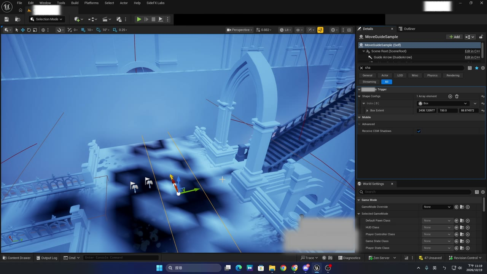
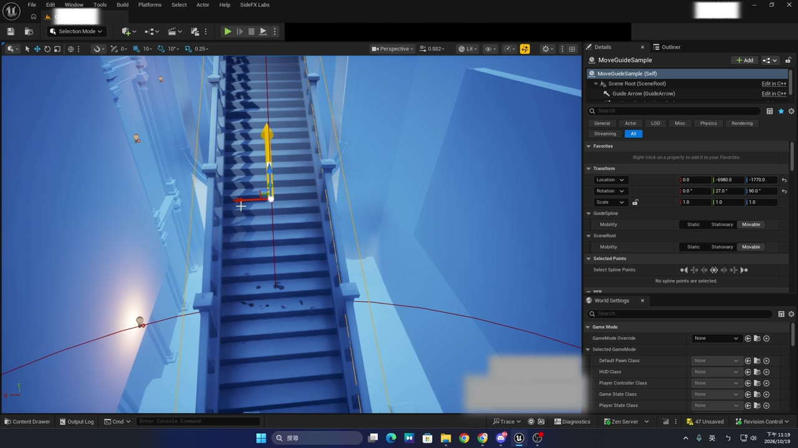

> One Volume plus a few functions on the player side fix 8-direction keyboard movement on diagonal and curved paths.
> In the code below, replace `YOURMODULE_API` and `AMyPlayerCharacter` with the names from your own project.

---

## The problem

In a top-down game, the keyboard can only input 8 directions (up, down, left, right and 4 diagonals).
When the level has **diagonal stairs, narrow bridges or winding walkways** that don't line up with any of those 8 directions:

- The player has to keep switching between two direction keys to zigzag along the path
- It's easy to bump into walls, get stuck on railings, or fall off the side of a bridge

Gamepads don't have this problem: an analog stick can point at any angle.

## The idea

Place a Volume over these sections and give it a **snap axis** (the direction the path runs).
While the player moves with the keyboard inside the Volume, any input that points *roughly* along the path gets **snapped onto the snap axis**.

```
            Snap axis (direction of the path)
               ↗
              /      ← Player presses "↑" or "→"; the angle is within SnapAngle
             /          → the actual movement direction snaps to ↗
            /
```

Design goals:

- **Keyboard only**: gamepads are unaffected
- **The snap axis is bidirectional**: walking back snaps to the opposite direction automatically, so you don't need a second Volume
- **Angle threshold**: input beyond `SnapAngle` is left untouched, so the player can still leave the path (for example, stepping sideways off the stairs)
- **Smooth transitions**: no sudden turns when entering, leaving or switching between Volumes
- Only the *input direction* changes; the character isn't moved directly, so collision, speed and Root Motion all work as before

---

## Demo

<div align="center">
<video src="./demo_stairs.mp4" controls autoplay muted loop playsinline width="800">
</video>
<br><em>Using only the arrow keys, the character walks up the diagonal stairs and turns onto the bridge</em>
</div>

> 🎬 If the video doesn't play: [download demo_stairs.mp4](./demo_stairs.mp4)

Without snapping, the stairs run halfway between two direction keys, so the player has to keep alternating keys, zigzags, and easily hits the railings.
With the snap Volume, holding one key roughly toward the stairs keeps the character steadily on the stairs' center line.

---

## Architecture

```
AMyMovementGuideVolume (the Volume)
 ├─ ShapeConfigs: combine any number of Box / Sphere / Capsule shapes into one area
 ├─ GuideMode: Arrow (straight) or Spline (curved)
 ├─ SnapAngle: the snap angle
 └─ Notifies the player on enter / exit

AMyPlayerCharacter (player side)
 ├─ Tracks the Volumes it's currently in (the last one entered wins)
 ├─ Move() calls ApplyMovementGuide to rewrite the direction
 └─ Smoothly blends the weight and the snap axis
```

---

## Technique 1: Build one Volume out of several shapes

A curved staircase is hard to cover with a single Box. Instead, the Volume can **combine any number of shapes**, and you can adjust them directly in the editor.

### Shape settings you can edit inline in the Details panel
Each shape setting is a `UObject` marked with:

```cpp
UCLASS(Abstract, EditInlineNew, DefaultToInstanced, ...)
```

Declare them as an array with `UPROPERTY(EditAnywhere, Instanced)`, and the Details panel lets you **pick Box / Sphere / Capsule from a dropdown and expand its parameters in place**, with no extra assets.

Each shape setting does only three things: create the matching ShapeComponent, apply its parameters to that component, and return its type name.

### Generate components from the settings
Rebuild the shape components in `OnConstruction`, so dragging or editing properties updates them right away:

- Component names follow the pattern `GuideShape_<Type>_<Index>`
- A component with that name already exists → **only update its parameters**, don't recreate it
- It doesn't exist → create it with `NewObject`, then `AddInstanceComponent` and `RegisterComponent`
- Old components whose settings were removed → unbind them and destroy them

> Gotcha: when you change a parameter of an element *inside* the array, the engine doesn't rerun the Construction Script.
> Override `PostEditChangeChainProperty`, and call `RerunConstructionScripts()` when the change comes from `ShapeConfigs`.

### Merge several shapes into *one* Volume
Each shape fires its own Begin / End Overlap. When the player walks from one Box into a connected Box, they get "left A" and "entered B". If you forwarded those directly, the player would keep entering and leaving while still inside the Volume.

The fix is an **overlap count**:

```cpp
TMap<TWeakObjectPtr<AActor>, int32> OverlapCounts;
```

- Count goes 0 → 1: only then does it count as "entered the Volume"
- Count goes 1 → 0: only then does it count as "left the Volume"

### Other details
- Set the shape components explicitly to the `Trigger` collision profile and enable `GenerateOverlapEvents`
- Bind events with `AddUniqueDynamic`, and don't call `Clear()` first, or you'll wipe out bindings from other systems
- Enable `bGenerateOverlapEventsDuringLevelStreaming`, so a Volume in a streamed level still fires "enter" if the player is already standing in it when it loads
- On `EndPlay` (for example when a streamed level unloads), **send "exit" yourself** to every Actor still inside, so the player isn't left inside a Volume that no longer exists
- Before rebuilding shapes at runtime, also send "exit" first; otherwise the counts are cleared and the "exit" never arrives

---

## Technique 2: Getting the snap axis

| Mode | Snap axis source | Use for |
|---|---|---|
| **Arrow** | The arrow component's forward vector | Straight stairs, bridges |
| **Spline** | The spline's **tangent at the point closest to the player** | Curved sections |

Both are flattened onto the horizontal plane (`GetSafeNormal2D`), keeping only the direction.
In Spline mode the snap direction changes continuously with the player's position, so it naturally follows the curve.
If the spline has too few points or the tangent is invalid, it falls back to the arrow direction.

---

## Technique 3: The snap calculation

```
1. Flatten and normalize the input direction → Dir
2. The axis is bidirectional: if Dot(Dir, Axis) < 0, flip Axis
3. Angle = acos(Dot)
   Angle > SnapAngle → don't snap, keep the original direction
4. Result = normalize( Dir × (1 − Weight) + Axis × Weight )
5. Multiply by the length of the original input vector
```

- Add a tiny tolerance (0.01°) when comparing angles, so input right on the boundary doesn't flicker between snapping and not snapping because of floating-point error
- The snapped direction is also written back as the "last input direction", so **abilities like dodge also follow the snapped direction**

---

## Technique 4: Smooth transitions

If the direction snapped instantly on entering the Volume, the character would turn abruptly and feel bad. There are two kinds of transitions here:

### Weight transition
- Entering the first Volume: weight goes 0 → 1
- Leaving all Volumes: weight goes 1 → 0
- The transition takes `MovementGuideBlendTime` (default 0.1 s; 0 means instant)
- While fading out after leaving, **the last snap axis keeps being used**

The weight isn't accumulated on Tick. Instead it stores the start value, the target value and the start time, and computes the current value from the world time when needed. The logic stays simple and no error builds up.

### Snap axis transition
When two Volumes touch or overlap, the snap axis can change suddenly. On a switch, store the old axis and the start time, then interpolate from the old axis to the new one over the transition time.

> Because the axis is bidirectional, **flip the old axis to the same side as the new one** before interpolating, or it will swing the long way around.

### Overlapping Volumes
The player keeps a list of the Volumes it's in, and **the last one entered wins**. When it leaves the active Volume, the previous Volume it's still inside takes over.
Overlaps usually mean something was placed wrong, so it also logs a warning.

---

## Full source

### MyMovementGuideVolume.h

```cpp
#pragma once

#include "CoreMinimal.h"
#include "GameFramework/Actor.h"
#include "MyMovementGuideVolume.generated.h"

class UArrowComponent;
class USplineComponent;
class UShapeComponent;
class UPrimitiveComponent;

// ---------------------------------------------------------------------
// Shape settings
// ---------------------------------------------------------------------

/** One shape of the Volume. EditInlineNew lets the Details panel pick the type from a dropdown and edit it inline */
UCLASS(Abstract, EditInlineNew, DefaultToInstanced, BlueprintType, CollapseCategories)
class YOURMODULE_API UMyGuideShapeConfig : public UObject
{
	GENERATED_BODY()

public:
	/** Offset and rotation relative to the Volume's root component */
	UPROPERTY(EditAnywhere, BlueprintReadWrite, Category = "Shape")
	FTransform RelativeTransform;

	virtual UShapeComponent* CreateShapeComponent(AActor* Owner, FName CompName) const
		PURE_VIRTUAL(UMyGuideShapeConfig::CreateShapeComponent, return nullptr;);

	/** Applies the size and relative transform to an existing component */
	virtual void ApplyToShape(UShapeComponent* Shape) const;

	virtual FString GetShapeTypeName() const
		PURE_VIRTUAL(UMyGuideShapeConfig::GetShapeTypeName, return FString(););
};

UCLASS(DisplayName = "Box")
class YOURMODULE_API UMyGuideShapeConfig_Box : public UMyGuideShapeConfig
{
	GENERATED_BODY()

public:
	UPROPERTY(EditAnywhere, BlueprintReadWrite, Category = "Shape")
	FVector BoxExtent = FVector(50.f);

	virtual UShapeComponent* CreateShapeComponent(AActor* Owner, FName CompName) const override;
	virtual void ApplyToShape(UShapeComponent* Shape) const override;
	virtual FString GetShapeTypeName() const override { return TEXT("Box"); }
};

UCLASS(DisplayName = "Sphere")
class YOURMODULE_API UMyGuideShapeConfig_Sphere : public UMyGuideShapeConfig
{
	GENERATED_BODY()

public:
	UPROPERTY(EditAnywhere, BlueprintReadWrite, Category = "Shape", meta = (ClampMin = "0.0"))
	float SphereRadius = 50.f;

	virtual UShapeComponent* CreateShapeComponent(AActor* Owner, FName CompName) const override;
	virtual void ApplyToShape(UShapeComponent* Shape) const override;
	virtual FString GetShapeTypeName() const override { return TEXT("Sphere"); }
};

UCLASS(DisplayName = "Capsule")
class YOURMODULE_API UMyGuideShapeConfig_Capsule : public UMyGuideShapeConfig
{
	GENERATED_BODY()

public:
	UPROPERTY(EditAnywhere, BlueprintReadWrite, Category = "Shape", meta = (ClampMin = "0.0"))
	float CapsuleRadius = 50.f;

	UPROPERTY(EditAnywhere, BlueprintReadWrite, Category = "Shape", meta = (ClampMin = "0.0"))
	float CapsuleHalfHeight = 100.f;

	virtual UShapeComponent* CreateShapeComponent(AActor* Owner, FName CompName) const override;
	virtual void ApplyToShape(UShapeComponent* Shape) const override;
	virtual FString GetShapeTypeName() const override { return TEXT("Capsule"); }
};

// ---------------------------------------------------------------------
// Axis-snap Volume
// ---------------------------------------------------------------------

UENUM(BlueprintType)
enum class EMyGuideMode : uint8
{
	/** Uses GuideArrow's facing as the snap axis; good for straight stairs and bridges */
	Arrow,
	/** Uses the GuideSpline tangent at the closest point as the snap axis; good for curves */
	Spline,
};

/**
 * Axis-snap Volume.
 * Once the player (AMyPlayerCharacter) enters, keyboard movement directions snap to the snap axis.
 * The area is made of ShapeConfigs, which can combine several Box / Sphere / Capsule shapes into one Volume.
 */
UCLASS()
class YOURMODULE_API AMyMovementGuideVolume : public AActor
{
	GENERATED_BODY()

public:
	AMyMovementGuideVolume();

	//~ Begin AActor Interface
	virtual void OnConstruction(const FTransform& Transform) override;
	virtual void BeginPlay() override;
	virtual void EndPlay(const EEndPlayReason::Type EndPlayReason) override;
#if WITH_EDITOR
	virtual void PostEditChangeChainProperty(FPropertyChangedChainEvent& PropertyChangedEvent) override;
#endif
	//~ End AActor Interface

	/** Returns the horizontal, normalized snap axis (bidirectional) */
	UFUNCTION(BlueprintPure, Category = "MovementGuide")
	FVector GetGuideAxis(const FVector& WorldLocation) const;

	/** Creates / updates / removes shape components to match ShapeConfigs */
	UFUNCTION(BlueprintCallable, Category = "MovementGuide")
	void RebuildShapes();

	/** The Volume's shapes; you can combine several */
	UPROPERTY(EditAnywhere, Instanced, BlueprintReadOnly, Category = "MovementGuide")
	TArray<TObjectPtr<UMyGuideShapeConfig>> ShapeConfigs;

	UPROPERTY(EditAnywhere, BlueprintReadOnly, Category = "MovementGuide")
	EMyGuideMode GuideMode = EMyGuideMode::Arrow;

	/** Snaps when the angle between the input and the snap axis (either direction) is at most this value */
	UPROPERTY(EditAnywhere, BlueprintReadOnly, Category = "MovementGuide", meta = (ClampMin = "0.0", ClampMax = "90.0", Units = "deg"))
	float SnapAngle = 30.f;

protected:
	UFUNCTION()
	void HandleShapeBeginOverlap(UPrimitiveComponent* OverlappedComp, AActor* OtherActor,
		UPrimitiveComponent* OtherComp, int32 OtherBodyIndex, bool bFromSweep, const FHitResult& SweepResult);

	UFUNCTION()
	void HandleShapeEndOverlap(UPrimitiveComponent* OverlappedComp, AActor* OtherActor,
		UPrimitiveComponent* OtherComp, int32 OtherBodyIndex);

	/** Called when the overlap count goes 0→1 */
	void OnActorEnter(AActor* OtherActor);

	/** Called when the overlap count goes 1→0 */
	void OnActorExit(AActor* OtherActor);

	/** Sends "exit" to every Actor still inside (used on rebuild and EndPlay) */
	void ExitAll();

	void DestroyShape(UShapeComponent* Shape);

	void UpdateGuideComponentVisibility();

	UPROPERTY(VisibleAnywhere, BlueprintReadOnly, Category = "Components")
	TObjectPtr<USceneComponent> SceneRoot;

	UPROPERTY(VisibleAnywhere, BlueprintReadOnly, Category = "Components")
	TObjectPtr<UArrowComponent> GuideArrow;

	UPROPERTY(VisibleAnywhere, BlueprintReadOnly, Category = "Components")
	TObjectPtr<USplineComponent> GuideSpline;

	UPROPERTY(Transient)
	TArray<TObjectPtr<UShapeComponent>> GeneratedShapes;

	/** How many shapes each Actor is currently touching */
	TMap<TWeakObjectPtr<AActor>, int32> OverlapCounts;

	static const TCHAR* ShapeNamePrefix;
};
```

### MyMovementGuideVolume.cpp

```cpp
#include "MyMovementGuideVolume.h"

#include "Components/ArrowComponent.h"
#include "Components/BoxComponent.h"
#include "Components/CapsuleComponent.h"
#include "Components/SphereComponent.h"
#include "Components/SplineComponent.h"
#include "MyPlayerCharacter.h"

// ---------------------------------------------------------------------
// Shape settings
// ---------------------------------------------------------------------

void UMyGuideShapeConfig::ApplyToShape(UShapeComponent* Shape) const
{
	if (Shape)
	{
		Shape->SetRelativeTransform(RelativeTransform);
	}
}

UShapeComponent* UMyGuideShapeConfig_Box::CreateShapeComponent(AActor* Owner, FName CompName) const
{
	UBoxComponent* Box = NewObject<UBoxComponent>(Owner, CompName);
	ApplyToShape(Box);
	return Box;
}

void UMyGuideShapeConfig_Box::ApplyToShape(UShapeComponent* Shape) const
{
	Super::ApplyToShape(Shape);
	if (UBoxComponent* Box = Cast<UBoxComponent>(Shape))
	{
		Box->SetBoxExtent(BoxExtent, false);
	}
}

UShapeComponent* UMyGuideShapeConfig_Sphere::CreateShapeComponent(AActor* Owner, FName CompName) const
{
	USphereComponent* Sphere = NewObject<USphereComponent>(Owner, CompName);
	ApplyToShape(Sphere);
	return Sphere;
}

void UMyGuideShapeConfig_Sphere::ApplyToShape(UShapeComponent* Shape) const
{
	Super::ApplyToShape(Shape);
	if (USphereComponent* Sphere = Cast<USphereComponent>(Shape))
	{
		Sphere->SetSphereRadius(SphereRadius, false);
	}
}

UShapeComponent* UMyGuideShapeConfig_Capsule::CreateShapeComponent(AActor* Owner, FName CompName) const
{
	UCapsuleComponent* Capsule = NewObject<UCapsuleComponent>(Owner, CompName);
	ApplyToShape(Capsule);
	return Capsule;
}

void UMyGuideShapeConfig_Capsule::ApplyToShape(UShapeComponent* Shape) const
{
	Super::ApplyToShape(Shape);
	if (UCapsuleComponent* Capsule = Cast<UCapsuleComponent>(Shape))
	{
		Capsule->SetCapsuleSize(CapsuleRadius, CapsuleHalfHeight, false);
	}
}

// ---------------------------------------------------------------------
// Axis-snap Volume
// ---------------------------------------------------------------------

const TCHAR* AMyMovementGuideVolume::ShapeNamePrefix = TEXT("GuideShape_");

AMyMovementGuideVolume::AMyMovementGuideVolume()
{
	PrimaryActorTick.bCanEverTick = false;

	// Fire "enter" even if the character is already standing inside when a streamed level loads
	bGenerateOverlapEventsDuringLevelStreaming = true;

	SceneRoot = CreateDefaultSubobject<USceneComponent>(TEXT("SceneRoot"));
	SceneRoot->SetMobility(EComponentMobility::Movable);
	RootComponent = SceneRoot;

	GuideArrow = CreateDefaultSubobject<UArrowComponent>(TEXT("GuideArrow"));
	GuideArrow->SetupAttachment(SceneRoot);
	GuideArrow->ArrowColor = FColor(255, 200, 0);
	GuideArrow->ArrowSize = 3.f;
	GuideArrow->SetHiddenInGame(true);

	GuideSpline = CreateDefaultSubobject<USplineComponent>(TEXT("GuideSpline"));
	GuideSpline->SetupAttachment(SceneRoot);
	GuideSpline->SetHiddenInGame(true);
}

void AMyMovementGuideVolume::OnConstruction(const FTransform& Transform)
{
	Super::OnConstruction(Transform);
	RebuildShapes();
	UpdateGuideComponentVisibility();
}

void AMyMovementGuideVolume::BeginPlay()
{
	Super::BeginPlay();

	if (GeneratedShapes.Num() != ShapeConfigs.Num())
	{
		RebuildShapes();
	}

	if (ShapeConfigs.IsEmpty())
	{
		UE_LOG(LogTemp, Warning, TEXT("%s: no ShapeConfigs set, this Volume has no effect"), *GetActorNameOrLabel());
	}
	if (GuideMode == EMyGuideMode::Spline && GuideSpline->GetNumberOfSplinePoints() < 2)
	{
		UE_LOG(LogTemp, Warning, TEXT("%s: Spline mode with fewer than 2 points, using GuideArrow's facing instead"), *GetActorNameOrLabel());
	}
}

void AMyMovementGuideVolume::EndPlay(const EEndPlayReason::Type EndPlayReason)
{
	// When the Volume is removed (e.g. a streamed level unloads), make everyone inside leave, EndOverlap or not
	ExitAll();
	Super::EndPlay(EndPlayReason);
}

#if WITH_EDITOR
void AMyMovementGuideVolume::PostEditChangeChainProperty(FPropertyChangedChainEvent& PropertyChangedEvent)
{
	Super::PostEditChangeChainProperty(PropertyChangedEvent);

	// Editing a parameter *inside* the array doesn't rerun Construction automatically, so trigger it here
	const auto* MemberNode = PropertyChangedEvent.PropertyChain.GetActiveMemberNode();
	if (MemberNode && MemberNode->GetValue()
		&& MemberNode->GetValue()->GetFName() == GET_MEMBER_NAME_CHECKED(AMyMovementGuideVolume, ShapeConfigs))
	{
		RerunConstructionScripts();
	}
}
#endif

void AMyMovementGuideVolume::RebuildShapes()
{
	// Rebuilding at runtime: let everyone inside leave normally first, or the cleared counts never send "exit"
	if (HasActorBegunPlay())
	{
		ExitAll();
	}

	TMap<FName, UShapeComponent*> Existing;
	for (UActorComponent* Comp : GetInstanceComponents())
	{
		UShapeComponent* Shape = Cast<UShapeComponent>(Comp);
		if (Shape && Shape->GetName().StartsWith(ShapeNamePrefix))
		{
			Existing.Add(Shape->GetFName(), Shape);
		}
	}

	GeneratedShapes.Reset();
	TSet<FName> Keep;

	for (int32 i = 0; i < ShapeConfigs.Num(); ++i)
	{
		const UMyGuideShapeConfig* Config = ShapeConfigs[i];
		if (!Config)
		{
			continue;
		}

		// The name includes the type and index: changing the type gives a new name, and the old component is cleaned up
		const FName Name(*FString::Printf(TEXT("%s%s_%d"), ShapeNamePrefix, *Config->GetShapeTypeName(), i));
		Keep.Add(Name);

		UShapeComponent* Shape = Existing.FindRef(Name);
		if (IsValid(Shape))
		{
			Config->ApplyToShape(Shape);
		}
		else
		{
			Shape = Config->CreateShapeComponent(this, Name);
			if (!Shape)
			{
				continue;
			}
			Shape->SetupAttachment(SceneRoot);
			Shape->SetMobility(EComponentMobility::Movable);
			Shape->SetCollisionProfileName(TEXT("Trigger"));
			Shape->SetGenerateOverlapEvents(true);
			AddInstanceComponent(Shape);
			Shape->RegisterComponent();
		}

		// AddUnique: don't clear events other systems bound to the shape
		Shape->OnComponentBeginOverlap.AddUniqueDynamic(this, &AMyMovementGuideVolume::HandleShapeBeginOverlap);
		Shape->OnComponentEndOverlap.AddUniqueDynamic(this, &AMyMovementGuideVolume::HandleShapeEndOverlap);
		GeneratedShapes.Add(Shape);
	}

	for (const TPair<FName, UShapeComponent*>& Pair : Existing)
	{
		if (!Keep.Contains(Pair.Key))
		{
			DestroyShape(Pair.Value);
		}
	}
}

void AMyMovementGuideVolume::DestroyShape(UShapeComponent* Shape)
{
	if (!IsValid(Shape))
	{
		return;
	}
	Shape->OnComponentBeginOverlap.RemoveDynamic(this, &AMyMovementGuideVolume::HandleShapeBeginOverlap);
	Shape->OnComponentEndOverlap.RemoveDynamic(this, &AMyMovementGuideVolume::HandleShapeEndOverlap);
	RemoveInstanceComponent(Shape);
	Shape->DestroyComponent();
}

void AMyMovementGuideVolume::HandleShapeBeginOverlap(UPrimitiveComponent* OverlappedComp, AActor* OtherActor,
	UPrimitiveComponent* OtherComp, int32 OtherBodyIndex, bool bFromSweep, const FHitResult& SweepResult)
{
	if (!OtherActor || OtherActor == this)
	{
		return;
	}

	int32& Count = OverlapCounts.FindOrAdd(OtherActor);
	if (++Count == 1)
	{
		OnActorEnter(OtherActor);
	}
}

void AMyMovementGuideVolume::HandleShapeEndOverlap(UPrimitiveComponent* OverlappedComp, AActor* OtherActor,
	UPrimitiveComponent* OtherComp, int32 OtherBodyIndex)
{
	int32* Count = OtherActor ? OverlapCounts.Find(OtherActor) : nullptr;
	if (!Count)
	{
		return;
	}

	if (--(*Count) <= 0)
	{
		OverlapCounts.Remove(OtherActor);
		OnActorExit(OtherActor);
	}
}

void AMyMovementGuideVolume::OnActorEnter(AActor* OtherActor)
{
	if (AMyPlayerCharacter* Player = Cast<AMyPlayerCharacter>(OtherActor))
	{
		Player->EnterMovementGuideVolume(this);
	}
}

void AMyMovementGuideVolume::OnActorExit(AActor* OtherActor)
{
	if (AMyPlayerCharacter* Player = Cast<AMyPlayerCharacter>(OtherActor))
	{
		Player->ExitMovementGuideVolume(this);
	}
}

void AMyMovementGuideVolume::ExitAll()
{
	TArray<TWeakObjectPtr<AActor>> Inside;
	OverlapCounts.GetKeys(Inside);
	OverlapCounts.Reset();

	for (const TWeakObjectPtr<AActor>& Actor : Inside)
	{
		if (AActor* Ptr = Actor.Get())
		{
			OnActorExit(Ptr);
		}
	}
}

FVector AMyMovementGuideVolume::GetGuideAxis(const FVector& WorldLocation) const
{
	if (GuideMode == EMyGuideMode::Spline && GuideSpline->GetNumberOfSplinePoints() >= 2)
	{
		const FVector Axis = GuideSpline->FindTangentClosestToWorldLocation(WorldLocation, ESplineCoordinateSpace::World).GetSafeNormal2D();
		if (!Axis.IsNearlyZero())
		{
			return Axis;
		}
	}
	return GuideArrow->GetForwardVector().GetSafeNormal2D();
}

void AMyMovementGuideVolume::UpdateGuideComponentVisibility()
{
	const bool bSpline = GuideMode == EMyGuideMode::Spline;
	GuideArrow->SetVisibility(!bSpline);
	GuideSpline->SetVisibility(bSpline);
}
```

### PlayerCharacter.h (additions)

> Replace `AMyPlayerCharacter` with your player class name (and change the class cast in the Volume's .cpp too).

```cpp
// Forward declaration
class AMyMovementGuideVolume;

public:
	/** Called by AMyMovementGuideVolume when the player enters it. With overlapping Volumes the last one entered wins, and a warning is logged */
	void EnterMovementGuideVolume(AMyMovementGuideVolume* Volume);

	/** Called by AMyMovementGuideVolume when the player leaves it, or when the Volume itself is removed */
	void ExitMovementGuideVolume(AMyMovementGuideVolume* Volume);

	/** Transition time (seconds) when entering/leaving snap Volumes or switching between overlapping ones. 0 = instant */
	UPROPERTY(EditDefaultsOnly, BlueprintReadOnly, Category = "Movement Guide", meta = (ClampMin = "0.0", UIMin = "0.0", Units = "s"))
	float MovementGuideBlendTime = 0.1f;

protected:
	/**
	 * Rewrites the movement direction based on the current snap Volume (called from Move, keyboard only).
	 * The result keeps the original vector's length and only changes its horizontal direction.
	 */
	FVector ApplyMovementGuide(const FVector& RawMoveDirection);

	/** Returns the active snap Volume (the last one entered that's still valid), or null. Also cleans up stale entries */
	AMyMovementGuideVolume* GetActiveMovementGuideVolume();

	/** Current snap weight (0 = no snapping, 1 = full snapping), blended over MovementGuideBlendTime */
	float GetMovementGuideWeight() const;

	/** Starts blending from the current weight toward TargetWeight */
	void SetMovementGuideTargetWeight(float TargetWeight);

	/** Starts blending from the snap axis in use to the newly active Volume's snap axis */
	void BeginMovementGuideAxisBlend();

	/** Snap Volumes the player is currently in, in the order entered; the last one is active */
	TArray<TWeakObjectPtr<AMyMovementGuideVolume>> MovementGuideVolumes;

	/** Start value, target value and start time (world time) of the weight blend */
	float MovementGuideWeightAtChange = 0.f;
	float MovementGuideTargetWeight = 0.f;
	float MovementGuideWeightChangeTime = 0.f;

	/** The most recently used snap axis and snap angle; kept during the fade-out after leaving */
	FVector MovementGuideAxis = FVector::ZeroVector;
	float MovementGuideSnapAngle = 0.f;

	/** Start axis and start time of the axis blend when switching between overlapping Volumes. A start time < 0 means no blend is running */
	FVector MovementGuideAxisBlendFrom = FVector::ZeroVector;
	float MovementGuideAxisBlendStartTime = -1.f;

private:
	/** Tolerance for the snap angle comparison, so input right on the boundary doesn't flicker due to floating-point error */
	static constexpr float MovementGuideSnapAngleTolerance = 0.01f;
```

### PlayerCharacter.cpp (additions)

```cpp
#include "MyMovementGuideVolume.h"

void AMyPlayerCharacter::EnterMovementGuideVolume(AMyMovementGuideVolume* Volume)
{
	if (!IsValid(Volume))
	{
		return;
	}

	MovementGuideVolumes.RemoveAll([](const TWeakObjectPtr<AMyMovementGuideVolume>& Entry)
	{
		return !Entry.IsValid();
	});

	if (MovementGuideVolumes.Contains(Volume))
	{
		return;
	}

	const AMyMovementGuideVolume* PreviousVolume = MovementGuideVolumes.IsEmpty() ? nullptr : MovementGuideVolumes.Last().Get();
	MovementGuideVolumes.Add(Volume);

	if (PreviousVolume)
	{
		UE_LOG(LogTemp, Warning, TEXT("Entered snap Volume %s while still inside %s. The Volumes overlap; using %s, the one entered last."),
			*Volume->GetActorNameOrLabel(), *PreviousVolume->GetActorNameOrLabel(), *Volume->GetActorNameOrLabel());
		BeginMovementGuideAxisBlend();
	}
	else
	{
		SetMovementGuideTargetWeight(1.f);
	}
}

void AMyPlayerCharacter::ExitMovementGuideVolume(AMyMovementGuideVolume* Volume)
{
	const int32 Index = MovementGuideVolumes.IndexOfByKey(Volume);
	if (Index == INDEX_NONE)
	{
		return;
	}

	const bool bWasActive = Index == MovementGuideVolumes.Num() - 1;
	MovementGuideVolumes.RemoveAt(Index);
	MovementGuideVolumes.RemoveAll([](const TWeakObjectPtr<AMyMovementGuideVolume>& Entry)
	{
		return !Entry.IsValid();
	});

	if (MovementGuideVolumes.IsEmpty())
	{
		// Left every Volume: keep the last snap axis and fade out over the transition time
		SetMovementGuideTargetWeight(0.f);
	}
	else if (bWasActive)
	{
		// The active Volume was left; the previous Volume the player is still in takes over
		BeginMovementGuideAxisBlend();
	}
}

AMyMovementGuideVolume* AMyPlayerCharacter::GetActiveMovementGuideVolume()
{
	while (!MovementGuideVolumes.IsEmpty())
	{
		if (AMyMovementGuideVolume* Volume = MovementGuideVolumes.Last().Get())
		{
			return Volume;
		}
		MovementGuideVolumes.Pop();
	}
	return nullptr;
}

float AMyPlayerCharacter::GetMovementGuideWeight() const
{
	if (MovementGuideBlendTime <= 0.f)
	{
		return MovementGuideTargetWeight;
	}

	const float Elapsed = GetWorld()->GetTimeSeconds() - MovementGuideWeightChangeTime;
	const float Delta = FMath::Max(Elapsed, 0.f) / MovementGuideBlendTime;
	return MovementGuideTargetWeight >= MovementGuideWeightAtChange
		? FMath::Min(MovementGuideWeightAtChange + Delta, MovementGuideTargetWeight)
		: FMath::Max(MovementGuideWeightAtChange - Delta, MovementGuideTargetWeight);
}

void AMyPlayerCharacter::SetMovementGuideTargetWeight(const float TargetWeight)
{
	MovementGuideWeightAtChange = GetMovementGuideWeight();
	MovementGuideTargetWeight = TargetWeight;
	MovementGuideWeightChangeTime = GetWorld()->GetTimeSeconds();
}

void AMyPlayerCharacter::BeginMovementGuideAxisBlend()
{
	// No blend needed if the player hasn't moved inside a Volume yet (no snap axis in use)
	if (MovementGuideAxis.IsNearlyZero() || MovementGuideBlendTime <= 0.f)
	{
		MovementGuideAxisBlendStartTime = -1.f;
		return;
	}

	MovementGuideAxisBlendFrom = MovementGuideAxis;
	MovementGuideAxisBlendStartTime = GetWorld()->GetTimeSeconds();
}

FVector AMyPlayerCharacter::ApplyMovementGuide(const FVector& RawMoveDirection)
{
	if (AMyMovementGuideVolume* ActiveVolume = GetActiveMovementGuideVolume())
	{
		FVector Axis = ActiveVolume->GetGuideAxis(GetActorLocation());

		// When switching between overlapping Volumes, blend from the old axis to the new one. The axis is bidirectional, so flip the old axis to the new one's side first
		if (MovementGuideAxisBlendStartTime >= 0.f && !Axis.IsNearlyZero())
		{
			const float Alpha = (GetWorld()->GetTimeSeconds() - MovementGuideAxisBlendStartTime) / MovementGuideBlendTime;
			if (Alpha < 1.f)
			{
				FVector From = MovementGuideAxisBlendFrom;
				if (FVector::DotProduct(From, Axis) < 0.f)
				{
					From = -From;
				}
				const FVector Blended = (From * (1.f - Alpha) + Axis * Alpha).GetSafeNormal2D();
				if (!Blended.IsNearlyZero())
				{
					Axis = Blended;
				}
			}
			else
			{
				MovementGuideAxisBlendStartTime = -1.f;
			}
		}

		MovementGuideAxis = Axis;
		MovementGuideSnapAngle = ActiveVolume->SnapAngle;
	}

	const float Weight = GetMovementGuideWeight();
	if (Weight <= 0.f || MovementGuideAxis.IsNearlyZero())
	{
		return RawMoveDirection;
	}

	const FVector RawDirection2D = RawMoveDirection.GetSafeNormal2D();
	if (RawDirection2D.IsNearlyZero())
	{
		return RawMoveDirection;
	}

	// The snap axis is bidirectional: use the end on the same side as the input
	FVector SnapTarget = MovementGuideAxis;
	float Dot = FVector::DotProduct(RawDirection2D, SnapTarget);
	if (Dot < 0.f)
	{
		SnapTarget = -SnapTarget;
		Dot = -Dot;
	}

	const float AngleToAxis = FMath::RadiansToDegrees(FMath::Acos(FMath::Clamp(Dot, -1.f, 1.f)));
	if (AngleToAxis > MovementGuideSnapAngle + MovementGuideSnapAngleTolerance)
	{
		// Outside the snap angle: keep the original direction
		return RawMoveDirection;
	}

	const FVector GuidedDirection2D = (RawDirection2D * (1.f - Weight) + SnapTarget * Weight).GetSafeNormal2D();
	if (GuidedDirection2D.IsNearlyZero())
	{
		return RawMoveDirection;
	}

	return GuidedDirection2D * RawMoveDirection.Size();
}
```

### The call in Move()

```cpp
FVector MoveDirection = (ForwardDirection * InputVector.Y) + (RightDirection * InputVector.X);

// Snapping applies to keyboard input only; the snapped direction also goes into LastInputDir so dodges follow it
if (!IsUsingGamepad())
{
	MoveDirection = ApplyMovementGuide(MoveDirection);
}

LastInputDir = MoveDirection;
AddMovementInput(MoveDirection, 1.0f);
```

---

## Walkthrough: placing a snap Volume on diagonal stairs

<div align="center">
<video src="./setup_walkthrough.mp4" controls playsinline width="800"></video>
<br><em>Full recording: place the Volume → set the shape and snap mode → align the arrow → test in game</em>
</div>

> 🎬 If the video doesn't play: [download setup_walkthrough.mp4](./setup_walkthrough.mp4)

Here are the steps from the recording:

**1. Drag the Volume into the level**

 from the Content Browser onto the stairs")

**2. Set the shape and snap mode**



- Add a **Box** to `ShapeConfigs` and adjust `BoxExtent` so the Volume covers the whole staircase (the full width of the walkway, from the bottom step to the top)
- Set `GuideMode` to **Arrow** (straight stairs)
- Start with a `SnapAngle` of **30°**

**3. Rotate the Actor so the arrow follows the stairs**

")

- The Volume and the arrow rotate together, so the Box lines up with the stairs too
- Only the horizontal direction matters: the arrow's pitch is ignored because the calculation flattens it onto the horizontal plane

**4. Check from another angle**



**5. Test in game**

Walk up from the bottom of the stairs with the keyboard, holding one key roughly toward the stairs. The character should move steadily along the stairs (as in the Demo section above).
If it feels too sticky, lower `SnapAngle`; if it doesn't snap, raise it.

### Curved paths

1. Change `GuideMode` to **Spline** (the editor hides the arrow and shows the spline automatically)
2. Place spline points along the path's center line, **at least 2**
3. Build the curve out of several Boxes in `ShapeConfigs`, using each one's `RelativeTransform` to set its position and rotation

---

## Tuning tips and caveats

- If `SnapAngle` is too large, it's hard for the player to leave the path; too small and it won't snap. Around 30° is a good starting point
- Avoid overlapping Volumes. When they overlap, the one entered last wins and a warning is logged
- Only player classes the Volume can cast to get snapped
- Only the input direction changes, so character collision, movement speed and Root Motion are unaffected
