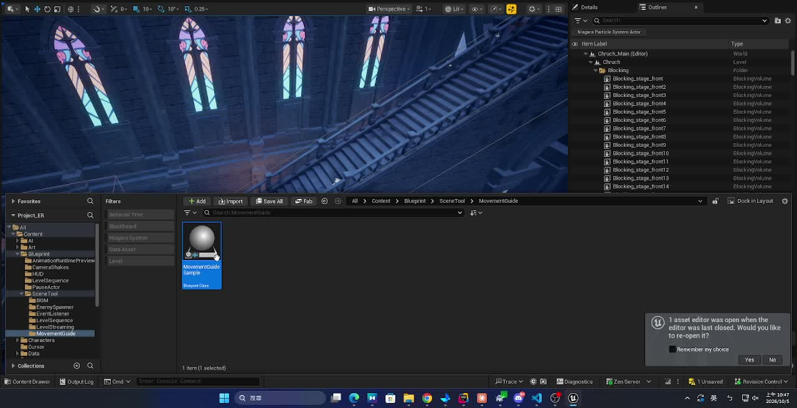
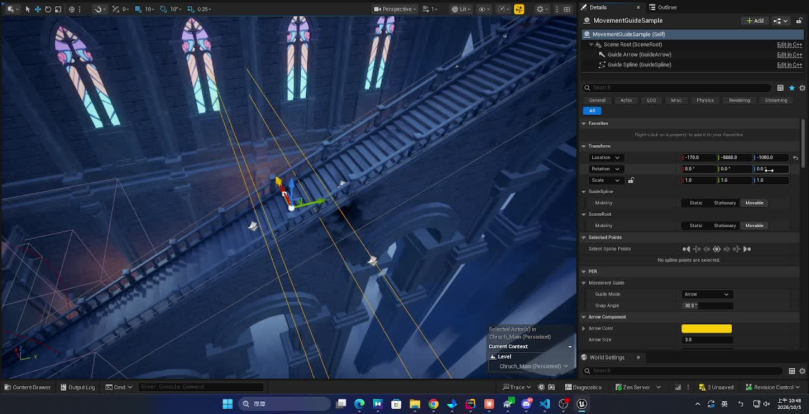
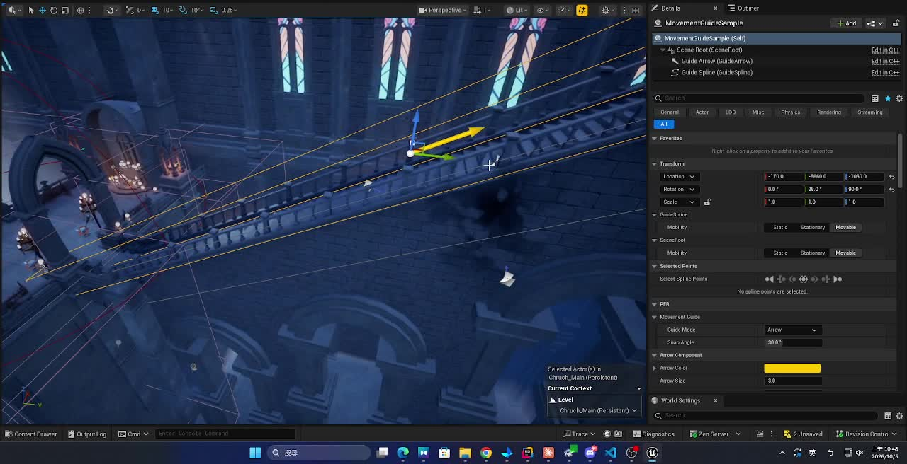
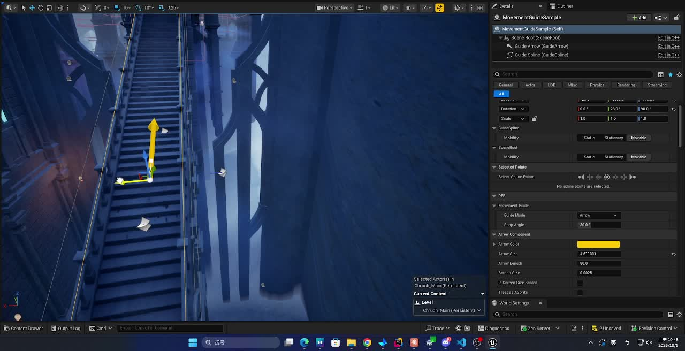

> 一個 Volume＋玩家端幾個函式，解決 8 方向鍵盤在斜向、彎曲路線上走不順的問題。
> 文中程式碼的 `YOURMODULE_API`、`AMyPlayerCharacter` 請換成自己專案的名稱。

---

## 問題

俯視角遊戲裡，鍵盤只能輸入 8 個方向（上下左右＋4 個斜角）。
當場景裡出現**斜向的樓梯、窄橋、彎曲的走道**，路的走向剛好不在這 8 個方向上時：

- 玩家必須在兩個方向鍵之間不停切換，才能「鋸齒狀」地沿著路走
- 一不小心就撞牆、卡在欄杆上，或從橋邊掉下去

手把沒有這個問題——類比搖桿可以推出任意角度。

## 解法概念

在這類路段擺一個範圍（Volume），並給它一條**吸附軸**（路的走向）。
玩家在範圍內用鍵盤移動時，只要輸入方向「大致」朝著路的走向，就把方向**吸到吸附軸上**。

```
            吸附軸（路的走向）
               ↗
              /      ← 玩家按「↑」或「→」，夾角在 SnapAngle 內
             /          → 實際移動方向被吸到 ↗
            /
```

設計重點：

- **只處理鍵盤**，手把不受影響
- **吸附軸是雙向的**：往回走時自動吸到反方向，不需要擺兩個範圍
- **有角度門檻**：夾角超過 `SnapAngle` 的輸入完全不改，玩家想離開路線（例如橫向走下樓梯）仍然可以
- **平滑過渡**：進出範圍、在範圍之間切換時不會瞬間轉向
- 只改「輸入方向」，不直接移動角色，所以碰撞、速度、Root Motion 都照舊

---

## 效果展示

<div align="center">
<video src="./demo_stairs.mp4" controls autoplay muted loop playsinline width="800">
</video>
<br><em>只按方向鍵，角色就順著斜向的樓梯走上去，再轉到橋面</em>
</div>

> 🎬 影片無法播放時：[下載 demo_stairs.mp4](./demo_stairs.mp4)

沒有吸附時，樓梯的走向剛好介於兩個方向鍵之間，玩家得不斷交替按鍵、走成鋸齒狀，很容易撞到欄杆；
加上吸附範圍後，只要大致朝樓梯方向按住一個鍵，角色就會穩定沿著樓梯中線移動。

---

## 架構

```
AMyMovementGuideVolume（範圍）
 ├─ ShapeConfigs：可組合多個 Box / Sphere / Capsule 拼出範圍
 ├─ GuideMode：Arrow（直線）或 Spline（彎道）
 ├─ SnapAngle：吸附角度
 └─ 玩家進入 / 離開時，通知玩家

AMyPlayerCharacter（玩家端）
 ├─ 記錄目前所在的範圍（最後進入者生效）
 ├─ Move() 時呼叫 ApplyMovementGuide 改寫方向
 └─ 權重與吸附軸的平滑過渡
```

---

## 技巧一：用多個形狀拼出一個範圍

彎曲的樓梯很難用單一個 Box 剛好包住。做法是讓範圍可以**組合任意數量的形狀**，並且在編輯器裡就能直接調整。

### 可在 Details 面板就地編輯的形狀設定
形狀設定做成 `UObject`，並標記：

```cpp
UCLASS(Abstract, EditInlineNew, DefaultToInstanced, ...)
```

再用 `UPROPERTY(EditAnywhere, Instanced)` 宣告成陣列，Details 面板就能**下拉選擇 Box / Sphere / Capsule，並直接展開編輯參數**，不需要另外建資產。

每種形狀設定只負責三件事：建立對應的 ShapeComponent、把參數套到元件上、回傳類型名稱。

### 依設定動態產生元件
在 `OnConstruction` 裡重建形狀元件，拖曳或改屬性時就會即時更新：

- 元件名稱固定為 `GuideShape_<類型>_<索引>`
- 同名元件已存在 → **只更新參數**，不重建
- 不存在 → `NewObject` 建立、`AddInstanceComponent`、`RegisterComponent`
- 設定已刪除的舊元件 → 解除綁定並銷毀

> 小坑：修改陣列「裡面」元素的參數時，引擎不會自動重跑 Construction Script。
> 需要覆寫 `PostEditChangeChainProperty`，偵測到是 `ShapeConfigs` 變動時呼叫 `RerunConstructionScripts()`。

### 多個形狀合併成「一個」範圍
每個形狀都會各自觸發 Begin / End Overlap。玩家從一個 Box 走進相連的另一個 Box 時，會收到「離開 A」和「進入 B」，如果直接轉發，玩家就會在範圍內被反覆判定進出。

解法是**重疊計數**：

```cpp
TMap<TWeakObjectPtr<AActor>, int32> OverlapCounts;
```

- 計數 0 → 1：才算「進入範圍」
- 計數 1 → 0：才算「離開範圍」

### 其他細節
- 形狀元件明確設成 `Trigger` 碰撞 Profile，並開啟 `GenerateOverlapEvents`
- 綁定事件用 `AddUniqueDynamic`，不要先 `Clear()`，以免清掉其他系統的綁定
- 開啟 `bGenerateOverlapEventsDuringLevelStreaming`：範圍在串流關卡中、玩家載入時已站在裡面，也能收到進入
- `EndPlay`（例如串流關卡卸載）時，對還在範圍內的 Actor **主動補送離開**，避免玩家殘留在已消失的範圍裡
- 執行期重建形狀前也先補送離開，避免計數被清空後永遠收不到離開

---

## 技巧二：取得吸附軸

| 模式 | 吸附軸來源 | 適用 |
|---|---|---|
| **Arrow** | 箭頭元件的前方向量 | 直線樓梯、橋 |
| **Spline** | Spline 上**離玩家最近一點的切線** | 彎曲路段 |

兩者都壓平到水平面（`GetSafeNormal2D`），只保留方向。
Spline 模式下，吸附方向會隨玩家位置連續變化，自然沿著彎道轉。
Spline 控制點不足或切線無效時，退回使用箭頭方向。

---

## 技巧三：吸附計算

```
1. 輸入方向壓平、正規化 → Dir
2. 軸是雙向的：Dot(Dir, Axis) < 0 就把 Axis 反過來
3. 夾角 = acos(Dot)
   夾角 > SnapAngle → 不吸附，維持原方向
4. 結果 = normalize( Dir × (1 − 權重) + Axis × 權重 )
5. 乘回原本輸入向量的長度
```

- 比較角度時加一個極小的容許值（0.01°），避免剛好落在邊界的輸入因浮點誤差時吸時不吸
- 吸附後的方向也寫回「最後輸入方向」，讓**閃避等技能也沿著吸附後的方向**

---

## 技巧四：平滑過渡

如果進入範圍就瞬間把方向吸過去，角色會突然轉向，手感很差。這裡有兩種過渡：

### 權重過渡
- 進入第一個範圍：權重 0 → 1
- 離開所有範圍：權重 1 → 0
- 過渡時間為 `MovementGuideBlendTime`（預設 0.1 秒，設 0 為瞬間）
- 離開後的淡出期間，**沿用最後一次的吸附軸**

權重不用 Tick 累加，而是記錄「開始值、目標值、開始時間」，需要時用目前世界時間即時算出，邏輯單純也不會累積誤差。

### 吸附軸過渡
兩個範圍相鄰或重疊時，吸附軸可能突然改變。切換時記錄舊軸與開始時間，在過渡時間內從舊軸插值到新軸。

> 因為軸是雙向的，插值前要先把舊軸**翻到與新軸同一側**，否則會從反方向繞一大圈。

### 範圍重疊
玩家記錄所在範圍的清單，**最後進入的生效**；離開生效中的範圍時，自動交給前一個仍在其中的範圍。
重疊通常代表擺放錯誤，所以同時輸出警告提醒。

---

## 完整程式碼

### MyMovementGuideVolume.h

```cpp
#pragma once

#include "CoreMinimal.h"
#include "GameFramework/Actor.h"
#include "MyMovementGuideVolume.generated.h"

class UArrowComponent;
class USplineComponent;
class UShapeComponent;
class UPrimitiveComponent;

// ---------------------------------------------------------------------
// 形狀設定
// ---------------------------------------------------------------------

/** 範圍的單一形狀設定。EditInlineNew 讓 Details 面板可直接下拉選類型並就地編輯 */
UCLASS(Abstract, EditInlineNew, DefaultToInstanced, BlueprintType, CollapseCategories)
class YOURMODULE_API UMyGuideShapeConfig : public UObject
{
	GENERATED_BODY()

public:
	/** 相對於 Volume 根元件的位移與旋轉 */
	UPROPERTY(EditAnywhere, BlueprintReadWrite, Category = "Shape")
	FTransform RelativeTransform;

	virtual UShapeComponent* CreateShapeComponent(AActor* Owner, FName CompName) const
		PURE_VIRTUAL(UMyGuideShapeConfig::CreateShapeComponent, return nullptr;);

	/** 套用尺寸與相對 Transform 到既有元件 */
	virtual void ApplyToShape(UShapeComponent* Shape) const;

	virtual FString GetShapeTypeName() const
		PURE_VIRTUAL(UMyGuideShapeConfig::GetShapeTypeName, return FString(););
};

UCLASS(DisplayName = "Box")
class YOURMODULE_API UMyGuideShapeConfig_Box : public UMyGuideShapeConfig
{
	GENERATED_BODY()

public:
	UPROPERTY(EditAnywhere, BlueprintReadWrite, Category = "Shape")
	FVector BoxExtent = FVector(50.f);

	virtual UShapeComponent* CreateShapeComponent(AActor* Owner, FName CompName) const override;
	virtual void ApplyToShape(UShapeComponent* Shape) const override;
	virtual FString GetShapeTypeName() const override { return TEXT("Box"); }
};

UCLASS(DisplayName = "Sphere")
class YOURMODULE_API UMyGuideShapeConfig_Sphere : public UMyGuideShapeConfig
{
	GENERATED_BODY()

public:
	UPROPERTY(EditAnywhere, BlueprintReadWrite, Category = "Shape", meta = (ClampMin = "0.0"))
	float SphereRadius = 50.f;

	virtual UShapeComponent* CreateShapeComponent(AActor* Owner, FName CompName) const override;
	virtual void ApplyToShape(UShapeComponent* Shape) const override;
	virtual FString GetShapeTypeName() const override { return TEXT("Sphere"); }
};

UCLASS(DisplayName = "Capsule")
class YOURMODULE_API UMyGuideShapeConfig_Capsule : public UMyGuideShapeConfig
{
	GENERATED_BODY()

public:
	UPROPERTY(EditAnywhere, BlueprintReadWrite, Category = "Shape", meta = (ClampMin = "0.0"))
	float CapsuleRadius = 50.f;

	UPROPERTY(EditAnywhere, BlueprintReadWrite, Category = "Shape", meta = (ClampMin = "0.0"))
	float CapsuleHalfHeight = 100.f;

	virtual UShapeComponent* CreateShapeComponent(AActor* Owner, FName CompName) const override;
	virtual void ApplyToShape(UShapeComponent* Shape) const override;
	virtual FString GetShapeTypeName() const override { return TEXT("Capsule"); }
};

// ---------------------------------------------------------------------
// 軸向吸附範圍
// ---------------------------------------------------------------------

UENUM(BlueprintType)
enum class EMyGuideMode : uint8
{
	/** 以 GuideArrow 朝向為吸附軸，適合直線樓梯、橋 */
	Arrow,
	/** 以 GuideSpline 最近點切線為吸附軸，適合彎道 */
	Spline,
};

/**
 * 軸向吸附範圍。
 * 玩家（AMyPlayerCharacter）進入範圍後，鍵盤移動方向會被吸附到吸附軸上。
 * 範圍由 ShapeConfigs 組成，可組合多個 Box / Sphere / Capsule，多個形狀視為同一個範圍。
 */
UCLASS()
class YOURMODULE_API AMyMovementGuideVolume : public AActor
{
	GENERATED_BODY()

public:
	AMyMovementGuideVolume();

	//~ Begin AActor Interface
	virtual void OnConstruction(const FTransform& Transform) override;
	virtual void BeginPlay() override;
	virtual void EndPlay(const EEndPlayReason::Type EndPlayReason) override;
#if WITH_EDITOR
	virtual void PostEditChangeChainProperty(FPropertyChangedChainEvent& PropertyChangedEvent) override;
#endif
	//~ End AActor Interface

	/** 取得水平、正規化的吸附軸（雙向） */
	UFUNCTION(BlueprintPure, Category = "MovementGuide")
	FVector GetGuideAxis(const FVector& WorldLocation) const;

	/** 依 ShapeConfigs 生成 / 更新 / 刪除形狀元件 */
	UFUNCTION(BlueprintCallable, Category = "MovementGuide")
	void RebuildShapes();

	/** 範圍形狀，可組合多個 */
	UPROPERTY(EditAnywhere, Instanced, BlueprintReadOnly, Category = "MovementGuide")
	TArray<TObjectPtr<UMyGuideShapeConfig>> ShapeConfigs;

	UPROPERTY(EditAnywhere, BlueprintReadOnly, Category = "MovementGuide")
	EMyGuideMode GuideMode = EMyGuideMode::Arrow;

	/** 輸入方向與吸附軸（正向或反向）的夾角小於等於此值時吸附 */
	UPROPERTY(EditAnywhere, BlueprintReadOnly, Category = "MovementGuide", meta = (ClampMin = "0.0", ClampMax = "90.0", Units = "deg"))
	float SnapAngle = 30.f;

protected:
	UFUNCTION()
	void HandleShapeBeginOverlap(UPrimitiveComponent* OverlappedComp, AActor* OtherActor,
		UPrimitiveComponent* OtherComp, int32 OtherBodyIndex, bool bFromSweep, const FHitResult& SweepResult);

	UFUNCTION()
	void HandleShapeEndOverlap(UPrimitiveComponent* OverlappedComp, AActor* OtherActor,
		UPrimitiveComponent* OtherComp, int32 OtherBodyIndex);

	/** 重疊計數 0→1 時呼叫 */
	void OnActorEnter(AActor* OtherActor);

	/** 重疊計數 1→0 時呼叫 */
	void OnActorExit(AActor* OtherActor);

	/** 對所有仍在範圍內的 Actor 補送離開（重建、EndPlay 時用） */
	void ExitAll();

	void DestroyShape(UShapeComponent* Shape);

	void UpdateGuideComponentVisibility();

	UPROPERTY(VisibleAnywhere, BlueprintReadOnly, Category = "Components")
	TObjectPtr<USceneComponent> SceneRoot;

	UPROPERTY(VisibleAnywhere, BlueprintReadOnly, Category = "Components")
	TObjectPtr<UArrowComponent> GuideArrow;

	UPROPERTY(VisibleAnywhere, BlueprintReadOnly, Category = "Components")
	TObjectPtr<USplineComponent> GuideSpline;

	UPROPERTY(Transient)
	TArray<TObjectPtr<UShapeComponent>> GeneratedShapes;

	/** 每個 Actor 目前碰到幾個形狀 */
	TMap<TWeakObjectPtr<AActor>, int32> OverlapCounts;

	static const TCHAR* ShapeNamePrefix;
};
```

### MyMovementGuideVolume.cpp

```cpp
#include "MyMovementGuideVolume.h"

#include "Components/ArrowComponent.h"
#include "Components/BoxComponent.h"
#include "Components/CapsuleComponent.h"
#include "Components/SphereComponent.h"
#include "Components/SplineComponent.h"
#include "MyPlayerCharacter.h"

// ---------------------------------------------------------------------
// 形狀設定
// ---------------------------------------------------------------------

void UMyGuideShapeConfig::ApplyToShape(UShapeComponent* Shape) const
{
	if (Shape)
	{
		Shape->SetRelativeTransform(RelativeTransform);
	}
}

UShapeComponent* UMyGuideShapeConfig_Box::CreateShapeComponent(AActor* Owner, FName CompName) const
{
	UBoxComponent* Box = NewObject<UBoxComponent>(Owner, CompName);
	ApplyToShape(Box);
	return Box;
}

void UMyGuideShapeConfig_Box::ApplyToShape(UShapeComponent* Shape) const
{
	Super::ApplyToShape(Shape);
	if (UBoxComponent* Box = Cast<UBoxComponent>(Shape))
	{
		Box->SetBoxExtent(BoxExtent, false);
	}
}

UShapeComponent* UMyGuideShapeConfig_Sphere::CreateShapeComponent(AActor* Owner, FName CompName) const
{
	USphereComponent* Sphere = NewObject<USphereComponent>(Owner, CompName);
	ApplyToShape(Sphere);
	return Sphere;
}

void UMyGuideShapeConfig_Sphere::ApplyToShape(UShapeComponent* Shape) const
{
	Super::ApplyToShape(Shape);
	if (USphereComponent* Sphere = Cast<USphereComponent>(Shape))
	{
		Sphere->SetSphereRadius(SphereRadius, false);
	}
}

UShapeComponent* UMyGuideShapeConfig_Capsule::CreateShapeComponent(AActor* Owner, FName CompName) const
{
	UCapsuleComponent* Capsule = NewObject<UCapsuleComponent>(Owner, CompName);
	ApplyToShape(Capsule);
	return Capsule;
}

void UMyGuideShapeConfig_Capsule::ApplyToShape(UShapeComponent* Shape) const
{
	Super::ApplyToShape(Shape);
	if (UCapsuleComponent* Capsule = Cast<UCapsuleComponent>(Shape))
	{
		Capsule->SetCapsuleSize(CapsuleRadius, CapsuleHalfHeight, false);
	}
}

// ---------------------------------------------------------------------
// 軸向吸附範圍
// ---------------------------------------------------------------------

const TCHAR* AMyMovementGuideVolume::ShapeNamePrefix = TEXT("GuideShape_");

AMyMovementGuideVolume::AMyMovementGuideVolume()
{
	PrimaryActorTick.bCanEverTick = false;

	// 範圍在串流關卡中、角色載入時已站在裡面，也要觸發進入
	bGenerateOverlapEventsDuringLevelStreaming = true;

	SceneRoot = CreateDefaultSubobject<USceneComponent>(TEXT("SceneRoot"));
	SceneRoot->SetMobility(EComponentMobility::Movable);
	RootComponent = SceneRoot;

	GuideArrow = CreateDefaultSubobject<UArrowComponent>(TEXT("GuideArrow"));
	GuideArrow->SetupAttachment(SceneRoot);
	GuideArrow->ArrowColor = FColor(255, 200, 0);
	GuideArrow->ArrowSize = 3.f;
	GuideArrow->SetHiddenInGame(true);

	GuideSpline = CreateDefaultSubobject<USplineComponent>(TEXT("GuideSpline"));
	GuideSpline->SetupAttachment(SceneRoot);
	GuideSpline->SetHiddenInGame(true);
}

void AMyMovementGuideVolume::OnConstruction(const FTransform& Transform)
{
	Super::OnConstruction(Transform);
	RebuildShapes();
	UpdateGuideComponentVisibility();
}

void AMyMovementGuideVolume::BeginPlay()
{
	Super::BeginPlay();

	if (GeneratedShapes.Num() != ShapeConfigs.Num())
	{
		RebuildShapes();
	}

	if (ShapeConfigs.IsEmpty())
	{
		UE_LOG(LogTemp, Warning, TEXT("%s: 沒有設定 ShapeConfigs，此範圍不會生效"), *GetActorNameOrLabel());
	}
	if (GuideMode == EMyGuideMode::Spline && GuideSpline->GetNumberOfSplinePoints() < 2)
	{
		UE_LOG(LogTemp, Warning, TEXT("%s: Spline 模式但控制點少於 2 個，改用 GuideArrow 朝向"), *GetActorNameOrLabel());
	}
}

void AMyMovementGuideVolume::EndPlay(const EEndPlayReason::Type EndPlayReason)
{
	// 範圍被移除（如串流卸載）時，不論是否收到 EndOverlap，都讓範圍內的人離開
	ExitAll();
	Super::EndPlay(EndPlayReason);
}

#if WITH_EDITOR
void AMyMovementGuideVolume::PostEditChangeChainProperty(FPropertyChangedChainEvent& PropertyChangedEvent)
{
	Super::PostEditChangeChainProperty(PropertyChangedEvent);

	// 修改陣列「裡面」的參數不會自動重跑 Construction，要手動觸發
	const auto* MemberNode = PropertyChangedEvent.PropertyChain.GetActiveMemberNode();
	if (MemberNode && MemberNode->GetValue()
		&& MemberNode->GetValue()->GetFName() == GET_MEMBER_NAME_CHECKED(AMyMovementGuideVolume, ShapeConfigs))
	{
		RerunConstructionScripts();
	}
}
#endif

void AMyMovementGuideVolume::RebuildShapes()
{
	// 執行期重建：先讓範圍內的人正常離開，避免計數被清掉後收不到離開
	if (HasActorBegunPlay())
	{
		ExitAll();
	}

	TMap<FName, UShapeComponent*> Existing;
	for (UActorComponent* Comp : GetInstanceComponents())
	{
		UShapeComponent* Shape = Cast<UShapeComponent>(Comp);
		if (Shape && Shape->GetName().StartsWith(ShapeNamePrefix))
		{
			Existing.Add(Shape->GetFName(), Shape);
		}
	}

	GeneratedShapes.Reset();
	TSet<FName> Keep;

	for (int32 i = 0; i < ShapeConfigs.Num(); ++i)
	{
		const UMyGuideShapeConfig* Config = ShapeConfigs[i];
		if (!Config)
		{
			continue;
		}

		// 名稱含類型與索引：換類型就是新名稱，舊元件會被清掉
		const FName Name(*FString::Printf(TEXT("%s%s_%d"), ShapeNamePrefix, *Config->GetShapeTypeName(), i));
		Keep.Add(Name);

		UShapeComponent* Shape = Existing.FindRef(Name);
		if (IsValid(Shape))
		{
			Config->ApplyToShape(Shape);
		}
		else
		{
			Shape = Config->CreateShapeComponent(this, Name);
			if (!Shape)
			{
				continue;
			}
			Shape->SetupAttachment(SceneRoot);
			Shape->SetMobility(EComponentMobility::Movable);
			Shape->SetCollisionProfileName(TEXT("Trigger"));
			Shape->SetGenerateOverlapEvents(true);
			AddInstanceComponent(Shape);
			Shape->RegisterComponent();
		}

		// AddUnique：不清掉其他系統綁在形狀上的事件
		Shape->OnComponentBeginOverlap.AddUniqueDynamic(this, &AMyMovementGuideVolume::HandleShapeBeginOverlap);
		Shape->OnComponentEndOverlap.AddUniqueDynamic(this, &AMyMovementGuideVolume::HandleShapeEndOverlap);
		GeneratedShapes.Add(Shape);
	}

	for (const TPair<FName, UShapeComponent*>& Pair : Existing)
	{
		if (!Keep.Contains(Pair.Key))
		{
			DestroyShape(Pair.Value);
		}
	}
}

void AMyMovementGuideVolume::DestroyShape(UShapeComponent* Shape)
{
	if (!IsValid(Shape))
	{
		return;
	}
	Shape->OnComponentBeginOverlap.RemoveDynamic(this, &AMyMovementGuideVolume::HandleShapeBeginOverlap);
	Shape->OnComponentEndOverlap.RemoveDynamic(this, &AMyMovementGuideVolume::HandleShapeEndOverlap);
	RemoveInstanceComponent(Shape);
	Shape->DestroyComponent();
}

void AMyMovementGuideVolume::HandleShapeBeginOverlap(UPrimitiveComponent* OverlappedComp, AActor* OtherActor,
	UPrimitiveComponent* OtherComp, int32 OtherBodyIndex, bool bFromSweep, const FHitResult& SweepResult)
{
	if (!OtherActor || OtherActor == this)
	{
		return;
	}

	int32& Count = OverlapCounts.FindOrAdd(OtherActor);
	if (++Count == 1)
	{
		OnActorEnter(OtherActor);
	}
}

void AMyMovementGuideVolume::HandleShapeEndOverlap(UPrimitiveComponent* OverlappedComp, AActor* OtherActor,
	UPrimitiveComponent* OtherComp, int32 OtherBodyIndex)
{
	int32* Count = OtherActor ? OverlapCounts.Find(OtherActor) : nullptr;
	if (!Count)
	{
		return;
	}

	if (--(*Count) <= 0)
	{
		OverlapCounts.Remove(OtherActor);
		OnActorExit(OtherActor);
	}
}

void AMyMovementGuideVolume::OnActorEnter(AActor* OtherActor)
{
	if (AMyPlayerCharacter* Player = Cast<AMyPlayerCharacter>(OtherActor))
	{
		Player->EnterMovementGuideVolume(this);
	}
}

void AMyMovementGuideVolume::OnActorExit(AActor* OtherActor)
{
	if (AMyPlayerCharacter* Player = Cast<AMyPlayerCharacter>(OtherActor))
	{
		Player->ExitMovementGuideVolume(this);
	}
}

void AMyMovementGuideVolume::ExitAll()
{
	TArray<TWeakObjectPtr<AActor>> Inside;
	OverlapCounts.GetKeys(Inside);
	OverlapCounts.Reset();

	for (const TWeakObjectPtr<AActor>& Actor : Inside)
	{
		if (AActor* Ptr = Actor.Get())
		{
			OnActorExit(Ptr);
		}
	}
}

FVector AMyMovementGuideVolume::GetGuideAxis(const FVector& WorldLocation) const
{
	if (GuideMode == EMyGuideMode::Spline && GuideSpline->GetNumberOfSplinePoints() >= 2)
	{
		const FVector Axis = GuideSpline->FindTangentClosestToWorldLocation(WorldLocation, ESplineCoordinateSpace::World).GetSafeNormal2D();
		if (!Axis.IsNearlyZero())
		{
			return Axis;
		}
	}
	return GuideArrow->GetForwardVector().GetSafeNormal2D();
}

void AMyMovementGuideVolume::UpdateGuideComponentVisibility()
{
	const bool bSpline = GuideMode == EMyGuideMode::Spline;
	GuideArrow->SetVisibility(!bSpline);
	GuideSpline->SetVisibility(bSpline);
}
```

### PlayerCharacter.h（新增段落）

> `AMyPlayerCharacter` 換成你的玩家類別名稱（Volume 的 .cpp 裡 Cast 的類別也要一起換）。

```cpp
// 前置宣告
class AMyMovementGuideVolume;

public:
	/** 由 AMyMovementGuideVolume 在玩家進入範圍時呼叫。範圍重疊時以最後進入的為準，並輸出警告 */
	void EnterMovementGuideVolume(AMyMovementGuideVolume* Volume);

	/** 由 AMyMovementGuideVolume 在玩家離開範圍、或範圍本身被移除時呼叫 */
	void ExitMovementGuideVolume(AMyMovementGuideVolume* Volume);

	/** 進出吸附範圍、或在重疊範圍間切換時的過渡時間（秒）。0 = 瞬間切換 */
	UPROPERTY(EditDefaultsOnly, BlueprintReadOnly, Category = "Movement Guide", meta = (ClampMin = "0.0", UIMin = "0.0", Units = "s"))
	float MovementGuideBlendTime = 0.1f;

protected:
	/**
	 * 依目前所在的吸附範圍改寫移動方向（僅鍵盤時由 Move 呼叫）。
	 * 回傳值保留原本向量的長度，只改變水平方向。
	 */
	FVector ApplyMovementGuide(const FVector& RawMoveDirection);

	/** 取得目前生效（最後進入且仍有效）的吸附範圍，可能為 null。會順便清掉已失效的紀錄 */
	AMyMovementGuideVolume* GetActiveMovementGuideVolume();

	/** 目前的吸附權重（0 = 不吸附、1 = 完全吸附），依 MovementGuideBlendTime 隨時間過渡 */
	float GetMovementGuideWeight() const;

	/** 從目前權重開始，往 TargetWeight 過渡 */
	void SetMovementGuideTargetWeight(float TargetWeight);

	/** 從目前使用中的吸附軸開始，過渡到新生效範圍的吸附軸 */
	void BeginMovementGuideAxisBlend();

	/** 玩家目前所在的吸附範圍，依進入順序排列，最後一個生效 */
	TArray<TWeakObjectPtr<AMyMovementGuideVolume>> MovementGuideVolumes;

	/** 權重過渡的起始值、目標值與開始時間（世界時間） */
	float MovementGuideWeightAtChange = 0.f;
	float MovementGuideTargetWeight = 0.f;
	float MovementGuideWeightChangeTime = 0.f;

	/** 最近一次實際使用的吸附軸與吸附角度；離開範圍後的過渡期間沿用 */
	FVector MovementGuideAxis = FVector::ZeroVector;
	float MovementGuideSnapAngle = 0.f;

	/** 在重疊範圍間切換時，吸附軸過渡的起點與開始時間。開始時間 < 0 代表沒有在過渡 */
	FVector MovementGuideAxisBlendFrom = FVector::ZeroVector;
	float MovementGuideAxisBlendStartTime = -1.f;

private:
	/** 吸附角度的比較容許值：避免剛好落在邊界上的輸入因浮點誤差時而吸附、時而不吸附 */
	static constexpr float MovementGuideSnapAngleTolerance = 0.01f;
```

### PlayerCharacter.cpp（新增段落）

```cpp
#include "MyMovementGuideVolume.h"

void AMyPlayerCharacter::EnterMovementGuideVolume(AMyMovementGuideVolume* Volume)
{
	if (!IsValid(Volume))
	{
		return;
	}

	MovementGuideVolumes.RemoveAll([](const TWeakObjectPtr<AMyMovementGuideVolume>& Entry)
	{
		return !Entry.IsValid();
	});

	if (MovementGuideVolumes.Contains(Volume))
	{
		return;
	}

	const AMyMovementGuideVolume* PreviousVolume = MovementGuideVolumes.IsEmpty() ? nullptr : MovementGuideVolumes.Last().Get();
	MovementGuideVolumes.Add(Volume);

	if (PreviousVolume)
	{
		UE_LOG(LogTemp, Warning, TEXT("進入吸附範圍 %s 時仍位於 %s 內，範圍重疊，以後進入的 %s 為準。"),
			*Volume->GetActorNameOrLabel(), *PreviousVolume->GetActorNameOrLabel(), *Volume->GetActorNameOrLabel());
		BeginMovementGuideAxisBlend();
	}
	else
	{
		SetMovementGuideTargetWeight(1.f);
	}
}

void AMyPlayerCharacter::ExitMovementGuideVolume(AMyMovementGuideVolume* Volume)
{
	const int32 Index = MovementGuideVolumes.IndexOfByKey(Volume);
	if (Index == INDEX_NONE)
	{
		return;
	}

	const bool bWasActive = Index == MovementGuideVolumes.Num() - 1;
	MovementGuideVolumes.RemoveAt(Index);
	MovementGuideVolumes.RemoveAll([](const TWeakObjectPtr<AMyMovementGuideVolume>& Entry)
	{
		return !Entry.IsValid();
	});

	if (MovementGuideVolumes.IsEmpty())
	{
		// 已離開所有範圍：沿用最後一次的吸附軸，在過渡時間內淡出
		SetMovementGuideTargetWeight(0.f);
	}
	else if (bWasActive)
	{
		// 離開的是生效中的範圍，改由前一個仍在其中的範圍接手
		BeginMovementGuideAxisBlend();
	}
}

AMyMovementGuideVolume* AMyPlayerCharacter::GetActiveMovementGuideVolume()
{
	while (!MovementGuideVolumes.IsEmpty())
	{
		if (AMyMovementGuideVolume* Volume = MovementGuideVolumes.Last().Get())
		{
			return Volume;
		}
		MovementGuideVolumes.Pop();
	}
	return nullptr;
}

float AMyPlayerCharacter::GetMovementGuideWeight() const
{
	if (MovementGuideBlendTime <= 0.f)
	{
		return MovementGuideTargetWeight;
	}

	const float Elapsed = GetWorld()->GetTimeSeconds() - MovementGuideWeightChangeTime;
	const float Delta = FMath::Max(Elapsed, 0.f) / MovementGuideBlendTime;
	return MovementGuideTargetWeight >= MovementGuideWeightAtChange
		? FMath::Min(MovementGuideWeightAtChange + Delta, MovementGuideTargetWeight)
		: FMath::Max(MovementGuideWeightAtChange - Delta, MovementGuideTargetWeight);
}

void AMyPlayerCharacter::SetMovementGuideTargetWeight(const float TargetWeight)
{
	MovementGuideWeightAtChange = GetMovementGuideWeight();
	MovementGuideTargetWeight = TargetWeight;
	MovementGuideWeightChangeTime = GetWorld()->GetTimeSeconds();
}

void AMyPlayerCharacter::BeginMovementGuideAxisBlend()
{
	// 還沒在範圍內移動過（沒有使用中的吸附軸）就不需要過渡
	if (MovementGuideAxis.IsNearlyZero() || MovementGuideBlendTime <= 0.f)
	{
		MovementGuideAxisBlendStartTime = -1.f;
		return;
	}

	MovementGuideAxisBlendFrom = MovementGuideAxis;
	MovementGuideAxisBlendStartTime = GetWorld()->GetTimeSeconds();
}

FVector AMyPlayerCharacter::ApplyMovementGuide(const FVector& RawMoveDirection)
{
	if (AMyMovementGuideVolume* ActiveVolume = GetActiveMovementGuideVolume())
	{
		FVector Axis = ActiveVolume->GetGuideAxis(GetActorLocation());

		// 在重疊範圍間切換時，吸附軸由舊軸過渡到新軸。軸是雙向的，先把舊軸翻到與新軸同側
		if (MovementGuideAxisBlendStartTime >= 0.f && !Axis.IsNearlyZero())
		{
			const float Alpha = (GetWorld()->GetTimeSeconds() - MovementGuideAxisBlendStartTime) / MovementGuideBlendTime;
			if (Alpha < 1.f)
			{
				FVector From = MovementGuideAxisBlendFrom;
				if (FVector::DotProduct(From, Axis) < 0.f)
				{
					From = -From;
				}
				const FVector Blended = (From * (1.f - Alpha) + Axis * Alpha).GetSafeNormal2D();
				if (!Blended.IsNearlyZero())
				{
					Axis = Blended;
				}
			}
			else
			{
				MovementGuideAxisBlendStartTime = -1.f;
			}
		}

		MovementGuideAxis = Axis;
		MovementGuideSnapAngle = ActiveVolume->SnapAngle;
	}

	const float Weight = GetMovementGuideWeight();
	if (Weight <= 0.f || MovementGuideAxis.IsNearlyZero())
	{
		return RawMoveDirection;
	}

	const FVector RawDirection2D = RawMoveDirection.GetSafeNormal2D();
	if (RawDirection2D.IsNearlyZero())
	{
		return RawMoveDirection;
	}

	// 吸附軸是雙向的：取與輸入方向同側的那一端
	FVector SnapTarget = MovementGuideAxis;
	float Dot = FVector::DotProduct(RawDirection2D, SnapTarget);
	if (Dot < 0.f)
	{
		SnapTarget = -SnapTarget;
		Dot = -Dot;
	}

	const float AngleToAxis = FMath::RadiansToDegrees(FMath::Acos(FMath::Clamp(Dot, -1.f, 1.f)));
	if (AngleToAxis > MovementGuideSnapAngle + MovementGuideSnapAngleTolerance)
	{
		// 超出吸附角度：維持原本方向
		return RawMoveDirection;
	}

	const FVector GuidedDirection2D = (RawDirection2D * (1.f - Weight) + SnapTarget * Weight).GetSafeNormal2D();
	if (GuidedDirection2D.IsNearlyZero())
	{
		return RawMoveDirection;
	}

	return GuidedDirection2D * RawMoveDirection.Size();
}
```

### Move() 裡的呼叫

```cpp
FVector MoveDirection = (ForwardDirection * InputVector.Y) + (RightDirection * InputVector.X);

// 方向吸附只套用在鍵盤操作；吸附後的方向也寫入 LastInputDir，讓閃避沿著吸附方向
if (!IsUsingGamepad())
{
	MoveDirection = ApplyMovementGuide(MoveDirection);
}

LastInputDir = MoveDirection;
AddMovementInput(MoveDirection, 1.0f);
```

---

## 使用示範：在斜向樓梯上擺一個吸附範圍

<div align="center">
<video src="./setup_walkthrough.mp4" controls playsinline width="800"></video>
<br><em>完整操作錄影：擺放 Volume → 設定形狀與吸附模式 → 對齊箭頭 → 進遊戲測試</em>
</div>

> 🎬 影片無法播放時：[下載 setup_walkthrough.mp4](./setup_walkthrough.mp4)

以下是錄影中的各個步驟：

**1. 把 Volume 拉進場景**



**2. 設定範圍形狀與吸附模式**



- `ShapeConfigs` 加一個 **Box**，調 `BoxExtent` 讓範圍包住整段樓梯（寬度涵蓋整個走道，長度從樓梯口到樓梯頂）
- `GuideMode` 選 **Arrow**（直線樓梯）
- `SnapAngle` 先用 **30°**

**3. 旋轉 Actor，讓箭頭對齊樓梯走向**



- 範圍與箭頭會一起旋轉，Box 也會順著樓梯擺好
- 只看水平方向：箭頭有俯仰角不影響，計算時會壓平到水平面

**4. 換個角度確認**



**5. 進遊戲測試**

用鍵盤從樓梯口往上走，大致朝樓梯方向按住一個鍵，角色應該會穩定沿著樓梯移動（如上方「效果展示」）。
手感太黏就把 `SnapAngle` 調小，吸不到就調大。

### 彎曲的路

1. `GuideMode` 改成 **Spline**（編輯器會自動隱藏箭頭、顯示 Spline）
2. 沿路中線擺 Spline 控制點，**至少 2 個**
3. `ShapeConfigs` 用多個 Box 拼出彎道，每個用 `RelativeTransform` 調位置與旋轉

---

## 調整建議與注意事項

- `SnapAngle` 太大玩家很難離開路線，太小又吸不到；30° 左右是不錯的起點
- 範圍盡量不要重疊；重疊時以最後進入的為準，並會輸出警告
- 只有 Volume 裡 Cast 得到的玩家類別會被吸附
- 只改輸入方向，不影響角色碰撞、移動速度與 Root Motion
