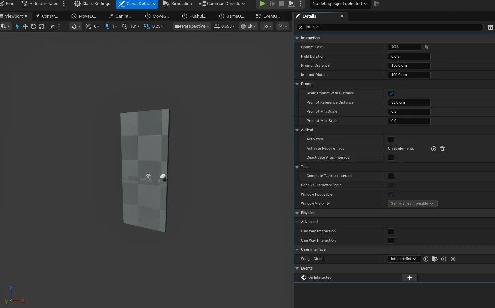
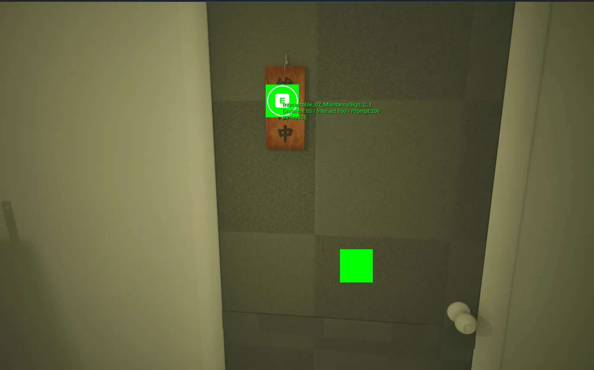
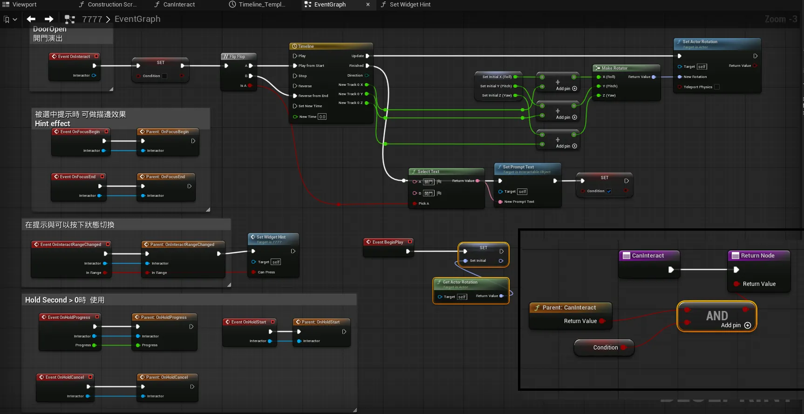
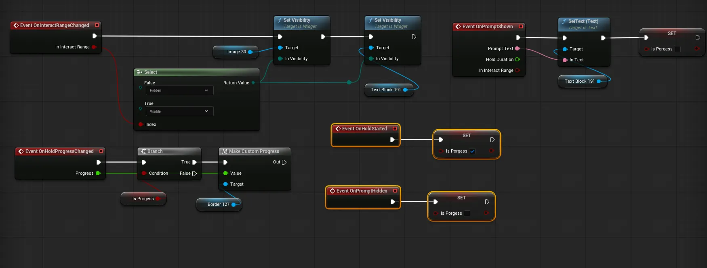
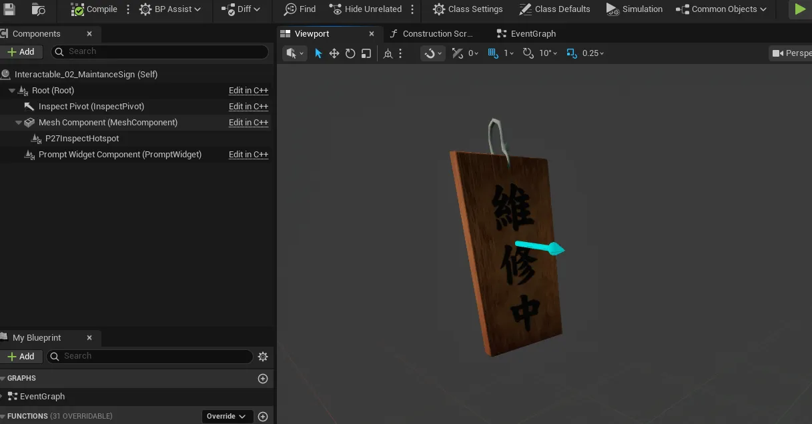
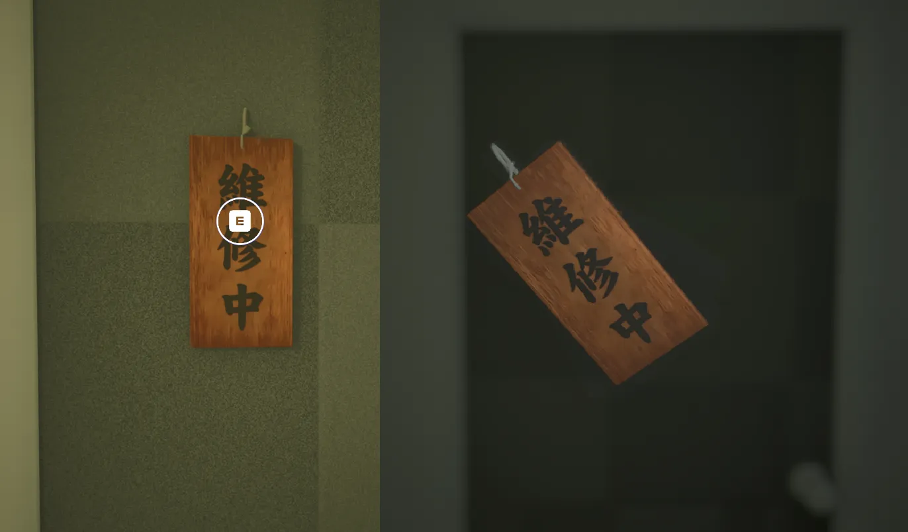
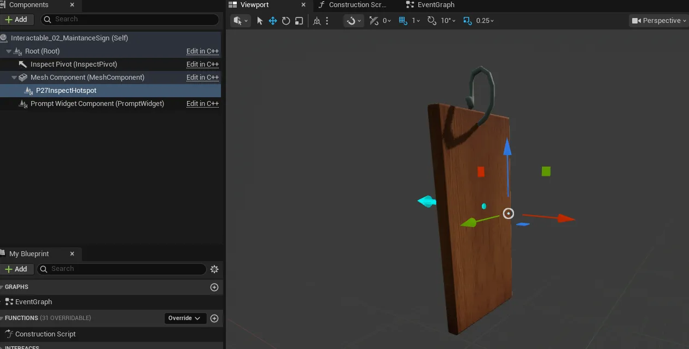

> Two components on the player (`Interactor`, `Inspector`), plus three classes for interactable objects, inspectable objects and inspect hotspots, build the first-person flow of "interact → pick up and inspect → flip it to trigger a hotspot → read the text".
> The `P27` prefix in this post is the sample project's naming. Replace `P27_API` with your own module's name. The full source is at the end.
> ⚠️ Everything here was implemented and tested on **UE 5.8** (First Person template). Other engine versions may behave differently.

> 🚧 **TODO (draft marker)**: blocks starting with "🚧 TODO" are screenshots, videos and Blueprint sequences still to be added. Delete each block once its content is in.

---

## The problem

In first-person horror and puzzle games, "interacting" is nearly the only thing the player does. Common requirements:

| Requirement | Problem with the usual approach | This post's approach |
|---|---|---|
| Show a prompt when looking at an object; press to interact | A Line Trace from the camera: small objects are hard to aim at, and objects need collision | Objects register with a Subsystem; pick the one most directly in view by "view angle", then use a Trace to check occlusion |
| The prompt flickers between two objects, or at an object's edge | The target is re-picked every frame and flips back and forth when a value sits right on a threshold | Add **hysteresis** to the angle, distance and occlusion checks |
| See the prompt from afar, but only press it up close | There's only one distance threshold | Two distances: `PromptDistance` / `InteractDistance` |
| Some interactions need a "hold" (open a drawer, pick a lock) | Needs separate timing and UI | Built-in `HoldDuration` and progress events |
| Pick up a letter or photo, turn it around, flip it to find clues | Build a separate Actor or open another level | Fly **the object itself** in front of the camera and turn look input into object rotation; mark "only usable from this side" spots with **hotspot** components |

Design goals:

- **Designers can stage everything in Blueprint**: every moment (focus, hold start, interaction complete, inspect start, hotspot trigger) is a `BlueprintNativeEvent` or `BlueprintImplementableEvent`. C++ only handles the checks and state.
- **UI stays separate from logic**: C++ never touches widget contents and only calls events. What the prompt looks like and how it animates is all done in UMG.
- **Objects don't need collision**: an interactable's Mesh defaults to `NoCollision`, so it never blocks the player or affects physics just so it can be aimed at.

---

## Demo

<div align="center">
<video src="./demo_interact.mp4" controls autoplay muted loop playsinline width="800">
</video>
<br><em>A prompt appears as you approach the object; once in range, pressing interact triggers its sequence</em>
</div>

> 🎬 If the video doesn't play: [download demo_interact.mp4](./demo_interact.mp4)

<div align="center">
<video src="./demo_inspect.mp4" controls autoplay muted loop playsinline width="800">
</video>
<br><em>After interacting, the object flies in front of the camera and the background darkens and blurs; the mouse rotates the object, and closing flies it back</em>
</div>

> 🎬 If the video doesn't play: [download demo_inspect.mp4](./demo_inspect.mp4)

---

## Architecture

| Class | Type | Lives on | Responsible for |
|---|---|---|---|
| `UP27InteractionSubsystem` | `UWorldSubsystem` | Created automatically | Collects every interactable in the level |
| `AInteractableObject` | `AActor` | Placed in the level | Interaction parameters, prompt widget, sequence events |
| `UP27InteractPromptWidget` | `UUserWidget` (Abstract) | The object's `PromptWidget` | Event interface for the interact prompt UI |
| `UP27InteractorComponent` | `UActorComponent` | Player | Picks the focused object every frame; handles press / hold |
| `AP27InspectableObject` | Inherits `AInteractableObject` | Placed in the level | Enters inspect after interacting; inspect parameters and read text |
| `UP27InspectHotspotComponent` | `UWidgetComponent` | Inspectable object | Marks spots that can be used while inspecting |
| `UP27InspectorComponent` | `UActorComponent` | Player | Inspect state machine, object placement and rotation, background effects, hotspot selection |
| `UP27InspectWidget` | `UUserWidget` (Abstract) | Created by the Inspector | On-screen UI while inspecting (key hints, read text) |
| `UP27InspectCameraModifier` | `UCameraModifier` | Added by the Inspector | Depth of field, vignette and exposure while inspecting |

---

## 1. Interactables and focus logic

### No collision: collect them in a Subsystem

Objects register themselves with `UP27InteractionSubsystem` in `BeginPlay` and unregister in `EndPlay`. The Subsystem is just a `TArray<TWeakObjectPtr<AInteractableObject>>`:

```cpp
void AInteractableObject::BeginPlay()
{
    Super::BeginPlay();
    if (UP27InteractionSubsystem* Subsystem = GetWorld()->GetSubsystem<UP27InteractionSubsystem>())
    {
        Subsystem->RegisterInteractable(this);
    }
    HidePrompt();
}
```

`DoesSupportWorldType` returns only `Game` / `PIE`, so it isn't created in editor viewports.

**Why not pick the target with a Line Trace?** Interactables in first-person games are often tiny (keys, notes, switches). Making the player "hit" one with a line takes precise aim, and the object must have collision to be hit at all. Instead this picks **the object closest to the crosshair (smallest angle)**, and the Trace is only used to check whether a wall is in the way.

### Two distances

| Parameter | Default | Description |
|---|---|---|
| `PromptDistance` | 400 cm | Within this distance (and in view, unoccluded) the object is focused and its prompt shown |
| `InteractDistance` | 200 cm | Interaction is only possible within this distance |

`GetPromptDistance()` returns the larger of the two, so a misconfiguration can't produce "pressable but no prompt". Distance is measured in 3D from the **camera** to `GetInteractLocation()`, not from the character to the object: in first person, the distance the player perceives is from the eyes to the object.

`GetInteractLocation()` returns the prompt widget's location by default. It's a `BlueprintNativeEvent`, so Blueprints can override it (for example, a door whose interaction point is the handle while its prompt sits beside the frame).



### Picking the focused object

`UP27InteractorComponent` lives on the player and makes one pick per frame:

```cpp
void UP27InteractorComponent::TickComponent(float DeltaTime, ...)
{
    FVector ViewLocation, ViewDirection;
    float FocusDistance = 0.0f;
    AInteractableObject* Interactable = GetViewPoint(ViewLocation, ViewDirection)
        ? SelectFocus(ViewLocation, ViewDirection, DeltaTime, FocusDistance)
        : nullptr;
    const bool bInRange = Interactable && IsWithinInteractRange(Interactable, FocusDistance);
    SetFocusedInteractable(Interactable, bInRange);
    // ……prompt scaling, in-range changes, hold progress
}
```

The viewpoint comes from `Controller->GetPlayerViewPoint()`, and the Tick Group is `TG_PostUpdateWork` so it gets the camera position after this frame's camera update. While inspecting, `GetViewPoint` just returns false, which pauses detection.

**Checking a single candidate** (`EvaluateCandidate`) runs these checks in order, cheapest first:

1. `CanInteract()`: whether the object can currently be interacted with
2. Distance ≤ `GetPromptDistance()`
3. The angle between the view direction and "camera → object" ≤ the angle limit

```cpp
const FVector ToTarget = Interactable->GetInteractLocation() - ViewLocation;
const float Distance = ToTarget.Size();
if (Distance <= KINDA_SMALL_NUMBER || Distance > Interactable->GetPromptDistance())
{
    return false;
}
const float Dot = FMath::Clamp(FVector::DotProduct(ToTarget / Distance, ViewDirection), -1.0f, 1.0f);
const float Angle = FMath::RadiansToDegrees(FMath::Acos(Dot));
if (Angle > AngleLimit)
{
    return false;
}
```

**Picking the best of all objects** (`FindBestInteractable`) uses a small trick: pass "the best angle so far" in as the next candidate's angle limit. Any later object that isn't more directly in view than the current best fails the angle check, with no occlusion Trace needed:

```cpp
AInteractableObject* BestInteractable = nullptr;
float BestAngle = MaxViewAngle;
for (const TWeakObjectPtr<AInteractableObject>& Entry : Subsystem->GetInteractables())
{
    AInteractableObject* Interactable = Entry.Get();
    if (!Interactable || Interactable == Exclude) continue;

    float Angle, Distance;
    if (!EvaluateCandidate(Interactable, ViewLocation, ViewDirection, BestAngle, Angle, Distance)) continue;
    if (!HasLineOfSight(ViewLocation, Interactable)) continue;   // Only trace the ones that could actually win

    BestInteractable = Interactable;
    BestAngle = Angle;   // The next candidate must be more directly in view than this
}
```

**The occlusion check** (`HasLineOfSight`) traces from the camera to the object, with two details:

- The Trace stops `LineOfSightTolerance` (default 10 cm) short of the target. Interaction points often sit right on an object's surface or a tabletop, and tracing all the way can graze the table and count as blocked.
- If the Actor hit is the object itself, **or an Actor attached to it**, it counts as visible.

```cpp
const bool bVisible = !bHit || HitActor == Interactable || (HitActor && HitActor->IsAttachedTo(Interactable));
```

### Stability: keeping the prompt from flickering

With only the rules above, when the crosshair rests near a threshold, focus turns on one frame and off the next; with two objects side by side, the prompt jumps between them. The fix is to give every threshold **hysteresis**, with different values for entering and leaving:

| Parameter | Default | Effect |
|---|---|---|
| `MaxViewAngle` | 25° | A new object must be within this angle to be focused |
| `FocusKeepAngleMargin` | 5° | A focused object is only lost beyond `MaxViewAngle + 5°` |
| `SwitchAngleMargin` | 3° | Another object must be **more than 3° more directly in view** than the focused one to switch |
| `FocusLoseDelay` | 0.2 s | A focused object must stay occluded for 0.2 s before it's dropped (so people or doors briefly passing in front don't cause flicker) |
| `RangeExitMargin` | 10 cm | Once in range, you must go beyond `InteractDistance + 10` to leave it |

`SelectFocus` first evaluates the current focus with the relaxed conditions, then looks for the best of the other objects, and only switches when "the current one can no longer be kept" or "the new one is clearly better":

```cpp
if (CurrentFocus && EvaluateCandidate(CurrentFocus, ..., MaxViewAngle + FocusKeepAngleMargin, CurrentAngle, CurrentDistance))
{
    if (HasLineOfSight(ViewLocation, CurrentFocus))
    {
        LostSightTime = 0.0f;
        bKeepCurrent = true;
    }
    else
    {
        LostSightTime += DeltaTime;
        bKeepCurrent = LostSightTime < FocusLoseDelay;
    }
}

AInteractableObject* BestInteractable = FindBestInteractable(ViewLocation, ViewDirection, CurrentFocus, BestAngle, BestDistance);

if (bKeepCurrent && !(BestInteractable && BestAngle + SwitchAngleMargin < CurrentAngle))
{
    return CurrentFocus;
}
return BestInteractable;
```

Note that `FindBestInteractable` excludes the current focus (`Exclude`), so it never compares an object against itself.



### Press and hold

Input is bound on the player character: `Started` begins, `Completed` / `Canceled` ends:

```cpp
EnhancedInputComponent->BindAction(InteractAction, ETriggerEvent::Started,   this, &ThisClass::DoInteractStart);
EnhancedInputComponent->BindAction(InteractAction, ETriggerEvent::Completed, this, &ThisClass::DoInteractEnd);
EnhancedInputComponent->BindAction(InteractAction, ETriggerEvent::Canceled,  this, &ThisClass::DoInteractEnd);
```

`StartInteract` only works when "there is a focused object and it's in range". A `HoldDuration` of 0 completes immediately; otherwise it enters the hold state and Tick accumulates the time:

```cpp
if (!bIsHolding) return;

if (!Interactable || !bInRange)
{
    CancelHold();     // Looked away or walked out of range
    return;
}

HoldElapsed += DeltaTime;
const float Progress = FMath::Clamp(HoldElapsed / Interactable->GetHoldDuration(), 0.0f, 1.0f);
Interactable->UpdateHoldProgress(GetOwner(), Progress);
if (Progress >= 1.0f)
{
    CompleteInteract();
}
```

A hold is canceled when: the key is released, the player leaves `InteractDistance`, focus is lost, or the focus changes (`SetFocusedInteractable` always calls `CancelHold` before switching targets). On cancel, progress drops to zero before the cancel event is sent, so a UI that just draws `Progress` never leaves anything behind.

### Sequence events

`AInteractableObject` doesn't play any sequences itself; it only calls events at the right moments. They're all `BlueprintNativeEvent`, so Blueprint subclasses override them directly:

| Event | When it fires |
|---|---|
| `OnFocusBegin` | Focus begins (prompt already shown) |
| `OnFocusEnd` | Focus lost (left range, looked away, occluded, deactivated; prompt already hidden) |
| `OnInteractRangeChanged(bInRange)` | Entering or leaving `InteractDistance` while focused; also sent once with the initial state when focus begins |
| `OnHoldStart` | A hold begins (not fired when `HoldDuration` is 0) |
| `OnHoldProgress(Progress)` | Every frame during a hold, 0–1; a 0 is also sent after start, cancel and completion |
| `OnHoldCancel` | A hold was interrupted; progress is already reset to zero |
| `OnInteract` | Interaction complete |

An external Actor that wants to know "this object was interacted with" can bind the `OnInteracted` delegate.

`Interact()` itself is `virtual`, so subclasses (like `AP27InspectableObject` below) can extend what happens after an interaction in C++. There's also `bDeactivateAfterInteract`: it calls `SetActivate(false)` automatically after the interaction, taking effect **before** `OnInteract`, so a Blueprint can turn it back on inside `OnInteract` (for "switch"-type objects, for example).

`CanInteract()` is a `BlueprintNativeEvent` too, returning `bActivated` by default. If you don't want it re-triggered while a sequence plays, override it to return false: the Interactor drops focus on the next frame and fires `OnFocusEnd`, so the prompt simply goes away.



<div align="center">
<video src="./demo_interact_fx.mp4" controls autoplay muted loop playsinline width="800">
</video>
<br><em>The Blueprint above in action: opening and closing the door, with the prompt hidden mid-sequence</em>
</div>

> 🎬 If the video doesn't play: [download demo_interact_fx.mp4](./demo_interact_fx.mp4)

---

## 2. The interact prompt

### The prompt is a WidgetComponent on the object

Every interactable has a `PromptWidget` (`UWidgetComponent`), set up in the constructor:

```cpp
PromptWidgetComponent->SetWidgetSpace(EWidgetSpace::Screen);   // Always faces the screen, unaffected by lighting
PromptWidgetComponent->SetDrawAtDesiredSize(true);            // Size is decided by the widget itself
PromptWidgetComponent->SetCollisionEnabled(ECollisionEnabled::NoCollision);
PromptWidgetComponent->SetHiddenInGame(true);                 // Only shown while focused
```

In the Blueprint, drag `PromptWidget` to where the prompt should appear and set its Widget Class to a UMG widget that inherits `UP27InteractPromptWidget`. Because `GetInteractLocation()` defaults to this component's location, **distance and occlusion are measured from wherever the prompt sits**, so what artists place is exactly what gets checked.

### The UI only receives events

`UP27InteractPromptWidget` is an `Abstract` class that only declares events and builds no UI:

| Event | Parameters | When it fires |
|---|---|---|
| `OnPromptShown` | Prompt text, `HoldDuration`, whether in range | Focus begins, or `SetPromptText` is called while focused |
| `OnInteractRangeChanged` | Whether in range | The state changes while focused; **also called every time the prompt is shown** |
| `OnHoldStarted` | — | A hold begins |
| `OnHoldProgressChanged` | 0–1 | Every frame during a hold |
| `OnHoldCanceled` | — | A hold is interrupted |
| `OnPromptHidden` | — | Focus is lost |

There's also an `OwningInteractable` property, so the widget can read other information from the object directly.

Sending `OnInteractRangeChanged` on show is deliberate: the UI only needs this one event to get the correct "pressable / not pressable" state, without handling it again in `OnPromptShown`. A common setup:

- **Not pressable (PROMPT ONLY)**: show just a small dot or a faded icon, hinting that "there's something there".
- **Pressable (IN RANGE)**: expand into a key icon + text ("Open", "Pick up").
- **With a HoldDuration**: draw a circular progress ring around the key icon, driving a material parameter with the value from `OnHoldProgressChanged`.



<div align="center">
<video src="./demo_prompt.mp4" controls autoplay muted loop playsinline width="800">
</video>
<br><em>The prompt switches between "visible" and "pressable", and scales with distance</em>
</div>

> 🎬 If the video doesn't play: [download demo_prompt.mp4](./demo_prompt.mp4)

### Perspective scaling in Screen Space

A Screen Space widget is the same size on screen no matter how far away it is. In first person, a small object in the distance with a prompt floating beside it as big as a nearby one looks out of place.

So while focused, the Interactor calls `UpdatePromptScale` every frame to scale the widget by "camera-to-prompt distance":

$$
\text{Scale} = \text{clamp}\left(\frac{\text{PromptReferenceDistance}}{\text{Distance}},\ \text{PromptMinScale},\ \text{PromptMaxScale}\right)
$$

```cpp
const float Distance = FVector::Distance(ViewLocation, PromptWidgetComponent->GetComponentLocation());
const float Scale = FMath::Clamp(PromptReferenceDistance / Distance, MinScale, MaxScale);
PromptWidget->SetRenderScale(FVector2D(Scale, Scale));
```

Under perspective projection, an object's on-screen size is inversely proportional to its distance, so `reference distance / distance` scales the prompt in the same proportion as the object. `PromptReferenceDistance` (default 150 cm) is the distance at which the prompt is its original size; the limits keep it from vanishing in the distance or blocking the view up close.

| Parameter | Default | Description |
|---|---|---|
| `bScalePromptWithDistance` | true | Whether distance scaling is enabled |
| `PromptReferenceDistance` | 150 cm | Scale = 1 at this distance |
| `PromptMinScale` | 0.3 | Minimum scale |
| `PromptMaxScale` | 1.5 | Maximum scale |

⚠️ This overwrites the RenderTransform Scale of the widget's **root**. Put pop-in, breathing and other prompt animations on child widgets, or they'll be overwritten every frame.

### The HUD can know what's focused too

To change the crosshair in the middle of the screen (for example, turning it into a hand icon on focus), bind the Interactor's delegate:

```cpp
UPROPERTY(BlueprintAssignable, Category="Interaction")
FP27OnFocusedInteractableChanged OnFocusedInteractableChanged;   // (NewFocus, bInInteractRange)
```

It broadcasts when the focus changes or the pressable state changes; a null `NewFocus` means nothing is focused.

---

## 3. Inspect: bringing the object up close

### From interaction to inspection

`AP27InspectableObject` inherits `AInteractableObject` and only overrides `Interact`: once the interaction completes, it finds the `UP27InspectorComponent` on the interactor and starts inspecting.

```cpp
void AP27InspectableObject::Interact(AActor* Interactor)
{
    Super::Interact(Interactor);   // The original events and delegate still fire as usual

    if (const AP27PlayerCharacter* Player = Cast<AP27PlayerCharacter>(Interactor))
    {
        if (UP27InspectorComponent* Inspector = Player->GetInspectorComponent())
        {
            Inspector->BeginInspect(this);
        }
    }
}
```

Because it's the same interaction flow, inspectable objects also get a prompt, can use `HoldDuration`, and can use `CanInteract` to control when they can be picked up.

### The state machine

The Inspector has four states: `Inactive` (not inspecting) → `Entering` (flying to the camera) → `Inspecting` (inspecting) → `Exiting` (flying back) → `Inactive`. When `EndAction` is `Collect`, it skips `Exiting` and goes straight back to `Inactive` on close.

`IsInspecting()` is true in every state except `Inactive`. The player character uses it to change what input means:

```cpp
void AP27PlayerCharacter::DoMove(float Right, float Forward)
{
    if (InspectorComponent->IsInspecting()) return;          // No moving while inspecting
    Super::DoMove(Right, Forward);
}

void AP27PlayerCharacter::DoAim(float Yaw, float Pitch)
{
    if (InspectorComponent->IsInspecting())
    {
        InspectorComponent->AddRotationInput(Yaw, Pitch);    // Look input rotates the object instead
        return;
    }
    Super::DoAim(Yaw, Pitch);
}

void AP27PlayerCharacter::DoInteractStart()
{
    if (InspectorComponent->IsInspecting())
    {
        InspectorComponent->ActivateFocusedHotspot();        // The interact key triggers hotspots instead
        return;
    }
    InteractorComponent->StartInteract();
}
```

Two more Input Actions: `InspectCloseAction` closes the inspect view, and `InspectReadAction` toggles reading mode. There's no Input Mapping Context switching; all the routing happens in the character's input functions.

### Where the object goes: InspectPivot

Objects have their origins in different places (some at the bottom, some in a corner), so putting the Actor's origin in front of the camera often leaves the object off-center. So inspectable objects get an extra `InspectPivot` (`UArrowComponent`):

- **Location**: placed `InspectDistance` straight in front of the camera while inspecting; it's also the center of rotation.
- **Arrow direction (X axis)**: faces the player by default, so it marks "the front of the object".
- `InspectRotation` can add a rotation on top of that (for example, tilting a letter back a little).



`BeginInspect` records the Pivot's transform relative to the Actor, and "the object's rotation in camera space":

```cpp
OriginTransform = Object->GetActorTransform();
PivotRelativeTransform = Object->GetInspectPivot()->GetComponentTransform().GetRelativeTransform(OriginTransform);
ViewLocalRotation = FQuat(FRotator(0.0f, 180.0f, 0.0f)) * FQuat(Object->GetInspectRotation());
```

The 180° Yaw multiplied in front of `ViewLocalRotation` turns the arrow from "facing forward from the camera" to "facing the camera".

Every frame, it computes where the Pivot should be in world space from the camera, then works back to the Actor's transform:

```cpp
FTransform UP27InspectorComponent::ComputeInspectTransform(const FVector& CameraLocation, const FQuat& CameraRotation) const
{
    const FVector PivotLocation = CameraLocation + CameraRotation.GetForwardVector() * InspectedObject->GetInspectDistance();
    const FQuat PivotRotation = CameraRotation * ViewLocalRotation;
    const FTransform PivotWorld(PivotRotation, PivotLocation, PivotRelativeTransform.GetScale3D() * OriginTransform.GetScale3D());
    return PivotRelativeTransform.Inverse() * PivotWorld;
}
```

$$
T_{actor} = T_{pivot\_relative}^{-1} \cdot T_{pivot\_world}
$$

Because it's recomputed from the camera every frame, when the camera moves (Camera Shake, breathing) the object moves with it and never drifts off screen.

### Flying in and back

`Entering` and `Exiting` interpolate between the original and target transforms with `FTransform::Blend`, using an `InterpEaseInOut` curve:

```cpp
case EP27InspectState::Entering:
{
    TransitionElapsed += DeltaTime;
    const float Alpha = Duration > 0.0f ? FMath::Clamp(TransitionElapsed / Duration, 0.0f, 1.0f) : 1.0f;
    FTransform Blended;
    Blended.Blend(OriginTransform, ComputeInspectTransform(CameraLocation, CameraRotation),
                  FMath::InterpEaseInOut(0.0f, 1.0f, Alpha, 2.0f));
    InspectedObject->SetActorTransform(Blended);
    if (Alpha >= 1.0f)
    {
        State = EP27InspectState::Inspecting;
    }
    break;
}
```

The fly-in target is recomputed every frame, so even if the camera is still moving during the fly-in, the object ends up exactly in front of it. Flying back goes from "where it was when closed" (`ExitStartTransform`) to `OriginTransform`.

The object's collision is turned off while inspecting and restored afterward, so the object doesn't push the player's capsule away when it flies to the camera.

### Rotating the object: stacking quaternions in camera space

Look input becomes a rotation around the camera's up axis (Yaw) and right axis (Pitch), **multiplied on the left** of `ViewLocalRotation`:

```cpp
void UP27InspectorComponent::AddRotationInput(float Yaw, float Pitch)
{
    if (State != EP27InspectState::Inspecting || bIsReading) return;

    const float YawDegrees   = -Yaw  * RotateSpeed * (bInvertYaw   ? -1.0f : 1.0f);
    const float PitchDegrees =  Pitch * RotateSpeed * (bInvertPitch ? -1.0f : 1.0f);
    const FQuat YawDelta  (FVector::UpVector,    FMath::DegreesToRadians(YawDegrees));
    const FQuat PitchDelta(FVector::RightVector, FMath::DegreesToRadians(PitchDegrees));
    ViewLocalRotation = (YawDelta * PitchDelta * ViewLocalRotation).GetNormalized();
}
```

**Why multiply on the left?** `ViewLocalRotation` is the object's rotation in camera space. Multiplying on the left rotates "around the camera's axes"; multiplying on the right rotates "around the object's own axes".

- On the right: once the object is turned on its side, "pushing the mouse up" rotates around the object's own tilted axis, in a direction the player doesn't expect.
- On the left: whatever angle the object is already at, mouse up flips it up and mouse left turns it left, like turning it in your hand.

Accumulating in quaternions also avoids the gimbal lock Euler angles hit when Pitch nears ±90°. Calling `GetNormalized()` after each multiply keeps floating-point error from slowly deforming the object.

### Background: post-processing stacked by a Camera Modifier

While inspecting, the background should blur and darken so the eye stays on the object. Instead of placing a Post Process Volume in the level, this uses a custom `UCameraModifier`:

```cpp
void UP27InspectCameraModifier::ModifyPostProcess(float DeltaTime, float& PostProcessBlendWeight, FPostProcessSettings& PostProcessSettings)
{
    PostProcessBlendWeight = Alpha;               // Camera Modifier's built-in fade in and out
    PostProcessSettings = InspectPostProcessSettings;
}
```

`BeginInspect` sets the parameters and calls `EnableModifier()`; ending calls `DisableModifier(false)` (not removed immediately, so it fades out):

```cpp
FPostProcessSettings Settings;
Settings.bOverride_DepthOfFieldFocalDistance = true;
Settings.DepthOfFieldFocalDistance = FocalDistance;     // = the object's InspectDistance
Settings.bOverride_DepthOfFieldFstop = true;
Settings.DepthOfFieldFstop = BackgroundFstop;
Settings.bOverride_DepthOfFieldMinFstop = true;
Settings.DepthOfFieldMinFstop = 0.0f;
Settings.bOverride_VignetteIntensity = true;
Settings.VignetteIntensity = VignetteIntensity;
Settings.bOverride_AutoExposureBias = true;
Settings.AutoExposureBias = ExposureBias;
```

Why a Camera Modifier:

- **Free fade in and out**: the engine handles `AlphaInTime` / `AlphaOutTime`.
- **Works whatever the current View Target is**: when the player sits in a chair or the camera cuts to another Camera Actor, the post-processing still applies.
- **Precise focus distance**: it uses the object's `InspectDistance` directly, so the object is sharp and the background fully blurred.

Exposure compensation darkens the whole screen, object included, so there's also a **fill light that follows the camera** (`UPointLightComponent`, no shadows, only 100 cm of range), fading in and out with the same timing:

```cpp
InspectLight->SetIntensity(InspectLightIntensity * LightAlpha);
InspectLight->SetWorldLocation(CameraLocation + CameraRotation.RotateVector(InspectLightOffset));
```

| Parameter | Default | Description |
|---|---|---|
| `BackgroundFstop` | 0.5 | Aperture; smaller blurs the background more |
| `VignetteIntensity` | 0.8 | Vignette strength |
| `ExposureBias` | -1 | Exposure compensation; negative darkens |
| `BackgroundBlendTime` | 0.3 s | Fade time for the background and fill light |
| `InspectLightIntensity` | 5 cd | Fill light intensity |
| `InspectLightRadius` | 100 cm | Fill light range; too large lights up nearby walls |
| `InspectLightOffset` | (0, 20, 15) | Fill light position relative to the camera (forward, right, up) |



### Ending: fly back or collect

`EndAction` decides what happens after the inspect view closes:

| EndAction | Behavior | Good for |
|---|---|---|
| `ReturnToOrigin` | Flies back, restores collision, and fires `OnInspectEnd(false)` when done | Things you look at and put back (photos, ornaments) |
| `Collect` | Hides it immediately, disables collision, calls `SetActivate(false)`, and fires `OnInspectEnd(true)` | Items you pick up (keys, notes) |

External code can bind `OnInspectEnded(InspectedObject, bCollected)`, for example to unlock a door once the key is collected.

### Reading mode

For letters, notes and the like, players need to read the writing clearly. Inspectable objects have a `ReadText` (multi-line text); when it's not empty, `InspectReadAction` toggles reading mode: the UI shows the text in large type, and meanwhile the object can't be rotated and hotspots are hidden.

Reading state has one easy mistake: designers often want to turn reading on right inside `OnInspectBegin` (pick up a letter and read it straight away), but the object is still flying in at that point. Entering reading immediately would put the text over the moving object. So during `Entering`, `SetReading(true)` only records a "pending" flag, and reading actually starts once the object is in place:

```cpp
void UP27InspectorComponent::SetReading(bool bNewReading)
{
    if (!bNewReading)
    {
        bPendingReading = false;
    }
    else if (State == EP27InspectState::Entering)
    {
        bPendingReading = InspectedObject && InspectedObject->HasReadText();
        return;   // Called again from Tick once the object is in place
    }
    // ……
}
```

`ReadText` can also be swapped during inspection with `SetReadText` (for example, writing that appears only on the back), and the widget receives `OnReadTextChanged`. If reading is in progress, the content updates directly; clearing it leaves reading automatically.

### The inspect UI

`UP27InspectorComponent`'s `InspectWidgetClass` names a UMG widget that inherits `UP27InspectWidget`. It's created and added to the viewport when inspection starts, and removed when it ends:

| Event | When it fires | Typical use |
|---|---|---|
| `OnInspectStarted(Object, bCanRead)` | Inspection starts | Show "rotate / close" key hints; `bCanRead` decides whether to show "read" |
| `OnInspectEnded` | Inspection ends (the widget is removed afterward) | Fade-out animation |
| `OnHotspotChanged(bHasHotspot, PromptText)` | The usable hotspot changes | Show "[E] Flip over" at the bottom of the screen |
| `OnReadTextChanged(bCanRead)` | The read text is set or cleared | Show / hide the "read" hint |
| `OnReadingChanged(bReading, ReadText)` | Entering or leaving reading, or the text updates while reading | Show the text in large type |

---

## 4. Inspect hotspots

### "Only visible once you turn it to this side"

A hotspot is a `UP27InspectHotspotComponent` (inheriting `UWidgetComponent`) added to an inspectable object to mark "a spot you can use while inspecting": an envelope's flap, the back of a photo, a box's hidden compartment.

Whether a hotspot appears depends on one thing: **whether its X axis (front) faces the camera**.

```cpp
bool UP27InspectHotspotComponent::GetFacingDot(const FVector& ViewLocation, float& OutDot) const
{
    const FVector ToView = (ViewLocation - GetComponentLocation()).GetSafeNormal();
    OutDot = FVector::DotProduct(GetForwardVector(), ToView);
    return OutDot >= FMath::Cos(FMath::DegreesToRadians(FacingAngle));
}
```

Put a hotspot on the back of an object with its X axis pointing outward, and the player has to flip the object over to see it. `FacingAngle` (default 60°) sets how directly it must face the camera to appear.



### Selection and display

Only while `Inspecting` and not reading, every frame it finds all enabled hotspots facing the camera and takes the one most directly facing it (largest Dot):

```cpp
void UP27InspectorComponent::UpdateHotspots(const FVector& CameraLocation)
{
    TInlineComponentArray<UP27InspectHotspotComponent*> Hotspots;
    InspectedObject->GetComponents(Hotspots);

    UP27InspectHotspotComponent* BestHotspot = nullptr;
    float BestDot = -1.0f;
    for (UP27InspectHotspotComponent* Hotspot : Hotspots)
    {
        float Dot = 0.0f;
        if (Hotspot && Hotspot->IsHotspotEnabled() && Hotspot->GetFacingDot(CameraLocation, Dot) && Dot > BestDot)
        {
            BestHotspot = Hotspot;
            BestDot = Dot;
        }
    }
    SetFocusedHotspot(BestHotspot);
}
```

Only one hotspot is usable at a time, and the interact key always maps to the single one lit up on screen.

A hotspot's Widget Class **can simply reuse the interact prompt's `UP27InteractPromptWidget`**: on show it's called with `OnPromptShown(PromptText, 0, true)`, which reads as a prompt that "needs no hold and is already in range". The whole game's interact prompts end up with one consistent style.

### Trigger order

Pressing interact while inspecting runs `ActivateFocusedHotspot` in this order:

1. The hotspot's `Trigger()`: if `bDisableAfterActivate` is set, it disables itself first; then it broadcasts the hotspot's `OnHotspotActivated`
2. The object's `OnHotspotActivated(Hotspot)`: Blueprints stage the sequence here (a flip animation, pulling out a hidden compartment)
3. The hotspot's `ReadTextOnActivate` is not empty → `SetReadText` swaps in that text
4. The hotspot's `bStartReadingOnActivate` → enter reading mode

```cpp
bool UP27InspectorComponent::ActivateFocusedHotspot()
{
    UP27InspectHotspotComponent* Hotspot = FocusedHotspot.Get();
    if (State != EP27InspectState::Inspecting || bIsReading || !Hotspot || !InspectedObject)
    {
        return false;
    }
    Hotspot->Trigger();
    InspectedObject->NotifyHotspotActivated(Hotspot);

    if (InspectedObject && !Hotspot->GetReadTextOnActivate().IsEmptyOrWhitespace())
    {
        InspectedObject->SetReadText(Hotspot->GetReadTextOnActivate());
    }
    if (Hotspot->ShouldStartReadingOnActivate())
    {
        SetReading(true);
    }
    return true;
}
```

Why this order: the Blueprint's `OnHotspotActivated` runs **before the text is swapped**, so the Blueprint can call `SetReadText` itself, and leaving `ReadTextOnActivate` empty on the hotspot won't overwrite it. A simple "flip it over → read the back" needs no Blueprint at all: just fill in the text on the hotspot and tick `bStartReadingOnActivate`.

| Parameter | Default | Description |
|---|---|---|
| `PromptText` | — | Hotspot prompt text, for example "Flip over", "Take out" |
| `FacingAngle` | 60° | The hotspot only appears when the angle between its front and the camera direction is within this |
| `bHotspotEnabled` | true | Whether it's enabled; toggle with `SetHotspotEnabled` |
| `bDisableAfterActivate` | false | Disable automatically after triggering once |
| `bStartReadingOnActivate` | false | Enter reading automatically after triggering |
| `ReadTextOnActivate` | — | After triggering, replace the object's read text with this |

### Example: an envelope

> 🚧 **TODO (Blueprint)**: the envelope example's Blueprint. Triggering the front hotspot "Open" plays the flap-opening animation and enables a second hotspot "Take out" on the letter; after taking it out, `bStartReadingOnActivate` goes straight into reading. Suggested file name: `bp_hotspot_letter.jpg`.

> 🚧 **TODO (video)**: the full envelope example in action. Suggested file name: `demo_hotspot.mp4`.

---

## Design trade-offs and gotchas

| Decision | Reason |
|---|---|
| Pick the target by angle, not Line Trace | Small objects are easy to aim at and need no collision; the Trace only handles occlusion |
| Use the best angle so far as the next candidate's limit | Angle checks are cheaper than Traces, so only objects that could win get traced |
| Hysteresis on angle, distance and occlusion | The prompt doesn't flicker near thresholds or between two objects |
| Measure distance from the camera, not the character | In first person, players perceive the distance from the eyes to the object |
| Interaction location defaults to the prompt's location | Where artists place the prompt is where it's checked: what you see is what you get |
| Scale the prompt's RenderScale with distance | Screen Space gets a sense of perspective too; animations go on child widgets |
| C++ only fires events; all staging is in Blueprint | Designers can tune things on their own without waiting for a programmer |
| Move **the object itself** when inspecting | No need for a separate display copy of the Actor; hotspots and mesh changes on the object show up directly |
| Rotate the object by multiplying on the left in camera space | Mouse directions feel natural whatever angle the object is at |
| Background via a Camera Modifier | Built-in fade in and out, unaffected by the current View Target |
| Calling `SetReading` mid-fly-in only records it as pending | Turning reading on in `OnInspectBegin` won't cover the object while it's flying |
| Hotspots reuse the interact prompt widget | One consistent prompt style across the game, and one less UI to build |

### Known limitations

- **Local single-player only**: `GetViewPoint` only handles `IsLocallyControlled` Pawns, with no network sync.
- **Candidates are scanned linearly**: every registered object is visited each frame. With many objects, a spatial partition could pre-filter them by distance.
- **Hotspots don't check occlusion**: only orientation. With complex shapes (like the inside of a box), a hotspot can appear even when the object itself blocks it; avoid this with `FacingAngle` and placement.
- **Inspecting moves the whole Actor**: other Actors attached to the object move with it; objects with physics simulation need it turned off first.
- **`Collect` has no exit animation**: the object hides as soon as the view closes. If you want a sequence, play one in `OnInspectEnd(true)`.

---

## Full source

### Interaction

#### P27InteractionSubsystem.h

```cpp
#pragma once

#include "CoreMinimal.h"
#include "Subsystems/WorldSubsystem.h"
#include "P27InteractionSubsystem.generated.h"

class AInteractableObject;

UCLASS()
class P27_API UP27InteractionSubsystem : public UWorldSubsystem
{
	GENERATED_BODY()

public:
	void RegisterInteractable(AInteractableObject* Interactable);
	void UnregisterInteractable(AInteractableObject* Interactable);

	const TArray<TWeakObjectPtr<AInteractableObject>>& GetInteractables() const { return Interactables; }

protected:
	virtual bool DoesSupportWorldType(const EWorldType::Type WorldType) const override;

private:
	TArray<TWeakObjectPtr<AInteractableObject>> Interactables;
};
```

#### P27InteractionSubsystem.cpp

```cpp
#include "P27InteractionSubsystem.h"
#include "InteractableObject.h"

void UP27InteractionSubsystem::RegisterInteractable(AInteractableObject* Interactable)
{
	if (Interactable)
	{
		Interactables.AddUnique(TWeakObjectPtr<AInteractableObject>(Interactable));
	}
}

void UP27InteractionSubsystem::UnregisterInteractable(AInteractableObject* Interactable)
{
	Interactables.RemoveAll([Interactable](const TWeakObjectPtr<AInteractableObject>& Entry)
	{
		return !Entry.IsValid() || Entry.Get() == Interactable;
	});
}

bool UP27InteractionSubsystem::DoesSupportWorldType(const EWorldType::Type WorldType) const
{
	return WorldType == EWorldType::Game || WorldType == EWorldType::PIE;
}
```

#### InteractableObject.h

```cpp
#pragma once

#include "CoreMinimal.h"
#include "GameFramework/Actor.h"
#include "InteractableObject.generated.h"

class UWidgetComponent;
class UP27InteractPromptWidget;

DECLARE_DYNAMIC_MULTICAST_DELEGATE_TwoParams(FP27OnInteracted, AInteractableObject*, Interactable, AActor*, Interactor);

UCLASS()
class P27_API AInteractableObject : public AActor
{
	GENERATED_BODY()

public:
	AInteractableObject();

	UFUNCTION(BlueprintCallable, Category="Interaction")
	void SetActivate(bool bNewActivated);

	UFUNCTION(BlueprintPure, Category="Interaction")
	bool IsActivated() const { return bActivated; }

	/** Whether it can currently be focused and interacted with; defaults to bActivated and can be overridden in BP (for example, return false while a sequence plays). Returning false drops focus and fires OnFocusEnd */
	UFUNCTION(BlueprintNativeEvent, BlueprintPure, Category="Interaction")
	bool CanInteract() const;

	UFUNCTION(BlueprintCallable, Category="Interaction")
	void SetPromptText(const FText& NewPromptText);

	UFUNCTION(BlueprintPure, Category="Interaction")
	FText GetPromptText() const { return PromptText; }

	UFUNCTION(BlueprintPure, Category="Interaction")
	float GetHoldDuration() const { return HoldDuration; }

	UFUNCTION(BlueprintPure, Category="Interaction")
	float GetInteractDistance() const { return InteractDistance; }

	UFUNCTION(BlueprintPure, Category="Interaction")
	float GetPromptDistance() const { return FMath::Max(PromptDistance, InteractDistance); }

	UFUNCTION(BlueprintPure, Category="Interaction")
	bool IsInInteractRange() const { return bInInteractRange; }

	UFUNCTION(BlueprintPure, Category="Interaction")
	bool IsFocused() const { return bIsFocused; }

	/** The location used for the distance, view angle and occlusion checks; defaults to the PromptWidget's location and can be overridden in BP */
	UFUNCTION(BlueprintNativeEvent, BlueprintPure, Category="Interaction")
	FVector GetInteractLocation() const;

	void BeginFocus(AActor* Interactor, bool bInRange);
	void EndFocus(AActor* Interactor);
	void SetInInteractRange(AActor* Interactor, bool bInRange);
	void UpdatePromptScale(const FVector& ViewLocation);
	void BeginHold(AActor* Interactor);
	void UpdateHoldProgress(AActor* Interactor, float Progress);
	void CancelHold(AActor* Interactor);
	virtual void Interact(AActor* Interactor);

	UPROPERTY(BlueprintAssignable, Category="Interaction")
	FP27OnInteracted OnInteracted;

protected:
	virtual void BeginPlay() override;
	virtual void EndPlay(const EEndPlayReason::Type EndPlayReason) override;

	/** Fires when the interaction completes (held for HoldDuration, or pressed when HoldDuration is 0); bDeactivateAfterInteract takes effect before this event */
	UFUNCTION(BlueprintNativeEvent, Category="Interaction")
	void OnInteract(AActor* Interactor);

	/** The player starts focusing this object (within PromptDistance, in view and unoccluded); the prompt is already shown */
	UFUNCTION(BlueprintNativeEvent, Category="Interaction")
	void OnFocusBegin(AActor* Interactor);

	/** The player stops focusing this object (left range, looked away, occluded or deactivated); the prompt is already hidden */
	UFUNCTION(BlueprintNativeEvent, Category="Interaction")
	void OnFocusEnd(AActor* Interactor);

	/** Fires when the interact key starts being held; not fired when HoldDuration is 0 */
	UFUNCTION(BlueprintNativeEvent, Category="Interaction")
	void OnHoldStart(AActor* Interactor);

	/** Fires every frame during a hold, Progress 0~1; a 0 is also sent after start, cancel and completion */
	UFUNCTION(BlueprintNativeEvent, Category="Interaction")
	void OnHoldProgress(AActor* Interactor, float Progress);

	/** Fires when a hold is interrupted (released, looked away, left InteractDistance, lost focus); progress is already reset to zero */
	UFUNCTION(BlueprintNativeEvent, Category="Interaction")
	void OnHoldCancel(AActor* Interactor);

	/** Fires when the in-InteractDistance (pressable) state changes while focused; also fires once with the initial state when focus begins */
	UFUNCTION(BlueprintNativeEvent, Category="Interaction")
	void OnInteractRangeChanged(AActor* Interactor, bool bInRange);

	UFUNCTION(BlueprintPure, Category="Interaction")
	UP27InteractPromptWidget* GetPromptWidget() const;

	UPROPERTY(VisibleAnywhere, BlueprintReadOnly, Category="Components")
	TObjectPtr<USceneComponent> Root;

	UPROPERTY(VisibleAnywhere, BlueprintReadOnly, Category="Components")
	TObjectPtr<UWidgetComponent> PromptWidgetComponent;

	UPROPERTY(VisibleAnywhere, BlueprintReadOnly, Category="Components")
	TObjectPtr<UStaticMeshComponent> MeshComponent;

	/** Text shown on the prompt, for example "Open", "Stand up" */
	UPROPERTY(EditAnywhere, BlueprintReadOnly, Category="Interaction")
	FText PromptText;

	/** How long to hold to complete the interaction; 0 = trigger on a single press */
	UPROPERTY(EditAnywhere, BlueprintReadOnly, Category="Interaction", meta=(ClampMin="0", Units="s"))
	float HoldDuration = 0.0f;

	/** The prompt shows when the camera is within this distance of GetInteractLocation(); if smaller than InteractDistance, InteractDistance is used */
	UPROPERTY(EditAnywhere, BlueprintReadOnly, Category="Interaction", meta=(ClampMin="0", Units="cm"))
	float PromptDistance = 400.0f;

	/** Interaction is only possible when the camera is within this distance of GetInteractLocation() */
	UPROPERTY(EditAnywhere, BlueprintReadOnly, Category="Interaction", meta=(ClampMin="0", Units="cm"))
	float InteractDistance = 200.0f;

	/** Whether the prompt scales with camera-to-prompt distance, so its on-screen size changes with distance like the object's */
	UPROPERTY(EditAnywhere, BlueprintReadOnly, Category="Interaction|Prompt")
	bool bScalePromptWithDistance = true;

	/** At this camera-to-prompt distance, the prompt is the widget's original size (Scale 1) */
	UPROPERTY(EditAnywhere, BlueprintReadOnly, Category="Interaction|Prompt", meta=(ClampMin="1", Units="cm", EditCondition="bScalePromptWithDistance"))
	float PromptReferenceDistance = 150.0f;

	/** Minimum distance scale, so distant prompts don't become too small to see */
	UPROPERTY(EditAnywhere, BlueprintReadOnly, Category="Interaction|Prompt", meta=(ClampMin="0", EditCondition="bScalePromptWithDistance"))
	float PromptMinScale = 0.3f;

	/** Maximum distance scale, so prompts don't get too large up close */
	UPROPERTY(EditAnywhere, BlueprintReadOnly, Category="Interaction|Prompt", meta=(ClampMin="0", EditCondition="bScalePromptWithDistance"))
	float PromptMaxScale = 1.5f;

	/** Whether interaction is enabled; toggle at runtime with SetActivate */
	UPROPERTY(EditAnywhere, BlueprintReadOnly, Category="Interaction|Activate")
	bool bActivated = true;

	/** Automatically SetActivate(false) after the interaction completes, taking effect before OnInteract */
	UPROPERTY(EditAnywhere, BlueprintReadOnly, Category="Interaction|Activate")
	bool bDeactivateAfterInteract = false;

private:
	void ShowPrompt();
	void HidePrompt();

	bool bIsFocused = false;
	bool bInInteractRange = false;
};
```

#### InteractableObject.cpp

```cpp
#include "InteractableObject.h"
#include "Components/WidgetComponent.h"
#include "P27InteractionSubsystem.h"
#include "P27InteractPromptWidget.h"

AInteractableObject::AInteractableObject()
{
	PrimaryActorTick.bCanEverTick = false;

	Root = CreateDefaultSubobject<USceneComponent>(TEXT("Root"));
	SetRootComponent(Root);

	PromptWidgetComponent = CreateDefaultSubobject<UWidgetComponent>(TEXT("PromptWidget"));
	PromptWidgetComponent->SetupAttachment(Root);
	PromptWidgetComponent->SetWidgetSpace(EWidgetSpace::Screen);
	PromptWidgetComponent->SetDrawAtDesiredSize(true);
	PromptWidgetComponent->SetCollisionEnabled(ECollisionEnabled::NoCollision);
	PromptWidgetComponent->SetGenerateOverlapEvents(false);
	PromptWidgetComponent->SetHiddenInGame(true);

	MeshComponent = CreateDefaultSubobject<UStaticMeshComponent>(TEXT("MeshComponent"));
	MeshComponent->SetupAttachment(Root);
	MeshComponent->SetCollisionEnabled(ECollisionEnabled::NoCollision);
	MeshComponent->SetGenerateOverlapEvents(false);
}

void AInteractableObject::BeginPlay()
{
	Super::BeginPlay();

	if (UP27InteractionSubsystem* Subsystem = GetWorld()->GetSubsystem<UP27InteractionSubsystem>())
	{
		Subsystem->RegisterInteractable(this);
	}
	HidePrompt();
}

void AInteractableObject::EndPlay(const EEndPlayReason::Type EndPlayReason)
{
	if (UP27InteractionSubsystem* Subsystem = GetWorld()->GetSubsystem<UP27InteractionSubsystem>())
	{
		Subsystem->UnregisterInteractable(this);
	}
	Super::EndPlay(EndPlayReason);
}

void AInteractableObject::SetActivate(bool bNewActivated)
{
	bActivated = bNewActivated;
}

bool AInteractableObject::CanInteract_Implementation() const
{
	return bActivated;
}

void AInteractableObject::SetPromptText(const FText& NewPromptText)
{
	PromptText = NewPromptText;
	if (bIsFocused)
	{
		ShowPrompt();
	}
}

FVector AInteractableObject::GetInteractLocation_Implementation() const
{
	return PromptWidgetComponent->GetComponentLocation();
}

void AInteractableObject::BeginFocus(AActor* Interactor, bool bInRange)
{
	bIsFocused = true;
	bInInteractRange = bInRange;
	ShowPrompt();
	OnFocusBegin(Interactor);
	OnInteractRangeChanged(Interactor, bInInteractRange);
}

void AInteractableObject::EndFocus(AActor* Interactor)
{
	bIsFocused = false;
	bInInteractRange = false;
	HidePrompt();
	OnFocusEnd(Interactor);
}

void AInteractableObject::UpdatePromptScale(const FVector& ViewLocation)
{
	if (!bScalePromptWithDistance || !bIsFocused)
	{
		return;
	}
	UP27InteractPromptWidget* PromptWidget = GetPromptWidget();
	if (!PromptWidget)
	{
		return;
	}
	const float Distance = FVector::Distance(ViewLocation, PromptWidgetComponent->GetComponentLocation());
	if (Distance <= KINDA_SMALL_NUMBER)
	{
		return;
	}
	const float MinScale = FMath::Min(PromptMinScale, PromptMaxScale);
	const float MaxScale = FMath::Max(PromptMinScale, PromptMaxScale);
	const float Scale = FMath::Clamp(PromptReferenceDistance / Distance, MinScale, MaxScale);
	PromptWidget->SetRenderScale(FVector2D(Scale, Scale));
}

void AInteractableObject::SetInInteractRange(AActor* Interactor, bool bInRange)
{
	if (!bIsFocused || bInInteractRange == bInRange)
	{
		return;
	}
	bInInteractRange = bInRange;
	if (UP27InteractPromptWidget* PromptWidget = GetPromptWidget())
	{
		PromptWidget->OnInteractRangeChanged(bInInteractRange);
	}
	OnInteractRangeChanged(Interactor, bInInteractRange);
}

void AInteractableObject::BeginHold(AActor* Interactor)
{
	if (UP27InteractPromptWidget* PromptWidget = GetPromptWidget())
	{
		PromptWidget->OnHoldStarted();
	}
	OnHoldStart(Interactor);
	UpdateHoldProgress(Interactor, 0.0f);
}

void AInteractableObject::CancelHold(AActor* Interactor)
{
	UpdateHoldProgress(Interactor, 0.0f);
	if (UP27InteractPromptWidget* PromptWidget = GetPromptWidget())
	{
		PromptWidget->OnHoldCanceled();
	}
	OnHoldCancel(Interactor);
}

void AInteractableObject::UpdateHoldProgress(AActor* Interactor, float Progress)
{
	if (UP27InteractPromptWidget* PromptWidget = GetPromptWidget())
	{
		PromptWidget->OnHoldProgressChanged(Progress);
	}
	OnHoldProgress(Interactor, Progress);
}

void AInteractableObject::Interact(AActor* Interactor)
{
	if (bDeactivateAfterInteract)
	{
		SetActivate(false);
	}
	OnInteract(Interactor);
	OnInteracted.Broadcast(this, Interactor);
}

// Fires when the interaction completes (held for HoldDuration, or pressed when HoldDuration is 0); bDeactivateAfterInteract takes effect before this event
void AInteractableObject::OnInteract_Implementation(AActor* Interactor)
{
}

// The player starts focusing this object (within PromptDistance, in view and unoccluded); the prompt is already shown
void AInteractableObject::OnFocusBegin_Implementation(AActor* Interactor)
{
}

// The player stops focusing this object (left range, looked away, occluded or deactivated); the prompt is already hidden
void AInteractableObject::OnFocusEnd_Implementation(AActor* Interactor)
{
}

// Fires when the interact key starts being held; not fired when HoldDuration is 0
void AInteractableObject::OnHoldStart_Implementation(AActor* Interactor)
{
}

// Fires every frame during a hold, Progress 0~1; a 0 is also sent after start, cancel and completion
void AInteractableObject::OnHoldProgress_Implementation(AActor* Interactor, float Progress)
{
}

// Fires when a hold is interrupted (released, looked away, left InteractDistance, lost focus); progress is already reset to zero
void AInteractableObject::OnHoldCancel_Implementation(AActor* Interactor)
{
}

// Fires when the in-InteractDistance (pressable) state changes while focused; also fires once with the initial state when focus begins
void AInteractableObject::OnInteractRangeChanged_Implementation(AActor* Interactor, bool bInRange)
{
}

UP27InteractPromptWidget* AInteractableObject::GetPromptWidget() const
{
	return Cast<UP27InteractPromptWidget>(PromptWidgetComponent->GetUserWidgetObject());
}

void AInteractableObject::ShowPrompt()
{
	PromptWidgetComponent->SetHiddenInGame(false);
	if (UP27InteractPromptWidget* PromptWidget = GetPromptWidget())
	{
		PromptWidget->SetOwningInteractable(this);
		PromptWidget->OnPromptShown(PromptText, HoldDuration, bInInteractRange);
		PromptWidget->OnInteractRangeChanged(bInInteractRange);
	}
}

void AInteractableObject::HidePrompt()
{
	PromptWidgetComponent->SetHiddenInGame(true);
	if (UP27InteractPromptWidget* PromptWidget = GetPromptWidget())
	{
		PromptWidget->OnPromptHidden();
	}
}
```

#### P27InteractPromptWidget.h

```cpp
#pragma once

#include "CoreMinimal.h"
#include "Blueprint/UserWidget.h"
#include "P27InteractPromptWidget.generated.h"

class AInteractableObject;

UCLASS(Abstract)
class P27_API UP27InteractPromptWidget : public UUserWidget
{
	GENERATED_BODY()

public:
	void SetOwningInteractable(AInteractableObject* NewOwningInteractable);

	/** Fires when the prompt is shown, with the prompt text, hold seconds and whether currently in range */
	UFUNCTION(BlueprintImplementableEvent, Category="Interaction")
	void OnPromptShown(const FText& PromptText, float HoldDuration, bool bInInteractRange);

	/** Whether in range; fires when the prompt is shown and when the state changes while focused */
	UFUNCTION(BlueprintImplementableEvent, Category="Interaction")
	void OnInteractRangeChanged(bool bInInteractRange);

	/** Fires when the prompt is hidden */
	UFUNCTION(BlueprintImplementableEvent, Category="Interaction")
	void OnPromptHidden();

	/** Fires when the interact key starts being held; not fired when HoldDuration is 0 */
	UFUNCTION(BlueprintImplementableEvent, Category="Interaction")
	void OnHoldStarted();

	/** Hold progress update, Progress 0~1; a 0 is also sent after start, cancel and completion */
	UFUNCTION(BlueprintImplementableEvent, Category="Interaction")
	void OnHoldProgressChanged(float Progress);

	/** Fires when a hold is interrupted; progress is already reset to zero */
	UFUNCTION(BlueprintImplementableEvent, Category="Interaction")
	void OnHoldCanceled();

protected:
	UPROPERTY(BlueprintReadOnly, Category="Interaction")
	TObjectPtr<AInteractableObject> OwningInteractable;
};
```

#### P27InteractPromptWidget.cpp

```cpp
#include "P27InteractPromptWidget.h"
#include "InteractableObject.h"

void UP27InteractPromptWidget::SetOwningInteractable(AInteractableObject* NewOwningInteractable)
{
	OwningInteractable = NewOwningInteractable;
}
```

#### P27InteractorComponent.h

```cpp
#pragma once

#include "CoreMinimal.h"
#include "Components/ActorComponent.h"
#include "P27InteractorComponent.generated.h"

class AInteractableObject;

DECLARE_DYNAMIC_MULTICAST_DELEGATE_TwoParams(FP27OnFocusedInteractableChanged, AInteractableObject*, NewFocus, bool, bInInteractRange);

UCLASS(ClassGroup=(P27), meta=(BlueprintSpawnableComponent))
class P27_API UP27InteractorComponent : public UActorComponent
{
	GENERATED_BODY()

public:
	UP27InteractorComponent();

	virtual void TickComponent(float DeltaTime, ELevelTick TickType, FActorComponentTickFunction* ThisTickFunction) override;

	UFUNCTION(BlueprintCallable, Category="Interaction")
	void StartInteract();

	UFUNCTION(BlueprintCallable, Category="Interaction")
	void StopInteract();

	UFUNCTION(BlueprintPure, Category="Interaction")
	AInteractableObject* GetFocusedInteractable() const;

	UFUNCTION(BlueprintPure, Category="Interaction")
	bool IsHolding() const { return bIsHolding; }

	UFUNCTION(BlueprintPure, Category="Interaction")
	bool IsFocusedInInteractRange() const { return bFocusedInRange; }

	UPROPERTY(BlueprintAssignable, Category="Interaction")
	FP27OnFocusedInteractableChanged OnFocusedInteractableChanged;

protected:
	virtual void EndPlay(const EEndPlayReason::Type EndPlayReason) override;

	/** A target is only picked for focus when its angle from the view direction is within this */
	UPROPERTY(EditAnywhere, BlueprintReadOnly, Category="Interaction", meta=(ClampMin="0", ClampMax="90", Units="deg"))
	float MaxViewAngle = 25.0f;

	/** Trace channel used for the line-of-sight check */
	UPROPERTY(EditAnywhere, BlueprintReadOnly, Category="Interaction")
	TEnumAsByte<ECollisionChannel> LineOfSightChannel = ECC_Visibility;

	/** A focused object is only lost beyond MaxViewAngle + this value, to avoid flickering at the boundary */
	UPROPERTY(EditAnywhere, BlueprintReadOnly, Category="Interaction|Stability", meta=(ClampMin="0", ClampMax="45", Units="deg"))
	float FocusKeepAngleMargin = 5.0f;

	/** Focus only switches when another object's angle is smaller than the focused one's by more than this */
	UPROPERTY(EditAnywhere, BlueprintReadOnly, Category="Interaction|Stability", meta=(ClampMin="0", ClampMax="45", Units="deg"))
	float SwitchAngleMargin = 3.0f;

	/** A focused object is only lost after being occluded for longer than this many seconds */
	UPROPERTY(EditAnywhere, BlueprintReadOnly, Category="Interaction|Stability", meta=(ClampMin="0", Units="s"))
	float FocusLoseDelay = 0.2f;

	/** The occlusion trace stops this far short of the target, so grazing the target's surface isn't misjudged */
	UPROPERTY(EditAnywhere, BlueprintReadOnly, Category="Interaction|Stability", meta=(ClampMin="0", Units="cm"))
	float LineOfSightTolerance = 10.0f;

	/** Once in range, you must go beyond InteractDistance + this value to leave it */
	UPROPERTY(EditAnywhere, BlueprintReadOnly, Category="Interaction|Stability", meta=(ClampMin="0", Units="cm"))
	float RangeExitMargin = 10.0f;

	/** Draw the occlusion trace and the focused object's distance info */
	UPROPERTY(EditAnywhere, BlueprintReadOnly, Category="Interaction|Debug")
	bool bDrawDebug = false;

private:
	bool GetViewPoint(FVector& OutLocation, FVector& OutDirection) const;
	AInteractableObject* SelectFocus(const FVector& ViewLocation, const FVector& ViewDirection, float DeltaTime, float& OutDistance);
	AInteractableObject* FindBestInteractable(const FVector& ViewLocation, const FVector& ViewDirection, const AInteractableObject* Exclude, float& OutAngle, float& OutDistance) const;
	bool EvaluateCandidate(AInteractableObject* Interactable, const FVector& ViewLocation, const FVector& ViewDirection, float AngleLimit, float& OutAngle, float& OutDistance) const;
	bool HasLineOfSight(const FVector& ViewLocation, AInteractableObject* Interactable) const;
	bool IsWithinInteractRange(AInteractableObject* Interactable, float Distance) const;
	void SetFocusedInteractable(AInteractableObject* NewFocus, bool bInRange);
	void CancelHold();
	void CompleteInteract();

	TWeakObjectPtr<AInteractableObject> FocusedInteractable;
	bool bIsHolding = false;
	bool bFocusedInRange = false;
	float HoldElapsed = 0.0f;
	float LostSightTime = 0.0f;
};
```

#### P27InteractorComponent.cpp

```cpp
#include "Component/P27InteractorComponent.h"
#include "Actor/Interactable/InteractableObject.h"
#include "Actor/Interactable/P27InteractionSubsystem.h"
#include "Character/P27PlayerCharacter.h"
#include "Component/P27InspectorComponent.h"
#include "DrawDebugHelpers.h"
#include "Engine/World.h"
#include "GameFramework/Controller.h"
#include "GameFramework/Pawn.h"

UP27InteractorComponent::UP27InteractorComponent()
{
	PrimaryComponentTick.bCanEverTick = true;
	PrimaryComponentTick.TickGroup = TG_PostUpdateWork;
}

void UP27InteractorComponent::TickComponent(float DeltaTime, ELevelTick TickType, FActorComponentTickFunction* ThisTickFunction)
{
	Super::TickComponent(DeltaTime, TickType, ThisTickFunction);

	FVector ViewLocation;
	FVector ViewDirection;
	float FocusDistance = 0.0f;
	AInteractableObject* Interactable = GetViewPoint(ViewLocation, ViewDirection) ? SelectFocus(ViewLocation, ViewDirection, DeltaTime, FocusDistance) : nullptr;
	const bool bInRange = Interactable && IsWithinInteractRange(Interactable, FocusDistance);
	SetFocusedInteractable(Interactable, bInRange);
	if (Interactable)
	{
		Interactable->UpdatePromptScale(ViewLocation);
	}

#if ENABLE_DRAW_DEBUG
	if (bDrawDebug && Interactable)
	{
		const FString DebugText = FString::Printf(TEXT("%s\nDistance %.0f / Interact %.0f / Prompt %.0f\n%s"),
			*GetNameSafe(Interactable), FocusDistance, Interactable->GetInteractDistance(), Interactable->GetPromptDistance(),
			bInRange ? TEXT("IN RANGE") : TEXT("PROMPT ONLY"));
		DrawDebugString(GetWorld(), Interactable->GetInteractLocation(), DebugText, nullptr, bInRange ? FColor::Green : FColor::Yellow, 0.0f, true);
	}
#endif
	if (Interactable && bFocusedInRange != bInRange)
	{
		bFocusedInRange = bInRange;
		Interactable->SetInInteractRange(GetOwner(), bInRange);
		OnFocusedInteractableChanged.Broadcast(Interactable, bInRange);
	}

	if (!bIsHolding)
	{
		return;
	}

	if (!Interactable || !bInRange)
	{
		CancelHold();
		return;
	}

	HoldElapsed += DeltaTime;
	const float HoldDuration = Interactable->GetHoldDuration();
	const float Progress = HoldDuration > 0.0f ? FMath::Clamp(HoldElapsed / HoldDuration, 0.0f, 1.0f) : 1.0f;
	Interactable->UpdateHoldProgress(GetOwner(), Progress);
	if (Progress >= 1.0f)
	{
		CompleteInteract();
	}
}

void UP27InteractorComponent::EndPlay(const EEndPlayReason::Type EndPlayReason)
{
	SetFocusedInteractable(nullptr, false);
	Super::EndPlay(EndPlayReason);
}

void UP27InteractorComponent::StartInteract()
{
	AInteractableObject* Interactable = FocusedInteractable.Get();
	if (!Interactable || !Interactable->IsInInteractRange() || bIsHolding)
	{
		return;
	}
	if (Interactable->GetHoldDuration() <= 0.0f)
	{
		CompleteInteract();
		return;
	}
	bIsHolding = true;
	HoldElapsed = 0.0f;
	Interactable->BeginHold(GetOwner());
}

void UP27InteractorComponent::StopInteract()
{
	if (bIsHolding)
	{
		CancelHold();
	}
}

AInteractableObject* UP27InteractorComponent::GetFocusedInteractable() const
{
	return FocusedInteractable.Get();
}

bool UP27InteractorComponent::GetViewPoint(FVector& OutLocation, FVector& OutDirection) const
{
	const APawn* Pawn = Cast<APawn>(GetOwner());
	if (!Pawn || !Pawn->IsLocallyControlled())
	{
		return false;
	}
	if (const AP27PlayerCharacter* Player = Cast<AP27PlayerCharacter>(Pawn))
	{
		const UP27InspectorComponent* Inspector = Player->GetInspectorComponent();
		if (Inspector && Inspector->IsInspecting())
		{
			return false;
		}
	}
	const AController* Controller = Pawn->GetController();
	if (!Controller)
	{
		return false;
	}
	FRotator ViewRotation;
	Controller->GetPlayerViewPoint(OutLocation, ViewRotation);
	OutDirection = ViewRotation.Vector();
	return true;
}

AInteractableObject* UP27InteractorComponent::SelectFocus(const FVector& ViewLocation, const FVector& ViewDirection, float DeltaTime, float& OutDistance)
{
	OutDistance = 0.0f;

	AInteractableObject* CurrentFocus = FocusedInteractable.Get();
	float CurrentAngle = 0.0f;
	float CurrentDistance = 0.0f;
	bool bKeepCurrent = false;
	if (CurrentFocus && EvaluateCandidate(CurrentFocus, ViewLocation, ViewDirection, MaxViewAngle + FocusKeepAngleMargin, CurrentAngle, CurrentDistance))
	{
		if (HasLineOfSight(ViewLocation, CurrentFocus))
		{
			LostSightTime = 0.0f;
			bKeepCurrent = true;
		}
		else
		{
			LostSightTime += DeltaTime;
			bKeepCurrent = LostSightTime < FocusLoseDelay;
		}
	}

	float BestAngle = 0.0f;
	float BestDistance = 0.0f;
	AInteractableObject* BestInteractable = FindBestInteractable(ViewLocation, ViewDirection, CurrentFocus, BestAngle, BestDistance);

	if (bKeepCurrent && !(BestInteractable && BestAngle + SwitchAngleMargin < CurrentAngle))
	{
		OutDistance = CurrentDistance;
		return CurrentFocus;
	}
	OutDistance = BestDistance;
	return BestInteractable;
}

AInteractableObject* UP27InteractorComponent::FindBestInteractable(const FVector& ViewLocation, const FVector& ViewDirection, const AInteractableObject* Exclude, float& OutAngle, float& OutDistance) const
{
	OutAngle = 0.0f;
	OutDistance = 0.0f;

	const UP27InteractionSubsystem* Subsystem = GetWorld()->GetSubsystem<UP27InteractionSubsystem>();
	if (!Subsystem)
	{
		return nullptr;
	}

	AInteractableObject* BestInteractable = nullptr;
	float BestAngle = MaxViewAngle;

	for (const TWeakObjectPtr<AInteractableObject>& Entry : Subsystem->GetInteractables())
	{
		AInteractableObject* Interactable = Entry.Get();
		if (!Interactable || Interactable == Exclude)
		{
			continue;
		}

		float Angle = 0.0f;
		float Distance = 0.0f;
		if (!EvaluateCandidate(Interactable, ViewLocation, ViewDirection, BestAngle, Angle, Distance))
		{
			continue;
		}
		if (!HasLineOfSight(ViewLocation, Interactable))
		{
			continue;
		}

		BestInteractable = Interactable;
		BestAngle = Angle;
		OutAngle = Angle;
		OutDistance = Distance;
	}
	return BestInteractable;
}

bool UP27InteractorComponent::EvaluateCandidate(AInteractableObject* Interactable, const FVector& ViewLocation, const FVector& ViewDirection, float AngleLimit, float& OutAngle, float& OutDistance) const
{
	if (!Interactable->CanInteract())
	{
		return false;
	}

	const FVector ToTarget = Interactable->GetInteractLocation() - ViewLocation;
	const float Distance = ToTarget.Size();
	if (Distance <= KINDA_SMALL_NUMBER || Distance > Interactable->GetPromptDistance())
	{
		return false;
	}

	const float Dot = FMath::Clamp(FVector::DotProduct(ToTarget / Distance, ViewDirection), -1.0f, 1.0f);
	const float Angle = FMath::RadiansToDegrees(FMath::Acos(Dot));
	if (Angle > AngleLimit)
	{
		return false;
	}

	OutAngle = Angle;
	OutDistance = Distance;
	return true;
}

bool UP27InteractorComponent::HasLineOfSight(const FVector& ViewLocation, AInteractableObject* Interactable) const
{
	const FVector Target = Interactable->GetInteractLocation();
	const FVector ToTarget = Target - ViewLocation;
	const float Distance = ToTarget.Size();
	if (Distance <= LineOfSightTolerance)
	{
		return true;
	}
	const FVector TraceEnd = Target - ToTarget / Distance * LineOfSightTolerance;

	FCollisionQueryParams Params(SCENE_QUERY_STAT(P27InteractLineOfSight), false, GetOwner());
	FHitResult Hit;
	const bool bHit = GetWorld()->LineTraceSingleByChannel(Hit, ViewLocation, TraceEnd, LineOfSightChannel, Params);
	const AActor* HitActor = bHit ? Hit.GetActor() : nullptr;
	const bool bVisible = !bHit || HitActor == Interactable || (HitActor && HitActor->IsAttachedTo(Interactable));

#if ENABLE_DRAW_DEBUG
	if (bDrawDebug)
	{
		const FColor Color = bVisible ? FColor::Green : FColor::Red;
		DrawDebugLine(GetWorld(), ViewLocation, bHit ? Hit.ImpactPoint : TraceEnd, Color, false, 0.0f, 0, 0.5f);
		DrawDebugSphere(GetWorld(), Target, 4.0f, 8, Color, false, 0.0f);
		if (bHit && !bVisible)
		{
			DrawDebugString(GetWorld(), Hit.ImpactPoint, GetNameSafe(HitActor), nullptr, FColor::Red, 0.0f, true);
		}
	}
#endif

	return bVisible;
}

bool UP27InteractorComponent::IsWithinInteractRange(AInteractableObject* Interactable, float Distance) const
{
	const bool bWasInRange = bFocusedInRange && FocusedInteractable.Get() == Interactable;
	const float Threshold = Interactable->GetInteractDistance() + (bWasInRange ? RangeExitMargin : 0.0f);
	return Distance <= Threshold;
}

void UP27InteractorComponent::SetFocusedInteractable(AInteractableObject* NewFocus, bool bInRange)
{
	AInteractableObject* OldFocus = FocusedInteractable.Get();
	if (OldFocus == NewFocus && (NewFocus || FocusedInteractable.IsExplicitlyNull()))
	{
		return;
	}

	if (bIsHolding)
	{
		CancelHold();
	}
	if (OldFocus)
	{
		OldFocus->EndFocus(GetOwner());
	}

	FocusedInteractable = NewFocus;
	bFocusedInRange = NewFocus && bInRange;
	LostSightTime = 0.0f;

	if (NewFocus)
	{
		NewFocus->BeginFocus(GetOwner(), bFocusedInRange);
	}
	OnFocusedInteractableChanged.Broadcast(NewFocus, bFocusedInRange);
}

void UP27InteractorComponent::CancelHold()
{
	bIsHolding = false;
	HoldElapsed = 0.0f;
	if (AInteractableObject* Interactable = FocusedInteractable.Get())
	{
		Interactable->CancelHold(GetOwner());
	}
}

void UP27InteractorComponent::CompleteInteract()
{
	bIsHolding = false;
	HoldElapsed = 0.0f;
	AInteractableObject* Interactable = FocusedInteractable.Get();
	if (!Interactable)
	{
		return;
	}
	Interactable->Interact(GetOwner());
	if (FocusedInteractable.Get() == Interactable)
	{
		Interactable->UpdateHoldProgress(GetOwner(), 0.0f);
	}
}
```

### Inspect

#### P27InspectableObject.h

```cpp
#pragma once

#include "CoreMinimal.h"
#include "Actor/Interactable/InteractableObject.h"
#include "P27InspectableObject.generated.h"

class UArrowComponent;
class UP27InspectHotspotComponent;
class UP27InspectorComponent;

UENUM(BlueprintType)
enum class EP27InspectEndAction : uint8
{
	ReturnToOrigin,
	Collect
};

DECLARE_DYNAMIC_MULTICAST_DELEGATE_TwoParams(FP27OnInspectEnded, AP27InspectableObject*, InspectedObject, bool, bCollected);

UCLASS()
class P27_API AP27InspectableObject : public AInteractableObject
{
	GENERATED_BODY()

public:
	AP27InspectableObject();

	virtual void Interact(AActor* Interactor) override;

	UFUNCTION(BlueprintCallable, Category="Inspect")
	void EndInspect();

	UFUNCTION(BlueprintPure, Category="Inspect")
	bool IsBeingInspected() const { return ActiveInspector.IsValid(); }

	UFUNCTION(BlueprintCallable, Category="Inspect")
	void SetReadText(const FText& NewReadText);

	/** Enter or leave reading mode while inspecting (for example, from OnInspectBegin or OnHotspotActivated); called in OnInspectBegin, it waits until the object is in place; can't enter without read text */
	UFUNCTION(BlueprintCallable, Category="Inspect")
	void SetReading(bool bReading);

	UFUNCTION(BlueprintPure, Category="Inspect")
	bool IsReading() const;

	UFUNCTION(BlueprintPure, Category="Inspect")
	FText GetReadText() const { return ReadText; }

	UFUNCTION(BlueprintPure, Category="Inspect")
	bool HasReadText() const { return !ReadText.IsEmptyOrWhitespace(); }

	UArrowComponent* GetInspectPivot() const;
	float GetInspectDistance() const { return InspectDistance; }
	FRotator GetInspectRotation() const { return InspectRotation; }
	float GetTransitionTime() const { return TransitionTime; }
	EP27InspectEndAction GetEndAction() const { return EndAction; }

	void NotifyInspectBegin(UP27InspectorComponent* Inspector);
	void NotifyInspectEnd(bool bCollected);
	void NotifyHotspotActivated(UP27InspectHotspotComponent* Hotspot);
	void NotifyReadingChanged(bool bReading);

	UPROPERTY(BlueprintAssignable, Category="Inspect")
	FP27OnInspectEnded OnInspectEnded;

protected:
	/** Fires when inspection starts (the object starts flying to the camera) */
	UFUNCTION(BlueprintNativeEvent, Category="Inspect")
	void OnInspectBegin();

	/** Fires when inspection ends: ReturnToOrigin fires after flying back, Collect fires immediately on close; bCollected means the object was collected (hidden and deactivated) */
	UFUNCTION(BlueprintNativeEvent, Category="Inspect")
	void OnInspectEnd(bool bCollected);

	/** Fires when the interact key triggers a hotspot while inspecting, for example flipping over or pulling out a hidden compartment */
	UFUNCTION(BlueprintNativeEvent, Category="Inspect")
	void OnHotspotActivated(UP27InspectHotspotComponent* Hotspot);

	/** Fires when entering or leaving reading mode */
	UFUNCTION(BlueprintNativeEvent, Category="Inspect")
	void OnReadingChanged(bool bReading);

	UPROPERTY(VisibleAnywhere, BlueprintReadOnly, Category="Components")
	TObjectPtr<UArrowComponent> InspectPivot;

	/** Distance between the InspectPivot and the camera while inspecting */
	UPROPERTY(EditAnywhere, BlueprintReadOnly, Category="Inspect", meta=(ClampMin="1", Units="cm"))
	float InspectDistance = 40.0f;

	/** Initial rotation while inspecting; by default the InspectPivot's arrow (X axis) faces the player, with this rotation applied on top */
	UPROPERTY(EditAnywhere, BlueprintReadOnly, Category="Inspect")
	FRotator InspectRotation = FRotator::ZeroRotator;

	/** Time to fly the object to the camera, and back to its origin */
	UPROPERTY(EditAnywhere, BlueprintReadOnly, Category="Inspect", meta=(ClampMin="0", Units="s"))
	float TransitionTime = 0.35f;

	/** After closing the inspect view: ReturnToOrigin = fly back; Collect = collect it (hide, disable collision and SetActivate(false)) */
	UPROPERTY(EditAnywhere, BlueprintReadOnly, Category="Inspect")
	EP27InspectEndAction EndAction = EP27InspectEndAction::ReturnToOrigin;

	/** Readable text (the contents of a letter or note); empty = can't be read; swap it at runtime with SetReadText */
	UPROPERTY(EditAnywhere, BlueprintReadOnly, Category="Inspect", meta=(MultiLine="true"))
	FText ReadText;

private:
	TWeakObjectPtr<UP27InspectorComponent> ActiveInspector;
};
```

#### P27InspectableObject.cpp

```cpp
#include "Actor/Interactable/Inspect/P27InspectableObject.h"
#include "Character/P27PlayerCharacter.h"
#include "Component/P27InspectorComponent.h"
#include "Components/ArrowComponent.h"

AP27InspectableObject::AP27InspectableObject()
{
	InspectPivot = CreateDefaultSubobject<UArrowComponent>(TEXT("InspectPivot"));
	InspectPivot->SetupAttachment(Root);
	InspectPivot->ArrowColor = FColor::Cyan;
	InspectPivot->ArrowSize = 0.5f;
}

void AP27InspectableObject::Interact(AActor* Interactor)
{
	Super::Interact(Interactor);

	if (const AP27PlayerCharacter* Player = Cast<AP27PlayerCharacter>(Interactor))
	{
		if (UP27InspectorComponent* Inspector = Player->GetInspectorComponent())
		{
			Inspector->BeginInspect(this);
		}
	}
}

void AP27InspectableObject::EndInspect()
{
	if (UP27InspectorComponent* Inspector = ActiveInspector.Get())
	{
		Inspector->EndInspect();
	}
}

void AP27InspectableObject::SetReadText(const FText& NewReadText)
{
	ReadText = NewReadText;
	if (UP27InspectorComponent* Inspector = ActiveInspector.Get())
	{
		Inspector->NotifyReadTextChanged();
	}
}

void AP27InspectableObject::SetReading(bool bReading)
{
	if (UP27InspectorComponent* Inspector = ActiveInspector.Get())
	{
		Inspector->SetReading(bReading);
	}
}

bool AP27InspectableObject::IsReading() const
{
	const UP27InspectorComponent* Inspector = ActiveInspector.Get();
	return Inspector && Inspector->IsReading();
}

UArrowComponent* AP27InspectableObject::GetInspectPivot() const
{
	return InspectPivot;
}

void AP27InspectableObject::NotifyInspectBegin(UP27InspectorComponent* Inspector)
{
	ActiveInspector = Inspector;
	OnInspectBegin();
}

void AP27InspectableObject::NotifyInspectEnd(bool bCollected)
{
	AActor* Inspector = ActiveInspector.IsValid() ? ActiveInspector->GetOwner() : nullptr;
	ActiveInspector = nullptr;
	if (bCollected)
	{
		SetActorHiddenInGame(true);
		SetActorEnableCollision(false);
		SetActivate(false);
	}
	OnInspectEnd(bCollected);
	OnInspectEnded.Broadcast(this, bCollected);
}

void AP27InspectableObject::NotifyHotspotActivated(UP27InspectHotspotComponent* Hotspot)
{
	OnHotspotActivated(Hotspot);
}

void AP27InspectableObject::NotifyReadingChanged(bool bReading)
{
	OnReadingChanged(bReading);
}

void AP27InspectableObject::OnInspectBegin_Implementation()
{
}

void AP27InspectableObject::OnInspectEnd_Implementation(bool bCollected)
{
}

void AP27InspectableObject::OnHotspotActivated_Implementation(UP27InspectHotspotComponent* Hotspot)
{
}

void AP27InspectableObject::OnReadingChanged_Implementation(bool bReading)
{
}
```

#### P27InspectHotspotComponent.h

```cpp
#pragma once

#include "CoreMinimal.h"
#include "Components/WidgetComponent.h"
#include "P27InspectHotspotComponent.generated.h"

class UP27InspectHotspotComponent;

DECLARE_DYNAMIC_MULTICAST_DELEGATE_OneParam(FP27OnInspectHotspotActivated, UP27InspectHotspotComponent*, Hotspot);

UCLASS(ClassGroup=(P27), meta=(BlueprintSpawnableComponent))
class P27_API UP27InspectHotspotComponent : public UWidgetComponent
{
	GENERATED_BODY()

public:
	UP27InspectHotspotComponent();

	UFUNCTION(BlueprintCallable, Category="Inspect|Hotspot")
	void SetHotspotEnabled(bool bEnabled);

	UFUNCTION(BlueprintPure, Category="Inspect|Hotspot")
	bool IsHotspotEnabled() const { return bHotspotEnabled; }

	UFUNCTION(BlueprintCallable, Category="Inspect|Hotspot")
	void SetPromptText(const FText& NewPromptText);

	UFUNCTION(BlueprintPure, Category="Inspect|Hotspot")
	FText GetPromptText() const { return PromptText; }

	bool ShouldStartReadingOnActivate() const { return bStartReadingOnActivate; }
	const FText& GetReadTextOnActivate() const { return ReadTextOnActivate; }

	bool GetFacingDot(const FVector& ViewLocation, float& OutDot) const;
	void ShowHint();
	void HideHint();
	void Trigger();

	UPROPERTY(BlueprintAssignable, Category="Inspect|Hotspot")
	FP27OnInspectHotspotActivated OnHotspotActivated;

protected:
	virtual void BeginPlay() override;

	/** Text shown on the hotspot prompt, for example "Flip over", "Take out" */
	UPROPERTY(EditAnywhere, BlueprintReadOnly, Category="Inspect|Hotspot")
	FText PromptText;

	/** The hotspot only appears when the angle between its X axis (front) and the "hotspot → camera" direction is within this, for "only visible once turned to face you" */
	UPROPERTY(EditAnywhere, BlueprintReadOnly, Category="Inspect|Hotspot", meta=(ClampMin="0", ClampMax="180", Units="deg"))
	float FacingAngle = 60.0f;

	/** Whether enabled; toggle at runtime with SetHotspotEnabled */
	UPROPERTY(EditAnywhere, BlueprintReadOnly, Category="Inspect|Hotspot")
	bool bHotspotEnabled = true;

	/** Disable automatically after triggering once */
	UPROPERTY(EditAnywhere, BlueprintReadOnly, Category="Inspect|Hotspot")
	bool bDisableAfterActivate = false;

	/** Enter reading mode automatically after triggering (runs after OnHotspotActivated; won't enter if the object has no read text) */
	UPROPERTY(EditAnywhere, BlueprintReadOnly, Category="Inspect|Hotspot|Read")
	bool bStartReadingOnActivate = false;

	/** After triggering, replace the object's read text with this; empty = no change (keeps the object's ReadText or the text set by BP in OnHotspotActivated) */
	UPROPERTY(EditAnywhere, BlueprintReadOnly, Category="Inspect|Hotspot|Read", meta=(MultiLine="true"))
	FText ReadTextOnActivate;

private:
	bool bHintVisible = false;
};
```

#### P27InspectHotspotComponent.cpp

```cpp
#include "Actor/Interactable/Inspect/P27InspectHotspotComponent.h"
#include "Actor/Interactable/InteractableObject.h"
#include "Actor/Interactable/P27InteractPromptWidget.h"

UP27InspectHotspotComponent::UP27InspectHotspotComponent()
{
	SetWidgetSpace(EWidgetSpace::Screen);
	SetDrawAtDesiredSize(true);
	SetCollisionEnabled(ECollisionEnabled::NoCollision);
	SetGenerateOverlapEvents(false);
	SetHiddenInGame(true);
}

void UP27InspectHotspotComponent::BeginPlay()
{
	Super::BeginPlay();
	SetHiddenInGame(true);
}

void UP27InspectHotspotComponent::SetHotspotEnabled(bool bEnabled)
{
	bHotspotEnabled = bEnabled;
	if (!bHotspotEnabled)
	{
		HideHint();
	}
}

void UP27InspectHotspotComponent::SetPromptText(const FText& NewPromptText)
{
	PromptText = NewPromptText;
	if (bHintVisible)
	{
		ShowHint();
	}
}

bool UP27InspectHotspotComponent::GetFacingDot(const FVector& ViewLocation, float& OutDot) const
{
	const FVector ToView = (ViewLocation - GetComponentLocation()).GetSafeNormal();
	OutDot = FVector::DotProduct(GetForwardVector(), ToView);
	return OutDot >= FMath::Cos(FMath::DegreesToRadians(FacingAngle));
}

void UP27InspectHotspotComponent::ShowHint()
{
	bHintVisible = true;
	SetHiddenInGame(false);
	if (UP27InteractPromptWidget* PromptWidget = Cast<UP27InteractPromptWidget>(GetUserWidgetObject()))
	{
		PromptWidget->SetOwningInteractable(Cast<AInteractableObject>(GetOwner()));
		PromptWidget->OnPromptShown(PromptText, 0.0f, true);
		PromptWidget->OnInteractRangeChanged(true);
	}
}

void UP27InspectHotspotComponent::HideHint()
{
	if (!bHintVisible)
	{
		return;
	}
	bHintVisible = false;
	SetHiddenInGame(true);
	if (UP27InteractPromptWidget* PromptWidget = Cast<UP27InteractPromptWidget>(GetUserWidgetObject()))
	{
		PromptWidget->OnPromptHidden();
	}
}

void UP27InspectHotspotComponent::Trigger()
{
	if (bDisableAfterActivate)
	{
		SetHotspotEnabled(false);
	}
	OnHotspotActivated.Broadcast(this);
}
```

#### P27InspectWidget.h

```cpp
#pragma once

#include "CoreMinimal.h"
#include "Blueprint/UserWidget.h"
#include "P27InspectWidget.generated.h"

class AP27InspectableObject;

UCLASS(Abstract)
class P27_API UP27InspectWidget : public UUserWidget
{
	GENERATED_BODY()

public:
	/** Fires when inspection starts; bCanRead means the object has readable text */
	UFUNCTION(BlueprintImplementableEvent, Category="Inspect")
	void OnInspectStarted(AP27InspectableObject* InspectedObject, bool bCanRead);

	/** Fires when inspection ends; the widget is removed afterward */
	UFUNCTION(BlueprintImplementableEvent, Category="Inspect")
	void OnInspectEnded();

	/** Fires when the usable hotspot changes; bHasHotspot false means no hotspot faces the player */
	UFUNCTION(BlueprintImplementableEvent, Category="Inspect")
	void OnHotspotChanged(bool bHasHotspot, const FText& PromptText);

	/** Fires when the object's read text is set or cleared (for example, text appearing after flipping it over) */
	UFUNCTION(BlueprintImplementableEvent, Category="Inspect")
	void OnReadTextChanged(bool bCanRead);

	/** Fires when entering or leaving reading mode, and again when the text updates while reading */
	UFUNCTION(BlueprintImplementableEvent, Category="Inspect")
	void OnReadingChanged(bool bReading, const FText& ReadText);
};
```

#### P27InspectorComponent.h

```cpp
#pragma once

#include "CoreMinimal.h"
#include "Components/ActorComponent.h"
#include "P27InspectorComponent.generated.h"

class AP27InspectableObject;
class APlayerController;
class UP27InspectCameraModifier;
class UP27InspectHotspotComponent;
class UP27InspectWidget;
class UPointLightComponent;

UENUM(BlueprintType)
enum class EP27InspectState : uint8
{
	Inactive,
	Entering,
	Inspecting,
	Exiting
};

UCLASS(ClassGroup=(P27), meta=(BlueprintSpawnableComponent))
class P27_API UP27InspectorComponent : public UActorComponent
{
	GENERATED_BODY()

public:
	UP27InspectorComponent();

	virtual void TickComponent(float DeltaTime, ELevelTick TickType, FActorComponentTickFunction* ThisTickFunction) override;

	UFUNCTION(BlueprintCallable, Category="Inspect")
	bool BeginInspect(AP27InspectableObject* Object);

	UFUNCTION(BlueprintCallable, Category="Inspect")
	void EndInspect();

	UFUNCTION(BlueprintCallable, Category="Inspect")
	void ToggleRead();

	/** Enter or leave reading mode; called while the object is flying in, it waits until the object is in place; can't enter if the object has no read text */
	UFUNCTION(BlueprintCallable, Category="Inspect")
	void SetReading(bool bNewReading);

	UFUNCTION(BlueprintCallable, Category="Inspect")
	bool ActivateFocusedHotspot();

	void AddRotationInput(float Yaw, float Pitch);
	void NotifyReadTextChanged();

	UFUNCTION(BlueprintPure, Category="Inspect")
	bool IsInspecting() const { return State != EP27InspectState::Inactive; }

	UFUNCTION(BlueprintPure, Category="Inspect")
	EP27InspectState GetInspectState() const { return State; }

	UFUNCTION(BlueprintPure, Category="Inspect")
	AP27InspectableObject* GetInspectedObject() const;

	UFUNCTION(BlueprintPure, Category="Inspect")
	bool IsReading() const { return bIsReading; }

protected:
	virtual void BeginPlay() override;
	virtual void EndPlay(const EEndPlayReason::Type EndPlayReason) override;

	/** UI added to the screen while inspecting (key hints, read text); must inherit P27InspectWidget; empty = none */
	UPROPERTY(EditAnywhere, BlueprintReadOnly, Category="Inspect|UI")
	TSubclassOf<UP27InspectWidget> InspectWidgetClass;

	/** Degrees the object rotates per unit of look input */
	UPROPERTY(EditAnywhere, BlueprintReadOnly, Category="Inspect|Rotate", meta=(ClampMin="0", Units="deg"))
	float RotateSpeed = 2.0f;

	/** Invert the left/right rotation; by default moving the mouse left turns the object's front left (like turning it in your hand) */
	UPROPERTY(EditAnywhere, BlueprintReadOnly, Category="Inspect|Rotate")
	bool bInvertYaw = false;

	/** Invert the up/down rotation */
	UPROPERTY(EditAnywhere, BlueprintReadOnly, Category="Inspect|Rotate")
	bool bInvertPitch = false;

	/** Aperture for the background depth of field; smaller blurs the background more; the focus distance is set to the object's InspectDistance automatically */
	UPROPERTY(EditAnywhere, BlueprintReadOnly, Category="Inspect|Background", meta=(ClampMin="0.1"))
	float BackgroundFstop = 0.5f;

	/** Vignette strength while inspecting */
	UPROPERTY(EditAnywhere, BlueprintReadOnly, Category="Inspect|Background", meta=(ClampMin="0"))
	float VignetteIntensity = 0.8f;

	/** Exposure compensation while inspecting; negative darkens the screen (the fill light brings the object back up) */
	UPROPERTY(EditAnywhere, BlueprintReadOnly, Category="Inspect|Background")
	float ExposureBias = -1.0f;

	/** Fade time for the background effects and the fill light */
	UPROPERTY(EditAnywhere, BlueprintReadOnly, Category="Inspect|Background", meta=(ClampMin="0", Units="s"))
	float BackgroundBlendTime = 0.3f;

	/** Add a fill light beside the camera while inspecting, so objects in dark places stay visible */
	UPROPERTY(EditAnywhere, BlueprintReadOnly, Category="Inspect|Light")
	bool bUseInspectLight = true;

	/** Fill light intensity (candelas) */
	UPROPERTY(EditAnywhere, BlueprintReadOnly, Category="Inspect|Light", meta=(ClampMin="0", Units="cd", EditCondition="bUseInspectLight"))
	float InspectLightIntensity = 5.0f;

	/** Fill light range; too large lights up nearby walls */
	UPROPERTY(EditAnywhere, BlueprintReadOnly, Category="Inspect|Light", meta=(ClampMin="1", Units="cm", EditCondition="bUseInspectLight"))
	float InspectLightRadius = 100.0f;

	/** Fill light position relative to the camera (X forward, Y right, Z up) */
	UPROPERTY(EditAnywhere, BlueprintReadOnly, Category="Inspect|Light", meta=(EditCondition="bUseInspectLight"))
	FVector InspectLightOffset = FVector(0.0f, 20.0f, 15.0f);

private:
	APlayerController* GetOwnerPlayerController() const;
	bool GetCameraView(FVector& OutLocation, FQuat& OutRotation) const;
	FTransform ComputeInspectTransform(const FVector& CameraLocation, const FQuat& CameraRotation) const;
	void UpdateHotspots(const FVector& CameraLocation);
	void SetFocusedHotspot(UP27InspectHotspotComponent* NewHotspot);
	void StartBackground(float FocalDistance);
	void StopBackground();
	void UpdateLight(float DeltaTime, const FVector& CameraLocation, const FQuat& CameraRotation, bool bHasCamera);
	void FinishInspect(bool bCollected);

	UPROPERTY(Transient)
	TObjectPtr<AP27InspectableObject> InspectedObject;

	UPROPERTY(Transient)
	TObjectPtr<UP27InspectWidget> InspectWidget;

	UPROPERTY(Transient)
	TObjectPtr<UP27InspectCameraModifier> CameraModifier;

	UPROPERTY(Transient)
	TObjectPtr<UPointLightComponent> InspectLight;

	TWeakObjectPtr<UP27InspectHotspotComponent> FocusedHotspot;

	EP27InspectState State = EP27InspectState::Inactive;
	float TransitionElapsed = 0.0f;
	FTransform OriginTransform;
	FTransform ExitStartTransform;
	FTransform PivotRelativeTransform;
	FQuat ViewLocalRotation = FQuat::Identity;
	bool bIsReading = false;
	bool bPendingReading = false;
	bool bOriginCollisionEnabled = true;
	float LightAlpha = 0.0f;
};
```

#### P27InspectorComponent.cpp

```cpp
#include "Component/P27InspectorComponent.h"
#include "Actor/Interactable/Inspect/P27InspectableObject.h"
#include "Actor/Interactable/Inspect/P27InspectHotspotComponent.h"
#include "Actor/Interactable/Inspect/P27InspectWidget.h"
#include "Camera/PlayerCameraManager.h"
#include "Component/P27InspectCameraModifier.h"
#include "Components/ArrowComponent.h"
#include "Components/PointLightComponent.h"
#include "GameFramework/Pawn.h"
#include "GameFramework/PlayerController.h"

UP27InspectorComponent::UP27InspectorComponent()
{
	PrimaryComponentTick.bCanEverTick = true;
	PrimaryComponentTick.TickGroup = TG_PostUpdateWork;
}

void UP27InspectorComponent::BeginPlay()
{
	Super::BeginPlay();

	if (bUseInspectLight)
	{
		InspectLight = NewObject<UPointLightComponent>(GetOwner(), TEXT("InspectLight"));
		InspectLight->SetMobility(EComponentMobility::Movable);
		InspectLight->SetIntensityUnits(ELightUnits::Candelas);
		InspectLight->SetIntensity(0.0f);
		InspectLight->SetAttenuationRadius(InspectLightRadius);
		InspectLight->SetCastShadows(false);
		InspectLight->SetVisibility(false);
		InspectLight->RegisterComponent();
	}
}

void UP27InspectorComponent::EndPlay(const EEndPlayReason::Type EndPlayReason)
{
	if (InspectedObject)
	{
		InspectedObject->SetActorTransform(OriginTransform);
		InspectedObject->SetActorEnableCollision(bOriginCollisionEnabled);
		AP27InspectableObject* Object = InspectedObject;
		InspectedObject = nullptr;
		State = EP27InspectState::Inactive;
		Object->NotifyInspectEnd(false);
	}
	if (InspectWidget)
	{
		InspectWidget->RemoveFromParent();
		InspectWidget = nullptr;
	}
	if (InspectLight)
	{
		InspectLight->DestroyComponent();
		InspectLight = nullptr;
	}
	Super::EndPlay(EndPlayReason);
}

AP27InspectableObject* UP27InspectorComponent::GetInspectedObject() const
{
	return InspectedObject;
}

APlayerController* UP27InspectorComponent::GetOwnerPlayerController() const
{
	const APawn* Pawn = Cast<APawn>(GetOwner());
	return Pawn ? Cast<APlayerController>(Pawn->GetController()) : nullptr;
}

bool UP27InspectorComponent::GetCameraView(FVector& OutLocation, FQuat& OutRotation) const
{
	const APlayerController* PlayerController = GetOwnerPlayerController();
	const APlayerCameraManager* CameraManager = PlayerController ? PlayerController->PlayerCameraManager.Get() : nullptr;
	if (!CameraManager)
	{
		return false;
	}
	OutLocation = CameraManager->GetCameraLocation();
	OutRotation = CameraManager->GetCameraRotation().Quaternion();
	return true;
}

bool UP27InspectorComponent::BeginInspect(AP27InspectableObject* Object)
{
	if (!Object || State != EP27InspectState::Inactive || !GetOwnerPlayerController())
	{
		return false;
	}

	InspectedObject = Object;
	OriginTransform = Object->GetActorTransform();
	PivotRelativeTransform = Object->GetInspectPivot()->GetComponentTransform().GetRelativeTransform(OriginTransform);
	bOriginCollisionEnabled = Object->GetActorEnableCollision();
	Object->SetActorEnableCollision(false);

	ViewLocalRotation = FQuat(FRotator(0.0f, 180.0f, 0.0f)) * FQuat(Object->GetInspectRotation());
	bIsReading = false;
	bPendingReading = false;
	FocusedHotspot = nullptr;
	TransitionElapsed = 0.0f;
	State = EP27InspectState::Entering;

	StartBackground(Object->GetInspectDistance());

	if (InspectWidgetClass)
	{
		InspectWidget = CreateWidget<UP27InspectWidget>(GetOwnerPlayerController(), InspectWidgetClass);
		if (InspectWidget)
		{
			InspectWidget->AddToViewport();
		}
	}

	Object->NotifyInspectBegin(this);
	if (InspectWidget)
	{
		InspectWidget->OnInspectStarted(Object, Object->HasReadText());
	}
	return true;
}

void UP27InspectorComponent::EndInspect()
{
	if (State != EP27InspectState::Entering && State != EP27InspectState::Inspecting)
	{
		return;
	}

	SetReading(false);
	SetFocusedHotspot(nullptr);
	StopBackground();

	if (InspectWidget)
	{
		InspectWidget->OnInspectEnded();
		InspectWidget->RemoveFromParent();
		InspectWidget = nullptr;
	}

	if (!InspectedObject || InspectedObject->GetEndAction() == EP27InspectEndAction::Collect)
	{
		FinishInspect(true);
		return;
	}

	ExitStartTransform = InspectedObject->GetActorTransform();
	TransitionElapsed = 0.0f;
	State = EP27InspectState::Exiting;
}

void UP27InspectorComponent::FinishInspect(bool bCollected)
{
	AP27InspectableObject* Object = InspectedObject;
	InspectedObject = nullptr;
	State = EP27InspectState::Inactive;
	if (!Object)
	{
		return;
	}
	if (!bCollected)
	{
		Object->SetActorTransform(OriginTransform);
		Object->SetActorEnableCollision(bOriginCollisionEnabled);
	}
	Object->NotifyInspectEnd(bCollected);
}

void UP27InspectorComponent::TickComponent(float DeltaTime, ELevelTick TickType, FActorComponentTickFunction* ThisTickFunction)
{
	Super::TickComponent(DeltaTime, TickType, ThisTickFunction);

	FVector CameraLocation;
	FQuat CameraRotation;
	const bool bHasCamera = GetCameraView(CameraLocation, CameraRotation);
	UpdateLight(DeltaTime, CameraLocation, CameraRotation, bHasCamera);

	if (State == EP27InspectState::Inactive || !bHasCamera)
	{
		return;
	}
	if (!InspectedObject)
	{
		State = EP27InspectState::Inactive;
		return;
	}

	const float Duration = InspectedObject->GetTransitionTime();
	switch (State)
	{
	case EP27InspectState::Entering:
	{
		TransitionElapsed += DeltaTime;
		const float Alpha = Duration > 0.0f ? FMath::Clamp(TransitionElapsed / Duration, 0.0f, 1.0f) : 1.0f;
		FTransform Blended;
		Blended.Blend(OriginTransform, ComputeInspectTransform(CameraLocation, CameraRotation), FMath::InterpEaseInOut(0.0f, 1.0f, Alpha, 2.0f));
		InspectedObject->SetActorTransform(Blended);
		if (Alpha >= 1.0f)
		{
			State = EP27InspectState::Inspecting;
			if (bPendingReading)
			{
				bPendingReading = false;
				SetReading(true);
			}
		}
		break;
	}
	case EP27InspectState::Inspecting:
		InspectedObject->SetActorTransform(ComputeInspectTransform(CameraLocation, CameraRotation));
		if (!bIsReading)
		{
			UpdateHotspots(CameraLocation);
		}
		break;
	case EP27InspectState::Exiting:
	{
		TransitionElapsed += DeltaTime;
		const float Alpha = Duration > 0.0f ? FMath::Clamp(TransitionElapsed / Duration, 0.0f, 1.0f) : 1.0f;
		FTransform Blended;
		Blended.Blend(ExitStartTransform, OriginTransform, FMath::InterpEaseInOut(0.0f, 1.0f, Alpha, 2.0f));
		InspectedObject->SetActorTransform(Blended);
		if (Alpha >= 1.0f)
		{
			FinishInspect(false);
		}
		break;
	}
	default:
		break;
	}
}

FTransform UP27InspectorComponent::ComputeInspectTransform(const FVector& CameraLocation, const FQuat& CameraRotation) const
{
	const FVector PivotLocation = CameraLocation + CameraRotation.GetForwardVector() * InspectedObject->GetInspectDistance();
	const FQuat PivotRotation = CameraRotation * ViewLocalRotation;
	const FTransform PivotWorld(PivotRotation, PivotLocation, PivotRelativeTransform.GetScale3D() * OriginTransform.GetScale3D());
	return PivotRelativeTransform.Inverse() * PivotWorld;
}

void UP27InspectorComponent::AddRotationInput(float Yaw, float Pitch)
{
	if (State != EP27InspectState::Inspecting || bIsReading)
	{
		return;
	}
	const float YawDegrees = -Yaw * RotateSpeed * (bInvertYaw ? -1.0f : 1.0f);
	const float PitchDegrees = Pitch * RotateSpeed * (bInvertPitch ? -1.0f : 1.0f);
	const FQuat YawDelta(FVector::UpVector, FMath::DegreesToRadians(YawDegrees));
	const FQuat PitchDelta(FVector::RightVector, FMath::DegreesToRadians(PitchDegrees));
	ViewLocalRotation = (YawDelta * PitchDelta * ViewLocalRotation).GetNormalized();
}

void UP27InspectorComponent::UpdateHotspots(const FVector& CameraLocation)
{
	TInlineComponentArray<UP27InspectHotspotComponent*> Hotspots;
	InspectedObject->GetComponents(Hotspots);

	UP27InspectHotspotComponent* BestHotspot = nullptr;
	float BestDot = -1.0f;
	for (UP27InspectHotspotComponent* Hotspot : Hotspots)
	{
		float Dot = 0.0f;
		if (Hotspot && Hotspot->IsHotspotEnabled() && Hotspot->GetFacingDot(CameraLocation, Dot) && Dot > BestDot)
		{
			BestHotspot = Hotspot;
			BestDot = Dot;
		}
	}
	SetFocusedHotspot(BestHotspot);
}

void UP27InspectorComponent::SetFocusedHotspot(UP27InspectHotspotComponent* NewHotspot)
{
	UP27InspectHotspotComponent* OldHotspot = FocusedHotspot.Get();
	if (OldHotspot == NewHotspot)
	{
		return;
	}
	if (OldHotspot)
	{
		OldHotspot->HideHint();
	}
	FocusedHotspot = NewHotspot;
	if (NewHotspot)
	{
		NewHotspot->ShowHint();
	}
	if (InspectWidget)
	{
		InspectWidget->OnHotspotChanged(NewHotspot != nullptr, NewHotspot ? NewHotspot->GetPromptText() : FText::GetEmpty());
	}
}

bool UP27InspectorComponent::ActivateFocusedHotspot()
{
	UP27InspectHotspotComponent* Hotspot = FocusedHotspot.Get();
	if (State != EP27InspectState::Inspecting || bIsReading || !Hotspot || !InspectedObject)
	{
		return false;
	}
	Hotspot->Trigger();
	InspectedObject->NotifyHotspotActivated(Hotspot);

	if (InspectedObject && !Hotspot->GetReadTextOnActivate().IsEmptyOrWhitespace())
	{
		InspectedObject->SetReadText(Hotspot->GetReadTextOnActivate());
	}
	if (Hotspot->ShouldStartReadingOnActivate())
	{
		SetReading(true);
	}
	return true;
}

void UP27InspectorComponent::ToggleRead()
{
	if (State != EP27InspectState::Inspecting || !InspectedObject)
	{
		return;
	}
	if (bIsReading || InspectedObject->HasReadText())
	{
		SetReading(!bIsReading);
	}
}

void UP27InspectorComponent::SetReading(bool bNewReading)
{
	if (!bNewReading)
	{
		bPendingReading = false;
	}
	else if (State == EP27InspectState::Entering)
	{
		bPendingReading = InspectedObject && InspectedObject->HasReadText();
		return;
	}
	if (bIsReading == bNewReading)
	{
		return;
	}
	if (bNewReading && (State != EP27InspectState::Inspecting || !InspectedObject || !InspectedObject->HasReadText()))
	{
		return;
	}
	bIsReading = bNewReading;
	if (bIsReading)
	{
		SetFocusedHotspot(nullptr);
	}
	if (InspectWidget)
	{
		InspectWidget->OnReadingChanged(bIsReading, InspectedObject ? InspectedObject->GetReadText() : FText::GetEmpty());
	}
	if (InspectedObject)
	{
		InspectedObject->NotifyReadingChanged(bIsReading);
	}
}

void UP27InspectorComponent::NotifyReadTextChanged()
{
	if (!InspectedObject)
	{
		return;
	}
	const bool bCanRead = InspectedObject->HasReadText();
	if (InspectWidget)
	{
		InspectWidget->OnReadTextChanged(bCanRead);
	}
	if (!bIsReading)
	{
		return;
	}
	if (!bCanRead)
	{
		SetReading(false);
	}
	else if (InspectWidget)
	{
		InspectWidget->OnReadingChanged(true, InspectedObject->GetReadText());
	}
}

void UP27InspectorComponent::StartBackground(float FocalDistance)
{
	APlayerController* PlayerController = GetOwnerPlayerController();
	APlayerCameraManager* CameraManager = PlayerController ? PlayerController->PlayerCameraManager.Get() : nullptr;
	if (!CameraManager)
	{
		return;
	}
	if (!CameraModifier)
	{
		CameraModifier = Cast<UP27InspectCameraModifier>(CameraManager->AddNewCameraModifier(UP27InspectCameraModifier::StaticClass()));
	}
	if (!CameraModifier)
	{
		return;
	}

	FPostProcessSettings Settings;
	Settings.bOverride_DepthOfFieldFocalDistance = true;
	Settings.DepthOfFieldFocalDistance = FocalDistance;
	Settings.bOverride_DepthOfFieldFstop = true;
	Settings.DepthOfFieldFstop = BackgroundFstop;
	Settings.bOverride_DepthOfFieldMinFstop = true;
	Settings.DepthOfFieldMinFstop = 0.0f;
	Settings.bOverride_VignetteIntensity = true;
	Settings.VignetteIntensity = VignetteIntensity;
	Settings.bOverride_AutoExposureBias = true;
	Settings.AutoExposureBias = ExposureBias;

	CameraModifier->SetPostProcessSettings(Settings);
	CameraModifier->SetBlendTimes(BackgroundBlendTime, BackgroundBlendTime);
	CameraModifier->EnableModifier();
}

void UP27InspectorComponent::StopBackground()
{
	if (CameraModifier)
	{
		CameraModifier->DisableModifier(false);
	}
}

void UP27InspectorComponent::UpdateLight(float DeltaTime, const FVector& CameraLocation, const FQuat& CameraRotation, bool bHasCamera)
{
	if (!InspectLight)
	{
		return;
	}
	const bool bWantLight = State == EP27InspectState::Entering || State == EP27InspectState::Inspecting;
	const float Speed = BackgroundBlendTime > 0.0f ? 1.0f / BackgroundBlendTime : 1000.0f;
	LightAlpha = FMath::FInterpConstantTo(LightAlpha, bWantLight ? 1.0f : 0.0f, DeltaTime, Speed);

	InspectLight->SetVisibility(LightAlpha > 0.0f);
	if (LightAlpha <= 0.0f)
	{
		return;
	}
	InspectLight->SetIntensity(InspectLightIntensity * LightAlpha);
	if (bHasCamera)
	{
		InspectLight->SetWorldLocation(CameraLocation + CameraRotation.RotateVector(InspectLightOffset));
	}
}
```

#### P27InspectCameraModifier.h

```cpp
#pragma once

#include "CoreMinimal.h"
#include "Camera/CameraModifier.h"
#include "P27InspectCameraModifier.generated.h"

UCLASS()
class P27_API UP27InspectCameraModifier : public UCameraModifier
{
	GENERATED_BODY()

public:
	void SetPostProcessSettings(const FPostProcessSettings& NewSettings) { InspectPostProcessSettings = NewSettings; }
	void SetBlendTimes(float InTime, float OutTime);

protected:
	virtual void ModifyPostProcess(float DeltaTime, float& PostProcessBlendWeight, FPostProcessSettings& PostProcessSettings) override;

private:
	FPostProcessSettings InspectPostProcessSettings;
};
```

#### P27InspectCameraModifier.cpp

```cpp
#include "Component/P27InspectCameraModifier.h"

void UP27InspectCameraModifier::SetBlendTimes(float InTime, float OutTime)
{
	AlphaInTime = InTime;
	AlphaOutTime = OutTime;
}

void UP27InspectCameraModifier::ModifyPostProcess(float DeltaTime, float& PostProcessBlendWeight, FPostProcessSettings& PostProcessSettings)
{
	PostProcessBlendWeight = Alpha;
	PostProcessSettings = InspectPostProcessSettings;
}
```

### Player character (additions)

Add two components in the constructor:

```cpp
// PlayerCharacter.h
UPROPERTY(VisibleAnywhere, BlueprintReadOnly, Category="Components", meta = (AllowPrivateAccess = "true"))
TObjectPtr<UP27InteractorComponent> InteractorComponent;

UPROPERTY(VisibleAnywhere, BlueprintReadOnly, Category="Components", meta = (AllowPrivateAccess = "true"))
TObjectPtr<UP27InspectorComponent> InspectorComponent;

UPROPERTY(EditAnywhere, Category ="Input")
UInputAction* InteractAction;

/** Close the inspect view while inspecting an object */
UPROPERTY(EditAnywhere, Category ="Input")
UInputAction* InspectCloseAction;

/** Toggle the read text while inspecting an object */
UPROPERTY(EditAnywhere, Category ="Input")
UInputAction* InspectReadAction;

public:
UP27InteractorComponent* GetInteractorComponent() const { return InteractorComponent; }
UP27InspectorComponent* GetInspectorComponent() const { return InspectorComponent; }

// PlayerCharacter.cpp (constructor)
InteractorComponent = CreateDefaultSubobject<UP27InteractorComponent>(TEXT("InteractorComponent"));
InspectorComponent = CreateDefaultSubobject<UP27InspectorComponent>(TEXT("InspectorComponent"));
```

Input binding and routing:

```cpp
void AP27PlayerCharacter::SetupPlayerInputComponent(UInputComponent* PlayerInputComponent)
{
	Super::SetupPlayerInputComponent(PlayerInputComponent);

	if (UEnhancedInputComponent* EnhancedInputComponent = Cast<UEnhancedInputComponent>(PlayerInputComponent))
	{
		// ……Move / Look

		//Interact
		EnhancedInputComponent->BindAction(InteractAction, ETriggerEvent::Started, this, &ThisClass::DoInteractStart);
		EnhancedInputComponent->BindAction(InteractAction, ETriggerEvent::Completed, this, &ThisClass::DoInteractEnd);
		EnhancedInputComponent->BindAction(InteractAction, ETriggerEvent::Canceled, this, &ThisClass::DoInteractEnd);

		//Inspect
		if (InspectCloseAction)
		{
			EnhancedInputComponent->BindAction(InspectCloseAction, ETriggerEvent::Started, this, &ThisClass::DoInspectClose);
		}
		if (InspectReadAction)
		{
			EnhancedInputComponent->BindAction(InspectReadAction, ETriggerEvent::Started, this, &ThisClass::DoInspectRead);
		}
	}
}

void AP27PlayerCharacter::DoMove(float Right, float Forward)
{
	if (InspectorComponent->IsInspecting())
	{
		return;
	}
	Super::DoMove(Right, Forward);
}

void AP27PlayerCharacter::DoAim(float Yaw, float Pitch)
{
	if (InspectorComponent->IsInspecting())
	{
		InspectorComponent->AddRotationInput(Yaw, Pitch);
		return;
	}
	Super::DoAim(Yaw, Pitch);
}

void AP27PlayerCharacter::DoInteractStart()
{
	if (InspectorComponent->IsInspecting())
	{
		InspectorComponent->ActivateFocusedHotspot();
		return;
	}
	InteractorComponent->StartInteract();
}

void AP27PlayerCharacter::DoInteractEnd()
{
	InteractorComponent->StopInteract();
}

void AP27PlayerCharacter::DoInspectClose()
{
	InspectorComponent->EndInspect();
}

void AP27PlayerCharacter::DoInspectRead()
{
	InspectorComponent->ToggleRead();
}
```
