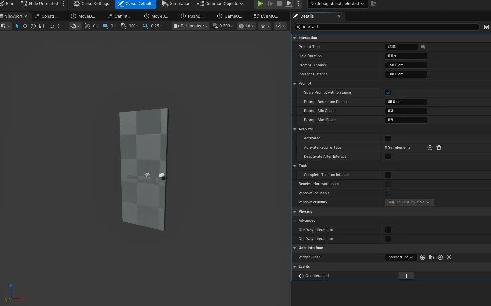
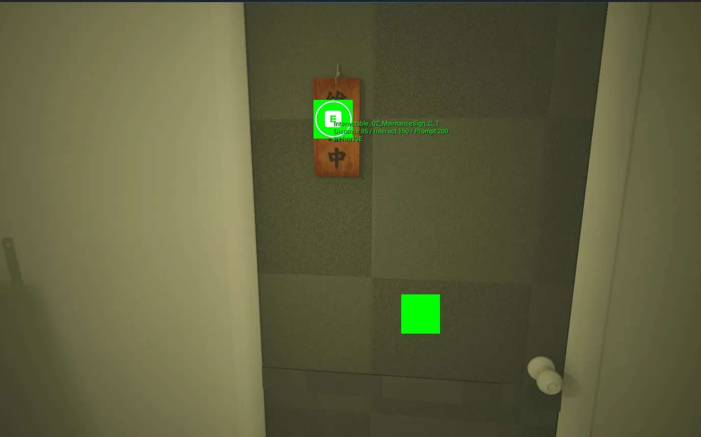
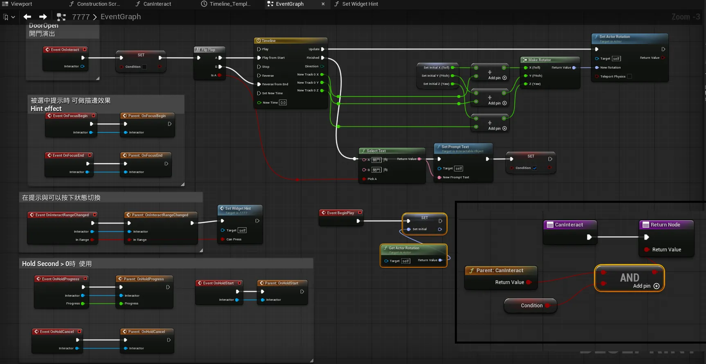
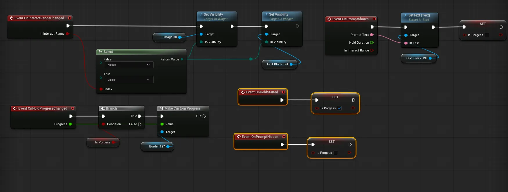
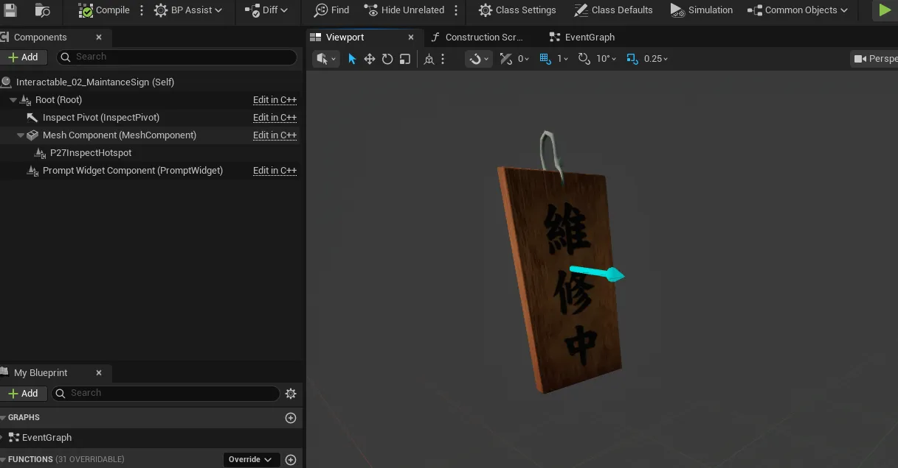
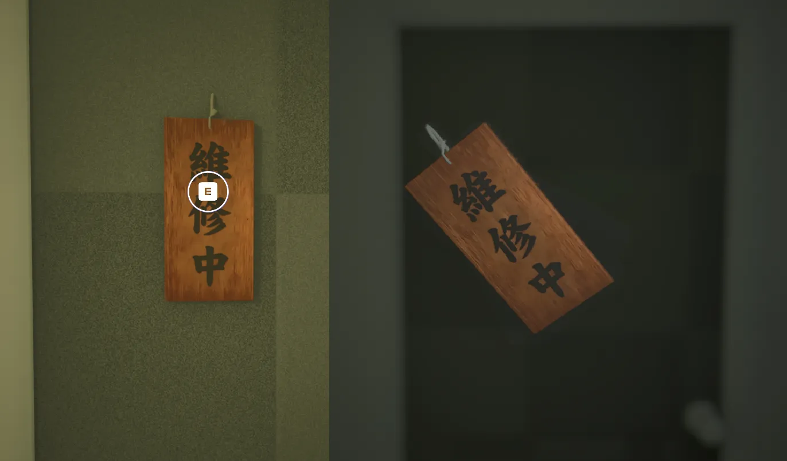
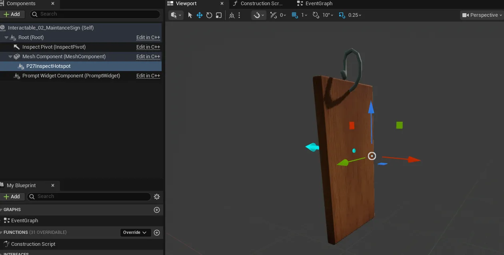

> 兩個掛在玩家身上的元件（`Interactor`、`Inspector`），加上可互動物件、可檢視物件與檢視熱點三個類別，做出第一人稱遊戲的「互動 → 拿起檢視 → 翻面觸發熱點 → 閱讀文字」流程。
> 文中的 `P27` 前綴是示範專案的命名，`P27_API` 請換成自己模組的名稱；文末附完整程式碼。
> ⚠️ 以下內容是在 **UE 5.8**（First Person 範本）上實作與驗證的，其他版本的引擎行為可能有改變。

> 🚧 **TODO（草稿標記）**：文中以「🚧 TODO」開頭的區塊是待補的截圖、影片與藍圖演出，補上後刪除該區塊即可。

---

## 問題

第一人稱的恐怖、解謎遊戲裡，「互動」幾乎是玩家唯一的操作。常見的需求有：

| 需求 | 常見做法的問題 | 本文的做法 |
|---|---|---|
| 看著物件時出現提示，按鍵互動 | 從鏡頭打一條 Line Trace：細小物件很難瞄準，物件需要開碰撞 | 物件註冊到 Subsystem，以「視線夾角」挑最正對的一個，再用 Trace 檢查遮擋 |
| 提示在兩個物件之間、或物件邊緣閃爍 | 每幀重新選目標，數值剛好在門檻上就來回切換 | 角度、距離、遮擋都加**遲滯（Hysteresis）** |
| 遠處看到提示、走近才能按 | 只有一個距離門檻 | `PromptDistance` / `InteractDistance` 兩段距離 |
| 有些互動要「按住」（開抽屜、撬鎖） | 要另外做計時與 UI | 內建 `HoldDuration` 與進度事件 |
| 拿起信件、照片轉著看，翻到背面找線索 | 做成另一個 Actor 或另開一個關卡 | 把**物件本身**飛到鏡頭前，視角輸入改成旋轉物件；用**熱點**元件標記「轉到這一面才能操作」的位置 |

設計目標：

- **企劃可以只用藍圖做演出**：所有時間點（鎖定、開始按住、互動完成、檢視開始、熱點觸發）都是 `BlueprintNativeEvent` 或 `BlueprintImplementableEvent`，C++ 只負責判定與狀態。
- **UI 跟邏輯分開**：C++ 不碰任何 Widget 的內容，只呼叫事件；提示長什麼樣、怎麼動畫都在 UMG 裡做。
- **物件不需要碰撞**：可互動物件的 Mesh 預設 `NoCollision`，不會因為「為了被瞄準」而擋住玩家或影響物理。

---

## 效果展示

<div align="center">
<video src="./demo_interact.mp4" controls autoplay muted loop playsinline width="800">
</video>
<br><em>走近物件時出現提示，進入可按範圍後按下互動鍵觸發演出</em>
</div>

> 🎬 影片無法播放時：[下載 demo_interact.mp4](./demo_interact.mp4)

<div align="center">
<video src="./demo_inspect.mp4" controls autoplay muted loop playsinline width="800">
</video>
<br><em>互動後物件飛到鏡頭前，背景變暗模糊；滑鼠旋轉物件，關閉後飛回原處</em>
</div>

> 🎬 影片無法播放時：[下載 demo_inspect.mp4](./demo_inspect.mp4)

---

## 架構

| 類別 | 類型 | 掛在哪 | 負責什麼 |
|---|---|---|---|
| `UP27InteractionSubsystem` | `UWorldSubsystem` | 自動建立 | 收集場上所有可互動物件 |
| `AInteractableObject` | `AActor` | 放在關卡 | 互動參數、提示 Widget、演出事件 |
| `UP27InteractPromptWidget` | `UUserWidget`（Abstract） | 物件的 `PromptWidget` | 互動提示 UI 的事件介面 |
| `UP27InteractorComponent` | `UActorComponent` | 玩家 | 每幀選出鎖定對象、處理按下／按住 |
| `AP27InspectableObject` | 繼承 `AInteractableObject` | 放在關卡 | 互動完成後進入檢視；檢視參數與閱讀文字 |
| `UP27InspectHotspotComponent` | `UWidgetComponent` | 可檢視物件 | 標記檢視中可操作的位置 |
| `UP27InspectorComponent` | `UActorComponent` | 玩家 | 檢視的狀態機、物件擺放與旋轉、背景效果、熱點選擇 |
| `UP27InspectWidget` | `UUserWidget`（Abstract） | 由 Inspector 建立 | 檢視時的畫面 UI（按鍵提示、閱讀文字） |
| `UP27InspectCameraModifier` | `UCameraModifier` | 由 Inspector 加入 | 檢視時的景深、暗角、曝光 |

---

## 一、可互動物件與鎖定邏輯

### 不用碰撞，用 Subsystem 收集

物件在 `BeginPlay` 把自己註冊到 `UP27InteractionSubsystem`，`EndPlay` 時移除。Subsystem 只是一個 `TArray<TWeakObjectPtr<AInteractableObject>>`：

```cpp
void AInteractableObject::BeginPlay()
{
    Super::BeginPlay();
    if (UP27InteractionSubsystem* Subsystem = GetWorld()->GetSubsystem<UP27InteractionSubsystem>())
    {
        Subsystem->RegisterInteractable(this);
    }
    HidePrompt();
}
```

`DoesSupportWorldType` 只回傳 `Game` / `PIE`，編輯器視窗裡不會建立。

**為什麼不用 Line Trace 選目標？** 第一人稱遊戲的可互動物件常常很小（鑰匙、紙條、開關），用一條線去「打中」它，玩家要瞄得很準；而且物件必須開碰撞才打得到。這裡改成「**哪個物件離準心最近（夾角最小）**」，Trace 只拿來檢查有沒有被牆擋住。

### 兩段距離

| 參數 | 預設 | 說明 |
|---|---|---|
| `PromptDistance` | 400 cm | 進入此距離（且在視角內、無遮擋）就鎖定並顯示提示 |
| `InteractDistance` | 200 cm | 進入此距離才能按 |

`GetPromptDistance()` 回傳兩者的較大值，避免設定錯誤時出現「能按但看不到提示」。距離量的是**攝影機**到 `GetInteractLocation()` 的 3D 距離，而不是角色到物件——第一人稱下玩家感受到的距離就是眼睛到物件的距離。

`GetInteractLocation()` 預設回傳提示 Widget 的位置，是 `BlueprintNativeEvent`，可在藍圖覆寫（例如門的互動點想放在門把上，但提示想顯示在門框旁）。



### 選出鎖定對象

`UP27InteractorComponent` 掛在玩家身上，每幀做一次選擇：

```cpp
void UP27InteractorComponent::TickComponent(float DeltaTime, ...)
{
    FVector ViewLocation, ViewDirection;
    float FocusDistance = 0.0f;
    AInteractableObject* Interactable = GetViewPoint(ViewLocation, ViewDirection)
        ? SelectFocus(ViewLocation, ViewDirection, DeltaTime, FocusDistance)
        : nullptr;
    const bool bInRange = Interactable && IsWithinInteractRange(Interactable, FocusDistance);
    SetFocusedInteractable(Interactable, bInRange);
    // ……提示縮放、可按範圍變化、按住進度
}
```

視點用 `Controller->GetPlayerViewPoint()`，Tick Group 設成 `TG_PostUpdateWork`，確保拿到的是這一幀相機更新後的位置。正在 Inspect 時 `GetViewPoint` 直接回傳 false，等於暫停偵測。

**單一候選物件的判定**（`EvaluateCandidate`）依序檢查，便宜的先做：

1. `CanInteract()`：物件目前是否可互動
2. 距離 ≤ `GetPromptDistance()`
3. 視線方向與「鏡頭 → 物件」的夾角 ≤ 角度上限

```cpp
const FVector ToTarget = Interactable->GetInteractLocation() - ViewLocation;
const float Distance = ToTarget.Size();
if (Distance <= KINDA_SMALL_NUMBER || Distance > Interactable->GetPromptDistance())
{
    return false;
}
const float Dot = FMath::Clamp(FVector::DotProduct(ToTarget / Distance, ViewDirection), -1.0f, 1.0f);
const float Angle = FMath::RadiansToDegrees(FMath::Acos(Dot));
if (Angle > AngleLimit)
{
    return false;
}
```

**在所有物件中挑最好的**（`FindBestInteractable`）時，有一個小技巧：把「目前最佳的角度」當成下一個候選的角度上限傳進去。後面的物件只要不比目前最好的更正對，就在角度檢查被刷掉，不需要再打遮擋 Trace：

```cpp
AInteractableObject* BestInteractable = nullptr;
float BestAngle = MaxViewAngle;
for (const TWeakObjectPtr<AInteractableObject>& Entry : Subsystem->GetInteractables())
{
    AInteractableObject* Interactable = Entry.Get();
    if (!Interactable || Interactable == Exclude) continue;

    float Angle, Distance;
    if (!EvaluateCandidate(Interactable, ViewLocation, ViewDirection, BestAngle, Angle, Distance)) continue;
    if (!HasLineOfSight(ViewLocation, Interactable)) continue;   // Trace 只打真正可能勝出的

    BestInteractable = Interactable;
    BestAngle = Angle;   // 下一個候選要比這個更正對
}
```

**遮擋檢查**（`HasLineOfSight`）從鏡頭往物件打一條 Trace，有兩個細節：

- Trace 在目標前 `LineOfSightTolerance`（預設 10 cm）就停止。互動點常常貼在物件表面或桌面上，打到底容易擦到桌面而誤判為被擋。
- 打到的 Actor 如果是物件本身，**或是 Attach 在物件上的 Actor**，都算看得到。

```cpp
const bool bVisible = !bHit || HitActor == Interactable || (HitActor && HitActor->IsAttachedTo(Interactable));
```

### 穩定性：讓提示不閃爍

只用上面的規則，玩家的準心剛好停在門檻附近時，鎖定會一幀有、一幀沒有；兩個物件靠在一起時，提示會在兩者之間跳。解法是對每個門檻都加**遲滯**——進入跟離開用不同的值：

| 參數 | 預設 | 作用 |
|---|---|---|
| `MaxViewAngle` | 25° | 新物件要在此角度內才會被鎖定 |
| `FocusKeepAngleMargin` | 5° | 已鎖定的物件放寬到 `MaxViewAngle + 5°` 才失去鎖定 |
| `SwitchAngleMargin` | 3° | 其他物件要比目前鎖定的**更正對 3° 以上**才切換 |
| `FocusLoseDelay` | 0.2 s | 已鎖定的物件被遮擋要持續 0.2 秒才放掉（人物、門板短暫擋住時不會閃） |
| `RangeExitMargin` | 10 cm | 已在可按範圍內時，要超過 `InteractDistance + 10` 才算離開 |

`SelectFocus` 先用放寬的條件評估目前的鎖定對象，再從其他物件找最佳者，只有在「目前的已經不能保留」或「新的明顯更好」時才換：

```cpp
if (CurrentFocus && EvaluateCandidate(CurrentFocus, ..., MaxViewAngle + FocusKeepAngleMargin, CurrentAngle, CurrentDistance))
{
    if (HasLineOfSight(ViewLocation, CurrentFocus))
    {
        LostSightTime = 0.0f;
        bKeepCurrent = true;
    }
    else
    {
        LostSightTime += DeltaTime;
        bKeepCurrent = LostSightTime < FocusLoseDelay;
    }
}

AInteractableObject* BestInteractable = FindBestInteractable(ViewLocation, ViewDirection, CurrentFocus, BestAngle, BestDistance);

if (bKeepCurrent && !(BestInteractable && BestAngle + SwitchAngleMargin < CurrentAngle))
{
    return CurrentFocus;
}
return BestInteractable;
```

注意 `FindBestInteractable` 會排除目前的鎖定對象（`Exclude`），所以不會出現「自己跟自己比」的情況。



### 按一下與按住

輸入綁定在玩家角色上，`Started` 開始、`Completed` / `Canceled` 結束：

```cpp
EnhancedInputComponent->BindAction(InteractAction, ETriggerEvent::Started,   this, &ThisClass::DoInteractStart);
EnhancedInputComponent->BindAction(InteractAction, ETriggerEvent::Completed, this, &ThisClass::DoInteractEnd);
EnhancedInputComponent->BindAction(InteractAction, ETriggerEvent::Canceled,  this, &ThisClass::DoInteractEnd);
```

`StartInteract` 只在「有鎖定對象、且在可按範圍內」時有效。`HoldDuration` 為 0 直接完成；否則進入按住狀態，由 Tick 累加時間：

```cpp
if (!bIsHolding) return;

if (!Interactable || !bInRange)
{
    CancelHold();     // 轉開視角、走出範圍
    return;
}

HoldElapsed += DeltaTime;
const float Progress = FMath::Clamp(HoldElapsed / Interactable->GetHoldDuration(), 0.0f, 1.0f);
Interactable->UpdateHoldProgress(GetOwner(), Progress);
if (Progress >= 1.0f)
{
    CompleteInteract();
}
```

按住會在以下情況取消：放開按鍵、離開 `InteractDistance`、失去鎖定或換了鎖定對象（`SetFocusedInteractable` 換目標前一定先 `CancelHold`）。取消時進度會先歸零再送出取消事件，UI 只要照著 `Progress` 畫就不會殘留。

### 演出事件

`AInteractableObject` 不做任何演出，只在對的時間點呼叫事件。全部都是 `BlueprintNativeEvent`，藍圖子類別直接覆寫：

| 事件 | 觸發時機 |
|---|---|
| `OnFocusBegin` | 開始鎖定（提示已顯示） |
| `OnFocusEnd` | 失去鎖定（離開範圍、轉開、被擋、被停用；提示已隱藏） |
| `OnInteractRangeChanged(bInRange)` | 鎖定期間進出 `InteractDistance`；開始鎖定時也會送一次初始狀態 |
| `OnHoldStart` | 開始按住（`HoldDuration` 為 0 時不觸發） |
| `OnHoldProgress(Progress)` | 按住期間每幀，0～1；開始、取消、完成後各送一次 0 |
| `OnHoldCancel` | 按住途中中斷，進度已歸零 |
| `OnInteract` | 互動完成 |

外部 Actor 想知道「這個物件被互動了」可以綁 `OnInteracted` delegate。

`Interact()` 本身是 `virtual`，子類別（例如下面的 `AP27InspectableObject`）可以在 C++ 擴充互動完成後的行為。另外有 `bDeactivateAfterInteract`：互動完成後自動 `SetActivate(false)`，且在 `OnInteract` **之前**生效，所以藍圖在 `OnInteract` 裡可以再把它打開（例如「開關」類物件）。

`CanInteract()` 也是 `BlueprintNativeEvent`，預設回傳 `bActivated`。演出播放中不想被重複觸發時，覆寫成回傳 false 即可——Interactor 下一幀就會放掉鎖定並觸發 `OnFocusEnd`，提示自然消失。



<div align="center">
<video src="./demo_interact_fx.mp4" controls autoplay muted loop playsinline width="800">
</video>
<br><em>上面藍圖的實際效果：開門、關門，演出途中提示消失</em>
</div>

> 🎬 影片無法播放時：[下載 demo_interact_fx.mp4](./demo_interact_fx.mp4)

---

## 二、互動提示窗口

### 提示是物件上的 WidgetComponent

每個可互動物件都有一個 `PromptWidget`（`UWidgetComponent`），建構子裡設定好：

```cpp
PromptWidgetComponent->SetWidgetSpace(EWidgetSpace::Screen);   // 永遠面向畫面、不受光照
PromptWidgetComponent->SetDrawAtDesiredSize(true);            // 大小由 Widget 自己決定
PromptWidgetComponent->SetCollisionEnabled(ECollisionEnabled::NoCollision);
PromptWidgetComponent->SetHiddenInGame(true);                 // 鎖定時才顯示
```

在藍圖裡把 `PromptWidget` 拖到想顯示提示的位置，Widget Class 指定一個繼承 `UP27InteractPromptWidget` 的 UMG 即可。因為 `GetInteractLocation()` 預設就是這個元件的位置，**提示放在哪，距離與遮擋就從哪裡算**，美術擺位置時所見即所得。

### UI 只接事件

`UP27InteractPromptWidget` 是 `Abstract` 類別，只宣告事件，不做任何 UI：

| 事件 | 參數 | 觸發時機 |
|---|---|---|
| `OnPromptShown` | 提示文字、`HoldDuration`、是否在可按範圍內 | 開始鎖定，或鎖定中呼叫 `SetPromptText` |
| `OnInteractRangeChanged` | 是否在可按範圍內 | 鎖定期間狀態改變；**每次顯示時也會呼叫一次** |
| `OnHoldStarted` | — | 開始按住 |
| `OnHoldProgressChanged` | 0～1 | 按住期間每幀 |
| `OnHoldCanceled` | — | 按住中斷 |
| `OnPromptHidden` | — | 失去鎖定 |

另外有 `OwningInteractable` 屬性，Widget 需要讀物件的其他資訊時可以直接拿。

`OnInteractRangeChanged` 在顯示時也送一次，是刻意的：UI 只要接這一個事件就能拿到正確的「可按／不可按」狀態，不需要在 `OnPromptShown` 再處理一次。常見的做法是：

- **不可按（PROMPT ONLY）**：只顯示一個小圓點或淡化的圖示，提示玩家「那裡有東西」。
- **可按（IN RANGE）**：展開成按鍵圖示 + 文字（「打開」「拿起」）。
- **有 HoldDuration**：按鍵圖示外圈畫一個圓形進度條，用 `OnHoldProgressChanged` 的值驅動材質參數。



<div align="center">
<video src="./demo_prompt.mp4" controls autoplay muted loop playsinline width="800">
</video>
<br><em>提示在「看得到」與「可以按」兩種狀態之間切換，並隨距離縮放</em>
</div>

> 🎬 影片無法播放時：[下載 demo_prompt.mp4](./demo_prompt.mp4)

### Screen Space 的透視縮放

Screen Space 的 Widget 不管距離多遠，在畫面上都一樣大。對第一人稱來說，遠處的小物件旁邊浮著一個跟近處一樣大的提示，會很突兀。

這裡讓 Interactor 在鎖定期間每幀呼叫 `UpdatePromptScale`，依「鏡頭到提示的距離」縮放 Widget：

$$
\text{Scale} = \text{clamp}\left(\frac{\text{PromptReferenceDistance}}{\text{Distance}},\ \text{PromptMinScale},\ \text{PromptMaxScale}\right)
$$

```cpp
const float Distance = FVector::Distance(ViewLocation, PromptWidgetComponent->GetComponentLocation());
const float Scale = FMath::Clamp(PromptReferenceDistance / Distance, MinScale, MaxScale);
PromptWidget->SetRenderScale(FVector2D(Scale, Scale));
```

透視投影下，物件在畫面上的大小與距離成反比，所以 `參考距離 / 距離` 就讓提示跟物件以相同比例縮放。`PromptReferenceDistance`（預設 150 cm）是「提示為原始大小」的距離；上下限避免遠處小到看不見、貼近時大到擋住畫面。

| 參數 | 預設 | 說明 |
|---|---|---|
| `bScalePromptWithDistance` | true | 是否啟用距離縮放 |
| `PromptReferenceDistance` | 150 cm | 此距離時 Scale = 1 |
| `PromptMinScale` | 0.3 | 縮放下限 |
| `PromptMaxScale` | 1.5 | 縮放上限 |

⚠️ 這會覆蓋 Widget **根節點**的 RenderTransform Scale。提示的彈出、呼吸等動畫請做在子元件上，否則會被每幀蓋掉。

### HUD 也可以知道目前鎖定了什麼

如果想在畫面中央的準心上做變化（例如鎖定時準心變成手的圖示），可以綁 Interactor 的 delegate：

```cpp
UPROPERTY(BlueprintAssignable, Category="Interaction")
FP27OnFocusedInteractableChanged OnFocusedInteractableChanged;   // (NewFocus, bInInteractRange)
```

鎖定對象改變、或可按狀態改變時都會廣播；`NewFocus` 為 null 表示沒有鎖定。

---

## 三、Inspect：把物件拿到眼前

### 從互動銜接到檢視

`AP27InspectableObject` 繼承 `AInteractableObject`，只覆寫 `Interact`：互動完成後，找到互動者身上的 `UP27InspectorComponent` 開始檢視。

```cpp
void AP27InspectableObject::Interact(AActor* Interactor)
{
    Super::Interact(Interactor);   // 原本的事件、delegate 照常觸發

    if (const AP27PlayerCharacter* Player = Cast<AP27PlayerCharacter>(Interactor))
    {
        if (UP27InspectorComponent* Inspector = Player->GetInspectorComponent())
        {
            Inspector->BeginInspect(this);
        }
    }
}
```

因為是同一套互動流程，可檢視物件一樣有提示、可以設 `HoldDuration`、可以用 `CanInteract` 控制何時能拿起。

### 狀態機

Inspector 有四個狀態：`Inactive`（未檢視）→ `Entering`（飛向鏡頭）→ `Inspecting`（檢視中）→ `Exiting`（飛回原處）→ `Inactive`。`EndAction` 為 `Collect` 時不經過 `Exiting`，關閉當下直接回到 `Inactive`。

`IsInspecting()` 在 `Inactive` 以外都是 true。玩家角色依此改變輸入的意義：

```cpp
void AP27PlayerCharacter::DoMove(float Right, float Forward)
{
    if (InspectorComponent->IsInspecting()) return;          // 檢視中不能移動
    Super::DoMove(Right, Forward);
}

void AP27PlayerCharacter::DoAim(float Yaw, float Pitch)
{
    if (InspectorComponent->IsInspecting())
    {
        InspectorComponent->AddRotationInput(Yaw, Pitch);    // 視角輸入改成轉物件
        return;
    }
    Super::DoAim(Yaw, Pitch);
}

void AP27PlayerCharacter::DoInteractStart()
{
    if (InspectorComponent->IsInspecting())
    {
        InspectorComponent->ActivateFocusedHotspot();        // 互動鍵改成觸發熱點
        return;
    }
    InteractorComponent->StartInteract();
}
```

另外兩個 Input Action：`InspectCloseAction` 關閉檢視、`InspectReadAction` 切換閱讀模式。不用切換 Input Mapping Context，所有分流都在角色的輸入函式裡完成。

### 物件擺在哪：InspectPivot

不同物件的原點位置不一樣（有的在底部、有的在角落），直接把 Actor 原點擺到鏡頭前，物件常常會偏掉。所以可檢視物件多了一個 `InspectPivot`（`UArrowComponent`）：

- **位置**：檢視時放在鏡頭正前方 `InspectDistance` 的點，也是旋轉中心。
- **箭頭方向（X 軸）**：預設朝向玩家，也就是「物件的正面」。
- `InspectRotation` 可以在此基礎上再加旋轉（例如信件要稍微往後仰）。



`BeginInspect` 時記下 Pivot 相對於 Actor 的 Transform，以及「物件在鏡頭空間中的旋轉」：

```cpp
OriginTransform = Object->GetActorTransform();
PivotRelativeTransform = Object->GetInspectPivot()->GetComponentTransform().GetRelativeTransform(OriginTransform);
ViewLocalRotation = FQuat(FRotator(0.0f, 180.0f, 0.0f)) * FQuat(Object->GetInspectRotation());
```

`ViewLocalRotation` 前面乘的 180° Yaw，就是讓箭頭從「朝鏡頭前方」轉成「朝向鏡頭」。

每幀從鏡頭位置算出 Pivot 應該在的 World Transform，再反推 Actor 的 Transform：

```cpp
FTransform UP27InspectorComponent::ComputeInspectTransform(const FVector& CameraLocation, const FQuat& CameraRotation) const
{
    const FVector PivotLocation = CameraLocation + CameraRotation.GetForwardVector() * InspectedObject->GetInspectDistance();
    const FQuat PivotRotation = CameraRotation * ViewLocalRotation;
    const FTransform PivotWorld(PivotRotation, PivotLocation, PivotRelativeTransform.GetScale3D() * OriginTransform.GetScale3D());
    return PivotRelativeTransform.Inverse() * PivotWorld;
}
```

$$
T_{actor} = T_{pivot\_relative}^{-1} \cdot T_{pivot\_world}
$$

因為是每幀依鏡頭重算，鏡頭有晃動（Camera Shake、呼吸）時物件會跟著一起動，不會脫離畫面。

### 飛入與飛回

`Entering` 與 `Exiting` 用 `FTransform::Blend` 在原位置與目標位置之間插值，曲線用 `InterpEaseInOut`：

```cpp
case EP27InspectState::Entering:
{
    TransitionElapsed += DeltaTime;
    const float Alpha = Duration > 0.0f ? FMath::Clamp(TransitionElapsed / Duration, 0.0f, 1.0f) : 1.0f;
    FTransform Blended;
    Blended.Blend(OriginTransform, ComputeInspectTransform(CameraLocation, CameraRotation),
                  FMath::InterpEaseInOut(0.0f, 1.0f, Alpha, 2.0f));
    InspectedObject->SetActorTransform(Blended);
    if (Alpha >= 1.0f)
    {
        State = EP27InspectState::Inspecting;
    }
    break;
}
```

飛入的終點每幀都重新計算，所以就算飛入途中鏡頭還在動，最後也會準確停在鏡頭前。飛回時則是從「關閉當下的位置」（`ExitStartTransform`）飛回 `OriginTransform`。

檢視期間物件的碰撞會關閉，結束時還原成原本的設定——物件飛到鏡頭前時，不會把玩家的膠囊體推開。

### 旋轉物件：在鏡頭空間疊加四元數

視角輸入轉成「繞鏡頭的上軸（Yaw）與右軸（Pitch）」的旋轉，**左乘**到 `ViewLocalRotation` 上：

```cpp
void UP27InspectorComponent::AddRotationInput(float Yaw, float Pitch)
{
    if (State != EP27InspectState::Inspecting || bIsReading) return;

    const float YawDegrees   = -Yaw  * RotateSpeed * (bInvertYaw   ? -1.0f : 1.0f);
    const float PitchDegrees =  Pitch * RotateSpeed * (bInvertPitch ? -1.0f : 1.0f);
    const FQuat YawDelta  (FVector::UpVector,    FMath::DegreesToRadians(YawDegrees));
    const FQuat PitchDelta(FVector::RightVector, FMath::DegreesToRadians(PitchDegrees));
    ViewLocalRotation = (YawDelta * PitchDelta * ViewLocalRotation).GetNormalized();
}
```

**為什麼左乘？** `ViewLocalRotation` 是物件在鏡頭空間中的旋轉。左乘代表「在鏡頭的座標軸上」旋轉，右乘則是「在物件自己的座標軸上」旋轉。

- 右乘：物件翻到側面後，「往上推滑鼠」會變成繞物件自己傾斜後的軸轉，方向跟玩家預期不一樣。
- 左乘：不管物件已經轉成什麼角度，滑鼠往上就是往上翻、往左就是往左轉，像用手抓著物件轉。

用四元數累積也避免了 Euler 角在 Pitch 接近 ±90° 時的萬向鎖。每次乘完 `GetNormalized()`，防止浮點誤差累積讓物件慢慢變形。

### 背景：Camera Modifier 疊後製

檢視時背景要模糊、變暗，讓視線集中在物件上。這裡沒有在場景裡放 Post Process Volume，而是用一個自訂的 `UCameraModifier`：

```cpp
void UP27InspectCameraModifier::ModifyPostProcess(float DeltaTime, float& PostProcessBlendWeight, FPostProcessSettings& PostProcessSettings)
{
    PostProcessBlendWeight = Alpha;               // Camera Modifier 內建的淡入淡出
    PostProcessSettings = InspectPostProcessSettings;
}
```

`BeginInspect` 時設定好參數並 `EnableModifier()`，結束時 `DisableModifier(false)`（不立即移除，讓它淡出）：

```cpp
FPostProcessSettings Settings;
Settings.bOverride_DepthOfFieldFocalDistance = true;
Settings.DepthOfFieldFocalDistance = FocalDistance;     // = 物件的 InspectDistance
Settings.bOverride_DepthOfFieldFstop = true;
Settings.DepthOfFieldFstop = BackgroundFstop;
Settings.bOverride_DepthOfFieldMinFstop = true;
Settings.DepthOfFieldMinFstop = 0.0f;
Settings.bOverride_VignetteIntensity = true;
Settings.VignetteIntensity = VignetteIntensity;
Settings.bOverride_AutoExposureBias = true;
Settings.AutoExposureBias = ExposureBias;
```

選 Camera Modifier 的好處：

- **淡入淡出免費**：`AlphaInTime` / `AlphaOutTime` 由引擎處理。
- **不管目前的 View Target 是誰都有效**：玩家坐在椅子上、鏡頭切到其他 Camera Actor 時，後製一樣會套用。
- **對焦距離精準**：直接用物件的 `InspectDistance`，物件清楚、背景全糊。

曝光補償調暗整個畫面後，物件也會跟著變暗，所以另外加了一盞**跟著鏡頭的補光**（`UPointLightComponent`，不投影、範圍只有 100 cm），用同樣的時間淡入淡出：

```cpp
InspectLight->SetIntensity(InspectLightIntensity * LightAlpha);
InspectLight->SetWorldLocation(CameraLocation + CameraRotation.RotateVector(InspectLightOffset));
```

| 參數 | 預設 | 說明 |
|---|---|---|
| `BackgroundFstop` | 0.5 | 光圈值，越小背景越糊 |
| `VignetteIntensity` | 0.8 | 暗角強度 |
| `ExposureBias` | -1 | 曝光補償，負值變暗 |
| `BackgroundBlendTime` | 0.3 s | 背景與補光的淡入淡出時間 |
| `InspectLightIntensity` | 5 cd | 補光強度 |
| `InspectLightRadius` | 100 cm | 補光範圍，太大會照亮周圍牆面 |
| `InspectLightOffset` | (0, 20, 15) | 補光相對鏡頭的位置（前、右、上） |



### 結束：飛回或收走

`EndAction` 決定關閉檢視後的行為：

| EndAction | 行為 | 適合 |
|---|---|---|
| `ReturnToOrigin` | 飛回原處、還原碰撞，結束時觸發 `OnInspectEnd(false)` | 看完放回去的東西（照片、擺飾） |
| `Collect` | 立即隱藏、關碰撞、`SetActivate(false)`，觸發 `OnInspectEnd(true)` | 撿起來的道具（鑰匙、紙條） |

外部可以綁 `OnInspectEnded(InspectedObject, bCollected)`，例如收走鑰匙後把門解鎖。

### 閱讀模式

信件、筆記這類物件，玩家需要看清楚上面的字。可檢視物件有一個 `ReadText`（多行文字），非空時就能用 `InspectReadAction` 切換閱讀模式：UI 顯示大字的文字內容，此時物件不能旋轉、熱點也會隱藏。

閱讀狀態有一個容易出錯的地方：企劃常常想在 `OnInspectBegin` 裡直接打開閱讀（拿起信就直接看內容），但這時物件還在飛入。如果立刻進入閱讀，文字會蓋在飛行中的物件上。所以 `SetReading(true)` 在 `Entering` 期間只記下「待辦」，飛到定位後才真正進入：

```cpp
void UP27InspectorComponent::SetReading(bool bNewReading)
{
    if (!bNewReading)
    {
        bPendingReading = false;
    }
    else if (State == EP27InspectState::Entering)
    {
        bPendingReading = InspectedObject && InspectedObject->HasReadText();
        return;   // 飛到定位後在 Tick 裡再呼叫一次 SetReading(true)
    }
    // ……
}
```

`ReadText` 也可以在檢視中用 `SetReadText` 更換（例如翻到背面才出現的字），Widget 會收到 `OnReadTextChanged`；正在閱讀中則直接更新內容，清空時自動離開閱讀。

### 檢視 UI

`UP27InspectorComponent` 的 `InspectWidgetClass` 指定一個繼承 `UP27InspectWidget` 的 UMG，檢視開始時建立並加到 Viewport，結束時移除：

| 事件 | 觸發時機 | 常見用途 |
|---|---|---|
| `OnInspectStarted(Object, bCanRead)` | 開始檢視 | 顯示「旋轉／關閉」按鍵提示；`bCanRead` 決定是否顯示「閱讀」 |
| `OnInspectEnded` | 結束檢視（之後 Widget 被移除） | 淡出動畫 |
| `OnHotspotChanged(bHasHotspot, PromptText)` | 目前可操作的熱點改變 | 畫面下方顯示「[E] 翻面」 |
| `OnReadTextChanged(bCanRead)` | 閱讀文字被設定或清空 | 顯示／隱藏「閱讀」提示 |
| `OnReadingChanged(bReading, ReadText)` | 進入或離開閱讀，或閱讀中文字更新 | 顯示大字內文 |

---

## 四、檢視熱點（Inspect Hotspot）

### 「轉到這一面才看得到」

熱點是加在可檢視物件上的 `UP27InspectHotspotComponent`（繼承 `UWidgetComponent`），用來標記「檢視中可以操作的位置」——信封的封口、照片的背面、盒子的夾層。

判斷熱點是否出現，只看一件事：**熱點的 X 軸（正面）有沒有朝向鏡頭**。

```cpp
bool UP27InspectHotspotComponent::GetFacingDot(const FVector& ViewLocation, float& OutDot) const
{
    const FVector ToView = (ViewLocation - GetComponentLocation()).GetSafeNormal();
    OutDot = FVector::DotProduct(GetForwardVector(), ToView);
    return OutDot >= FMath::Cos(FMath::DegreesToRadians(FacingAngle));
}
```

把熱點擺在物件背面、X 軸朝外，玩家就必須把物件翻過來才看得到它。`FacingAngle`（預設 60°）決定要多正對才出現。



### 選擇與顯示

只在 `Inspecting` 且不在閱讀中時，每幀找出所有啟用中、朝向鏡頭的熱點，取最正對（Dot 最大）的一個：

```cpp
void UP27InspectorComponent::UpdateHotspots(const FVector& CameraLocation)
{
    TInlineComponentArray<UP27InspectHotspotComponent*> Hotspots;
    InspectedObject->GetComponents(Hotspots);

    UP27InspectHotspotComponent* BestHotspot = nullptr;
    float BestDot = -1.0f;
    for (UP27InspectHotspotComponent* Hotspot : Hotspots)
    {
        float Dot = 0.0f;
        if (Hotspot && Hotspot->IsHotspotEnabled() && Hotspot->GetFacingDot(CameraLocation, Dot) && Dot > BestDot)
        {
            BestHotspot = Hotspot;
            BestDot = Dot;
        }
    }
    SetFocusedHotspot(BestHotspot);
}
```

同一時間只會有一個熱點可以操作，互動鍵永遠對應畫面上唯一亮起的那個。

熱點的 Widget Class **可以直接沿用互動提示的 `UP27InteractPromptWidget`**：顯示時以 `OnPromptShown(PromptText, 0, true)` 呼叫，等於「不需按住、已在範圍內」的提示。整個遊戲的互動提示風格就自然統一了。

### 觸發順序

檢視中按下互動鍵，`ActivateFocusedHotspot` 依序執行：

1. 熱點 `Trigger()`：若 `bDisableAfterActivate`，先停用自己；廣播熱點的 `OnHotspotActivated`
2. 物件的 `OnHotspotActivated(Hotspot)`：藍圖在這裡做演出（翻面動畫、取出夾層）
3. 熱點的 `ReadTextOnActivate` 非空 → `SetReadText` 換成這段文字
4. 熱點的 `bStartReadingOnActivate` → 進入閱讀模式

```cpp
bool UP27InspectorComponent::ActivateFocusedHotspot()
{
    UP27InspectHotspotComponent* Hotspot = FocusedHotspot.Get();
    if (State != EP27InspectState::Inspecting || bIsReading || !Hotspot || !InspectedObject)
    {
        return false;
    }
    Hotspot->Trigger();
    InspectedObject->NotifyHotspotActivated(Hotspot);

    if (InspectedObject && !Hotspot->GetReadTextOnActivate().IsEmptyOrWhitespace())
    {
        InspectedObject->SetReadText(Hotspot->GetReadTextOnActivate());
    }
    if (Hotspot->ShouldStartReadingOnActivate())
    {
        SetReading(true);
    }
    return true;
}
```

順序的考量：藍圖的 `OnHotspotActivated` 在**換文字之前**執行，所以藍圖也可以自己呼叫 `SetReadText`；熱點上的 `ReadTextOnActivate` 留空就不會覆蓋。簡單的「翻到背面 → 讀背面的字」完全不用寫藍圖，只要在熱點上填文字、勾 `bStartReadingOnActivate`。

| 參數 | 預設 | 說明 |
|---|---|---|
| `PromptText` | — | 熱點提示文字，例如「翻面」「取出」 |
| `FacingAngle` | 60° | 熱點正面與鏡頭方向的夾角在此內才出現 |
| `bHotspotEnabled` | true | 是否啟用，可用 `SetHotspotEnabled` 切換 |
| `bDisableAfterActivate` | false | 觸發一次後自動停用 |
| `bStartReadingOnActivate` | false | 觸發後自動進入閱讀 |
| `ReadTextOnActivate` | — | 觸發後把物件的閱讀文字換成這段 |

### 範例：信封

> 🚧 **TODO（藍圖）**：信封範例的藍圖——正面熱點「打開」觸發後播放打開封口的動畫、啟用信紙上的第二個熱點「取出」；取出後 `bStartReadingOnActivate` 直接進入閱讀。建議檔名 `bp_hotspot_letter.jpg`。

> 🚧 **TODO（影片）**：信封範例的完整操作。建議檔名 `demo_hotspot.mp4`。

---

## 設計取捨與踩過的坑

| 決策 | 原因 |
|---|---|
| 用夾角而不是 Line Trace 選目標 | 小物件好瞄準、物件不需要碰撞；Trace 只負責遮擋 |
| 最佳角度當作下一個候選的上限 | 角度檢查比 Trace 便宜，只對可能勝出的物件打 Trace |
| 角度、距離、遮擋全部加遲滯 | 提示不會在門檻附近或兩個物件之間閃爍 |
| 距離從鏡頭量，不從角色量 | 第一人稱下玩家感受到的是眼睛到物件的距離 |
| 互動位置預設 = 提示位置 | 美術擺提示的位置就是判定的位置，所見即所得 |
| 提示依距離縮放 RenderScale | Screen Space 也有透視感；動畫要做在子元件上 |
| C++ 只發事件，演出全在藍圖 | 企劃可以獨立調整，不用等程式 |
| 檢視時移動**物件本身** | 不需要複製一份展示用 Actor，物件上的熱點、Mesh 變化都直接看得到 |
| 物件旋轉在鏡頭空間左乘 | 不管物件轉成什麼角度，滑鼠方向都符合直覺 |
| 背景用 Camera Modifier | 有內建淡入淡出，且不受目前 View Target 影響 |
| 飛入中呼叫 `SetReading` 只記待辦 | `OnInspectBegin` 裡直接開閱讀不會蓋在飛行中的物件上 |
| 熱點沿用互動提示 Widget | 整個遊戲的提示風格一致，也少做一個 UI |

### 已知限制

- **只支援本地單人**：`GetViewPoint` 只處理 `IsLocallyControlled` 的 Pawn，沒有任何網路同步。
- **候選物件是線性掃描**：每幀走過所有已註冊的物件。數量多時可以依距離用空間分割先篩一輪。
- **熱點不檢查遮擋**：只看朝向。物件形狀複雜時（例如盒子內側），熱點可能在被物件自己擋住的情況下仍然出現，需要靠 `FacingAngle` 與擺放位置避開。
- **檢視移動整個 Actor**：Attach 在物件上的其他 Actor 會一起移動；有物理模擬的物件需要先關閉模擬。
- **`Collect` 沒有離場動畫**：關閉時立即隱藏，需要演出的話可以在 `OnInspectEnd(true)` 裡另外播放。

---

## 完整程式碼

### 互動

#### P27InteractionSubsystem.h

```cpp
#pragma once

#include "CoreMinimal.h"
#include "Subsystems/WorldSubsystem.h"
#include "P27InteractionSubsystem.generated.h"

class AInteractableObject;

UCLASS()
class P27_API UP27InteractionSubsystem : public UWorldSubsystem
{
	GENERATED_BODY()

public:
	void RegisterInteractable(AInteractableObject* Interactable);
	void UnregisterInteractable(AInteractableObject* Interactable);

	const TArray<TWeakObjectPtr<AInteractableObject>>& GetInteractables() const { return Interactables; }

protected:
	virtual bool DoesSupportWorldType(const EWorldType::Type WorldType) const override;

private:
	TArray<TWeakObjectPtr<AInteractableObject>> Interactables;
};
```

#### P27InteractionSubsystem.cpp

```cpp
#include "P27InteractionSubsystem.h"
#include "InteractableObject.h"

void UP27InteractionSubsystem::RegisterInteractable(AInteractableObject* Interactable)
{
	if (Interactable)
	{
		Interactables.AddUnique(TWeakObjectPtr<AInteractableObject>(Interactable));
	}
}

void UP27InteractionSubsystem::UnregisterInteractable(AInteractableObject* Interactable)
{
	Interactables.RemoveAll([Interactable](const TWeakObjectPtr<AInteractableObject>& Entry)
	{
		return !Entry.IsValid() || Entry.Get() == Interactable;
	});
}

bool UP27InteractionSubsystem::DoesSupportWorldType(const EWorldType::Type WorldType) const
{
	return WorldType == EWorldType::Game || WorldType == EWorldType::PIE;
}
```

#### InteractableObject.h

```cpp
#pragma once

#include "CoreMinimal.h"
#include "GameFramework/Actor.h"
#include "InteractableObject.generated.h"

class UWidgetComponent;
class UP27InteractPromptWidget;

DECLARE_DYNAMIC_MULTICAST_DELEGATE_TwoParams(FP27OnInteracted, AInteractableObject*, Interactable, AActor*, Interactor);

UCLASS()
class P27_API AInteractableObject : public AActor
{
	GENERATED_BODY()

public:
	AInteractableObject();

	UFUNCTION(BlueprintCallable, Category="Interaction")
	void SetActivate(bool bNewActivated);

	UFUNCTION(BlueprintPure, Category="Interaction")
	bool IsActivated() const { return bActivated; }

	/** 目前是否可被鎖定與互動；預設為 bActivated，可在 BP 覆寫（例如播放演出時回傳 false），回傳 false 時會失去鎖定並觸發 OnFocusEnd */
	UFUNCTION(BlueprintNativeEvent, BlueprintPure, Category="Interaction")
	bool CanInteract() const;

	UFUNCTION(BlueprintCallable, Category="Interaction")
	void SetPromptText(const FText& NewPromptText);

	UFUNCTION(BlueprintPure, Category="Interaction")
	FText GetPromptText() const { return PromptText; }

	UFUNCTION(BlueprintPure, Category="Interaction")
	float GetHoldDuration() const { return HoldDuration; }

	UFUNCTION(BlueprintPure, Category="Interaction")
	float GetInteractDistance() const { return InteractDistance; }

	UFUNCTION(BlueprintPure, Category="Interaction")
	float GetPromptDistance() const { return FMath::Max(PromptDistance, InteractDistance); }

	UFUNCTION(BlueprintPure, Category="Interaction")
	bool IsInInteractRange() const { return bInInteractRange; }

	UFUNCTION(BlueprintPure, Category="Interaction")
	bool IsFocused() const { return bIsFocused; }

	/** 距離、視角與遮擋判斷所用的位置，預設為 PromptWidget 的位置，可在 BP 覆寫 */
	UFUNCTION(BlueprintNativeEvent, BlueprintPure, Category="Interaction")
	FVector GetInteractLocation() const;

	void BeginFocus(AActor* Interactor, bool bInRange);
	void EndFocus(AActor* Interactor);
	void SetInInteractRange(AActor* Interactor, bool bInRange);
	void UpdatePromptScale(const FVector& ViewLocation);
	void BeginHold(AActor* Interactor);
	void UpdateHoldProgress(AActor* Interactor, float Progress);
	void CancelHold(AActor* Interactor);
	virtual void Interact(AActor* Interactor);

	UPROPERTY(BlueprintAssignable, Category="Interaction")
	FP27OnInteracted OnInteracted;

protected:
	virtual void BeginPlay() override;
	virtual void EndPlay(const EEndPlayReason::Type EndPlayReason) override;

	/** 互動完成時觸發（按住滿 HoldDuration，或 HoldDuration 為 0 時按下）；bDeactivateAfterInteract 會在此事件之前生效 */
	UFUNCTION(BlueprintNativeEvent, Category="Interaction")
	void OnInteract(AActor* Interactor);

	/** 玩家開始鎖定此物件（進入 PromptDistance、視角內且無遮擋），提示已顯示 */
	UFUNCTION(BlueprintNativeEvent, Category="Interaction")
	void OnFocusBegin(AActor* Interactor);

	/** 玩家不再鎖定此物件（離開範圍、轉開視角、被遮擋或被停用），提示已隱藏 */
	UFUNCTION(BlueprintNativeEvent, Category="Interaction")
	void OnFocusEnd(AActor* Interactor);

	/** 開始按住互動鍵時觸發；HoldDuration 為 0 時不會觸發 */
	UFUNCTION(BlueprintNativeEvent, Category="Interaction")
	void OnHoldStart(AActor* Interactor);

	/** 按住期間每幀觸發，Progress 為 0~1；開始、取消與完成後都會送一次 0 */
	UFUNCTION(BlueprintNativeEvent, Category="Interaction")
	void OnHoldProgress(AActor* Interactor, float Progress);

	/** 按住途中中斷時觸發（放開、轉開視角、離開 InteractDistance、失去鎖定），此時進度已歸零 */
	UFUNCTION(BlueprintNativeEvent, Category="Interaction")
	void OnHoldCancel(AActor* Interactor);

	/** 鎖定期間是否進入 InteractDistance（可按）的狀態改變時觸發；開始鎖定時也會觸發一次初始狀態 */
	UFUNCTION(BlueprintNativeEvent, Category="Interaction")
	void OnInteractRangeChanged(AActor* Interactor, bool bInRange);

	UFUNCTION(BlueprintPure, Category="Interaction")
	UP27InteractPromptWidget* GetPromptWidget() const;

	UPROPERTY(VisibleAnywhere, BlueprintReadOnly, Category="Components")
	TObjectPtr<USceneComponent> Root;

	UPROPERTY(VisibleAnywhere, BlueprintReadOnly, Category="Components")
	TObjectPtr<UWidgetComponent> PromptWidgetComponent;

	UPROPERTY(VisibleAnywhere, BlueprintReadOnly, Category="Components")
	TObjectPtr<UStaticMeshComponent> MeshComponent;

	/** 提示上顯示的文字，例如「打開」「站起」 */
	UPROPERTY(EditAnywhere, BlueprintReadOnly, Category="Interaction")
	FText PromptText;

	/** 需要按住多久才完成互動，0 = 按一下就觸發 */
	UPROPERTY(EditAnywhere, BlueprintReadOnly, Category="Interaction", meta=(ClampMin="0", Units="s"))
	float HoldDuration = 0.0f;

	/** 攝影機到 GetInteractLocation() 在此距離內會顯示提示；小於 InteractDistance 時以 InteractDistance 為準 */
	UPROPERTY(EditAnywhere, BlueprintReadOnly, Category="Interaction", meta=(ClampMin="0", Units="cm"))
	float PromptDistance = 400.0f;

	/** 攝影機到 GetInteractLocation() 在此距離內才能按下互動 */
	UPROPERTY(EditAnywhere, BlueprintReadOnly, Category="Interaction", meta=(ClampMin="0", Units="cm"))
	float InteractDistance = 200.0f;

	/** 提示是否依攝影機到提示的距離縮放，讓提示在畫面上的大小跟物件一樣隨距離變化 */
	UPROPERTY(EditAnywhere, BlueprintReadOnly, Category="Interaction|Prompt")
	bool bScalePromptWithDistance = true;

	/** 攝影機與提示相距此距離時，提示為 Widget 原本的大小（Scale 1） */
	UPROPERTY(EditAnywhere, BlueprintReadOnly, Category="Interaction|Prompt", meta=(ClampMin="1", Units="cm", EditCondition="bScalePromptWithDistance"))
	float PromptReferenceDistance = 150.0f;

	/** 距離縮放的下限，避免遠處提示小到看不見 */
	UPROPERTY(EditAnywhere, BlueprintReadOnly, Category="Interaction|Prompt", meta=(ClampMin="0", EditCondition="bScalePromptWithDistance"))
	float PromptMinScale = 0.3f;

	/** 距離縮放的上限，避免貼近時提示過大 */
	UPROPERTY(EditAnywhere, BlueprintReadOnly, Category="Interaction|Prompt", meta=(ClampMin="0", EditCondition="bScalePromptWithDistance"))
	float PromptMaxScale = 1.5f;

	/** 是否啟用互動，執行中可用 SetActivate 切換 */
	UPROPERTY(EditAnywhere, BlueprintReadOnly, Category="Interaction|Activate")
	bool bActivated = true;

	/** 互動完成後自動 SetActivate(false)，在 OnInteract 之前生效 */
	UPROPERTY(EditAnywhere, BlueprintReadOnly, Category="Interaction|Activate")
	bool bDeactivateAfterInteract = false;

private:
	void ShowPrompt();
	void HidePrompt();

	bool bIsFocused = false;
	bool bInInteractRange = false;
};
```

#### InteractableObject.cpp

```cpp
#include "InteractableObject.h"
#include "Components/WidgetComponent.h"
#include "P27InteractionSubsystem.h"
#include "P27InteractPromptWidget.h"

AInteractableObject::AInteractableObject()
{
	PrimaryActorTick.bCanEverTick = false;

	Root = CreateDefaultSubobject<USceneComponent>(TEXT("Root"));
	SetRootComponent(Root);

	PromptWidgetComponent = CreateDefaultSubobject<UWidgetComponent>(TEXT("PromptWidget"));
	PromptWidgetComponent->SetupAttachment(Root);
	PromptWidgetComponent->SetWidgetSpace(EWidgetSpace::Screen);
	PromptWidgetComponent->SetDrawAtDesiredSize(true);
	PromptWidgetComponent->SetCollisionEnabled(ECollisionEnabled::NoCollision);
	PromptWidgetComponent->SetGenerateOverlapEvents(false);
	PromptWidgetComponent->SetHiddenInGame(true);

	MeshComponent = CreateDefaultSubobject<UStaticMeshComponent>(TEXT("MeshComponent"));
	MeshComponent->SetupAttachment(Root);
	MeshComponent->SetCollisionEnabled(ECollisionEnabled::NoCollision);
	MeshComponent->SetGenerateOverlapEvents(false);
}

void AInteractableObject::BeginPlay()
{
	Super::BeginPlay();

	if (UP27InteractionSubsystem* Subsystem = GetWorld()->GetSubsystem<UP27InteractionSubsystem>())
	{
		Subsystem->RegisterInteractable(this);
	}
	HidePrompt();
}

void AInteractableObject::EndPlay(const EEndPlayReason::Type EndPlayReason)
{
	if (UP27InteractionSubsystem* Subsystem = GetWorld()->GetSubsystem<UP27InteractionSubsystem>())
	{
		Subsystem->UnregisterInteractable(this);
	}
	Super::EndPlay(EndPlayReason);
}

void AInteractableObject::SetActivate(bool bNewActivated)
{
	bActivated = bNewActivated;
}

bool AInteractableObject::CanInteract_Implementation() const
{
	return bActivated;
}

void AInteractableObject::SetPromptText(const FText& NewPromptText)
{
	PromptText = NewPromptText;
	if (bIsFocused)
	{
		ShowPrompt();
	}
}

FVector AInteractableObject::GetInteractLocation_Implementation() const
{
	return PromptWidgetComponent->GetComponentLocation();
}

void AInteractableObject::BeginFocus(AActor* Interactor, bool bInRange)
{
	bIsFocused = true;
	bInInteractRange = bInRange;
	ShowPrompt();
	OnFocusBegin(Interactor);
	OnInteractRangeChanged(Interactor, bInInteractRange);
}

void AInteractableObject::EndFocus(AActor* Interactor)
{
	bIsFocused = false;
	bInInteractRange = false;
	HidePrompt();
	OnFocusEnd(Interactor);
}

void AInteractableObject::UpdatePromptScale(const FVector& ViewLocation)
{
	if (!bScalePromptWithDistance || !bIsFocused)
	{
		return;
	}
	UP27InteractPromptWidget* PromptWidget = GetPromptWidget();
	if (!PromptWidget)
	{
		return;
	}
	const float Distance = FVector::Distance(ViewLocation, PromptWidgetComponent->GetComponentLocation());
	if (Distance <= KINDA_SMALL_NUMBER)
	{
		return;
	}
	const float MinScale = FMath::Min(PromptMinScale, PromptMaxScale);
	const float MaxScale = FMath::Max(PromptMinScale, PromptMaxScale);
	const float Scale = FMath::Clamp(PromptReferenceDistance / Distance, MinScale, MaxScale);
	PromptWidget->SetRenderScale(FVector2D(Scale, Scale));
}

void AInteractableObject::SetInInteractRange(AActor* Interactor, bool bInRange)
{
	if (!bIsFocused || bInInteractRange == bInRange)
	{
		return;
	}
	bInInteractRange = bInRange;
	if (UP27InteractPromptWidget* PromptWidget = GetPromptWidget())
	{
		PromptWidget->OnInteractRangeChanged(bInInteractRange);
	}
	OnInteractRangeChanged(Interactor, bInInteractRange);
}

void AInteractableObject::BeginHold(AActor* Interactor)
{
	if (UP27InteractPromptWidget* PromptWidget = GetPromptWidget())
	{
		PromptWidget->OnHoldStarted();
	}
	OnHoldStart(Interactor);
	UpdateHoldProgress(Interactor, 0.0f);
}

void AInteractableObject::CancelHold(AActor* Interactor)
{
	UpdateHoldProgress(Interactor, 0.0f);
	if (UP27InteractPromptWidget* PromptWidget = GetPromptWidget())
	{
		PromptWidget->OnHoldCanceled();
	}
	OnHoldCancel(Interactor);
}

void AInteractableObject::UpdateHoldProgress(AActor* Interactor, float Progress)
{
	if (UP27InteractPromptWidget* PromptWidget = GetPromptWidget())
	{
		PromptWidget->OnHoldProgressChanged(Progress);
	}
	OnHoldProgress(Interactor, Progress);
}

void AInteractableObject::Interact(AActor* Interactor)
{
	if (bDeactivateAfterInteract)
	{
		SetActivate(false);
	}
	OnInteract(Interactor);
	OnInteracted.Broadcast(this, Interactor);
}

// 互動完成時觸發（按住滿 HoldDuration，或 HoldDuration 為 0 時按下）；bDeactivateAfterInteract 會在此事件之前生效
void AInteractableObject::OnInteract_Implementation(AActor* Interactor)
{
}

// 玩家開始鎖定此物件（進入 PromptDistance、視角內且無遮擋），提示已顯示
void AInteractableObject::OnFocusBegin_Implementation(AActor* Interactor)
{
}

// 玩家不再鎖定此物件（離開範圍、轉開視角、被遮擋或被停用），提示已隱藏
void AInteractableObject::OnFocusEnd_Implementation(AActor* Interactor)
{
}

// 開始按住互動鍵時觸發；HoldDuration 為 0 時不會觸發
void AInteractableObject::OnHoldStart_Implementation(AActor* Interactor)
{
}

// 按住期間每幀觸發，Progress 為 0~1；開始、取消與完成後都會送一次 0
void AInteractableObject::OnHoldProgress_Implementation(AActor* Interactor, float Progress)
{
}

// 按住途中中斷時觸發（放開、轉開視角、離開 InteractDistance、失去鎖定），此時進度已歸零
void AInteractableObject::OnHoldCancel_Implementation(AActor* Interactor)
{
}

// 鎖定期間是否進入 InteractDistance（可按）的狀態改變時觸發；開始鎖定時也會觸發一次初始狀態
void AInteractableObject::OnInteractRangeChanged_Implementation(AActor* Interactor, bool bInRange)
{
}

UP27InteractPromptWidget* AInteractableObject::GetPromptWidget() const
{
	return Cast<UP27InteractPromptWidget>(PromptWidgetComponent->GetUserWidgetObject());
}

void AInteractableObject::ShowPrompt()
{
	PromptWidgetComponent->SetHiddenInGame(false);
	if (UP27InteractPromptWidget* PromptWidget = GetPromptWidget())
	{
		PromptWidget->SetOwningInteractable(this);
		PromptWidget->OnPromptShown(PromptText, HoldDuration, bInInteractRange);
		PromptWidget->OnInteractRangeChanged(bInInteractRange);
	}
}

void AInteractableObject::HidePrompt()
{
	PromptWidgetComponent->SetHiddenInGame(true);
	if (UP27InteractPromptWidget* PromptWidget = GetPromptWidget())
	{
		PromptWidget->OnPromptHidden();
	}
}
```

#### P27InteractPromptWidget.h

```cpp
#pragma once

#include "CoreMinimal.h"
#include "Blueprint/UserWidget.h"
#include "P27InteractPromptWidget.generated.h"

class AInteractableObject;

UCLASS(Abstract)
class P27_API UP27InteractPromptWidget : public UUserWidget
{
	GENERATED_BODY()

public:
	void SetOwningInteractable(AInteractableObject* NewOwningInteractable);

	/** 提示顯示時觸發，帶入提示文字、按住秒數與目前是否在可按範圍內 */
	UFUNCTION(BlueprintImplementableEvent, Category="Interaction")
	void OnPromptShown(const FText& PromptText, float HoldDuration, bool bInInteractRange);

	/** 是否在可按範圍內；提示顯示時與鎖定期間狀態改變時觸發 */
	UFUNCTION(BlueprintImplementableEvent, Category="Interaction")
	void OnInteractRangeChanged(bool bInInteractRange);

	/** 提示隱藏時觸發 */
	UFUNCTION(BlueprintImplementableEvent, Category="Interaction")
	void OnPromptHidden();

	/** 開始按住互動鍵時觸發；HoldDuration 為 0 時不會觸發 */
	UFUNCTION(BlueprintImplementableEvent, Category="Interaction")
	void OnHoldStarted();

	/** 按住進度更新，Progress 為 0~1；開始、取消與完成後都會送一次 0 */
	UFUNCTION(BlueprintImplementableEvent, Category="Interaction")
	void OnHoldProgressChanged(float Progress);

	/** 按住途中中斷時觸發，此時進度已歸零 */
	UFUNCTION(BlueprintImplementableEvent, Category="Interaction")
	void OnHoldCanceled();

protected:
	UPROPERTY(BlueprintReadOnly, Category="Interaction")
	TObjectPtr<AInteractableObject> OwningInteractable;
};
```

#### P27InteractPromptWidget.cpp

```cpp
#include "P27InteractPromptWidget.h"
#include "InteractableObject.h"

void UP27InteractPromptWidget::SetOwningInteractable(AInteractableObject* NewOwningInteractable)
{
	OwningInteractable = NewOwningInteractable;
}
```

#### P27InteractorComponent.h

```cpp
#pragma once

#include "CoreMinimal.h"
#include "Components/ActorComponent.h"
#include "P27InteractorComponent.generated.h"

class AInteractableObject;

DECLARE_DYNAMIC_MULTICAST_DELEGATE_TwoParams(FP27OnFocusedInteractableChanged, AInteractableObject*, NewFocus, bool, bInInteractRange);

UCLASS(ClassGroup=(P27), meta=(BlueprintSpawnableComponent))
class P27_API UP27InteractorComponent : public UActorComponent
{
	GENERATED_BODY()

public:
	UP27InteractorComponent();

	virtual void TickComponent(float DeltaTime, ELevelTick TickType, FActorComponentTickFunction* ThisTickFunction) override;

	UFUNCTION(BlueprintCallable, Category="Interaction")
	void StartInteract();

	UFUNCTION(BlueprintCallable, Category="Interaction")
	void StopInteract();

	UFUNCTION(BlueprintPure, Category="Interaction")
	AInteractableObject* GetFocusedInteractable() const;

	UFUNCTION(BlueprintPure, Category="Interaction")
	bool IsHolding() const { return bIsHolding; }

	UFUNCTION(BlueprintPure, Category="Interaction")
	bool IsFocusedInInteractRange() const { return bFocusedInRange; }

	UPROPERTY(BlueprintAssignable, Category="Interaction")
	FP27OnFocusedInteractableChanged OnFocusedInteractableChanged;

protected:
	virtual void EndPlay(const EEndPlayReason::Type EndPlayReason) override;

	/** 視線方向與目標的夾角在此角度內才會被選為鎖定對象 */
	UPROPERTY(EditAnywhere, BlueprintReadOnly, Category="Interaction", meta=(ClampMin="0", ClampMax="90", Units="deg"))
	float MaxViewAngle = 25.0f;

	/** 檢查視線遮擋用的 trace channel */
	UPROPERTY(EditAnywhere, BlueprintReadOnly, Category="Interaction")
	TEnumAsByte<ECollisionChannel> LineOfSightChannel = ECC_Visibility;

	/** 已鎖定的物件要超過 MaxViewAngle + 此值才會失去鎖定，避免在邊界閃爍 */
	UPROPERTY(EditAnywhere, BlueprintReadOnly, Category="Interaction|Stability", meta=(ClampMin="0", ClampMax="45", Units="deg"))
	float FocusKeepAngleMargin = 5.0f;

	/** 其他物件的夾角要比目前鎖定的小超過此值才會切換鎖定 */
	UPROPERTY(EditAnywhere, BlueprintReadOnly, Category="Interaction|Stability", meta=(ClampMin="0", ClampMax="45", Units="deg"))
	float SwitchAngleMargin = 3.0f;

	/** 已鎖定的物件被遮擋持續超過此秒數才會失去鎖定 */
	UPROPERTY(EditAnywhere, BlueprintReadOnly, Category="Interaction|Stability", meta=(ClampMin="0", Units="s"))
	float FocusLoseDelay = 0.2f;

	/** 遮擋檢查的 trace 在目標前此距離停止，避免擦過目標表面造成誤判 */
	UPROPERTY(EditAnywhere, BlueprintReadOnly, Category="Interaction|Stability", meta=(ClampMin="0", Units="cm"))
	float LineOfSightTolerance = 10.0f;

	/** 已在可按範圍內時，要超過 InteractDistance + 此值才算離開 */
	UPROPERTY(EditAnywhere, BlueprintReadOnly, Category="Interaction|Stability", meta=(ClampMin="0", Units="cm"))
	float RangeExitMargin = 10.0f;

	/** 繪製遮擋檢查的 trace 與鎖定物件的距離資訊 */
	UPROPERTY(EditAnywhere, BlueprintReadOnly, Category="Interaction|Debug")
	bool bDrawDebug = false;

private:
	bool GetViewPoint(FVector& OutLocation, FVector& OutDirection) const;
	AInteractableObject* SelectFocus(const FVector& ViewLocation, const FVector& ViewDirection, float DeltaTime, float& OutDistance);
	AInteractableObject* FindBestInteractable(const FVector& ViewLocation, const FVector& ViewDirection, const AInteractableObject* Exclude, float& OutAngle, float& OutDistance) const;
	bool EvaluateCandidate(AInteractableObject* Interactable, const FVector& ViewLocation, const FVector& ViewDirection, float AngleLimit, float& OutAngle, float& OutDistance) const;
	bool HasLineOfSight(const FVector& ViewLocation, AInteractableObject* Interactable) const;
	bool IsWithinInteractRange(AInteractableObject* Interactable, float Distance) const;
	void SetFocusedInteractable(AInteractableObject* NewFocus, bool bInRange);
	void CancelHold();
	void CompleteInteract();

	TWeakObjectPtr<AInteractableObject> FocusedInteractable;
	bool bIsHolding = false;
	bool bFocusedInRange = false;
	float HoldElapsed = 0.0f;
	float LostSightTime = 0.0f;
};
```

#### P27InteractorComponent.cpp

```cpp
#include "Component/P27InteractorComponent.h"
#include "Actor/Interactable/InteractableObject.h"
#include "Actor/Interactable/P27InteractionSubsystem.h"
#include "Character/P27PlayerCharacter.h"
#include "Component/P27InspectorComponent.h"
#include "DrawDebugHelpers.h"
#include "Engine/World.h"
#include "GameFramework/Controller.h"
#include "GameFramework/Pawn.h"

UP27InteractorComponent::UP27InteractorComponent()
{
	PrimaryComponentTick.bCanEverTick = true;
	PrimaryComponentTick.TickGroup = TG_PostUpdateWork;
}

void UP27InteractorComponent::TickComponent(float DeltaTime, ELevelTick TickType, FActorComponentTickFunction* ThisTickFunction)
{
	Super::TickComponent(DeltaTime, TickType, ThisTickFunction);

	FVector ViewLocation;
	FVector ViewDirection;
	float FocusDistance = 0.0f;
	AInteractableObject* Interactable = GetViewPoint(ViewLocation, ViewDirection) ? SelectFocus(ViewLocation, ViewDirection, DeltaTime, FocusDistance) : nullptr;
	const bool bInRange = Interactable && IsWithinInteractRange(Interactable, FocusDistance);
	SetFocusedInteractable(Interactable, bInRange);
	if (Interactable)
	{
		Interactable->UpdatePromptScale(ViewLocation);
	}

#if ENABLE_DRAW_DEBUG
	if (bDrawDebug && Interactable)
	{
		const FString DebugText = FString::Printf(TEXT("%s\nDistance %.0f / Interact %.0f / Prompt %.0f\n%s"),
			*GetNameSafe(Interactable), FocusDistance, Interactable->GetInteractDistance(), Interactable->GetPromptDistance(),
			bInRange ? TEXT("IN RANGE") : TEXT("PROMPT ONLY"));
		DrawDebugString(GetWorld(), Interactable->GetInteractLocation(), DebugText, nullptr, bInRange ? FColor::Green : FColor::Yellow, 0.0f, true);
	}
#endif
	if (Interactable && bFocusedInRange != bInRange)
	{
		bFocusedInRange = bInRange;
		Interactable->SetInInteractRange(GetOwner(), bInRange);
		OnFocusedInteractableChanged.Broadcast(Interactable, bInRange);
	}

	if (!bIsHolding)
	{
		return;
	}

	if (!Interactable || !bInRange)
	{
		CancelHold();
		return;
	}

	HoldElapsed += DeltaTime;
	const float HoldDuration = Interactable->GetHoldDuration();
	const float Progress = HoldDuration > 0.0f ? FMath::Clamp(HoldElapsed / HoldDuration, 0.0f, 1.0f) : 1.0f;
	Interactable->UpdateHoldProgress(GetOwner(), Progress);
	if (Progress >= 1.0f)
	{
		CompleteInteract();
	}
}

void UP27InteractorComponent::EndPlay(const EEndPlayReason::Type EndPlayReason)
{
	SetFocusedInteractable(nullptr, false);
	Super::EndPlay(EndPlayReason);
}

void UP27InteractorComponent::StartInteract()
{
	AInteractableObject* Interactable = FocusedInteractable.Get();
	if (!Interactable || !Interactable->IsInInteractRange() || bIsHolding)
	{
		return;
	}
	if (Interactable->GetHoldDuration() <= 0.0f)
	{
		CompleteInteract();
		return;
	}
	bIsHolding = true;
	HoldElapsed = 0.0f;
	Interactable->BeginHold(GetOwner());
}

void UP27InteractorComponent::StopInteract()
{
	if (bIsHolding)
	{
		CancelHold();
	}
}

AInteractableObject* UP27InteractorComponent::GetFocusedInteractable() const
{
	return FocusedInteractable.Get();
}

bool UP27InteractorComponent::GetViewPoint(FVector& OutLocation, FVector& OutDirection) const
{
	const APawn* Pawn = Cast<APawn>(GetOwner());
	if (!Pawn || !Pawn->IsLocallyControlled())
	{
		return false;
	}
	if (const AP27PlayerCharacter* Player = Cast<AP27PlayerCharacter>(Pawn))
	{
		const UP27InspectorComponent* Inspector = Player->GetInspectorComponent();
		if (Inspector && Inspector->IsInspecting())
		{
			return false;
		}
	}
	const AController* Controller = Pawn->GetController();
	if (!Controller)
	{
		return false;
	}
	FRotator ViewRotation;
	Controller->GetPlayerViewPoint(OutLocation, ViewRotation);
	OutDirection = ViewRotation.Vector();
	return true;
}

AInteractableObject* UP27InteractorComponent::SelectFocus(const FVector& ViewLocation, const FVector& ViewDirection, float DeltaTime, float& OutDistance)
{
	OutDistance = 0.0f;

	AInteractableObject* CurrentFocus = FocusedInteractable.Get();
	float CurrentAngle = 0.0f;
	float CurrentDistance = 0.0f;
	bool bKeepCurrent = false;
	if (CurrentFocus && EvaluateCandidate(CurrentFocus, ViewLocation, ViewDirection, MaxViewAngle + FocusKeepAngleMargin, CurrentAngle, CurrentDistance))
	{
		if (HasLineOfSight(ViewLocation, CurrentFocus))
		{
			LostSightTime = 0.0f;
			bKeepCurrent = true;
		}
		else
		{
			LostSightTime += DeltaTime;
			bKeepCurrent = LostSightTime < FocusLoseDelay;
		}
	}

	float BestAngle = 0.0f;
	float BestDistance = 0.0f;
	AInteractableObject* BestInteractable = FindBestInteractable(ViewLocation, ViewDirection, CurrentFocus, BestAngle, BestDistance);

	if (bKeepCurrent && !(BestInteractable && BestAngle + SwitchAngleMargin < CurrentAngle))
	{
		OutDistance = CurrentDistance;
		return CurrentFocus;
	}
	OutDistance = BestDistance;
	return BestInteractable;
}

AInteractableObject* UP27InteractorComponent::FindBestInteractable(const FVector& ViewLocation, const FVector& ViewDirection, const AInteractableObject* Exclude, float& OutAngle, float& OutDistance) const
{
	OutAngle = 0.0f;
	OutDistance = 0.0f;

	const UP27InteractionSubsystem* Subsystem = GetWorld()->GetSubsystem<UP27InteractionSubsystem>();
	if (!Subsystem)
	{
		return nullptr;
	}

	AInteractableObject* BestInteractable = nullptr;
	float BestAngle = MaxViewAngle;

	for (const TWeakObjectPtr<AInteractableObject>& Entry : Subsystem->GetInteractables())
	{
		AInteractableObject* Interactable = Entry.Get();
		if (!Interactable || Interactable == Exclude)
		{
			continue;
		}

		float Angle = 0.0f;
		float Distance = 0.0f;
		if (!EvaluateCandidate(Interactable, ViewLocation, ViewDirection, BestAngle, Angle, Distance))
		{
			continue;
		}
		if (!HasLineOfSight(ViewLocation, Interactable))
		{
			continue;
		}

		BestInteractable = Interactable;
		BestAngle = Angle;
		OutAngle = Angle;
		OutDistance = Distance;
	}
	return BestInteractable;
}

bool UP27InteractorComponent::EvaluateCandidate(AInteractableObject* Interactable, const FVector& ViewLocation, const FVector& ViewDirection, float AngleLimit, float& OutAngle, float& OutDistance) const
{
	if (!Interactable->CanInteract())
	{
		return false;
	}

	const FVector ToTarget = Interactable->GetInteractLocation() - ViewLocation;
	const float Distance = ToTarget.Size();
	if (Distance <= KINDA_SMALL_NUMBER || Distance > Interactable->GetPromptDistance())
	{
		return false;
	}

	const float Dot = FMath::Clamp(FVector::DotProduct(ToTarget / Distance, ViewDirection), -1.0f, 1.0f);
	const float Angle = FMath::RadiansToDegrees(FMath::Acos(Dot));
	if (Angle > AngleLimit)
	{
		return false;
	}

	OutAngle = Angle;
	OutDistance = Distance;
	return true;
}

bool UP27InteractorComponent::HasLineOfSight(const FVector& ViewLocation, AInteractableObject* Interactable) const
{
	const FVector Target = Interactable->GetInteractLocation();
	const FVector ToTarget = Target - ViewLocation;
	const float Distance = ToTarget.Size();
	if (Distance <= LineOfSightTolerance)
	{
		return true;
	}
	const FVector TraceEnd = Target - ToTarget / Distance * LineOfSightTolerance;

	FCollisionQueryParams Params(SCENE_QUERY_STAT(P27InteractLineOfSight), false, GetOwner());
	FHitResult Hit;
	const bool bHit = GetWorld()->LineTraceSingleByChannel(Hit, ViewLocation, TraceEnd, LineOfSightChannel, Params);
	const AActor* HitActor = bHit ? Hit.GetActor() : nullptr;
	const bool bVisible = !bHit || HitActor == Interactable || (HitActor && HitActor->IsAttachedTo(Interactable));

#if ENABLE_DRAW_DEBUG
	if (bDrawDebug)
	{
		const FColor Color = bVisible ? FColor::Green : FColor::Red;
		DrawDebugLine(GetWorld(), ViewLocation, bHit ? Hit.ImpactPoint : TraceEnd, Color, false, 0.0f, 0, 0.5f);
		DrawDebugSphere(GetWorld(), Target, 4.0f, 8, Color, false, 0.0f);
		if (bHit && !bVisible)
		{
			DrawDebugString(GetWorld(), Hit.ImpactPoint, GetNameSafe(HitActor), nullptr, FColor::Red, 0.0f, true);
		}
	}
#endif

	return bVisible;
}

bool UP27InteractorComponent::IsWithinInteractRange(AInteractableObject* Interactable, float Distance) const
{
	const bool bWasInRange = bFocusedInRange && FocusedInteractable.Get() == Interactable;
	const float Threshold = Interactable->GetInteractDistance() + (bWasInRange ? RangeExitMargin : 0.0f);
	return Distance <= Threshold;
}

void UP27InteractorComponent::SetFocusedInteractable(AInteractableObject* NewFocus, bool bInRange)
{
	AInteractableObject* OldFocus = FocusedInteractable.Get();
	if (OldFocus == NewFocus && (NewFocus || FocusedInteractable.IsExplicitlyNull()))
	{
		return;
	}

	if (bIsHolding)
	{
		CancelHold();
	}
	if (OldFocus)
	{
		OldFocus->EndFocus(GetOwner());
	}

	FocusedInteractable = NewFocus;
	bFocusedInRange = NewFocus && bInRange;
	LostSightTime = 0.0f;

	if (NewFocus)
	{
		NewFocus->BeginFocus(GetOwner(), bFocusedInRange);
	}
	OnFocusedInteractableChanged.Broadcast(NewFocus, bFocusedInRange);
}

void UP27InteractorComponent::CancelHold()
{
	bIsHolding = false;
	HoldElapsed = 0.0f;
	if (AInteractableObject* Interactable = FocusedInteractable.Get())
	{
		Interactable->CancelHold(GetOwner());
	}
}

void UP27InteractorComponent::CompleteInteract()
{
	bIsHolding = false;
	HoldElapsed = 0.0f;
	AInteractableObject* Interactable = FocusedInteractable.Get();
	if (!Interactable)
	{
		return;
	}
	Interactable->Interact(GetOwner());
	if (FocusedInteractable.Get() == Interactable)
	{
		Interactable->UpdateHoldProgress(GetOwner(), 0.0f);
	}
}
```

### 檢視

#### P27InspectableObject.h

```cpp
#pragma once

#include "CoreMinimal.h"
#include "Actor/Interactable/InteractableObject.h"
#include "P27InspectableObject.generated.h"

class UArrowComponent;
class UP27InspectHotspotComponent;
class UP27InspectorComponent;

UENUM(BlueprintType)
enum class EP27InspectEndAction : uint8
{
	ReturnToOrigin,
	Collect
};

DECLARE_DYNAMIC_MULTICAST_DELEGATE_TwoParams(FP27OnInspectEnded, AP27InspectableObject*, InspectedObject, bool, bCollected);

UCLASS()
class P27_API AP27InspectableObject : public AInteractableObject
{
	GENERATED_BODY()

public:
	AP27InspectableObject();

	virtual void Interact(AActor* Interactor) override;

	UFUNCTION(BlueprintCallable, Category="Inspect")
	void EndInspect();

	UFUNCTION(BlueprintPure, Category="Inspect")
	bool IsBeingInspected() const { return ActiveInspector.IsValid(); }

	UFUNCTION(BlueprintCallable, Category="Inspect")
	void SetReadText(const FText& NewReadText);

	/** 檢視中進入或離開閱讀模式（例如在 OnInspectBegin 或 OnHotspotActivated 裡打開）；在 OnInspectBegin 呼叫會等物件飛到定位後才進入，沒有閱讀文字時無法進入 */
	UFUNCTION(BlueprintCallable, Category="Inspect")
	void SetReading(bool bReading);

	UFUNCTION(BlueprintPure, Category="Inspect")
	bool IsReading() const;

	UFUNCTION(BlueprintPure, Category="Inspect")
	FText GetReadText() const { return ReadText; }

	UFUNCTION(BlueprintPure, Category="Inspect")
	bool HasReadText() const { return !ReadText.IsEmptyOrWhitespace(); }

	UArrowComponent* GetInspectPivot() const;
	float GetInspectDistance() const { return InspectDistance; }
	FRotator GetInspectRotation() const { return InspectRotation; }
	float GetTransitionTime() const { return TransitionTime; }
	EP27InspectEndAction GetEndAction() const { return EndAction; }

	void NotifyInspectBegin(UP27InspectorComponent* Inspector);
	void NotifyInspectEnd(bool bCollected);
	void NotifyHotspotActivated(UP27InspectHotspotComponent* Hotspot);
	void NotifyReadingChanged(bool bReading);

	UPROPERTY(BlueprintAssignable, Category="Inspect")
	FP27OnInspectEnded OnInspectEnded;

protected:
	/** 開始檢視（物件開始飛向鏡頭）時觸發 */
	UFUNCTION(BlueprintNativeEvent, Category="Inspect")
	void OnInspectBegin();

	/** 檢視結束時觸發：ReturnToOrigin 在飛回原處後觸發，Collect 在關閉時立即觸發；bCollected 表示物件已被收走（隱藏並停用） */
	UFUNCTION(BlueprintNativeEvent, Category="Inspect")
	void OnInspectEnd(bool bCollected);

	/** 檢視中按下互動鍵觸發熱點時觸發，例如翻面、取出夾層 */
	UFUNCTION(BlueprintNativeEvent, Category="Inspect")
	void OnHotspotActivated(UP27InspectHotspotComponent* Hotspot);

	/** 進入或離開閱讀模式時觸發 */
	UFUNCTION(BlueprintNativeEvent, Category="Inspect")
	void OnReadingChanged(bool bReading);

	UPROPERTY(VisibleAnywhere, BlueprintReadOnly, Category="Components")
	TObjectPtr<UArrowComponent> InspectPivot;

	/** 檢視時 InspectPivot 與鏡頭的距離 */
	UPROPERTY(EditAnywhere, BlueprintReadOnly, Category="Inspect", meta=(ClampMin="1", Units="cm"))
	float InspectDistance = 40.0f;

	/** 檢視時的初始旋轉；預設為 InspectPivot 的箭頭（X 軸）朝向玩家，在此基礎上再旋轉 */
	UPROPERTY(EditAnywhere, BlueprintReadOnly, Category="Inspect")
	FRotator InspectRotation = FRotator::ZeroRotator;

	/** 物件飛到鏡頭前、以及飛回原處的時間 */
	UPROPERTY(EditAnywhere, BlueprintReadOnly, Category="Inspect", meta=(ClampMin="0", Units="s"))
	float TransitionTime = 0.35f;

	/** 關閉檢視後：ReturnToOrigin = 飛回原處；Collect = 收走（隱藏、關閉碰撞並 SetActivate(false)） */
	UPROPERTY(EditAnywhere, BlueprintReadOnly, Category="Inspect")
	EP27InspectEndAction EndAction = EP27InspectEndAction::ReturnToOrigin;

	/** 可閱讀的文字（信件、筆記內容），留空 = 不能閱讀；執行中可用 SetReadText 更換 */
	UPROPERTY(EditAnywhere, BlueprintReadOnly, Category="Inspect", meta=(MultiLine="true"))
	FText ReadText;

private:
	TWeakObjectPtr<UP27InspectorComponent> ActiveInspector;
};
```

#### P27InspectableObject.cpp

```cpp
#include "Actor/Interactable/Inspect/P27InspectableObject.h"
#include "Character/P27PlayerCharacter.h"
#include "Component/P27InspectorComponent.h"
#include "Components/ArrowComponent.h"

AP27InspectableObject::AP27InspectableObject()
{
	InspectPivot = CreateDefaultSubobject<UArrowComponent>(TEXT("InspectPivot"));
	InspectPivot->SetupAttachment(Root);
	InspectPivot->ArrowColor = FColor::Cyan;
	InspectPivot->ArrowSize = 0.5f;
}

void AP27InspectableObject::Interact(AActor* Interactor)
{
	Super::Interact(Interactor);

	if (const AP27PlayerCharacter* Player = Cast<AP27PlayerCharacter>(Interactor))
	{
		if (UP27InspectorComponent* Inspector = Player->GetInspectorComponent())
		{
			Inspector->BeginInspect(this);
		}
	}
}

void AP27InspectableObject::EndInspect()
{
	if (UP27InspectorComponent* Inspector = ActiveInspector.Get())
	{
		Inspector->EndInspect();
	}
}

void AP27InspectableObject::SetReadText(const FText& NewReadText)
{
	ReadText = NewReadText;
	if (UP27InspectorComponent* Inspector = ActiveInspector.Get())
	{
		Inspector->NotifyReadTextChanged();
	}
}

void AP27InspectableObject::SetReading(bool bReading)
{
	if (UP27InspectorComponent* Inspector = ActiveInspector.Get())
	{
		Inspector->SetReading(bReading);
	}
}

bool AP27InspectableObject::IsReading() const
{
	const UP27InspectorComponent* Inspector = ActiveInspector.Get();
	return Inspector && Inspector->IsReading();
}

UArrowComponent* AP27InspectableObject::GetInspectPivot() const
{
	return InspectPivot;
}

void AP27InspectableObject::NotifyInspectBegin(UP27InspectorComponent* Inspector)
{
	ActiveInspector = Inspector;
	OnInspectBegin();
}

void AP27InspectableObject::NotifyInspectEnd(bool bCollected)
{
	AActor* Inspector = ActiveInspector.IsValid() ? ActiveInspector->GetOwner() : nullptr;
	ActiveInspector = nullptr;
	if (bCollected)
	{
		SetActorHiddenInGame(true);
		SetActorEnableCollision(false);
		SetActivate(false);
	}
	OnInspectEnd(bCollected);
	OnInspectEnded.Broadcast(this, bCollected);
}

void AP27InspectableObject::NotifyHotspotActivated(UP27InspectHotspotComponent* Hotspot)
{
	OnHotspotActivated(Hotspot);
}

void AP27InspectableObject::NotifyReadingChanged(bool bReading)
{
	OnReadingChanged(bReading);
}

void AP27InspectableObject::OnInspectBegin_Implementation()
{
}

void AP27InspectableObject::OnInspectEnd_Implementation(bool bCollected)
{
}

void AP27InspectableObject::OnHotspotActivated_Implementation(UP27InspectHotspotComponent* Hotspot)
{
}

void AP27InspectableObject::OnReadingChanged_Implementation(bool bReading)
{
}
```

#### P27InspectHotspotComponent.h

```cpp
#pragma once

#include "CoreMinimal.h"
#include "Components/WidgetComponent.h"
#include "P27InspectHotspotComponent.generated.h"

class UP27InspectHotspotComponent;

DECLARE_DYNAMIC_MULTICAST_DELEGATE_OneParam(FP27OnInspectHotspotActivated, UP27InspectHotspotComponent*, Hotspot);

UCLASS(ClassGroup=(P27), meta=(BlueprintSpawnableComponent))
class P27_API UP27InspectHotspotComponent : public UWidgetComponent
{
	GENERATED_BODY()

public:
	UP27InspectHotspotComponent();

	UFUNCTION(BlueprintCallable, Category="Inspect|Hotspot")
	void SetHotspotEnabled(bool bEnabled);

	UFUNCTION(BlueprintPure, Category="Inspect|Hotspot")
	bool IsHotspotEnabled() const { return bHotspotEnabled; }

	UFUNCTION(BlueprintCallable, Category="Inspect|Hotspot")
	void SetPromptText(const FText& NewPromptText);

	UFUNCTION(BlueprintPure, Category="Inspect|Hotspot")
	FText GetPromptText() const { return PromptText; }

	bool ShouldStartReadingOnActivate() const { return bStartReadingOnActivate; }
	const FText& GetReadTextOnActivate() const { return ReadTextOnActivate; }

	bool GetFacingDot(const FVector& ViewLocation, float& OutDot) const;
	void ShowHint();
	void HideHint();
	void Trigger();

	UPROPERTY(BlueprintAssignable, Category="Inspect|Hotspot")
	FP27OnInspectHotspotActivated OnHotspotActivated;

protected:
	virtual void BeginPlay() override;

	/** 熱點提示上顯示的文字，例如「翻面」「取出」 */
	UPROPERTY(EditAnywhere, BlueprintReadOnly, Category="Inspect|Hotspot")
	FText PromptText;

	/** 熱點的 X 軸（正面）與「熱點→攝影機」方向的夾角在此角度內才會出現，用來做「轉到正面才看得到」 */
	UPROPERTY(EditAnywhere, BlueprintReadOnly, Category="Inspect|Hotspot", meta=(ClampMin="0", ClampMax="180", Units="deg"))
	float FacingAngle = 60.0f;

	/** 是否啟用，執行中可用 SetHotspotEnabled 切換 */
	UPROPERTY(EditAnywhere, BlueprintReadOnly, Category="Inspect|Hotspot")
	bool bHotspotEnabled = true;

	/** 觸發一次後自動停用 */
	UPROPERTY(EditAnywhere, BlueprintReadOnly, Category="Inspect|Hotspot")
	bool bDisableAfterActivate = false;

	/** 觸發後自動進入閱讀模式（在 OnHotspotActivated 之後執行，物件沒有閱讀文字時不會進入） */
	UPROPERTY(EditAnywhere, BlueprintReadOnly, Category="Inspect|Hotspot|Read")
	bool bStartReadingOnActivate = false;

	/** 觸發後把物件的閱讀文字換成這段，留空 = 不更換（沿用物件的 ReadText 或 BP 在 OnHotspotActivated 設定的文字） */
	UPROPERTY(EditAnywhere, BlueprintReadOnly, Category="Inspect|Hotspot|Read", meta=(MultiLine="true"))
	FText ReadTextOnActivate;

private:
	bool bHintVisible = false;
};
```

#### P27InspectHotspotComponent.cpp

```cpp
#include "Actor/Interactable/Inspect/P27InspectHotspotComponent.h"
#include "Actor/Interactable/InteractableObject.h"
#include "Actor/Interactable/P27InteractPromptWidget.h"

UP27InspectHotspotComponent::UP27InspectHotspotComponent()
{
	SetWidgetSpace(EWidgetSpace::Screen);
	SetDrawAtDesiredSize(true);
	SetCollisionEnabled(ECollisionEnabled::NoCollision);
	SetGenerateOverlapEvents(false);
	SetHiddenInGame(true);
}

void UP27InspectHotspotComponent::BeginPlay()
{
	Super::BeginPlay();
	SetHiddenInGame(true);
}

void UP27InspectHotspotComponent::SetHotspotEnabled(bool bEnabled)
{
	bHotspotEnabled = bEnabled;
	if (!bHotspotEnabled)
	{
		HideHint();
	}
}

void UP27InspectHotspotComponent::SetPromptText(const FText& NewPromptText)
{
	PromptText = NewPromptText;
	if (bHintVisible)
	{
		ShowHint();
	}
}

bool UP27InspectHotspotComponent::GetFacingDot(const FVector& ViewLocation, float& OutDot) const
{
	const FVector ToView = (ViewLocation - GetComponentLocation()).GetSafeNormal();
	OutDot = FVector::DotProduct(GetForwardVector(), ToView);
	return OutDot >= FMath::Cos(FMath::DegreesToRadians(FacingAngle));
}

void UP27InspectHotspotComponent::ShowHint()
{
	bHintVisible = true;
	SetHiddenInGame(false);
	if (UP27InteractPromptWidget* PromptWidget = Cast<UP27InteractPromptWidget>(GetUserWidgetObject()))
	{
		PromptWidget->SetOwningInteractable(Cast<AInteractableObject>(GetOwner()));
		PromptWidget->OnPromptShown(PromptText, 0.0f, true);
		PromptWidget->OnInteractRangeChanged(true);
	}
}

void UP27InspectHotspotComponent::HideHint()
{
	if (!bHintVisible)
	{
		return;
	}
	bHintVisible = false;
	SetHiddenInGame(true);
	if (UP27InteractPromptWidget* PromptWidget = Cast<UP27InteractPromptWidget>(GetUserWidgetObject()))
	{
		PromptWidget->OnPromptHidden();
	}
}

void UP27InspectHotspotComponent::Trigger()
{
	if (bDisableAfterActivate)
	{
		SetHotspotEnabled(false);
	}
	OnHotspotActivated.Broadcast(this);
}
```

#### P27InspectWidget.h

```cpp
#pragma once

#include "CoreMinimal.h"
#include "Blueprint/UserWidget.h"
#include "P27InspectWidget.generated.h"

class AP27InspectableObject;

UCLASS(Abstract)
class P27_API UP27InspectWidget : public UUserWidget
{
	GENERATED_BODY()

public:
	/** 開始檢視時觸發；bCanRead 表示此物件有可閱讀的文字 */
	UFUNCTION(BlueprintImplementableEvent, Category="Inspect")
	void OnInspectStarted(AP27InspectableObject* InspectedObject, bool bCanRead);

	/** 結束檢視時觸發，之後 Widget 會被移除 */
	UFUNCTION(BlueprintImplementableEvent, Category="Inspect")
	void OnInspectEnded();

	/** 目前可互動的熱點改變時觸發；bHasHotspot 為 false 時表示沒有熱點朝向玩家 */
	UFUNCTION(BlueprintImplementableEvent, Category="Inspect")
	void OnHotspotChanged(bool bHasHotspot, const FText& PromptText);

	/** 物件的閱讀文字被設定或清空時觸發（例如翻面後出現文字） */
	UFUNCTION(BlueprintImplementableEvent, Category="Inspect")
	void OnReadTextChanged(bool bCanRead);

	/** 進入或離開閱讀模式時觸發，閱讀中文字更新時也會再觸發一次 */
	UFUNCTION(BlueprintImplementableEvent, Category="Inspect")
	void OnReadingChanged(bool bReading, const FText& ReadText);
};
```

#### P27InspectorComponent.h

```cpp
#pragma once

#include "CoreMinimal.h"
#include "Components/ActorComponent.h"
#include "P27InspectorComponent.generated.h"

class AP27InspectableObject;
class APlayerController;
class UP27InspectCameraModifier;
class UP27InspectHotspotComponent;
class UP27InspectWidget;
class UPointLightComponent;

UENUM(BlueprintType)
enum class EP27InspectState : uint8
{
	Inactive,
	Entering,
	Inspecting,
	Exiting
};

UCLASS(ClassGroup=(P27), meta=(BlueprintSpawnableComponent))
class P27_API UP27InspectorComponent : public UActorComponent
{
	GENERATED_BODY()

public:
	UP27InspectorComponent();

	virtual void TickComponent(float DeltaTime, ELevelTick TickType, FActorComponentTickFunction* ThisTickFunction) override;

	UFUNCTION(BlueprintCallable, Category="Inspect")
	bool BeginInspect(AP27InspectableObject* Object);

	UFUNCTION(BlueprintCallable, Category="Inspect")
	void EndInspect();

	UFUNCTION(BlueprintCallable, Category="Inspect")
	void ToggleRead();

	/** 進入或離開閱讀模式；物件飛入途中呼叫會在飛到定位後才進入，物件沒有閱讀文字時無法進入 */
	UFUNCTION(BlueprintCallable, Category="Inspect")
	void SetReading(bool bNewReading);

	UFUNCTION(BlueprintCallable, Category="Inspect")
	bool ActivateFocusedHotspot();

	void AddRotationInput(float Yaw, float Pitch);
	void NotifyReadTextChanged();

	UFUNCTION(BlueprintPure, Category="Inspect")
	bool IsInspecting() const { return State != EP27InspectState::Inactive; }

	UFUNCTION(BlueprintPure, Category="Inspect")
	EP27InspectState GetInspectState() const { return State; }

	UFUNCTION(BlueprintPure, Category="Inspect")
	AP27InspectableObject* GetInspectedObject() const;

	UFUNCTION(BlueprintPure, Category="Inspect")
	bool IsReading() const { return bIsReading; }

protected:
	virtual void BeginPlay() override;
	virtual void EndPlay(const EEndPlayReason::Type EndPlayReason) override;

	/** 檢視時加到畫面上的 UI（按鍵提示、閱讀文字），需繼承 P27InspectWidget；留空 = 不顯示 */
	UPROPERTY(EditAnywhere, BlueprintReadOnly, Category="Inspect|UI")
	TSubclassOf<UP27InspectWidget> InspectWidgetClass;

	/** 每單位視角輸入旋轉物件的角度 */
	UPROPERTY(EditAnywhere, BlueprintReadOnly, Category="Inspect|Rotate", meta=(ClampMin="0", Units="deg"))
	float RotateSpeed = 2.0f;

	/** 反轉左右旋轉方向；預設為滑鼠往左、物件正面往左轉（像用手抓著物件轉） */
	UPROPERTY(EditAnywhere, BlueprintReadOnly, Category="Inspect|Rotate")
	bool bInvertYaw = false;

	/** 反轉上下旋轉方向 */
	UPROPERTY(EditAnywhere, BlueprintReadOnly, Category="Inspect|Rotate")
	bool bInvertPitch = false;

	/** 背景景深的光圈值，越小背景越模糊；對焦距離自動設為物件的 InspectDistance */
	UPROPERTY(EditAnywhere, BlueprintReadOnly, Category="Inspect|Background", meta=(ClampMin="0.1"))
	float BackgroundFstop = 0.5f;

	/** 檢視時的暗角強度 */
	UPROPERTY(EditAnywhere, BlueprintReadOnly, Category="Inspect|Background", meta=(ClampMin="0"))
	float VignetteIntensity = 0.8f;

	/** 檢視時的曝光補償，負值讓畫面變暗（物件靠補光補回亮度） */
	UPROPERTY(EditAnywhere, BlueprintReadOnly, Category="Inspect|Background")
	float ExposureBias = -1.0f;

	/** 背景效果與補光的淡入淡出時間 */
	UPROPERTY(EditAnywhere, BlueprintReadOnly, Category="Inspect|Background", meta=(ClampMin="0", Units="s"))
	float BackgroundBlendTime = 0.3f;

	/** 檢視時在鏡頭旁加一盞補光，避免暗處的物件看不清楚 */
	UPROPERTY(EditAnywhere, BlueprintReadOnly, Category="Inspect|Light")
	bool bUseInspectLight = true;

	/** 補光強度（燭光） */
	UPROPERTY(EditAnywhere, BlueprintReadOnly, Category="Inspect|Light", meta=(ClampMin="0", Units="cd", EditCondition="bUseInspectLight"))
	float InspectLightIntensity = 5.0f;

	/** 補光的照射範圍，太大會照亮周圍牆面 */
	UPROPERTY(EditAnywhere, BlueprintReadOnly, Category="Inspect|Light", meta=(ClampMin="1", Units="cm", EditCondition="bUseInspectLight"))
	float InspectLightRadius = 100.0f;

	/** 補光相對鏡頭的位置（X 前、Y 右、Z 上） */
	UPROPERTY(EditAnywhere, BlueprintReadOnly, Category="Inspect|Light", meta=(EditCondition="bUseInspectLight"))
	FVector InspectLightOffset = FVector(0.0f, 20.0f, 15.0f);

private:
	APlayerController* GetOwnerPlayerController() const;
	bool GetCameraView(FVector& OutLocation, FQuat& OutRotation) const;
	FTransform ComputeInspectTransform(const FVector& CameraLocation, const FQuat& CameraRotation) const;
	void UpdateHotspots(const FVector& CameraLocation);
	void SetFocusedHotspot(UP27InspectHotspotComponent* NewHotspot);
	void StartBackground(float FocalDistance);
	void StopBackground();
	void UpdateLight(float DeltaTime, const FVector& CameraLocation, const FQuat& CameraRotation, bool bHasCamera);
	void FinishInspect(bool bCollected);

	UPROPERTY(Transient)
	TObjectPtr<AP27InspectableObject> InspectedObject;

	UPROPERTY(Transient)
	TObjectPtr<UP27InspectWidget> InspectWidget;

	UPROPERTY(Transient)
	TObjectPtr<UP27InspectCameraModifier> CameraModifier;

	UPROPERTY(Transient)
	TObjectPtr<UPointLightComponent> InspectLight;

	TWeakObjectPtr<UP27InspectHotspotComponent> FocusedHotspot;

	EP27InspectState State = EP27InspectState::Inactive;
	float TransitionElapsed = 0.0f;
	FTransform OriginTransform;
	FTransform ExitStartTransform;
	FTransform PivotRelativeTransform;
	FQuat ViewLocalRotation = FQuat::Identity;
	bool bIsReading = false;
	bool bPendingReading = false;
	bool bOriginCollisionEnabled = true;
	float LightAlpha = 0.0f;
};
```

#### P27InspectorComponent.cpp

```cpp
#include "Component/P27InspectorComponent.h"
#include "Actor/Interactable/Inspect/P27InspectableObject.h"
#include "Actor/Interactable/Inspect/P27InspectHotspotComponent.h"
#include "Actor/Interactable/Inspect/P27InspectWidget.h"
#include "Camera/PlayerCameraManager.h"
#include "Component/P27InspectCameraModifier.h"
#include "Components/ArrowComponent.h"
#include "Components/PointLightComponent.h"
#include "GameFramework/Pawn.h"
#include "GameFramework/PlayerController.h"

UP27InspectorComponent::UP27InspectorComponent()
{
	PrimaryComponentTick.bCanEverTick = true;
	PrimaryComponentTick.TickGroup = TG_PostUpdateWork;
}

void UP27InspectorComponent::BeginPlay()
{
	Super::BeginPlay();

	if (bUseInspectLight)
	{
		InspectLight = NewObject<UPointLightComponent>(GetOwner(), TEXT("InspectLight"));
		InspectLight->SetMobility(EComponentMobility::Movable);
		InspectLight->SetIntensityUnits(ELightUnits::Candelas);
		InspectLight->SetIntensity(0.0f);
		InspectLight->SetAttenuationRadius(InspectLightRadius);
		InspectLight->SetCastShadows(false);
		InspectLight->SetVisibility(false);
		InspectLight->RegisterComponent();
	}
}

void UP27InspectorComponent::EndPlay(const EEndPlayReason::Type EndPlayReason)
{
	if (InspectedObject)
	{
		InspectedObject->SetActorTransform(OriginTransform);
		InspectedObject->SetActorEnableCollision(bOriginCollisionEnabled);
		AP27InspectableObject* Object = InspectedObject;
		InspectedObject = nullptr;
		State = EP27InspectState::Inactive;
		Object->NotifyInspectEnd(false);
	}
	if (InspectWidget)
	{
		InspectWidget->RemoveFromParent();
		InspectWidget = nullptr;
	}
	if (InspectLight)
	{
		InspectLight->DestroyComponent();
		InspectLight = nullptr;
	}
	Super::EndPlay(EndPlayReason);
}

AP27InspectableObject* UP27InspectorComponent::GetInspectedObject() const
{
	return InspectedObject;
}

APlayerController* UP27InspectorComponent::GetOwnerPlayerController() const
{
	const APawn* Pawn = Cast<APawn>(GetOwner());
	return Pawn ? Cast<APlayerController>(Pawn->GetController()) : nullptr;
}

bool UP27InspectorComponent::GetCameraView(FVector& OutLocation, FQuat& OutRotation) const
{
	const APlayerController* PlayerController = GetOwnerPlayerController();
	const APlayerCameraManager* CameraManager = PlayerController ? PlayerController->PlayerCameraManager.Get() : nullptr;
	if (!CameraManager)
	{
		return false;
	}
	OutLocation = CameraManager->GetCameraLocation();
	OutRotation = CameraManager->GetCameraRotation().Quaternion();
	return true;
}

bool UP27InspectorComponent::BeginInspect(AP27InspectableObject* Object)
{
	if (!Object || State != EP27InspectState::Inactive || !GetOwnerPlayerController())
	{
		return false;
	}

	InspectedObject = Object;
	OriginTransform = Object->GetActorTransform();
	PivotRelativeTransform = Object->GetInspectPivot()->GetComponentTransform().GetRelativeTransform(OriginTransform);
	bOriginCollisionEnabled = Object->GetActorEnableCollision();
	Object->SetActorEnableCollision(false);

	ViewLocalRotation = FQuat(FRotator(0.0f, 180.0f, 0.0f)) * FQuat(Object->GetInspectRotation());
	bIsReading = false;
	bPendingReading = false;
	FocusedHotspot = nullptr;
	TransitionElapsed = 0.0f;
	State = EP27InspectState::Entering;

	StartBackground(Object->GetInspectDistance());

	if (InspectWidgetClass)
	{
		InspectWidget = CreateWidget<UP27InspectWidget>(GetOwnerPlayerController(), InspectWidgetClass);
		if (InspectWidget)
		{
			InspectWidget->AddToViewport();
		}
	}

	Object->NotifyInspectBegin(this);
	if (InspectWidget)
	{
		InspectWidget->OnInspectStarted(Object, Object->HasReadText());
	}
	return true;
}

void UP27InspectorComponent::EndInspect()
{
	if (State != EP27InspectState::Entering && State != EP27InspectState::Inspecting)
	{
		return;
	}

	SetReading(false);
	SetFocusedHotspot(nullptr);
	StopBackground();

	if (InspectWidget)
	{
		InspectWidget->OnInspectEnded();
		InspectWidget->RemoveFromParent();
		InspectWidget = nullptr;
	}

	if (!InspectedObject || InspectedObject->GetEndAction() == EP27InspectEndAction::Collect)
	{
		FinishInspect(true);
		return;
	}

	ExitStartTransform = InspectedObject->GetActorTransform();
	TransitionElapsed = 0.0f;
	State = EP27InspectState::Exiting;
}

void UP27InspectorComponent::FinishInspect(bool bCollected)
{
	AP27InspectableObject* Object = InspectedObject;
	InspectedObject = nullptr;
	State = EP27InspectState::Inactive;
	if (!Object)
	{
		return;
	}
	if (!bCollected)
	{
		Object->SetActorTransform(OriginTransform);
		Object->SetActorEnableCollision(bOriginCollisionEnabled);
	}
	Object->NotifyInspectEnd(bCollected);
}

void UP27InspectorComponent::TickComponent(float DeltaTime, ELevelTick TickType, FActorComponentTickFunction* ThisTickFunction)
{
	Super::TickComponent(DeltaTime, TickType, ThisTickFunction);

	FVector CameraLocation;
	FQuat CameraRotation;
	const bool bHasCamera = GetCameraView(CameraLocation, CameraRotation);
	UpdateLight(DeltaTime, CameraLocation, CameraRotation, bHasCamera);

	if (State == EP27InspectState::Inactive || !bHasCamera)
	{
		return;
	}
	if (!InspectedObject)
	{
		State = EP27InspectState::Inactive;
		return;
	}

	const float Duration = InspectedObject->GetTransitionTime();
	switch (State)
	{
	case EP27InspectState::Entering:
	{
		TransitionElapsed += DeltaTime;
		const float Alpha = Duration > 0.0f ? FMath::Clamp(TransitionElapsed / Duration, 0.0f, 1.0f) : 1.0f;
		FTransform Blended;
		Blended.Blend(OriginTransform, ComputeInspectTransform(CameraLocation, CameraRotation), FMath::InterpEaseInOut(0.0f, 1.0f, Alpha, 2.0f));
		InspectedObject->SetActorTransform(Blended);
		if (Alpha >= 1.0f)
		{
			State = EP27InspectState::Inspecting;
			if (bPendingReading)
			{
				bPendingReading = false;
				SetReading(true);
			}
		}
		break;
	}
	case EP27InspectState::Inspecting:
		InspectedObject->SetActorTransform(ComputeInspectTransform(CameraLocation, CameraRotation));
		if (!bIsReading)
		{
			UpdateHotspots(CameraLocation);
		}
		break;
	case EP27InspectState::Exiting:
	{
		TransitionElapsed += DeltaTime;
		const float Alpha = Duration > 0.0f ? FMath::Clamp(TransitionElapsed / Duration, 0.0f, 1.0f) : 1.0f;
		FTransform Blended;
		Blended.Blend(ExitStartTransform, OriginTransform, FMath::InterpEaseInOut(0.0f, 1.0f, Alpha, 2.0f));
		InspectedObject->SetActorTransform(Blended);
		if (Alpha >= 1.0f)
		{
			FinishInspect(false);
		}
		break;
	}
	default:
		break;
	}
}

FTransform UP27InspectorComponent::ComputeInspectTransform(const FVector& CameraLocation, const FQuat& CameraRotation) const
{
	const FVector PivotLocation = CameraLocation + CameraRotation.GetForwardVector() * InspectedObject->GetInspectDistance();
	const FQuat PivotRotation = CameraRotation * ViewLocalRotation;
	const FTransform PivotWorld(PivotRotation, PivotLocation, PivotRelativeTransform.GetScale3D() * OriginTransform.GetScale3D());
	return PivotRelativeTransform.Inverse() * PivotWorld;
}

void UP27InspectorComponent::AddRotationInput(float Yaw, float Pitch)
{
	if (State != EP27InspectState::Inspecting || bIsReading)
	{
		return;
	}
	const float YawDegrees = -Yaw * RotateSpeed * (bInvertYaw ? -1.0f : 1.0f);
	const float PitchDegrees = Pitch * RotateSpeed * (bInvertPitch ? -1.0f : 1.0f);
	const FQuat YawDelta(FVector::UpVector, FMath::DegreesToRadians(YawDegrees));
	const FQuat PitchDelta(FVector::RightVector, FMath::DegreesToRadians(PitchDegrees));
	ViewLocalRotation = (YawDelta * PitchDelta * ViewLocalRotation).GetNormalized();
}

void UP27InspectorComponent::UpdateHotspots(const FVector& CameraLocation)
{
	TInlineComponentArray<UP27InspectHotspotComponent*> Hotspots;
	InspectedObject->GetComponents(Hotspots);

	UP27InspectHotspotComponent* BestHotspot = nullptr;
	float BestDot = -1.0f;
	for (UP27InspectHotspotComponent* Hotspot : Hotspots)
	{
		float Dot = 0.0f;
		if (Hotspot && Hotspot->IsHotspotEnabled() && Hotspot->GetFacingDot(CameraLocation, Dot) && Dot > BestDot)
		{
			BestHotspot = Hotspot;
			BestDot = Dot;
		}
	}
	SetFocusedHotspot(BestHotspot);
}

void UP27InspectorComponent::SetFocusedHotspot(UP27InspectHotspotComponent* NewHotspot)
{
	UP27InspectHotspotComponent* OldHotspot = FocusedHotspot.Get();
	if (OldHotspot == NewHotspot)
	{
		return;
	}
	if (OldHotspot)
	{
		OldHotspot->HideHint();
	}
	FocusedHotspot = NewHotspot;
	if (NewHotspot)
	{
		NewHotspot->ShowHint();
	}
	if (InspectWidget)
	{
		InspectWidget->OnHotspotChanged(NewHotspot != nullptr, NewHotspot ? NewHotspot->GetPromptText() : FText::GetEmpty());
	}
}

bool UP27InspectorComponent::ActivateFocusedHotspot()
{
	UP27InspectHotspotComponent* Hotspot = FocusedHotspot.Get();
	if (State != EP27InspectState::Inspecting || bIsReading || !Hotspot || !InspectedObject)
	{
		return false;
	}
	Hotspot->Trigger();
	InspectedObject->NotifyHotspotActivated(Hotspot);

	if (InspectedObject && !Hotspot->GetReadTextOnActivate().IsEmptyOrWhitespace())
	{
		InspectedObject->SetReadText(Hotspot->GetReadTextOnActivate());
	}
	if (Hotspot->ShouldStartReadingOnActivate())
	{
		SetReading(true);
	}
	return true;
}

void UP27InspectorComponent::ToggleRead()
{
	if (State != EP27InspectState::Inspecting || !InspectedObject)
	{
		return;
	}
	if (bIsReading || InspectedObject->HasReadText())
	{
		SetReading(!bIsReading);
	}
}

void UP27InspectorComponent::SetReading(bool bNewReading)
{
	if (!bNewReading)
	{
		bPendingReading = false;
	}
	else if (State == EP27InspectState::Entering)
	{
		bPendingReading = InspectedObject && InspectedObject->HasReadText();
		return;
	}
	if (bIsReading == bNewReading)
	{
		return;
	}
	if (bNewReading && (State != EP27InspectState::Inspecting || !InspectedObject || !InspectedObject->HasReadText()))
	{
		return;
	}
	bIsReading = bNewReading;
	if (bIsReading)
	{
		SetFocusedHotspot(nullptr);
	}
	if (InspectWidget)
	{
		InspectWidget->OnReadingChanged(bIsReading, InspectedObject ? InspectedObject->GetReadText() : FText::GetEmpty());
	}
	if (InspectedObject)
	{
		InspectedObject->NotifyReadingChanged(bIsReading);
	}
}

void UP27InspectorComponent::NotifyReadTextChanged()
{
	if (!InspectedObject)
	{
		return;
	}
	const bool bCanRead = InspectedObject->HasReadText();
	if (InspectWidget)
	{
		InspectWidget->OnReadTextChanged(bCanRead);
	}
	if (!bIsReading)
	{
		return;
	}
	if (!bCanRead)
	{
		SetReading(false);
	}
	else if (InspectWidget)
	{
		InspectWidget->OnReadingChanged(true, InspectedObject->GetReadText());
	}
}

void UP27InspectorComponent::StartBackground(float FocalDistance)
{
	APlayerController* PlayerController = GetOwnerPlayerController();
	APlayerCameraManager* CameraManager = PlayerController ? PlayerController->PlayerCameraManager.Get() : nullptr;
	if (!CameraManager)
	{
		return;
	}
	if (!CameraModifier)
	{
		CameraModifier = Cast<UP27InspectCameraModifier>(CameraManager->AddNewCameraModifier(UP27InspectCameraModifier::StaticClass()));
	}
	if (!CameraModifier)
	{
		return;
	}

	FPostProcessSettings Settings;
	Settings.bOverride_DepthOfFieldFocalDistance = true;
	Settings.DepthOfFieldFocalDistance = FocalDistance;
	Settings.bOverride_DepthOfFieldFstop = true;
	Settings.DepthOfFieldFstop = BackgroundFstop;
	Settings.bOverride_DepthOfFieldMinFstop = true;
	Settings.DepthOfFieldMinFstop = 0.0f;
	Settings.bOverride_VignetteIntensity = true;
	Settings.VignetteIntensity = VignetteIntensity;
	Settings.bOverride_AutoExposureBias = true;
	Settings.AutoExposureBias = ExposureBias;

	CameraModifier->SetPostProcessSettings(Settings);
	CameraModifier->SetBlendTimes(BackgroundBlendTime, BackgroundBlendTime);
	CameraModifier->EnableModifier();
}

void UP27InspectorComponent::StopBackground()
{
	if (CameraModifier)
	{
		CameraModifier->DisableModifier(false);
	}
}

void UP27InspectorComponent::UpdateLight(float DeltaTime, const FVector& CameraLocation, const FQuat& CameraRotation, bool bHasCamera)
{
	if (!InspectLight)
	{
		return;
	}
	const bool bWantLight = State == EP27InspectState::Entering || State == EP27InspectState::Inspecting;
	const float Speed = BackgroundBlendTime > 0.0f ? 1.0f / BackgroundBlendTime : 1000.0f;
	LightAlpha = FMath::FInterpConstantTo(LightAlpha, bWantLight ? 1.0f : 0.0f, DeltaTime, Speed);

	InspectLight->SetVisibility(LightAlpha > 0.0f);
	if (LightAlpha <= 0.0f)
	{
		return;
	}
	InspectLight->SetIntensity(InspectLightIntensity * LightAlpha);
	if (bHasCamera)
	{
		InspectLight->SetWorldLocation(CameraLocation + CameraRotation.RotateVector(InspectLightOffset));
	}
}
```

#### P27InspectCameraModifier.h

```cpp
#pragma once

#include "CoreMinimal.h"
#include "Camera/CameraModifier.h"
#include "P27InspectCameraModifier.generated.h"

UCLASS()
class P27_API UP27InspectCameraModifier : public UCameraModifier
{
	GENERATED_BODY()

public:
	void SetPostProcessSettings(const FPostProcessSettings& NewSettings) { InspectPostProcessSettings = NewSettings; }
	void SetBlendTimes(float InTime, float OutTime);

protected:
	virtual void ModifyPostProcess(float DeltaTime, float& PostProcessBlendWeight, FPostProcessSettings& PostProcessSettings) override;

private:
	FPostProcessSettings InspectPostProcessSettings;
};
```

#### P27InspectCameraModifier.cpp

```cpp
#include "Component/P27InspectCameraModifier.h"

void UP27InspectCameraModifier::SetBlendTimes(float InTime, float OutTime)
{
	AlphaInTime = InTime;
	AlphaOutTime = OutTime;
}

void UP27InspectCameraModifier::ModifyPostProcess(float DeltaTime, float& PostProcessBlendWeight, FPostProcessSettings& PostProcessSettings)
{
	PostProcessBlendWeight = Alpha;
	PostProcessSettings = InspectPostProcessSettings;
}
```

### 玩家角色（新增段落）

建構子加上兩個元件：

```cpp
// PlayerCharacter.h
UPROPERTY(VisibleAnywhere, BlueprintReadOnly, Category="Components", meta = (AllowPrivateAccess = "true"))
TObjectPtr<UP27InteractorComponent> InteractorComponent;

UPROPERTY(VisibleAnywhere, BlueprintReadOnly, Category="Components", meta = (AllowPrivateAccess = "true"))
TObjectPtr<UP27InspectorComponent> InspectorComponent;

UPROPERTY(EditAnywhere, Category ="Input")
UInputAction* InteractAction;

/** 檢視物件時關閉檢視 */
UPROPERTY(EditAnywhere, Category ="Input")
UInputAction* InspectCloseAction;

/** 檢視物件時切換閱讀文字 */
UPROPERTY(EditAnywhere, Category ="Input")
UInputAction* InspectReadAction;

public:
UP27InteractorComponent* GetInteractorComponent() const { return InteractorComponent; }
UP27InspectorComponent* GetInspectorComponent() const { return InspectorComponent; }

// PlayerCharacter.cpp（建構子）
InteractorComponent = CreateDefaultSubobject<UP27InteractorComponent>(TEXT("InteractorComponent"));
InspectorComponent = CreateDefaultSubobject<UP27InspectorComponent>(TEXT("InspectorComponent"));
```

輸入綁定與分流：

```cpp
void AP27PlayerCharacter::SetupPlayerInputComponent(UInputComponent* PlayerInputComponent)
{
	Super::SetupPlayerInputComponent(PlayerInputComponent);

	if (UEnhancedInputComponent* EnhancedInputComponent = Cast<UEnhancedInputComponent>(PlayerInputComponent))
	{
		// ……Move / Look

		//Interact
		EnhancedInputComponent->BindAction(InteractAction, ETriggerEvent::Started, this, &ThisClass::DoInteractStart);
		EnhancedInputComponent->BindAction(InteractAction, ETriggerEvent::Completed, this, &ThisClass::DoInteractEnd);
		EnhancedInputComponent->BindAction(InteractAction, ETriggerEvent::Canceled, this, &ThisClass::DoInteractEnd);

		//Inspect
		if (InspectCloseAction)
		{
			EnhancedInputComponent->BindAction(InspectCloseAction, ETriggerEvent::Started, this, &ThisClass::DoInspectClose);
		}
		if (InspectReadAction)
		{
			EnhancedInputComponent->BindAction(InspectReadAction, ETriggerEvent::Started, this, &ThisClass::DoInspectRead);
		}
	}
}

void AP27PlayerCharacter::DoMove(float Right, float Forward)
{
	if (InspectorComponent->IsInspecting())
	{
		return;
	}
	Super::DoMove(Right, Forward);
}

void AP27PlayerCharacter::DoAim(float Yaw, float Pitch)
{
	if (InspectorComponent->IsInspecting())
	{
		InspectorComponent->AddRotationInput(Yaw, Pitch);
		return;
	}
	Super::DoAim(Yaw, Pitch);
}

void AP27PlayerCharacter::DoInteractStart()
{
	if (InspectorComponent->IsInspecting())
	{
		InspectorComponent->ActivateFocusedHotspot();
		return;
	}
	InteractorComponent->StartInteract();
}

void AP27PlayerCharacter::DoInteractEnd()
{
	InteractorComponent->StopInteract();
}

void AP27PlayerCharacter::DoInspectClose()
{
	InspectorComponent->EndInspect();
}

void AP27PlayerCharacter::DoInspectRead()
{
	InspectorComponent->ToggleRead();
}
```
