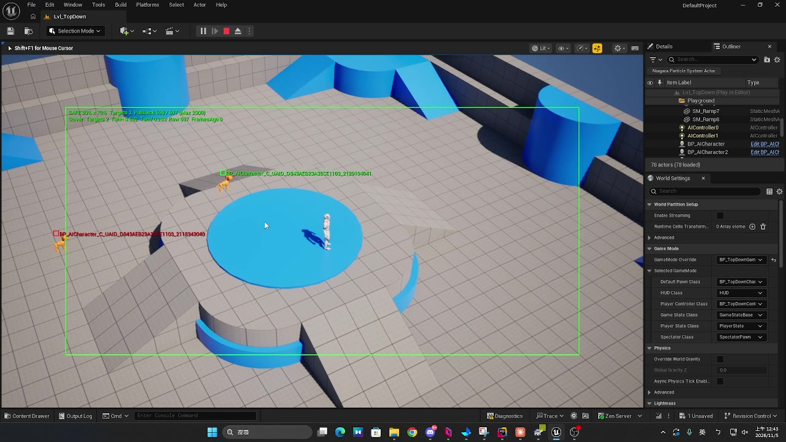
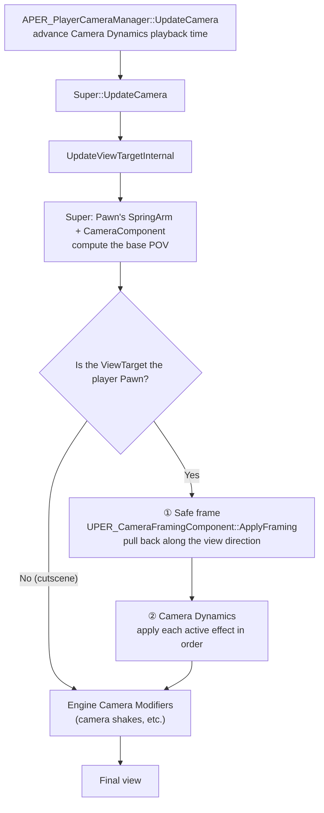
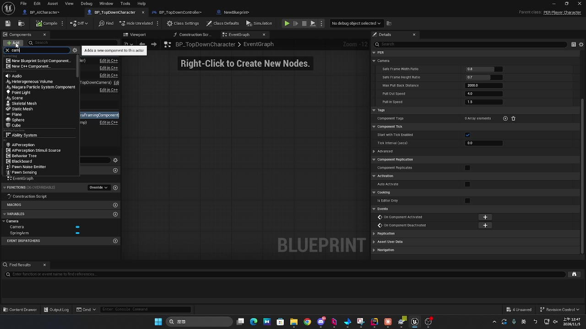
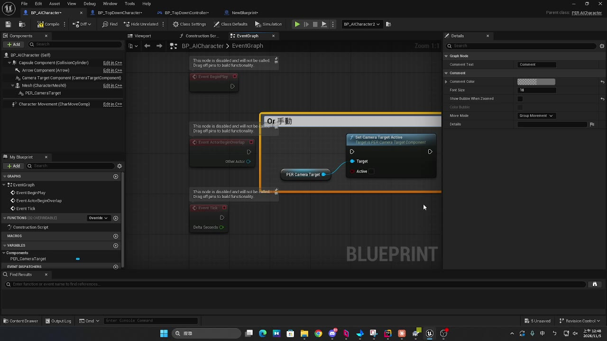
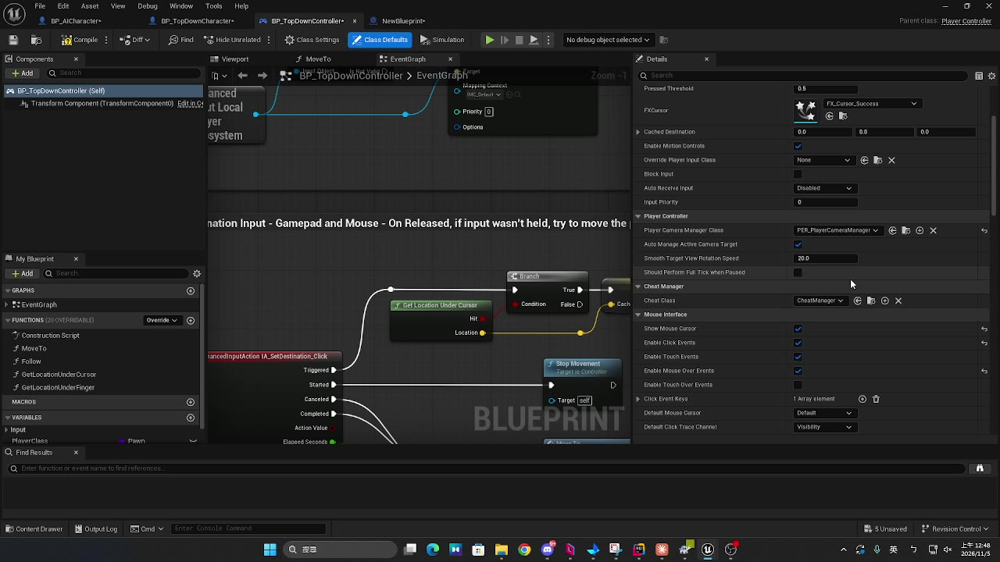
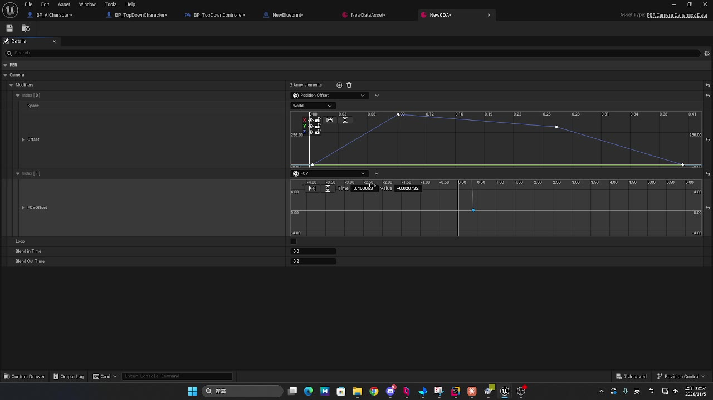
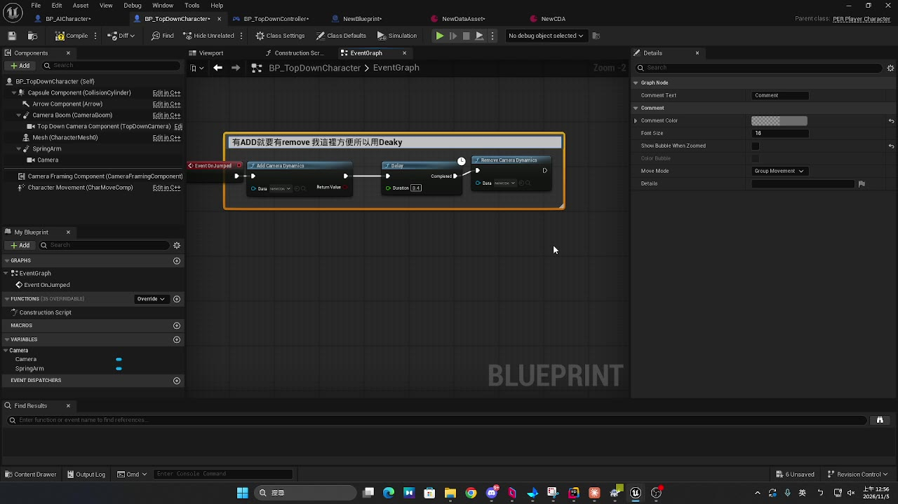

> A custom PlayerCameraManager, plus two components and a DataAsset, let a top-down camera "automatically keep targets in frame" and "play short camera moves for a performance".
> The `PER_` prefix in this post is the demo project's naming; replace it with your own project's name.
> ⚠️ Everything below was implemented and verified on **UE 5.8**. Engine behavior may differ in other versions.

---

## The problem

A top-down action game's camera is usually a SpringArm attached to the player, with a fixed angle and a fixed distance. That works for regular combat, but falls short in two situations:

| Situation | Problem | Feature |
|---|---|---|
| Boss fights, large enemies, the player knocked far away | Important targets leave the screen and the player misses attack wind-ups | **Safe frame**: pull back automatically so targets stay on screen |
| A boss leaps, an ultimate plays, a charged burst | Short camera offsets, push-ins, pull-outs and FOV changes tied to the action | **Camera Dynamics**: describe the move with curve assets; code only plays them |

Both features share the same design goals:

- **Don't touch CameraBoom's parameters**: `TargetArmLength` and rotation stay as they are, so existing Blueprint camera animations (a death camera, for example) keep working.
- **Only active in the player's view**: automatically disabled when a Level Sequence cutscene takes over, so cutscene cameras are untouched.
- **Designers and artists can tune it themselves**: parameters live on components and DataAssets, no code changes needed.

---

## Demo: the safe frame

<div align="center">
<video src="./demo_safe_frame.mp4" controls autoplay muted loop playsinline width="800">
</video>
<br><em>The green box is the safe frame. When an enemy nears its edge, the camera pulls back along the view direction, then slowly returns once the enemy is back inside</em>
</div>

> 🎬 If the video doesn't play: [download demo_safe_frame.mp4](./demo_safe_frame.mp4)



---

## Architecture: how one frame of camera is computed

Both features live on a custom `APER_PlayerCameraManager`. The key is the **insertion point**: after the Pawn's camera component has computed the view (POV), and before the engine's Camera Modifiers (camera shakes, CineShot) are applied.



```cpp
void APER_PlayerCameraManager::UpdateViewTargetInternal(FTViewTarget& OutVT, float DeltaTime)
{
    Super::UpdateViewTargetInternal(OutVT, DeltaTime);   // let the Pawn's camera finish first

    APawn* Pawn = PCOwner ? PCOwner->GetPawn() : nullptr;
    if (!Pawn || OutVT.Target != Pawn)
    {
        return;                                           // skip cutscene cameras
    }

    if (UPER_CameraFramingComponent* Framing = Pawn->FindComponentByClass<UPER_CameraFramingComponent>())
    {
        Framing->ApplyFraming(PCOwner, DeltaTime, OutVT.POV);   // ① safe frame
    }

    for (const FPER_ActiveCameraDynamics& Active : ActiveDynamics)  // ② additive effects
    {
        // ...apply each Modifier by its weight
    }
}
```

**Why this insertion point?**

- **After** the Pawn's camera: we get the "normal" view and only need to apply a delta, instead of rewriting the whole camera logic.
- **Before** Camera Modifiers: camera shakes stack on top last, so the safe frame's pull-back doesn't swallow them, and they don't affect the safe frame's math.
- Checking `OutVT.Target != Pawn`: when a Level Sequence plays, the ViewTarget switches to the cutscene camera and both features turn off on their own.

---

## Safe frame (Camera Framing)

### Who does what

| Class | Attached to | Responsibility |
|---|---|---|
| `UPER_CameraTargetComponent` | Enemies, bosses, or any Actor that needs to stay in frame | Marks "this point must stay on screen" |
| `UPER_CameraFramingComponent` | The player | Computes how far to pull back each frame |
| `APER_PlayerCameraManager` | Set on the PlayerController | Calls `ApplyFraming` |

`UPER_CameraTargetComponent` is a `USceneComponent`, so in the character Blueprint you can attach it to a socket or adjust its height. It is **disabled by default**; enable it in Details, or call this from Blueprint when needed (for example when a boss fight starts):

```cpp
CameraTarget->SetCameraTargetActive(true);
```

There is also `MaxFramingDistance`: targets farther than this from the player are ignored for now, so an enemy on the other side of the map can't drag the camera all the way out.

### The core math: solve for "how far back" directly

The intuitive approach is "if a target is outside the frame, back up a little until it's inside", but that jitters back and forth and takes several frames to converge. Instead, we **solve the exact pull-back distance every frame**.

Let the camera position be $C$ and its forward, right and up axes be $\hat{F}, \hat{R}, \hat{U}$. For a target point $T$:

$$
\text{depth} = (T - C)\cdot\hat{F},\quad
\text{side} = |(T - C)\cdot\hat{R}|,\quad
\text{vertical} = |(T - C)\cdot\hat{U}|
$$

Under perspective projection, the target's horizontal position on screen (with half the screen width as 1) is:

$$
x_{screen} = \frac{\text{side}}{\text{depth} \cdot \tan(\theta_H)}
$$

Moving the camera back by $D$ along the view direction makes the depth $\text{depth} + D$ while the side distance stays the same. For the target to fall inside the safe frame (with width ratio $w$):

$$
\frac{\text{side}}{(\text{depth} + D)\tan(\theta_H)} \le w
\quad\Longrightarrow\quad
D \ge \frac{\text{side}}{w \cdot \tan(\theta_H)} - \text{depth}
$$

The vertical axis works the same way. The maximum over all targets and both axes is the pull-back this frame needs:

```cpp
const float LimitH = TanH * SafeFrameWidthRatio;
const float LimitV = TanV * SafeFrameHeightRatio;
for (const UPER_CameraTargetComponent* Target : Targets)
{
    const FVector ToTarget = Target->GetComponentLocation() - InOutPOV.Location;
    const float Depth    = ToTarget | Forward;
    const float Side     = FMath::Abs(ToTarget | Right);
    const float Vertical = FMath::Abs(ToTarget | Up);
    Required = FMath::Max3(Required, Side / LimitH - Depth, Vertical / LimitV - Depth);
}
```

**Why only pull back along the view direction?** The camera's orientation doesn't change, so the player always stays at the center of the screen and controls feel the same while zoomed out. Visually it's the same as lengthening the SpringArm, without touching the SpringArm itself.

### Getting the correct tangent of the half-FOV

You can't just use `POV.FOV`: UE's FOV is horizontal by default, but the viewport aspect ratio and the `AspectRatioAxisConstraint` setting both affect the actual vertical FOV, and converting it yourself is easy to get wrong.

Instead we read the **projection matrix the engine actually renders with**:

```cpp
FSceneViewProjectionData ProjectionData;
LocalPlayer->GetProjectionData(LocalPlayer->ViewportClient->Viewport, ProjectionData);

const FMatrix& Projection = ProjectionData.ProjectionMatrix;
OutTanH = 1.0 / Projection.M[0][0];   // M[0][0] = 1 / tan(horizontal half-FOV)
OutTanV = 1.0 / Projection.M[1][1];   // M[1][1] = 1 / tan(vertical half-FOV)
```

However the window is resized and whichever axis locks the FOV, the result matches the screen. The cost is that it's **last frame's** projection, so it lags one frame when the FOV changes sharply, which isn't noticeable in practice.

### Pull out fast, pull back in slowly

```cpp
RequiredPullBack = FMath::Clamp(Required, 0.f, MaxPullBackDistance);
const float Speed = RequiredPullBack > CurrentPullBack ? PullOutSpeed : PullInSpeed;
CurrentPullBack = FMath::FInterpTo(CurrentPullBack, RequiredPullBack, DeltaTime, Speed);
InOutPOV.Location -= Forward * CurrentPullBack;
```

- **Pull out faster (default 4)**: when a target is about to leave the frame, react immediately or the player will miss the attack.
- **Pull back in slower (default 1.5)**: once targets are back inside, return gently so an enemy hovering at the edge doesn't make the camera pump in and out.
- **`MaxPullBackDistance` cap**: stops the camera from pulling back forever when a target is too far away.

### Parameters

**`UPER_CameraFramingComponent` (player)**

| Parameter | Default | Description |
|---|---|---|
| `SafeFrameWidthRatio` | 0.8 | Safe frame width as a fraction of the screen; outside it is the no-go zone |
| `SafeFrameHeightRatio` | 0.7 | Safe frame height as a fraction of the screen |
| `MaxPullBackDistance` | 2000 | Maximum pull-back distance (cm) |
| `PullOutSpeed` | 4 | Interpolation speed when pulling out |
| `PullInSpeed` | 1.5 | Interpolation speed when pulling back in |

**`UPER_CameraTargetComponent` (target)**

| Parameter | Default | Description |
|---|---|---|
| `bCameraTargetActive` | false | Whether this target counts for the safe frame |
| `MaxFramingDistance` | 0 | Ignored when farther than this from the player; 0 means no limit |

### Debug display

In the console:

```
PER.ShowCameraSafeFrame 1
```

The screen shows:

- A green rectangle: the safe frame
- Each active target: green inside the frame, red outside, labeled with the Actor name
- Text: current / required / maximum pull-back, target count, tangent of the half-FOV and other solver inputs

The debug code is wrapped in `#if ENABLE_DRAW_DEBUG`, so Shipping builds compile it out entirely.

---

## Walkthrough: the safe frame

<div align="center">
<video src="./setup_safe_frame.mp4" controls playsinline width="800"></video>
<br><em>The full flow: adding the components, enabling targets, and setting the CameraManager</em>
</div>

> 🎬 If the video doesn't play: [download setup_safe_frame.mp4](./setup_safe_frame.mp4)

**1. Player: tune the safe frame**

On the player character's `CameraFramingComponent`, adjust the frame size and pull speeds under the Camera category in Details.



**2. Targets: add a CameraTarget and enable it**

Add a `CameraTargetComponent` to an enemy (or any Actor that needs to stay in frame); you can attach it to a socket on the Mesh to set its height. There are two ways to enable it: tick `Camera Target Active` in Details, or call `Set Camera Target Active` from Blueprint (for example, on when a boss fight starts and off when it ends).



**3. Set the CameraManager**

In the PlayerController's Class Defaults, set `Player Camera Manager Class` to `PER_PlayerCameraManager`. A C++ Controller can also set it in its constructor:

```cpp
PlayerCameraManagerClass = APER_PlayerCameraManager::StaticClass();
```

If the Controller Blueprint's Class Defaults override it, change it back, or neither feature will run.



**4. Check the result**

In PIE, enter `PER.ShowCameraSafeFrame 1` in the console and check that the frame size and pull-back distance look right.

---

## Camera Dynamics (additive camera moves)

<div align="center">
<video src="./camera_dynamics.mp4" controls playsinline width="800"></video>
<br><em>Creating a Camera Dynamics Data asset, editing its curves, and playing it on jump</em>
</div>

> 🎬 If the video doesn't play: [download camera_dynamics.mp4](./camera_dynamics.mp4)

### Data layout

A camera move is a DataAsset holding several "effect entries", each describing a change over time with curves:

```
UPER_CameraDynamicsData (DataAsset)
├─ Modifiers (Instanced array)
│   ├─ UPER_CameraDynamics_Offset    position offset (FRuntimeVectorCurve)
│   ├─ UPER_CameraDynamics_Distance  pull out / push in along the view (FRuntimeFloatCurve)
│   └─ UPER_CameraDynamics_FOV       FOV add/subtract (FRuntimeFloatCurve)
├─ bLoop          whether to loop
├─ BlendInTime    blend-in time
└─ BlendOutTime   blend-out time
```

| Effect | What it does | Typical use |
|---|---|---|
| **Position Offset** | Offsets the camera position, in world space or camera space (X forward, Y right, Z up) | Camera rises with a leaping boss |
| **Arm Distance** | Pulls out (positive) or pushes in (negative) along the view, same as changing arm length | Push in before an ultimate, pull out on the burst |
| **FOV** | Adds/subtracts FOV (degrees), clamped to 1–170 | Sense of speed for dashes and charged bursts |

There's no separate length field: the duration is **the time of the last key across all curves**.



### Extensible effect entries

The effect base class is declared `EditInlineNew` + `DefaultToInstanced`, so entries can be added and edited from a dropdown right in the DataAsset's array:

```cpp
UCLASS(Abstract, EditInlineNew, DefaultToInstanced, CollapseCategories)
class UPER_CameraDynamicsModifier : public UObject
{
    GENERATED_BODY()
public:
    /** Time of the curve's last key, used as the effect length */
    virtual float GetDuration() const { return 0.f; }

    /** Weight is the blend weight (0~1); multiply the effect value by it */
    virtual void ApplyToView(float Time, float Weight, FMinimalViewInfo& InOutPOV) const {}
};
```

To add a new kind of effect (roll, depth of field, ...), subclass it and implement the two functions; **the CameraManager doesn't change**. FOV as an example:

```cpp
void UPER_CameraDynamics_FOV::ApplyToView(float Time, float Weight, FMinimalViewInfo& InOutPOV) const
{
    const float Offset = FOVOffset.GetRichCurveConst()->Eval(Time);
    InOutPOV.FOV = FMath::Clamp(InOutPOV.FOV + Offset * Weight, 1.f, 170.f);
}
```

### Playing and stopping

Blueprint or C++ calls static functions directly, no need to fetch the CameraManager first:

```cpp
// Play: ends on its own when the curves finish; with bLoop it runs until Remove
APER_PlayerCameraManager::AddCameraDynamics(this, BossJumpCameraData);

// Stop: blends out, then removes every active instance of this Data
APER_PlayerCameraManager::RemoveCameraDynamics(this, BossJumpCameraData);
```

Calling the same Data repeatedly **stacks**: two impacts in a row play two copies of the effect at once.



### Active state and weight

Each playing effect is stored as one record:

```cpp
struct FPER_ActiveCameraDynamics
{
    TObjectPtr<UPER_CameraDynamicsData> Data;
    float Elapsed = 0.f;       // time played
    float Duration = 0.f;      // effect length
    float StopElapsed = -1.f;  // < 0 means Remove hasn't been called yet
};
```

The weight is the minimum of three blends, then SmoothStep softens the start and end:

```cpp
float Weight = BlendIn > 0 ? Clamp(Elapsed / BlendIn, 0, 1) : 1;              // blend in at the start
if (!bLoop && BlendOut > 0)
    Weight = Min(Weight, Clamp((Duration - Elapsed) / BlendOut, 0, 1));       // blend out before a natural end
if (StopElapsed >= 0)
    Weight = Min(Weight, BlendOut > 0 ? Clamp(1 - StopElapsed / BlendOut, 0, 1) : 0);  // blend out after Remove
return FMath::SmoothStep(0.f, 1.f, Weight);
```

Looping effects sample at `Fmod(Elapsed, Duration)`, so the curves replay from the start.

### Where should time advance?

This is the easiest part to get wrong. The intuitive place is `UpdateViewTargetInternal`, but **while blending between ViewTargets, the engine calls it twice per frame** (once for the old target, once for the new), so time runs at double speed.

So advancing time and removing expired entries happen in `UpdateCamera`, which runs once per frame:

```cpp
void APER_PlayerCameraManager::UpdateCamera(float DeltaTime)
{
    ActiveDynamics.RemoveAll([DeltaTime](FPER_ActiveCameraDynamics& Active)
    {
        Active.Elapsed += DeltaTime;
        if (Active.StopElapsed >= 0.f)
        {
            Active.StopElapsed += DeltaTime;
            if (Active.StopElapsed >= Active.Data->BlendOutTime) return true;   // blend-out finished
        }
        return !Active.Data->bLoop && Active.Elapsed >= Active.Duration;        // finished playing
    });

    Super::UpdateCamera(DeltaTime);   // UpdateViewTargetInternal is called after this
}
```

`UpdateViewTargetInternal` only **reads** the time to apply effects, so however many times it's called, the result is the same.

### Example: boss jump

1. In the Content Browser, create a Data Asset of class `PER_CameraDynamicsData` and name it `CD_BossJump`.
2. Add a **Position Offset** to `Modifiers`, set Space to World, and key the Z curve: 0 s → 0, 0.4 s → 150, 1.0 s → 0.
3. Add an **Arm Distance**: 0 s → 0, 0.4 s → 300, 1.0 s → 0.
4. `BlendInTime = 0.1`, `BlendOutTime = 0.2`.
5. Call `AddCameraDynamics(CD_BossJump)` from the boss jump animation's AnimNotify or from the ability.

---

## Design decisions and pitfalls

| Decision | Why |
|---|---|
| Modify the POV, not the SpringArm | Blueprint camera animations and the SpringArm's collision and lag all keep working; both features are purely additive |
| The safe frame only pulls back along the view | The player stays centered and control directions don't change; the math can be solved directly instead of iterated |
| Tangent of the half-FOV from the projection matrix | Matches the aspect ratio and FOV axis lock automatically, no manual conversion |
| Pull out fast, pull back in slowly | Threats aren't missed, and the camera doesn't jitter when a target sits at the edge |
| Targets disabled by default | Regular mobs don't move the camera; only moments that call for it opt in |
| Time advances in `UpdateCamera` | `UpdateViewTargetInternal` runs twice per frame during ViewTarget blends |
| Effects as Instanced UObjects | New effect types don't touch the player; designers combine several effects in one asset |
| Both disabled during cutscenes | Checked with `ViewTarget != Pawn`, no extra flags or state |

### Known limitations

- **Perspective projection only**: the safe frame is skipped for orthographic projection (`ProjectionMode != Perspective` returns early).
- **Targets are found with `TObjectIterator`**: fine with a few targets; with many on screen, register components to a `UWorldSubsystem` in `BeginPlay` / `EndPlay` instead.
- **Projection data is from last frame**: when the FOV changes sharply (for example an instant jump from an FOV effect), the safe frame reacts one frame late.
