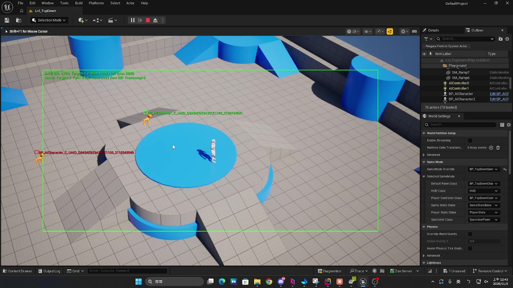
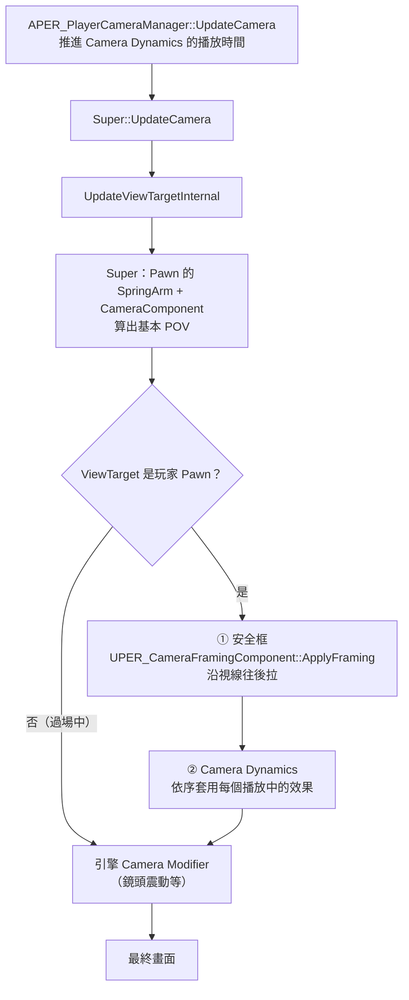
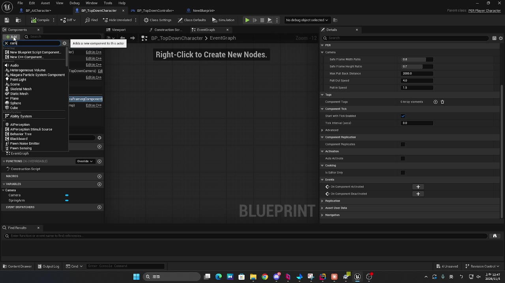
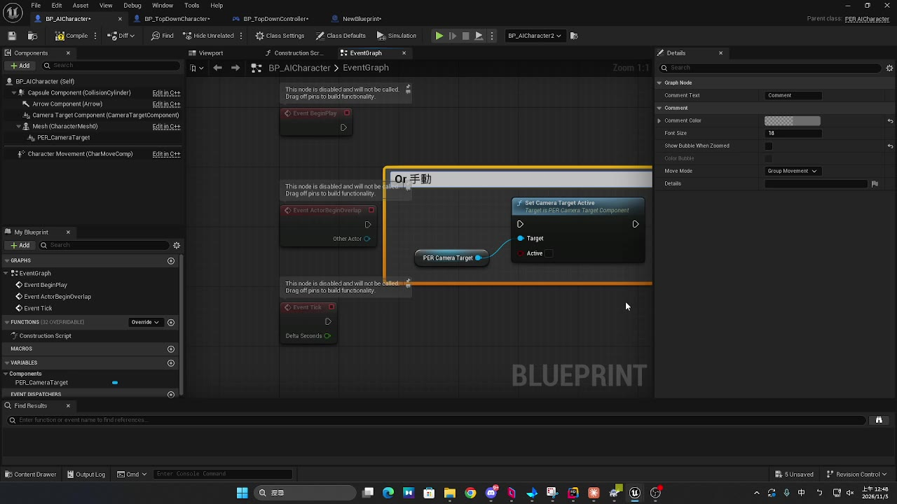
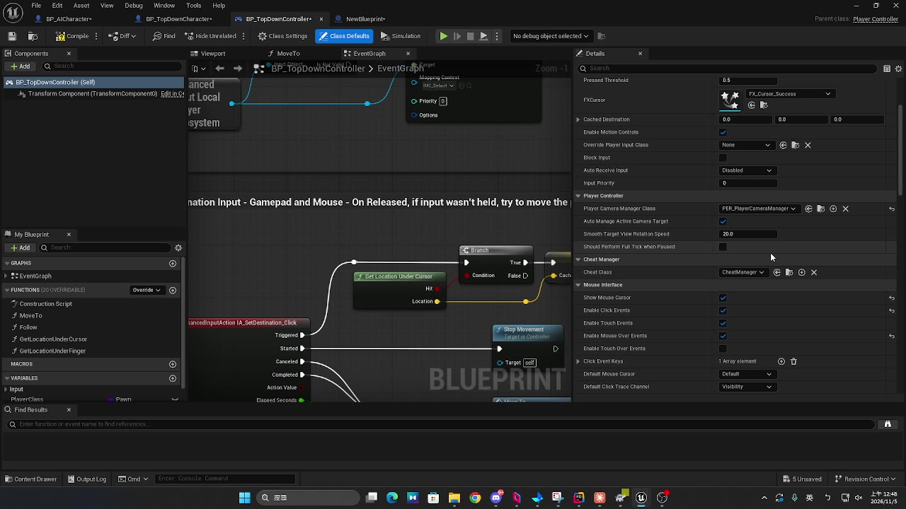
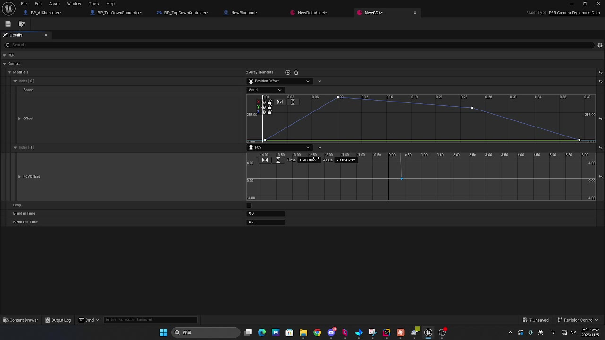
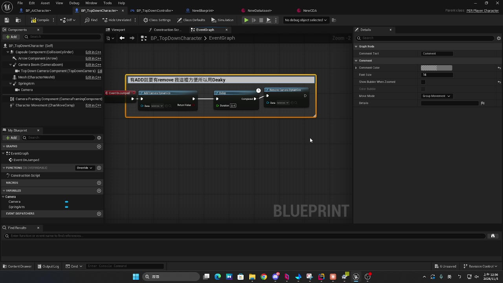

> 一個自訂的 PlayerCameraManager，加上兩個元件與一個 DataAsset，讓俯視角鏡頭能「自動把目標收進畫面」，也能「依演出播放短暫的運鏡」。
> 文中的 `PER_` 前綴是示範專案的命名，`YOURMODULE_API` 請換成自己模組的名稱；文末附完整程式碼。
> ⚠️ 以下內容是在 **UE 5.8** 上實作與驗證的，其他版本的引擎行為可能有改變。

---

## 問題

俯視角動作遊戲的鏡頭通常是 SpringArm 掛在玩家身上，固定角度、固定距離。這在一般戰鬥沒問題，但遇到兩種情況就不夠用：

| 情況 | 問題 | 對應功能 |
|---|---|---|
| Boss 戰、大型敵人、玩家被擊飛到遠處 | 重要目標跑出畫面，玩家看不到攻擊前搖 | **安全框**：自動拉遠，讓目標保持在畫面內 |
| Boss 跳起、大招演出、蓄力爆發 | 需要依劇情做短暫的鏡頭位移、拉近拉遠、FOV 變化 | **Camera Dynamics**：用曲線資產描述運鏡，程式只負責播放 |

兩個功能有共同的設計目標：

- **不改 CameraBoom 的參數**：`TargetArmLength`、旋轉都不動，藍圖原本的鏡頭動畫（例如死亡鏡頭）照常運作。
- **只在玩家視角時生效**：切到 Level Sequence 過場時自動停用，不干擾過場鏡頭。
- **企劃與美術可以自己調**：參數放在元件與 DataAsset 上，不用改程式。

---

## 效果展示：安全框

<div align="center">
<video src="./demo_safe_frame.mp4" controls autoplay muted loop playsinline width="800">
</video>
<br><em>綠框是安全框；敵人一靠近框邊，鏡頭就沿著視線往後拉，回到框內後再慢慢收回</em>
</div>

> 🎬 影片無法播放時：[下載 demo_safe_frame.mp4](./demo_safe_frame.mp4)



---

## 架構：鏡頭在一幀內怎麼算出來

兩個功能都掛在自訂的 `APER_PlayerCameraManager` 上。關鍵是**插入點**：在 Pawn 的相機元件算完畫面（POV）之後、引擎的 Camera Modifier（鏡頭震動、CineShot）套用之前。



```cpp
void APER_PlayerCameraManager::UpdateViewTargetInternal(FTViewTarget& OutVT, float DeltaTime)
{
    Super::UpdateViewTargetInternal(OutVT, DeltaTime);   // Pawn 的相機先算完

    APawn* Pawn = PCOwner ? PCOwner->GetPawn() : nullptr;
    if (!Pawn || OutVT.Target != Pawn)
    {
        return;                                           // 過場鏡頭不套用
    }

    if (UPER_CameraFramingComponent* Framing = Pawn->FindComponentByClass<UPER_CameraFramingComponent>())
    {
        Framing->ApplyFraming(PCOwner, DeltaTime, OutVT.POV);   // ① 安全框
    }

    for (const FPER_ActiveCameraDynamics& Active : ActiveDynamics)  // ② 附加效果
    {
        // ……依權重套用每個 Modifier
    }
}
```

**為什麼選這個插入點？**

- 在 Pawn 相機**之後**：拿到的是「正常情況下的畫面」，只需要做差量修正，不用重寫整套相機邏輯。
- 在 Camera Modifier **之前**：鏡頭震動疊在最後，不會被安全框的拉遠吃掉，也不會影響安全框的計算。
- 判斷 `OutVT.Target != Pawn`：播 Level Sequence 時 ViewTarget 換成過場相機，兩個功能自然停用。

---

## 安全框（Camera Framing）

### 元件分工

| 類別 | 掛在哪 | 負責什麼 |
|---|---|---|
| `UPER_CameraTargetComponent` | 敵人、Boss，或任何需要入鏡的 Actor | 標記「這個點要留在畫面內」 |
| `UPER_CameraFramingComponent` | 玩家 | 每幀計算要拉遠多少 |
| `APER_PlayerCameraManager` | PlayerController 指定 | 呼叫 `ApplyFraming` |

`UPER_CameraTargetComponent` 是一個 `USceneComponent`，可以在角色藍圖裡掛到 Socket 或調整高度。**預設不啟用**，可以在 Details 勾選，或由藍圖在需要時（例如 Boss 戰開始）呼叫：

```cpp
CameraTarget->SetCameraTargetActive(true);
```

另外有 `MaxFramingDistance`：目標離玩家超過這個距離就暫時不納入，避免整張地圖另一頭的敵人把鏡頭拉到最遠。

### 核心數學：直接解出「要退多少」

最直覺的做法是「目標在框外就慢慢往後退，直到它進框」，但這會產生來回抖動，而且需要多幀才收斂。這裡改成**每幀直接解出精確的後退距離**。

設鏡頭位置為 $C$，朝向的前、右、上三軸為 $\hat{F}, \hat{R}, \hat{U}$。對某個目標點 $T$：

$$
\text{depth} = (T - C)\cdot\hat{F},\quad
\text{side} = |(T - C)\cdot\hat{R}|,\quad
\text{vertical} = |(T - C)\cdot\hat{U}|
$$

透視投影下，目標在畫面上的水平位置（以畫面半寬為 1）是：

$$
x_{screen} = \frac{\text{side}}{\text{depth} \cdot \tan(\theta_H)}
$$

鏡頭沿視線往後退 $D$，深度變成 $\text{depth} + D$，側向距離不變。要讓目標落在安全框內（安全框寬度比例為 $w$）：

$$
\frac{\text{side}}{(\text{depth} + D)\tan(\theta_H)} \le w
\quad\Longrightarrow\quad
D \ge \frac{\text{side}}{w \cdot \tan(\theta_H)} - \text{depth}
$$

垂直方向同理。對所有目標、兩個軸取最大值，就是這一幀需要的後退距離：

```cpp
const float LimitH = TanH * SafeFrameWidthRatio;
const float LimitV = TanV * SafeFrameHeightRatio;
for (const UPER_CameraTargetComponent* Target : Targets)
{
    const FVector ToTarget = Target->GetComponentLocation() - InOutPOV.Location;
    const float Depth    = ToTarget | Forward;
    const float Side     = FMath::Abs(ToTarget | Right);
    const float Vertical = FMath::Abs(ToTarget | Up);
    Required = FMath::Max3(Required, Side / LimitH - Depth, Vertical / LimitV - Depth);
}
```

**為什麼只沿視線往後退？** 鏡頭的朝向不變，玩家永遠在畫面中心，操作手感不會因為拉遠而改變；畫面效果等同於拉長 SpringArm，但不用動到 SpringArm 本身。

### 取得正確的 tan 半視角

FOV 不能直接拿 `POV.FOV` 來算：UE 的 FOV 預設是水平視角，但視窗比例、`AspectRatioAxisConstraint` 設定都會影響實際的垂直視角，自己換算很容易錯。

這裡直接讀引擎**實際算圖用的投影矩陣**：

```cpp
FSceneViewProjectionData ProjectionData;
LocalPlayer->GetProjectionData(LocalPlayer->ViewportClient->Viewport, ProjectionData);

const FMatrix& Projection = ProjectionData.ProjectionMatrix;
OutTanH = 1.0 / Projection.M[0][0];   // M[0][0] = 1 / tan(水平半視角)
OutTanV = 1.0 / Projection.M[1][1];   // M[1][1] = 1 / tan(垂直半視角)
```

不管視窗怎麼縮放、用哪個軸鎖定 FOV，算出來都跟畫面一致。代價是拿到的是**上一幀**的投影，FOV 劇烈變化時會差一幀，實際上看不出來。

### 拉遠快、拉回慢

```cpp
RequiredPullBack = FMath::Clamp(Required, 0.f, MaxPullBackDistance);
const float Speed = RequiredPullBack > CurrentPullBack ? PullOutSpeed : PullInSpeed;
CurrentPullBack = FMath::FInterpTo(CurrentPullBack, RequiredPullBack, DeltaTime, Speed);
InOutPOV.Location -= Forward * CurrentPullBack;
```

- **拉遠用較快的速度（預設 4）**：目標要出框時要立刻反應，否則玩家會漏看攻擊。
- **拉回用較慢的速度（預設 1.5）**：目標回到框內後慢慢收回，避免敵人在框邊來回時鏡頭忽遠忽近。
- **`MaxPullBackDistance` 上限**：避免目標太遠時鏡頭無限拉遠。

### 參數一覽

**`UPER_CameraFramingComponent`（玩家）**

| 參數 | 預設 | 說明 |
|---|---|---|
| `SafeFrameWidthRatio` | 0.8 | 安全框佔畫面寬度的比例，框外為禁止區域 |
| `SafeFrameHeightRatio` | 0.7 | 安全框佔畫面高度的比例 |
| `MaxPullBackDistance` | 2000 | 最多往後拉多遠（cm） |
| `PullOutSpeed` | 4 | 拉遠的插值速度 |
| `PullInSpeed` | 1.5 | 拉回的插值速度 |

**`UPER_CameraTargetComponent`（目標）**

| 參數 | 預設 | 說明 |
|---|---|---|
| `bCameraTargetActive` | false | 是否納入安全框 |
| `MaxFramingDistance` | 0 | 與玩家距離超過此值時不納入；0 為不限 |

### 除錯顯示

主控台輸入：

```
PER.ShowCameraSafeFrame 1
```

畫面會顯示：

- 綠色矩形：安全框範圍
- 每個啟用中的目標點：框內為綠色、框外為紅色，旁邊標示 Actor 名稱
- 文字：目前拉遠距離／需要的距離／上限、目標數量、tan 半視角等計算輸入

除錯程式碼包在 `#if ENABLE_DRAW_DEBUG` 內，Shipping 版會在編譯階段完全排除。

---

## 使用示範：安全框

<div align="center">
<video src="./setup_safe_frame.mp4" controls playsinline width="800"></video>
<br><em>從掛元件、啟用目標到指定 CameraManager 的完整流程</em>
</div>

> 🎬 影片無法播放時：[下載 setup_safe_frame.mp4](./setup_safe_frame.mp4)

**1. 玩家：調整安全框參數**

玩家角色身上的 `CameraFramingComponent`，在 Details 的 Camera 分類裡調整框的大小與拉遠速度。



**2. 目標：掛上 CameraTarget 並啟用**

在敵人（或任何需要入鏡的 Actor）上掛 `CameraTargetComponent`，可以掛到 Mesh 的 Socket 上調整高度。啟用方式有兩種：直接在 Details 勾 `Camera Target Active`，或在藍圖裡呼叫 `Set Camera Target Active`（例如進入 Boss 戰時開、戰鬥結束時關）。



**3. 指定 CameraManager**

PlayerController 的 Class Defaults 裡，`Player Camera Manager Class` 要指定成 `PER_PlayerCameraManager`。C++ 版的 Controller 也可以直接在建構子設定：

```cpp
PlayerCameraManagerClass = APER_PlayerCameraManager::StaticClass();
```

如果 Controller 藍圖的 Class Defaults 另外改過，要記得改回來，否則兩個功能都不會生效。



**4. 確認效果**

進 PIE 後在主控台開 `PER.ShowCameraSafeFrame 1`，確認框的大小與拉遠距離是否合適。

---

## Camera Dynamics（附加運鏡效果）

<div align="center">
<video src="./camera_dynamics.mp4" controls playsinline width="800"></video>
<br><em>建立 Camera Dynamics Data、編輯曲線，並在跳躍時播放</em>
</div>

> 🎬 影片無法播放時：[下載 camera_dynamics.mp4](./camera_dynamics.mp4)

### 資料結構

運鏡效果是一個 DataAsset，裡面放多個「效果項目」，每個項目用曲線描述隨時間的變化：

```
UPER_CameraDynamicsData（DataAsset）
├─ Modifiers（Instanced 陣列）
│   ├─ UPER_CameraDynamics_Offset    位置偏移（FRuntimeVectorCurve）
│   ├─ UPER_CameraDynamics_Distance  沿視線拉遠／拉近（FRuntimeFloatCurve）
│   └─ UPER_CameraDynamics_FOV       FOV 加減（FRuntimeFloatCurve）
├─ bLoop          是否循環
├─ BlendInTime    淡入時間
└─ BlendOutTime   淡出時間
```

| 效果 | 作用 | 典型用途 |
|---|---|---|
| **Position Offset** | 鏡頭位置偏移，可選世界座標或鏡頭座標（X 前、Y 右、Z 上） | Boss 跳起時鏡頭跟著往上 |
| **Arm Distance** | 沿視線拉遠（正值）或拉近（負值），效果等同改 Arm 長度 | 大招前拉近、爆發時拉遠 |
| **FOV** | FOV 加減（度），結果限制在 1～170 | 衝刺、蓄力爆發的速度感 |

效果長度不用另外填：自動取所有曲線中**最後一個 Key 的時間**。



### 可擴充的效果項目

效果項目的基底類別宣告成 `EditInlineNew` + `DefaultToInstanced`，在 DataAsset 的陣列裡可以直接從下拉選單新增、編輯：

```cpp
UCLASS(Abstract, EditInlineNew, DefaultToInstanced, CollapseCategories)
class UPER_CameraDynamicsModifier : public UObject
{
    GENERATED_BODY()
public:
    /** 曲線最後一個 Key 的時間，作為效果長度 */
    virtual float GetDuration() const { return 0.f; }

    /** Weight 為淡入淡出權重（0~1），效果值要乘上它 */
    virtual void ApplyToView(float Time, float Weight, FMinimalViewInfo& InOutPOV) const {}
};
```

要新增一種效果（例如 Roll 傾斜、景深），只要繼承這個類別、實作兩個函式，**不用改 CameraManager**。以 FOV 為例：

```cpp
void UPER_CameraDynamics_FOV::ApplyToView(float Time, float Weight, FMinimalViewInfo& InOutPOV) const
{
    const float Offset = FOVOffset.GetRichCurveConst()->Eval(Time);
    InOutPOV.FOV = FMath::Clamp(InOutPOV.FOV + Offset * Weight, 1.f, 170.f);
}
```

### 播放與停止

藍圖或 C++ 直接呼叫靜態函式，不需要先取得 CameraManager：

```cpp
// 播放：曲線跑完自動結束；勾 bLoop 則持續到 Remove
APER_PlayerCameraManager::AddCameraDynamics(this, BossJumpCameraData);

// 停止：淡出後移除這個 Data 所有播放中的效果
APER_PlayerCameraManager::RemoveCameraDynamics(this, BossJumpCameraData);
```

同一個 Data 重複呼叫會**疊加**，例如連續兩次衝擊會有兩份效果同時播放。



### 播放中的狀態與權重

每個播放中的效果記錄成一筆資料：

```cpp
struct FPER_ActiveCameraDynamics
{
    TObjectPtr<UPER_CameraDynamicsData> Data;
    float Elapsed = 0.f;       // 已播放時間
    float Duration = 0.f;      // 效果長度
    float StopElapsed = -1.f;  // < 0 表示還沒被 Remove
};
```

權重由三種淡入淡出取最小值，最後套 SmoothStep 讓開始與結束更柔和：

```cpp
float Weight = BlendIn > 0 ? Clamp(Elapsed / BlendIn, 0, 1) : 1;              // 開頭淡入
if (!bLoop && BlendOut > 0)
    Weight = Min(Weight, Clamp((Duration - Elapsed) / BlendOut, 0, 1));       // 自然結束前淡出
if (StopElapsed >= 0)
    Weight = Min(Weight, BlendOut > 0 ? Clamp(1 - StopElapsed / BlendOut, 0, 1) : 0);  // 被 Remove 後淡出
return FMath::SmoothStep(0.f, 1.f, Weight);
```

循環效果的取樣時間用 `Fmod(Elapsed, Duration)`，曲線會從頭重播。

### 時間要在哪裡推進？

這是實作時最容易出錯的地方。直覺上會在 `UpdateViewTargetInternal` 裡推進時間，但**切換 ViewTarget 的混合期間，引擎一幀會呼叫它兩次**（舊目標、新目標各一次），時間就會快一倍。

所以時間推進和過期清除放在 `UpdateCamera`，一幀只會跑一次：

```cpp
void APER_PlayerCameraManager::UpdateCamera(float DeltaTime)
{
    ActiveDynamics.RemoveAll([DeltaTime](FPER_ActiveCameraDynamics& Active)
    {
        Active.Elapsed += DeltaTime;
        if (Active.StopElapsed >= 0.f)
        {
            Active.StopElapsed += DeltaTime;
            if (Active.StopElapsed >= Active.Data->BlendOutTime) return true;   // 淡出完成
        }
        return !Active.Data->bLoop && Active.Elapsed >= Active.Duration;        // 播完
    });

    Super::UpdateCamera(DeltaTime);   // 之後才會呼叫 UpdateViewTargetInternal
}
```

`UpdateViewTargetInternal` 裡只**讀取**時間來套用效果，呼叫幾次都不影響結果。

### 範例：Boss 跳躍

1. 內容瀏覽器新增 Data Asset，類別選 `PER_CameraDynamicsData`，命名 `CD_BossJump`。
2. `Modifiers` 新增 **Position Offset**，Space 選 World，在 Z 曲線打 Key：0 秒 → 0、0.4 秒 → 150、1.0 秒 → 0。
3. 再新增 **Arm Distance**：0 秒 → 0、0.4 秒 → 300、1.0 秒 → 0。
4. `BlendInTime = 0.1`、`BlendOutTime = 0.2`。
5. 在 Boss 跳躍動畫的 AnimNotify 或技能裡呼叫 `AddCameraDynamics(CD_BossJump)`。

---

## 完整程式碼

> 以下是 `Camera/` 資料夾的完整原始碼。`YOURMODULE_API` 請換成自己模組的 API 巨集；`UE_LOG` 用的是 `LogTemp`，可以換成專案自己的 Log 分類。

### PER_PlayerCameraManager.h

```cpp
#pragma once

#include "CoreMinimal.h"
#include "Camera/PlayerCameraManager.h"
#include "PER_PlayerCameraManager.generated.h"

class UPER_CameraDynamicsData;

USTRUCT()
struct FPER_ActiveCameraDynamics
{
	GENERATED_BODY()

	UPROPERTY()
	TObjectPtr<UPER_CameraDynamicsData> Data;

	float Elapsed = 0.f;
	float Duration = 0.f;
	/** < 0 表示還沒被 Remove */
	float StopElapsed = -1.f;
};

/**
 * 玩家鏡頭：在 Pawn 鏡頭算完、Camera Modifier（CineShot、震動）套用之前，
 * 依序套用安全框拉遠（UPER_CameraFramingComponent）與附加鏡頭效果（UPER_CameraDynamicsData）。
 * ViewTarget 不是玩家 Pawn 時（LevelSequence 過場）兩者都不套用。
 */
UCLASS()
class YOURMODULE_API APER_PlayerCameraManager : public APlayerCameraManager
{
	GENERATED_BODY()

public:
	/** 對本機玩家鏡頭播放附加效果。同一個 Data 重複呼叫會疊加 */
	UFUNCTION(BlueprintCallable, Category = "PER|Camera", meta = (WorldContext = "WorldContextObject"))
	static bool AddCameraDynamics(const UObject* WorldContextObject, UPER_CameraDynamicsData* Data);

	/** 淡出並移除這個 Data 播放中的所有效果 */
	UFUNCTION(BlueprintCallable, Category = "PER|Camera", meta = (WorldContext = "WorldContextObject"))
	static void RemoveCameraDynamics(const UObject* WorldContextObject, UPER_CameraDynamicsData* Data);

	virtual void UpdateCamera(float DeltaTime) override;

protected:
	virtual void UpdateViewTargetInternal(FTViewTarget& OutVT, float DeltaTime) override;

private:
	static APER_PlayerCameraManager* GetLocalCameraManager(const UObject* WorldContextObject);
	static float GetWeight(const FPER_ActiveCameraDynamics& Active);

	UPROPERTY(Transient)
	TArray<FPER_ActiveCameraDynamics> ActiveDynamics;
};
```

### PER_PlayerCameraManager.cpp

```cpp
#include "Camera/PER_PlayerCameraManager.h"

#include "Camera/PER_CameraDynamicsData.h"
#include "Camera/PER_CameraFramingComponent.h"
#include "GameFramework/Pawn.h"
#include "GameFramework/PlayerController.h"
#include "Kismet/GameplayStatics.h"

bool APER_PlayerCameraManager::AddCameraDynamics(const UObject* WorldContextObject, UPER_CameraDynamicsData* Data)
{
	APER_PlayerCameraManager* Manager = GetLocalCameraManager(WorldContextObject);
	if (!Manager || !Data)
	{
		return false;
	}
	const float Duration = Data->GetDuration();
	if (!Data->bLoop && Duration <= 0.f)
	{
		UE_LOG(LogTemp, Warning, TEXT("AddCameraDynamics: %s 的曲線沒有 Key，也沒有勾 bLoop，不會有效果"), *GetNameSafe(Data));
		return false;
	}
	FPER_ActiveCameraDynamics& Active = Manager->ActiveDynamics.AddDefaulted_GetRef();
	Active.Data = Data;
	Active.Duration = Duration;
	return true;
}

void APER_PlayerCameraManager::RemoveCameraDynamics(const UObject* WorldContextObject, UPER_CameraDynamicsData* Data)
{
	APER_PlayerCameraManager* Manager = GetLocalCameraManager(WorldContextObject);
	if (!Manager)
	{
		return;
	}
	for (FPER_ActiveCameraDynamics& Active : Manager->ActiveDynamics)
	{
		if (Active.Data == Data && Active.StopElapsed < 0.f)
		{
			Active.StopElapsed = 0.f;
		}
	}
}

APER_PlayerCameraManager* APER_PlayerCameraManager::GetLocalCameraManager(const UObject* WorldContextObject)
{
	APlayerCameraManager* Manager = UGameplayStatics::GetPlayerCameraManager(WorldContextObject, 0);
	APER_PlayerCameraManager* PERManager = Cast<APER_PlayerCameraManager>(Manager);
	if (Manager && !PERManager)
	{
		UE_LOG(LogTemp, Warning, TEXT("玩家的 PlayerCameraManager 不是 APER_PlayerCameraManager（%s），附加鏡頭效果無法播放"), *GetNameSafe(Manager->GetClass()));
	}
	return PERManager;
}

float APER_PlayerCameraManager::GetWeight(const FPER_ActiveCameraDynamics& Active)
{
	const UPER_CameraDynamicsData* Data = Active.Data;
	float Weight = Data->BlendInTime > 0.f ? FMath::Clamp(Active.Elapsed / Data->BlendInTime, 0.f, 1.f) : 1.f;
	if (!Data->bLoop && Data->BlendOutTime > 0.f)
	{
		Weight = FMath::Min(Weight, FMath::Clamp((Active.Duration - Active.Elapsed) / Data->BlendOutTime, 0.f, 1.f));
	}
	if (Active.StopElapsed >= 0.f)
	{
		Weight = FMath::Min(Weight, Data->BlendOutTime > 0.f ? FMath::Clamp(1.f - Active.StopElapsed / Data->BlendOutTime, 0.f, 1.f) : 0.f);
	}
	return FMath::SmoothStep(0.f, 1.f, Weight);
}

void APER_PlayerCameraManager::UpdateCamera(float DeltaTime)
{
	// 在這裡推進時間：UpdateViewTargetInternal 在 ViewTarget 混合期間一幀會呼叫兩次
	ActiveDynamics.RemoveAll([DeltaTime](FPER_ActiveCameraDynamics& Active)
	{
		if (!Active.Data)
		{
			return true;
		}
		Active.Elapsed += DeltaTime;
		if (Active.StopElapsed >= 0.f)
		{
			Active.StopElapsed += DeltaTime;
			if (Active.StopElapsed >= Active.Data->BlendOutTime)
			{
				return true;
			}
		}
		return !Active.Data->bLoop && Active.Elapsed >= Active.Duration;
	});

	Super::UpdateCamera(DeltaTime);
}

void APER_PlayerCameraManager::UpdateViewTargetInternal(FTViewTarget& OutVT, float DeltaTime)
{
	Super::UpdateViewTargetInternal(OutVT, DeltaTime);

	APawn* Pawn = PCOwner ? PCOwner->GetPawn() : nullptr;
	if (!Pawn || OutVT.Target != Pawn)
	{
		return;
	}

	if (UPER_CameraFramingComponent* Framing = Pawn->FindComponentByClass<UPER_CameraFramingComponent>())
	{
		Framing->ApplyFraming(PCOwner, DeltaTime, OutVT.POV);
	}

	for (const FPER_ActiveCameraDynamics& Active : ActiveDynamics)
	{
		const float Weight = GetWeight(Active);
		if (Weight <= 0.f)
		{
			continue;
		}
		const float Time = Active.Data->bLoop && Active.Duration > 0.f ? FMath::Fmod(Active.Elapsed, Active.Duration) : Active.Elapsed;
		for (const UPER_CameraDynamicsModifier* Modifier : Active.Data->Modifiers)
		{
			if (Modifier)
			{
				Modifier->ApplyToView(Time, Weight, OutVT.POV);
			}
		}
	}
}
```

### PER_CameraFramingComponent.h

```cpp
#pragma once

#include "CoreMinimal.h"
#include "Components/ActorComponent.h"
#include "EngineDefines.h"
#include "PER_CameraFramingComponent.generated.h"

class APlayerController;
class UCanvas;
struct FMinimalViewInfo;

/**
 * 玩家鏡頭的安全框。掛在玩家角色上，由 APER_PlayerCameraManager 每幀呼叫 ApplyFraming：
 * 啟用中的 UPER_CameraTargetComponent 超出安全框時，沿鏡頭方向往後拉（等同加長 SpringArm），
 * 鏡頭仍對準玩家；全部回到框內後再拉回。不改 CameraBoom 的 TargetArmLength，死亡鏡頭等藍圖動畫照常運作。
 */
UCLASS(ClassGroup = (Camera), meta = (BlueprintSpawnableComponent))
class YOURMODULE_API UPER_CameraFramingComponent : public UActorComponent
{
	GENERATED_BODY()

public:
	UPER_CameraFramingComponent();

	/** 安全框占畫面寬、高的比例，框外為禁止區域 */
	UPROPERTY(EditAnywhere, BlueprintReadWrite, Category = "PER|Camera", meta = (ClampMin = "0.05", ClampMax = "1.0"))
	float SafeFrameWidthRatio = 0.8f;

	UPROPERTY(EditAnywhere, BlueprintReadWrite, Category = "PER|Camera", meta = (ClampMin = "0.05", ClampMax = "1.0"))
	float SafeFrameHeightRatio = 0.7f;

	/** 最多往後拉多遠 */
	UPROPERTY(EditAnywhere, BlueprintReadWrite, Category = "PER|Camera", meta = (ClampMin = "0.0"))
	float MaxPullBackDistance = 2000.f;

	/** 鏡頭變化的插值速度 */
	UPROPERTY(EditAnywhere, BlueprintReadWrite, Category = "PER|Camera", meta = (ClampMin = "0.0"))
	float PullOutSpeed = 4.f;

	UPROPERTY(EditAnywhere, BlueprintReadWrite, Category = "PER|Camera", meta = (ClampMin = "0.0"))
	float PullInSpeed = 1.5f;

	UFUNCTION(BlueprintPure, Category = "PER|Camera")
	float GetCurrentPullBack() const { return CurrentPullBack; }

	void ApplyFraming(const APlayerController* PC, float DeltaTime, FMinimalViewInfo& InOutPOV);

protected:
	virtual void BeginPlay() override;
	virtual void EndPlay(const EEndPlayReason::Type EndPlayReason) override;

private:
	/** 啟用中且在各自 MaxFramingDistance 內的目標點 */
	void GetFramingTargets(TArray<class UPER_CameraTargetComponent*>& OutTargets) const;

	float CurrentPullBack = 0.f;
	float RequiredPullBack = 0.f;

#if ENABLE_DRAW_DEBUG
	void DrawSafeFrameDebug(UCanvas* Canvas, APlayerController* PC);
	FDelegateHandle DebugDrawHandle;

	//  ApplyFraming 的計算輸入，顯示在除錯文字上
	float DebugTanH = 0.f;
	float DebugTanV = 0.f;
	float DebugRawRequired = 0.f;
	int32 DebugTargetCount = 0;
	uint64 DebugApplyFrame = 0;
#endif
};
```

### PER_CameraFramingComponent.cpp

```cpp
#include "Camera/PER_CameraFramingComponent.h"

#include "Camera/CameraTypes.h"
#include "Camera/PER_CameraTargetComponent.h"
#include "Engine/GameViewportClient.h"
#include "Engine/LocalPlayer.h"
#include "GameFramework/PlayerController.h"
#include "SceneView.h"

#if ENABLE_DRAW_DEBUG
#include "CanvasItem.h"
#include "Debug/DebugDrawService.h"
#include "Engine/Canvas.h"
#include "Engine/Engine.h"
#include "HAL/IConsoleManager.h"

/** 主控台輸入 PER.ShowCameraSafeFrame 1 顯示安全框、目標點與拉遠數值 */
static TAutoConsoleVariable<bool> CVarShowCameraSafeFrame(
	TEXT("PER.ShowCameraSafeFrame"),
	false,
	TEXT("顯示鏡頭安全框、安全框目標點與鏡頭拉遠距離"),
	ECVF_Cheat);
#endif

namespace
{
	/**
	 * 水平／垂直半視角的 tan，直接取引擎實際算圖用的投影矩陣（上一幀的畫面），
	 * 以哪個軸的 FOV 為準、視窗比例都跟畫面一致（M[0][0] = 1 / tan 水平半視角，M[1][1] = 1 / tan 垂直半視角）
	 */
	bool GetTanHalfFov(const APlayerController* PC, float& OutTanH, float& OutTanV)
	{
		const ULocalPlayer* LocalPlayer = PC->GetLocalPlayer();
		if (!LocalPlayer || !LocalPlayer->ViewportClient || !LocalPlayer->ViewportClient->Viewport)
		{
			return false;
		}
		FSceneViewProjectionData ProjectionData;
		if (!LocalPlayer->GetProjectionData(LocalPlayer->ViewportClient->Viewport, ProjectionData))
		{
			return false;
		}
		const FMatrix& Projection = ProjectionData.ProjectionMatrix;
		if (Projection.M[0][0] <= UE_KINDA_SMALL_NUMBER || Projection.M[1][1] <= UE_KINDA_SMALL_NUMBER)
		{
			return false;
		}
		OutTanH = static_cast<float>(1.0 / Projection.M[0][0]);
		OutTanV = static_cast<float>(1.0 / Projection.M[1][1]);
		return true;
	}
}

UPER_CameraFramingComponent::UPER_CameraFramingComponent()
{
	PrimaryComponentTick.bCanEverTick = false;
}

void UPER_CameraFramingComponent::GetFramingTargets(TArray<UPER_CameraTargetComponent*>& OutTargets) const
{
	UPER_CameraTargetComponent::GetActiveTargets(GetWorld(), OutTargets);
	const FVector PlayerLocation = GetOwner()->GetActorLocation();
	OutTargets.RemoveAllSwap([&PlayerLocation](const UPER_CameraTargetComponent* Target)
	{
		return !Target->IsWithinFramingDistance(PlayerLocation);
	});
}

void UPER_CameraFramingComponent::ApplyFraming(const APlayerController* PC, float DeltaTime, FMinimalViewInfo& InOutPOV)
{
	const FRotationMatrix ViewMatrix(InOutPOV.Rotation);
	const FVector Forward = ViewMatrix.GetScaledAxis(EAxis::X);
	const FVector Right = ViewMatrix.GetScaledAxis(EAxis::Y);
	const FVector Up = ViewMatrix.GetScaledAxis(EAxis::Z);

	// 鏡頭往後退 D 後，目標在畫面上的位置 = 側向距離 / ((深度 + D) × tan 半視角)，
	// 要落在安全框內（≤ 比例）所需的最小 D 可以直接解出來
	float Required = -MAX_flt;
	TArray<UPER_CameraTargetComponent*> Targets;
	GetFramingTargets(Targets);
	float TanH = 0.f;
	float TanV = 0.f;
	if (Targets.Num() > 0 && InOutPOV.ProjectionMode == ECameraProjectionMode::Perspective && GetTanHalfFov(PC, TanH, TanV))
	{
		const float LimitH = TanH * SafeFrameWidthRatio;
		const float LimitV = TanV * SafeFrameHeightRatio;
		for (const UPER_CameraTargetComponent* Target : Targets)
		{
			const FVector ToTarget = Target->GetComponentLocation() - InOutPOV.Location;
			const float Depth = static_cast<float>(ToTarget | Forward);
			const float Side = static_cast<float>(FMath::Abs(ToTarget | Right));
			const float Vertical = static_cast<float>(FMath::Abs(ToTarget | Up));
			Required = FMath::Max3(Required, Side / LimitH - Depth, Vertical / LimitV - Depth);
		}
	}

#if ENABLE_DRAW_DEBUG
	DebugTanH = TanH;
	DebugTanV = TanV;
	DebugRawRequired = Required;
	DebugTargetCount = Targets.Num();
	DebugApplyFrame = GFrameCounter;
#endif

	RequiredPullBack = FMath::Clamp(Required, 0.f, MaxPullBackDistance);
	const float Speed = RequiredPullBack > CurrentPullBack ? PullOutSpeed : PullInSpeed;
	CurrentPullBack = FMath::FInterpTo(CurrentPullBack, RequiredPullBack, DeltaTime, Speed);
	InOutPOV.Location -= Forward * CurrentPullBack;
}

void UPER_CameraFramingComponent::BeginPlay()
{
	Super::BeginPlay();
#if ENABLE_DRAW_DEBUG
	DebugDrawHandle = UDebugDrawService::Register(TEXT("Game"), FDebugDrawDelegate::CreateUObject(this, &UPER_CameraFramingComponent::DrawSafeFrameDebug));
#endif
}

void UPER_CameraFramingComponent::EndPlay(const EEndPlayReason::Type EndPlayReason)
{
#if ENABLE_DRAW_DEBUG
	UDebugDrawService::Unregister(DebugDrawHandle);
	DebugDrawHandle.Reset();
#endif
	Super::EndPlay(EndPlayReason);
}

#if ENABLE_DRAW_DEBUG
void UPER_CameraFramingComponent::DrawSafeFrameDebug(UCanvas* Canvas, APlayerController* PC)
{
	if (!CVarShowCameraSafeFrame.GetValueOnGameThread())
	{
		return;
	}
	if (!Canvas || !Canvas->SceneView || !PC || PC->GetPawn() != GetOwner())
	{
		return;
	}

	const FSceneView* View = Canvas->SceneView;
	const FIntRect Rect = View->UnscaledViewRect;
	if (Rect.Width() <= 0 || Rect.Height() <= 0)
	{
		return;
	}

	const FVector2D Center(Rect.Width() * 0.5f, Rect.Height() * 0.5f);
	const FVector2D HalfExtent(Center.X * SafeFrameWidthRatio, Center.Y * SafeFrameHeightRatio);
	const FLinearColor FrameColor = FLinearColor::Green;

	FCanvasBoxItem Frame(Center - HalfExtent, HalfExtent * 2.f);
	Frame.SetColor(FrameColor);
	Frame.LineThickness = 2.f;
	Canvas->DrawItem(Frame);

	TArray<UPER_CameraTargetComponent*> Targets;
	GetFramingTargets(Targets);

	const FString Label = FString::Printf(TEXT("SAFE %.0f%% x %.0f%%  Targets %d  PullBack %.0f / %.0f (Max %.0f)"),
		SafeFrameWidthRatio * 100.f, SafeFrameHeightRatio * 100.f, Targets.Num(), CurrentPullBack, RequiredPullBack, MaxPullBackDistance);
	FCanvasTextItem Text(Center - HalfExtent + FVector2D(6.f, 4.f), FText::FromString(Label), GEngine->GetSmallFont(), FrameColor);
	Text.EnableShadow(FLinearColor::Black);
	Canvas->DrawItem(Text);

	const FString Detail = FString::Printf(TEXT("Solver: Targets %d  TanH %.3f  TanV %.3f  Raw %.0f  FramesAgo %llu"),
		DebugTargetCount, DebugTanH, DebugTanV, DebugRawRequired, GFrameCounter - DebugApplyFrame);
	FCanvasTextItem DetailText(Center - HalfExtent + FVector2D(6.f, 20.f), FText::FromString(Detail), GEngine->GetSmallFont(), FrameColor);
	DetailText.EnableShadow(FLinearColor::Black);
	Canvas->DrawItem(DetailText);

	// 目標點：框內綠色、框外紅色
	const FVector2D MarkerHalf(6.f, 6.f);
	for (const UPER_CameraTargetComponent* Target : Targets)
	{
		FVector2D Screen;
		if (!FSceneView::ProjectWorldToScreen(Target->GetComponentLocation(), Rect, View->ViewMatrices.GetViewProjectionMatrix(), Screen))
		{
			continue;
		}
		Screen -= FVector2D(Rect.Min.X, Rect.Min.Y);
		const FVector2D Offset = Screen - Center;
		const bool bInside = FMath::Abs(Offset.X) <= HalfExtent.X && FMath::Abs(Offset.Y) <= HalfExtent.Y;
		const FLinearColor MarkerColor = bInside ? FLinearColor::Green : FLinearColor::Red;

		FCanvasBoxItem Marker(Screen - MarkerHalf, MarkerHalf * 2.f);
		Marker.SetColor(MarkerColor);
		Marker.LineThickness = 2.f;
		Canvas->DrawItem(Marker);

		FCanvasTextItem Name(Screen + FVector2D(8.f, -6.f), FText::FromString(GetNameSafe(Target->GetOwner())), GEngine->GetSmallFont(), MarkerColor);
		Name.EnableShadow(FLinearColor::Black);
		Canvas->DrawItem(Name);
	}
}
#endif
```

### PER_CameraTargetComponent.h

```cpp
#pragma once

#include "CoreMinimal.h"
#include "Components/SceneComponent.h"
#include "PER_CameraTargetComponent.generated.h"

/**
 * 鏡頭安全框的目標點。放在角色 BP 或掛 Socket，啟用後玩家鏡頭會拉遠，讓這個點保持在安全框內。
 * 預設不啟用，藍圖呼叫 SetCameraTargetActive(true) 啟用。
 */
UCLASS(ClassGroup = (Camera), meta = (BlueprintSpawnableComponent))
class YOURMODULE_API UPER_CameraTargetComponent : public USceneComponent
{
	GENERATED_BODY()

public:
	UPER_CameraTargetComponent();

	UFUNCTION(BlueprintCallable, Category = "PER|Camera")
	void SetCameraTargetActive(bool bActive);

	UFUNCTION(BlueprintPure, Category = "PER|Camera")
	bool IsCameraTargetActive() const { return bCameraTargetActive; }

	/** 跟主角的距離超過此值時，即使已啟用也不納入安全框；回到範圍內立即納入。0 為不限距離 */
	UPROPERTY(EditAnywhere, BlueprintReadWrite, Category = "PER|Camera", meta = (ClampMin = "0.0"))
	float MaxFramingDistance = 0.f;

	bool IsWithinFramingDistance(const FVector& PlayerLocation) const;

	static void GetActiveTargets(const UWorld* World, TArray<UPER_CameraTargetComponent*>& OutTargets);

protected:
	UPROPERTY(EditAnywhere, BlueprintReadOnly, Category = "PER|Camera")
	bool bCameraTargetActive = false;
};
```

### PER_CameraTargetComponent.cpp

```cpp
#include "Camera/PER_CameraTargetComponent.h"

#include "UObject/UObjectIterator.h"

UPER_CameraTargetComponent::UPER_CameraTargetComponent()
{
	PrimaryComponentTick.bCanEverTick = false;
#if WITH_EDITORONLY_DATA
	bVisualizeComponent = true;
#endif
}

void UPER_CameraTargetComponent::SetCameraTargetActive(bool bActive)
{
	bCameraTargetActive = bActive;
}

bool UPER_CameraTargetComponent::IsWithinFramingDistance(const FVector& PlayerLocation) const
{
	return MaxFramingDistance <= 0.f || FVector::DistSquared(GetComponentLocation(), PlayerLocation) <= FMath::Square(MaxFramingDistance);
}

void UPER_CameraTargetComponent::GetActiveTargets(const UWorld* World, TArray<UPER_CameraTargetComponent*>& OutTargets)
{
	for (TObjectIterator<UPER_CameraTargetComponent> It; It; ++It)
	{
		UPER_CameraTargetComponent* Target = *It;
		if (IsValid(Target) && Target->bCameraTargetActive && !Target->IsTemplate() && Target->GetWorld() == World)
		{
			OutTargets.Add(Target);
		}
	}
}
```

### PER_CameraDynamicsData.h

```cpp
#pragma once

#include "CoreMinimal.h"
#include "Curves/CurveFloat.h"
#include "Curves/CurveVector.h"
#include "Engine/DataAsset.h"
#include "PER_CameraDynamicsData.generated.h"

struct FMinimalViewInfo;

/** 附加鏡頭效果的單一項目，依曲線時間改動畫面。新增效果種類就繼承這個類別 */
UCLASS(Abstract, EditInlineNew, DefaultToInstanced, CollapseCategories)
class YOURMODULE_API UPER_CameraDynamicsModifier : public UObject
{
	GENERATED_BODY()

public:
	/** 曲線最後一個 Key 的時間，作為效果長度 */
	virtual float GetDuration() const { return 0.f; }

	/** Weight 為淡入淡出權重（0~1），效果值要乘上它 */
	virtual void ApplyToView(float Time, float Weight, FMinimalViewInfo& InOutPOV) const {}
};

UENUM(BlueprintType)
enum class EPER_CameraOffsetSpace : uint8
{
	World,
	/** X 前、Y 右、Z 上，以鏡頭朝向為準 */
	Camera,
};

/** 位置偏移，例如 Boss 跳起時鏡頭往上移 */
UCLASS(DisplayName = "Position Offset")
class YOURMODULE_API UPER_CameraDynamics_Offset : public UPER_CameraDynamicsModifier
{
	GENERATED_BODY()

public:
	UPROPERTY(EditAnywhere, Category = "PER|Camera")
	EPER_CameraOffsetSpace Space = EPER_CameraOffsetSpace::World;

	UPROPERTY(EditAnywhere, Category = "PER|Camera")
	FRuntimeVectorCurve Offset;

	virtual float GetDuration() const override;
	virtual void ApplyToView(float Time, float Weight, FMinimalViewInfo& InOutPOV) const override;
};

/** 沿鏡頭方向拉遠（正值）或拉近（負值），效果等同改 Arm 長度 */
UCLASS(DisplayName = "Arm Distance")
class YOURMODULE_API UPER_CameraDynamics_Distance : public UPER_CameraDynamicsModifier
{
	GENERATED_BODY()

public:
	UPROPERTY(EditAnywhere, Category = "PER|Camera")
	FRuntimeFloatCurve Distance;

	virtual float GetDuration() const override;
	virtual void ApplyToView(float Time, float Weight, FMinimalViewInfo& InOutPOV) const override;
};

/** FOV 加減（度） */
UCLASS(DisplayName = "FOV")
class YOURMODULE_API UPER_CameraDynamics_FOV : public UPER_CameraDynamicsModifier
{
	GENERATED_BODY()

public:
	UPROPERTY(EditAnywhere, Category = "PER|Camera")
	FRuntimeFloatCurve FOVOffset;

	virtual float GetDuration() const override;
	virtual void ApplyToView(float Time, float Weight, FMinimalViewInfo& InOutPOV) const override;
};

/**
 * 附加鏡頭效果組合。用 APER_PlayerCameraManager::AddCameraDynamics 播放，
 * 曲線跑完自動結束；勾 bLoop 則持續到 RemoveCameraDynamics。
 */
UCLASS(BlueprintType)
class YOURMODULE_API UPER_CameraDynamicsData : public UDataAsset
{
	GENERATED_BODY()

public:
	UPROPERTY(EditAnywhere, Instanced, Category = "PER|Camera")
	TArray<TObjectPtr<UPER_CameraDynamicsModifier>> Modifiers;

	UPROPERTY(EditAnywhere, Category = "PER|Camera")
	bool bLoop = false;

	UPROPERTY(EditAnywhere, Category = "PER|Camera", meta = (ClampMin = "0.0"))
	float BlendInTime = 0.f;

	/** 自然結束前與 Remove 時的淡出時間 */
	UPROPERTY(EditAnywhere, Category = "PER|Camera", meta = (ClampMin = "0.0"))
	float BlendOutTime = 0.2f;

	/** 所有效果中最長的曲線時間 */
	float GetDuration() const;
};
```

### PER_CameraDynamicsData.cpp

```cpp
#include "Camera/PER_CameraDynamicsData.h"

#include "Camera/CameraTypes.h"

namespace
{
	float GetCurveEndTime(const FRichCurve* Curve)
	{
		return Curve && Curve->GetNumKeys() > 0 ? Curve->GetLastKey().Time : 0.f;
	}

	float EvalCurve(const FRichCurve* Curve, float Time)
	{
		return Curve ? Curve->Eval(Time) : 0.f;
	}
}

float UPER_CameraDynamics_Offset::GetDuration() const
{
	float Duration = 0.f;
	for (int32 Axis = 0; Axis < 3; ++Axis)
	{
		Duration = FMath::Max(Duration, GetCurveEndTime(Offset.GetRichCurveConst(Axis)));
	}
	return Duration;
}

void UPER_CameraDynamics_Offset::ApplyToView(float Time, float Weight, FMinimalViewInfo& InOutPOV) const
{
	FVector Value;
	for (int32 Axis = 0; Axis < 3; ++Axis)
	{
		Value[Axis] = EvalCurve(Offset.GetRichCurveConst(Axis), Time);
	}
	if (Space == EPER_CameraOffsetSpace::Camera)
	{
		Value = InOutPOV.Rotation.RotateVector(Value);
	}
	InOutPOV.Location += Value * Weight;
}

float UPER_CameraDynamics_Distance::GetDuration() const
{
	return GetCurveEndTime(Distance.GetRichCurveConst());
}

void UPER_CameraDynamics_Distance::ApplyToView(float Time, float Weight, FMinimalViewInfo& InOutPOV) const
{
	InOutPOV.Location -= InOutPOV.Rotation.Vector() * EvalCurve(Distance.GetRichCurveConst(), Time) * Weight;
}

float UPER_CameraDynamics_FOV::GetDuration() const
{
	return GetCurveEndTime(FOVOffset.GetRichCurveConst());
}

void UPER_CameraDynamics_FOV::ApplyToView(float Time, float Weight, FMinimalViewInfo& InOutPOV) const
{
	InOutPOV.FOV = FMath::Clamp(InOutPOV.FOV + EvalCurve(FOVOffset.GetRichCurveConst(), Time) * Weight, 1.f, 170.f);
}

float UPER_CameraDynamicsData::GetDuration() const
{
	float Duration = 0.f;
	for (const UPER_CameraDynamicsModifier* Modifier : Modifiers)
	{
		if (Modifier)
		{
			Duration = FMath::Max(Duration, Modifier->GetDuration());
		}
	}
	return Duration;
}
```

### 玩家、AI 角色與 Controller（新增段落）

玩家角色建構子加上安全框元件：

```cpp
// PlayerCharacter.h
UPROPERTY(VisibleAnywhere, BlueprintReadOnly, Category="Components", meta = (AllowPrivateAccess = "true"))
TObjectPtr<UPER_CameraFramingComponent> CameraFramingComponent;

// PlayerCharacter.cpp（建構子）
CameraFramingComponent = CreateDefaultSubobject<UPER_CameraFramingComponent>(TEXT("CameraFramingComponent"));
```

AI 角色建構子加上目標點（預設放在膠囊中心）：

```cpp
// AICharacter.h
UPROPERTY(VisibleAnywhere, BlueprintReadOnly, Category="Components", meta = (AllowPrivateAccess = "true"))
TObjectPtr<UPER_CameraTargetComponent> CameraTargetComponent;

// AICharacter.cpp（建構子）
CameraTargetComponent = CreateDefaultSubobject<UPER_CameraTargetComponent>(TEXT("CameraTargetComponent"));
CameraTargetComponent->SetupAttachment(RootComponent);
```

PlayerController 建構子指定 CameraManager：

```cpp
PlayerCameraManagerClass = APER_PlayerCameraManager::StaticClass();
```

---

## 設計取捨與踩過的坑

| 決策 | 原因 |
|---|---|
| 不改 SpringArm，直接改 POV | 藍圖的鏡頭動畫、SpringArm 的碰撞與延遲都照常運作，兩個功能是純疊加 |
| 安全框只沿視線後退 | 玩家固定在畫面中心，操作方向不變；數學上可以直接解，不用反覆逼近 |
| 從投影矩陣取 tan 半視角 | 自動符合視窗比例與 FOV 軸鎖定，不用自己換算 |
| 拉遠快、拉回慢 | 不漏看威脅，又避免目標在框邊時鏡頭抖動 |
| 目標點預設不啟用 | 小怪不會影響鏡頭，只有設計上需要的時機才納入 |
| 時間在 `UpdateCamera` 推進 | ViewTarget 混合期間 `UpdateViewTargetInternal` 一幀會被呼叫兩次 |
| 效果項目用 Instanced UObject | 新增效果種類不用改播放器，企劃可在同一個資產裡組合多種效果 |
| 過場時兩者都停用 | 用 `ViewTarget != Pawn` 判斷，不需要額外的開關或狀態 |

### 已知限制

- **只支援透視投影**：正交投影時安全框不計算（`ProjectionMode != Perspective` 直接略過）。
- **目標點查詢使用 `TObjectIterator`**：目標數量少時沒問題；若場上有大量目標，可改成在元件 `BeginPlay` / `EndPlay` 註冊到 `UWorldSubsystem`。
- **投影資料是上一幀的**：FOV 劇烈變化（例如 FOV 效果的瞬間跳變）時，安全框會晚一幀反應。
