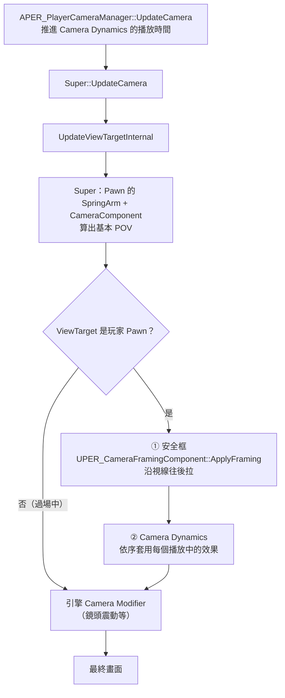

> 一個自訂的 PlayerCameraManager，加上兩個元件與一個 DataAsset，讓俯視角鏡頭能「自動把目標收進畫面」，也能「依演出播放短暫的運鏡」。
> 文中的 `PER_` 前綴是示範專案的命名，請換成自己專案的名稱。
> ⚠️ 以下內容是在 **UE 5.8** 上實作與驗證的，其他版本的引擎行為可能有改變。

---

## 問題

俯視角動作遊戲的鏡頭通常是 SpringArm 掛在玩家身上，固定角度、固定距離。這在一般戰鬥沒問題，但遇到兩種情況就不夠用：

| 情況 | 問題 | 對應功能 |
|---|---|---|
| Boss 戰、大型敵人、玩家被擊飛到遠處 | 重要目標跑出畫面，玩家看不到攻擊前搖 | **安全框**：自動拉遠，讓目標保持在畫面內 |
| Boss 跳起、大招演出、蓄力爆發 | 需要依劇情做短暫的鏡頭位移、拉近拉遠、FOV 變化 | **Camera Dynamics**：用曲線資產描述運鏡，程式只負責播放 |

兩個功能有共同的設計目標：

- **不改 CameraBoom 的參數**：`TargetArmLength`、旋轉都不動，藍圖原本的鏡頭動畫（例如死亡鏡頭）照常運作。
- **只在玩家視角時生效**：切到 Level Sequence 過場時自動停用，不干擾過場鏡頭。
- **企劃與美術可以自己調**：參數放在元件與 DataAsset 上，不用改程式。

---

## 效果展示：安全框

<div align="center">
<video src="./demo_safe_frame.mp4" controls autoplay muted loop playsinline width="800">
</video>
<br><em>綠框是安全框；敵人一靠近框邊，鏡頭就沿著視線往後拉，回到框內後再慢慢收回</em>
</div>

> 🎬 影片無法播放時：[下載 demo_safe_frame.mp4](./demo_safe_frame.mp4)


---

## 架構：鏡頭在一幀內怎麼算出來

兩個功能都掛在自訂的 `APER_PlayerCameraManager` 上。關鍵是**插入點**：在 Pawn 的相機元件算完畫面（POV）之後、引擎的 Camera Modifier（鏡頭震動、CineShot）套用之前。



```cpp
void APER_PlayerCameraManager::UpdateViewTargetInternal(FTViewTarget& OutVT, float DeltaTime)
{
    Super::UpdateViewTargetInternal(OutVT, DeltaTime);   // Pawn 的相機先算完

    APawn* Pawn = PCOwner ? PCOwner->GetPawn() : nullptr;
    if (!Pawn || OutVT.Target != Pawn)
    {
        return;                                           // 過場鏡頭不套用
    }

    if (UPER_CameraFramingComponent* Framing = Pawn->FindComponentByClass<UPER_CameraFramingComponent>())
    {
        Framing->ApplyFraming(PCOwner, DeltaTime, OutVT.POV);   // ① 安全框
    }

    for (const FPER_ActiveCameraDynamics& Active : ActiveDynamics)  // ② 附加效果
    {
        // ……依權重套用每個 Modifier
    }
}
```

**為什麼選這個插入點？**

- 在 Pawn 相機**之後**：拿到的是「正常情況下的畫面」，只需要做差量修正，不用重寫整套相機邏輯。
- 在 Camera Modifier **之前**：鏡頭震動疊在最後，不會被安全框的拉遠吃掉，也不會影響安全框的計算。
- 判斷 `OutVT.Target != Pawn`：播 Level Sequence 時 ViewTarget 換成過場相機，兩個功能自然停用。

---

## 安全框（Camera Framing）

### 元件分工

| 類別 | 掛在哪 | 負責什麼 |
|---|---|---|
| `UPER_CameraTargetComponent` | 敵人、Boss，或任何需要入鏡的 Actor | 標記「這個點要留在畫面內」 |
| `UPER_CameraFramingComponent` | 玩家 | 每幀計算要拉遠多少 |
| `APER_PlayerCameraManager` | PlayerController 指定 | 呼叫 `ApplyFraming` |

`UPER_CameraTargetComponent` 是一個 `USceneComponent`，可以在角色藍圖裡掛到 Socket 或調整高度。**預設不啟用**，可以在 Details 勾選，或由藍圖在需要時（例如 Boss 戰開始）呼叫：

```cpp
CameraTarget->SetCameraTargetActive(true);
```

另外有 `MaxFramingDistance`：目標離玩家超過這個距離就暫時不納入，避免整張地圖另一頭的敵人把鏡頭拉到最遠。

### 核心數學：直接解出「要退多少」

最直覺的做法是「目標在框外就慢慢往後退，直到它進框」，但這會產生來回抖動，而且需要多幀才收斂。這裡改成**每幀直接解出精確的後退距離**。

設鏡頭位置為 $C$，朝向的前、右、上三軸為 $\hat{F}, \hat{R}, \hat{U}$。對某個目標點 $T$：

$$
\text{depth} = (T - C)\cdot\hat{F},\quad
\text{side} = |(T - C)\cdot\hat{R}|,\quad
\text{vertical} = |(T - C)\cdot\hat{U}|
$$

透視投影下，目標在畫面上的水平位置（以畫面半寬為 1）是：

$$
x_{screen} = \frac{\text{side}}{\text{depth} \cdot \tan(\theta_H)}
$$

鏡頭沿視線往後退 $D$，深度變成 $\text{depth} + D$，側向距離不變。要讓目標落在安全框內（安全框寬度比例為 $w$）：

$$
\frac{\text{side}}{(\text{depth} + D)\tan(\theta_H)} \le w
\quad\Longrightarrow\quad
D \ge \frac{\text{side}}{w \cdot \tan(\theta_H)} - \text{depth}
$$

垂直方向同理。對所有目標、兩個軸取最大值，就是這一幀需要的後退距離：

```cpp
const float LimitH = TanH * SafeFrameWidthRatio;
const float LimitV = TanV * SafeFrameHeightRatio;
for (const UPER_CameraTargetComponent* Target : Targets)
{
    const FVector ToTarget = Target->GetComponentLocation() - InOutPOV.Location;
    const float Depth    = ToTarget | Forward;
    const float Side     = FMath::Abs(ToTarget | Right);
    const float Vertical = FMath::Abs(ToTarget | Up);
    Required = FMath::Max3(Required, Side / LimitH - Depth, Vertical / LimitV - Depth);
}
```

**為什麼只沿視線往後退？** 鏡頭的朝向不變，玩家永遠在畫面中心，操作手感不會因為拉遠而改變；畫面效果等同於拉長 SpringArm，但不用動到 SpringArm 本身。

### 取得正確的 tan 半視角

FOV 不能直接拿 `POV.FOV` 來算：UE 的 FOV 預設是水平視角，但視窗比例、`AspectRatioAxisConstraint` 設定都會影響實際的垂直視角，自己換算很容易錯。

這裡直接讀引擎**實際算圖用的投影矩陣**：

```cpp
FSceneViewProjectionData ProjectionData;
LocalPlayer->GetProjectionData(LocalPlayer->ViewportClient->Viewport, ProjectionData);

const FMatrix& Projection = ProjectionData.ProjectionMatrix;
OutTanH = 1.0 / Projection.M[0][0];   // M[0][0] = 1 / tan(水平半視角)
OutTanV = 1.0 / Projection.M[1][1];   // M[1][1] = 1 / tan(垂直半視角)
```

不管視窗怎麼縮放、用哪個軸鎖定 FOV，算出來都跟畫面一致。代價是拿到的是**上一幀**的投影，FOV 劇烈變化時會差一幀，實際上看不出來。

### 拉遠快、拉回慢

```cpp
RequiredPullBack = FMath::Clamp(Required, 0.f, MaxPullBackDistance);
const float Speed = RequiredPullBack > CurrentPullBack ? PullOutSpeed : PullInSpeed;
CurrentPullBack = FMath::FInterpTo(CurrentPullBack, RequiredPullBack, DeltaTime, Speed);
InOutPOV.Location -= Forward * CurrentPullBack;
```

- **拉遠用較快的速度（預設 4）**：目標要出框時要立刻反應，否則玩家會漏看攻擊。
- **拉回用較慢的速度（預設 1.5）**：目標回到框內後慢慢收回，避免敵人在框邊來回時鏡頭忽遠忽近。
- **`MaxPullBackDistance` 上限**：避免目標太遠時鏡頭無限拉遠。

### 參數一覽

**`UPER_CameraFramingComponent`（玩家）**

| 參數 | 預設 | 說明 |
|---|---|---|
| `SafeFrameWidthRatio` | 0.8 | 安全框佔畫面寬度的比例，框外為禁止區域 |
| `SafeFrameHeightRatio` | 0.7 | 安全框佔畫面高度的比例 |
| `MaxPullBackDistance` | 2000 | 最多往後拉多遠（cm） |
| `PullOutSpeed` | 4 | 拉遠的插值速度 |
| `PullInSpeed` | 1.5 | 拉回的插值速度 |

**`UPER_CameraTargetComponent`（目標）**

| 參數 | 預設 | 說明 |
|---|---|---|
| `bCameraTargetActive` | false | 是否納入安全框 |
| `MaxFramingDistance` | 0 | 與玩家距離超過此值時不納入；0 為不限 |

### 除錯顯示

主控台輸入：

```
PER.ShowCameraSafeFrame 1
```

畫面會顯示：

- 綠色矩形：安全框範圍
- 每個啟用中的目標點：框內為綠色、框外為紅色，旁邊標示 Actor 名稱
- 文字：目前拉遠距離／需要的距離／上限、目標數量、tan 半視角等計算輸入

除錯程式碼包在 `#if ENABLE_DRAW_DEBUG` 內，Shipping 版會在編譯階段完全排除。

---

## 使用示範：安全框

<div align="center">
<video src="./setup_safe_frame.mp4" controls playsinline width="800"></video>
<br><em>從掛元件、啟用目標到指定 CameraManager 的完整流程</em>
</div>

> 🎬 影片無法播放時：[下載 setup_safe_frame.mp4](./setup_safe_frame.mp4)

**1. 玩家：調整安全框參數**

玩家角色身上的 `CameraFramingComponent`，在 Details 的 Camera 分類裡調整框的大小與拉遠速度。


**2. 目標：掛上 CameraTarget 並啟用**

在敵人（或任何需要入鏡的 Actor）上掛 `CameraTargetComponent`，可以掛到 Mesh 的 Socket 上調整高度。啟用方式有兩種：直接在 Details 勾 `Camera Target Active`，或在藍圖裡呼叫 `Set Camera Target Active`（例如進入 Boss 戰時開、戰鬥結束時關）。


**3. 指定 CameraManager**

PlayerController 的 Class Defaults 裡，`Player Camera Manager Class` 要指定成 `PER_PlayerCameraManager`。C++ 版的 Controller 也可以直接在建構子設定：

```cpp
PlayerCameraManagerClass = APER_PlayerCameraManager::StaticClass();
```

如果 Controller 藍圖的 Class Defaults 另外改過，要記得改回來，否則兩個功能都不會生效。


**4. 確認效果**

進 PIE 後在主控台開 `PER.ShowCameraSafeFrame 1`，確認框的大小與拉遠距離是否合適。

---

## Camera Dynamics（附加運鏡效果）

<div align="center">
<video src="./camera_dynamics.mp4" controls playsinline width="800"></video>
<br><em>建立 Camera Dynamics Data、編輯曲線，並在跳躍時播放</em>
</div>

> 🎬 影片無法播放時：[下載 camera_dynamics.mp4](./camera_dynamics.mp4)

### 資料結構

運鏡效果是一個 DataAsset，裡面放多個「效果項目」，每個項目用曲線描述隨時間的變化：

```
UPER_CameraDynamicsData（DataAsset）
├─ Modifiers（Instanced 陣列）
│   ├─ UPER_CameraDynamics_Offset    位置偏移（FRuntimeVectorCurve）
│   ├─ UPER_CameraDynamics_Distance  沿視線拉遠／拉近（FRuntimeFloatCurve）
│   └─ UPER_CameraDynamics_FOV       FOV 加減（FRuntimeFloatCurve）
├─ bLoop          是否循環
├─ BlendInTime    淡入時間
└─ BlendOutTime   淡出時間
```

| 效果 | 作用 | 典型用途 |
|---|---|---|
| **Position Offset** | 鏡頭位置偏移，可選世界座標或鏡頭座標（X 前、Y 右、Z 上） | Boss 跳起時鏡頭跟著往上 |
| **Arm Distance** | 沿視線拉遠（正值）或拉近（負值），效果等同改 Arm 長度 | 大招前拉近、爆發時拉遠 |
| **FOV** | FOV 加減（度），結果限制在 1～170 | 衝刺、蓄力爆發的速度感 |

效果長度不用另外填：自動取所有曲線中**最後一個 Key 的時間**。


### 可擴充的效果項目

效果項目的基底類別宣告成 `EditInlineNew` + `DefaultToInstanced`，在 DataAsset 的陣列裡可以直接從下拉選單新增、編輯：

```cpp
UCLASS(Abstract, EditInlineNew, DefaultToInstanced, CollapseCategories)
class UPER_CameraDynamicsModifier : public UObject
{
    GENERATED_BODY()
public:
    /** 曲線最後一個 Key 的時間，作為效果長度 */
    virtual float GetDuration() const { return 0.f; }

    /** Weight 為淡入淡出權重（0~1），效果值要乘上它 */
    virtual void ApplyToView(float Time, float Weight, FMinimalViewInfo& InOutPOV) const {}
};
```

要新增一種效果（例如 Roll 傾斜、景深），只要繼承這個類別、實作兩個函式，**不用改 CameraManager**。以 FOV 為例：

```cpp
void UPER_CameraDynamics_FOV::ApplyToView(float Time, float Weight, FMinimalViewInfo& InOutPOV) const
{
    const float Offset = FOVOffset.GetRichCurveConst()->Eval(Time);
    InOutPOV.FOV = FMath::Clamp(InOutPOV.FOV + Offset * Weight, 1.f, 170.f);
}
```

### 播放與停止

藍圖或 C++ 直接呼叫靜態函式，不需要先取得 CameraManager：

```cpp
// 播放：曲線跑完自動結束；勾 bLoop 則持續到 Remove
APER_PlayerCameraManager::AddCameraDynamics(this, BossJumpCameraData);

// 停止：淡出後移除這個 Data 所有播放中的效果
APER_PlayerCameraManager::RemoveCameraDynamics(this, BossJumpCameraData);
```

同一個 Data 重複呼叫會**疊加**，例如連續兩次衝擊會有兩份效果同時播放。


### 播放中的狀態與權重

每個播放中的效果記錄成一筆資料：

```cpp
struct FPER_ActiveCameraDynamics
{
    TObjectPtr<UPER_CameraDynamicsData> Data;
    float Elapsed = 0.f;       // 已播放時間
    float Duration = 0.f;      // 效果長度
    float StopElapsed = -1.f;  // < 0 表示還沒被 Remove
};
```

權重由三種淡入淡出取最小值，最後套 SmoothStep 讓開始與結束更柔和：

```cpp
float Weight = BlendIn > 0 ? Clamp(Elapsed / BlendIn, 0, 1) : 1;              // 開頭淡入
if (!bLoop && BlendOut > 0)
    Weight = Min(Weight, Clamp((Duration - Elapsed) / BlendOut, 0, 1));       // 自然結束前淡出
if (StopElapsed >= 0)
    Weight = Min(Weight, BlendOut > 0 ? Clamp(1 - StopElapsed / BlendOut, 0, 1) : 0);  // 被 Remove 後淡出
return FMath::SmoothStep(0.f, 1.f, Weight);
```

循環效果的取樣時間用 `Fmod(Elapsed, Duration)`，曲線會從頭重播。

### 時間要在哪裡推進？

這是實作時最容易出錯的地方。直覺上會在 `UpdateViewTargetInternal` 裡推進時間，但**切換 ViewTarget 的混合期間，引擎一幀會呼叫它兩次**（舊目標、新目標各一次），時間就會快一倍。

所以時間推進和過期清除放在 `UpdateCamera`，一幀只會跑一次：

```cpp
void APER_PlayerCameraManager::UpdateCamera(float DeltaTime)
{
    ActiveDynamics.RemoveAll([DeltaTime](FPER_ActiveCameraDynamics& Active)
    {
        Active.Elapsed += DeltaTime;
        if (Active.StopElapsed >= 0.f)
        {
            Active.StopElapsed += DeltaTime;
            if (Active.StopElapsed >= Active.Data->BlendOutTime) return true;   // 淡出完成
        }
        return !Active.Data->bLoop && Active.Elapsed >= Active.Duration;        // 播完
    });

    Super::UpdateCamera(DeltaTime);   // 之後才會呼叫 UpdateViewTargetInternal
}
```

`UpdateViewTargetInternal` 裡只**讀取**時間來套用效果，呼叫幾次都不影響結果。

### 範例：Boss 跳躍

1. 內容瀏覽器新增 Data Asset，類別選 `PER_CameraDynamicsData`，命名 `CD_BossJump`。
2. `Modifiers` 新增 **Position Offset**，Space 選 World，在 Z 曲線打 Key：0 秒 → 0、0.4 秒 → 150、1.0 秒 → 0。
3. 再新增 **Arm Distance**：0 秒 → 0、0.4 秒 → 300、1.0 秒 → 0。
4. `BlendInTime = 0.1`、`BlendOutTime = 0.2`。
5. 在 Boss 跳躍動畫的 AnimNotify 或技能裡呼叫 `AddCameraDynamics(CD_BossJump)`。

---

## 設計取捨與踩過的坑

| 決策 | 原因 |
|---|---|
| 不改 SpringArm，直接改 POV | 藍圖的鏡頭動畫、SpringArm 的碰撞與延遲都照常運作，兩個功能是純疊加 |
| 安全框只沿視線後退 | 玩家固定在畫面中心，操作方向不變；數學上可以直接解，不用反覆逼近 |
| 從投影矩陣取 tan 半視角 | 自動符合視窗比例與 FOV 軸鎖定，不用自己換算 |
| 拉遠快、拉回慢 | 不漏看威脅，又避免目標在框邊時鏡頭抖動 |
| 目標點預設不啟用 | 小怪不會影響鏡頭，只有設計上需要的時機才納入 |
| 時間在 `UpdateCamera` 推進 | ViewTarget 混合期間 `UpdateViewTargetInternal` 一幀會被呼叫兩次 |
| 效果項目用 Instanced UObject | 新增效果種類不用改播放器，企劃可在同一個資產裡組合多種效果 |
| 過場時兩者都停用 | 用 `ViewTarget != Pawn` 判斷，不需要額外的開關或狀態 |

### 已知限制

- **只支援透視投影**：正交投影時安全框不計算（`ProjectionMode != Perspective` 直接略過）。
- **目標點查詢使用 `TObjectIterator`**：目標數量少時沒問題；若場上有大量目標，可改成在元件 `BeginPlay` / `EndPlay` 註冊到 `UWorldSubsystem`。
- **投影資料是上一幀的**：FOV 劇烈變化（例如 FOV 效果的瞬間跳變）時，安全框會晚一幀反應。
