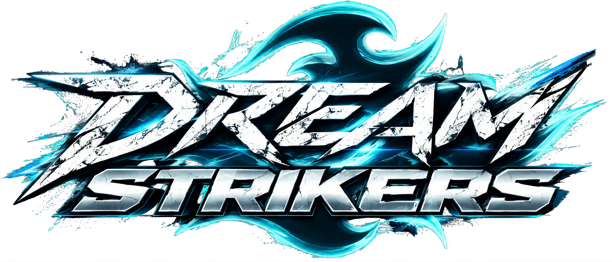
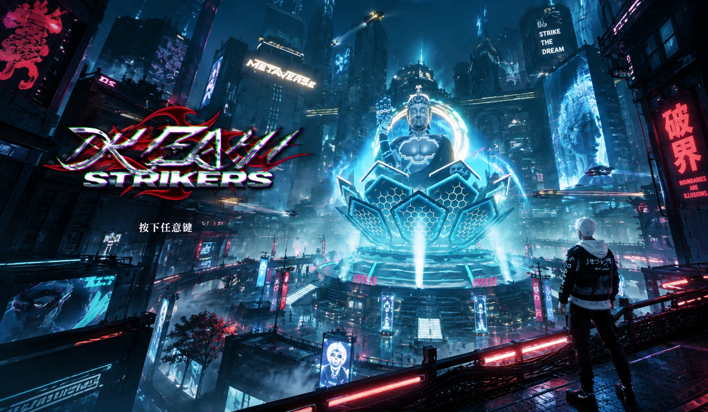
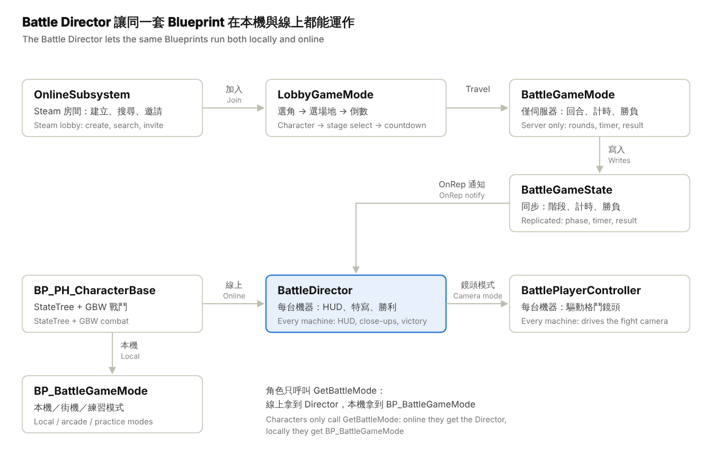
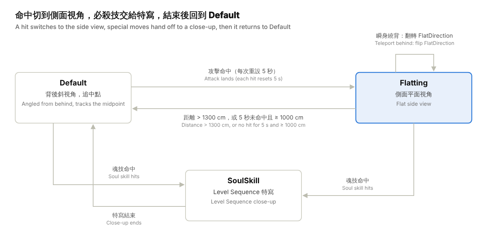
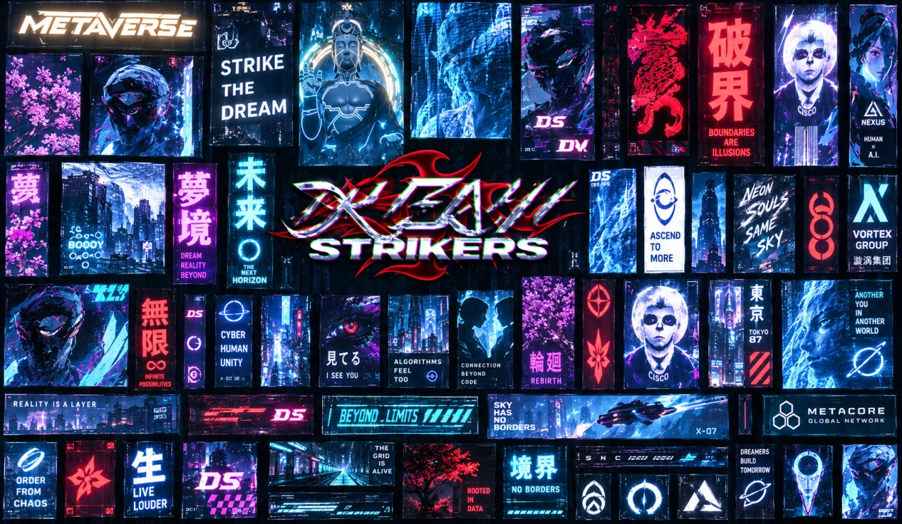

Inspired by Bandai Namco's Naruto: Ultimate Ninja Storm series and Jump Force, DreamStrikers is my attempt at an easy-to-pick-up 3D action fighting game. This page covers the main systems I designed and built for the project: the fighting camera, the character state machine and combat system, the online versus architecture, and the development tools.

:::tip
In independent development. A demo is out on Steam, and the game is planned to go free-to-play. [Visit the Steam page](https://store.steampowered.com/app/3183230/_/)
:::

## Overview

DreamStrikers (code name Fightet) is a 3D versus fighting game built in Unreal Engine 5.8. Its gameplay and camera take after Naruto Shippuden: Ultimate Ninja Storm: two fighters circle, dash and chase each other around a free 3D arena, and the camera always looks at the fight from behind your own character. The project supports local versus, arcade, practice, and online lobby matches through Steam.

| Item | Details |
| --- | --- |
| Engine | Unreal Engine 5.8 (C++ module `Fightet` + Blueprint) |
| Playable characters | KAI, LITO, RAIN, ICE (the roster is managed by `UMS_GameInstance.Player List`) |
| Game modes | Local 2P, arcade (with AI), practice, online lobby (2 fighters + up to 6 spectators) |
| Core systems | Two-fighter camera, Soul system (Soul skills 1–4, Awakening, the Final finisher), chase / evade (FFC) |
| Character state machine | GBW Powerful State (driven by StateTree) + Gameplay Abilities |
| Online | SteamCorePro + Online Subsystem Sessions, server-authoritative round flow |
| Input | Enhanced Input (`IMC_Fighter` / `IMC_FighterP2`), DualShock support with rumble |
| UI | UMG + CommonUI + Ultimate Menu System (UMS), Niagara UI Renderer, Async Loading Screen |

**The C++ source is split into five folders by responsibility:**

| Folder | Responsibility |
| --- | --- |
| `Battle/` | Online battles: server round flow, the battle director synced across machines, fighting camera, results screen, performance tests |
| `Lobby/` | Online lobby: character select, stage select, fighter / spectator rotation, shared selection frame |
| `Online/` | Steam lobby create / search / invite, friends list, Blueprint reflection call helpers, UMS menu bridge |
| `Menu/` | Main menu scene: title camera zones, background flying traffic |
| `BattleContent/` | C++ base for the Blueprint function libraries |

## Code architecture

The core idea is "the server decides the match, and every machine stages its own presentation". The GameMode runs the round flow only on the server and writes the results into the replicated GameState. On each machine, the Battle Director turns state changes into HUD, camera and character events.

Read it from the top left: the online flow goes from a Steam lobby into lobby mode, then travels to the battle. The Battle Director highlighted in the middle is what lets the local code go online as-is.

## Camera system: a 3D fighting camera modeled on Ultimate Ninja Storm

The camera's goal is to "always look from behind your own character, angled toward the midpoint between the two fighters", so players can see both themselves and their opponent in a free 3D arena. Instead of spawning a separate camera, it drives the SpringArm and Camera on the character directly, updated every frame by `AFightetBattlePlayerController::PlayerTick`. In online matches each machine runs its own camera focused on its own character; spectators follow P1.

The camera has three modes (`E_BattleCameraMode`), plus a reserved "frozen" value that lets specific moves take over the camera. Mode changes don't apply immediately: they're written to `TargetCameraMode` and applied on the next frame, so several systems can't overwrite each other within the same frame.

| Mode | When it's used | Camera behavior |
| --- | --- | --- |
| Default (0) | Normal movement, circling, positioning | Angled view from behind, turning along the line between the fighters; the spring arm stretches with distance (280–500 cm) |
| Flatting (1) | Exchanges after an attack lands | Switches to a flat side view that puts the fighters on the left and right of the screen like a 2D fighter; the spring arm can reach 3000 cm |
| SoulSkill (2) | Close-ups for Soul skills / special moves | Hands the camera to a Level Sequence, then blends back to the character camera when it ends |

These are the only paths between the three modes. Close-ups always return to Default, so the camera state after any cinematic is predictable.

### Default mode: a four-step algorithm

1. **Angle check:** compute the angle θ between the "camera → self" and "camera → opponent" vectors. The spring arm only turns when θ is greater than `TurnAngle` (30°). This dead zone keeps the camera from jittering back and forth when the two fighters are nearly in line with the view.
2. **SpringArm handle:** take the midpoint Mid between the fighters and extend one arm length toward the opponent to get a target point. The spring arm's yaw turns smoothly toward it with `RLerp(…, Δt×4)`.
3. **Camera faces the midpoint:** the Camera itself only rotates in yaw and eases toward Mid, so you sit on one side of the screen and your opponent on the other.
4. **Arm length follows distance:** the arm length eases out toward clamp(distance between fighters, default arm length, 500), so the camera pulls back as they move apart.

$$
\theta = \arccos\frac{(P_{self}-C)\cdot(P_{other}-C)}{\lVert P_{self}-C\rVert\,\lVert P_{other}-C\rVert},\qquad \text{rotate arm only if } \theta > 30^\circ
$$

$$
T = M + \widehat{(P_{other}-P_{self})}\cdot L_{default},\qquad M = \tfrac{1}{2}(P_{self}+P_{other})
$$

### Flatting mode: a side view on hit

When an attack lands, the character calls `FlattingCameraResetTime` and the camera enters flat mode. Every hit resets a 5-second "still fighting" timer. This keeps the view steady during combos instead of swinging around as the fighters move.

- **Picking a side on entry:** the Z component of the cross product (P_self − C) × (P_other − C) tells which side of the line between the fighters the camera is on, and it stays on that side. It never swings around to the other side when switching.
- **Continuous update:** take a side point next to Mid at a distance of clamp(distance between fighters, 270, 2000). The spring arm turns toward it with an extra 30° offset to keep some depth, and the arm length eases toward clamp(distance, default arm length, 3000).
- **Exit conditions:** return to Default when the fighters are more than 1300 cm apart, or when there's been no hit for 5 seconds and they're at least 1000 cm apart.
- **Teleport-behind fix (RetainFlattingPosition):** when a character dashes behind the opponent, the two swap sides. Calculated normally, the camera would whip around 180°. Instead it flips `FlatDirection`: the camera stays where it is, and only the left and right sides of the screen swap.

### SoulSkill mode: special-move close-ups

When a Soul skill lands, a Level Sequence plays a close-up:

1. Spawn a local, non-replicated `SoulCineCamera` attached to the caster.
2. Bind it to the Sequence's camera track with `SetBindingByTag("Camera")`, so the same close-up works anywhere in the arena.
3. Blend in with `SetViewTargetWithBlend`.
4. The close-up ends when the `CloseUp` bool on the character state machine goes back to false.
5. Blend back to the character camera over the specified BlendOut time, then clean up the camera and Sequence.

The timing design is tied closely to online sync; see "Networking and online versus". The victory animation uses the same method, with an extra `Player` tag bound to the winner.

### Local 2P camera: Switch Focus

In local versus, two players share one screen, and the camera can only follow one of them at a time. `BP_BattleGameMode` "switches focus" to whichever fighter is closer to the camera:

1. **Measure distances:** `Get Players to Camera Distance` computes each fighter's distance to the camera, and `Players to Camera Angle` uses a dot product to get their angle relative to the camera.
2. **Decide whether to switch:** `Get Player Camera Must Switch` compares the two distances and only switches when the opponent is clearly closer to the camera than the current focus, beyond a threshold.
3. **Switch:** `Switch to near player camera` moves the focus to the closer fighter and turns their spring arm toward the opponent, so the view doesn't jump after the switch.
4. **Cooldown:** `Allow Switch?` is controlled by a timer, so the camera won't switch again for a while after switching. This prevents ping-ponging when the two distances are close. `STT_SoulCollsion` also disables switching while a Soul skill plays.

In online play every machine has its own screen and doesn't need to switch focus, so the C++ port always focuses on your own character and keeps only the Default and Flatting camera work.

### Other camera details

- **Fallback side camera:** characters without a SpringArm use a standalone CameraActor instead. Camera distance = clamp(distance between fighters × 0.9 + 337.5, 450, 1400), height 120 cm, look-at height 90 cm, FOV 60°.
- **Hit shake:** getting hit, light hits and finishers each have their own Camera Shake (`BeHitCamShake`, `LightHitShake`, `FinalCameraShake`), triggered by GBW's `BP_ET_HitCameraShake` effect, with matching gamepad rumble.
- **Title screen camera zones:** `AFightetTitleCameraZone` blends the FOV based on the camera's distance to the zone (150–1500 cm), hides objects that block the view and switches character poses, so the menu camera moves smoothly between screens.
- **Every parameter is Config:** angles, arm lengths, exit distances and hold times are all UPROPERTY(Config) and can be overridden in `DefaultGame.ini`, so designers can tune the feel without recompiling.

## Character movement and lock-on

Character movement is handled by GBW Powerful Hit's FlowMove system, and every character template (`PHT_KAI`, `PHT_LITO`, …) uses the `TP_FreeMode` free-camera mode. Characters move freely in 3D space; most of the feeling of "facing the opponent" and "circling" comes from the camera turning described in the previous section. Lock-on and dash direction are handled by the StateTree and animation notifies:

| Mechanic | Where it lives | How it works |
| --- | --- | --- |
| Ground / air detection | `STE_Battle_FlowMoveCognition` (StateTree Evaluator, server only) | Every frame, `K2_ComputeFloorDist` measures the capsule's distance to the ground and writes `IsGround` / `IsAir`, which the state tree uses to switch Ground → Air → Land |
| Dash direction | `STC_DashDirection` | Takes the dot product of the "self → opponent" direction and the input direction, and uses the cosine to tell forward from back; the Z component of the cross product tells left from right. These map to the four states DashFront / DashLeft / DashRight / DashBack |
| Has input or not | `STC_HasMoveVector` / `STC_NoMoveVector` | Tells standing attacks from moving attacks; for example, only pressing Soul while standing still enters `NoMoveSoulOperation` |
| Attack lock-on | `ANS_LockOnTarget` (animation notify state) | At the start of the notify and on every tick, turns the character toward the opponent and sets the movement vector toward them, so attacks keep tracking the opponent |
| Chase (teleport) | `STT_FFC_Persue` | Spends FFC gauge, finds an unobstructed spot around the opponent, teleports there, turns to face them, and calls `RetainFlattingPosition` to fix the flat camera |
| Evade (substitution) | `STT_FFC_Escape` | Teleports away from the opponent, snaps the landing point to the ground with `K2_FindFloor`, and turns to face the opponent |
| Air combos | `AN_AirAttackLaunch` / `AN_AirAttackEnd` | Mark when the opponent is launched and when the air combo ends |

**Teleport landing algorithm (CheckBlockers):** chase and evade don't teleport to a fixed spot. Around the target point, starting from an initial angle and stepping by a fixed increment, they run capsule sweeps one by one (`CapsuleTraceSingleForObjects`, using the character capsule's radius). If a sweep hits an object with certain tags, they try the next angle until they find free space. That way characters never end up inside a wall or on top of the opponent after teleporting.

In online matches, a character's movement is decided by the machine that owns it. The server only tells each machine the starting positions for each round through `FighterStarts`, and the owner places its own character there.

## Combat system

Combat is data-driven: each character is a GBW Powerful State template made of a StateTree, a team setting and a set of starting attributes, all defined in `DefaultGBW.ini`. Adding a character mostly means adding data and a state tree, without touching the shared character base `BP_PH_CharacterBase`. Players and AI share the same character and only swap StateTrees (for example `ST_PH_LITO` vs `ST_PH_V_AI-LITO` + `GBW_ST_AI`).

### Character state tree (StateTree)

Each character's behavior is a StateTree. Using `ST_PH_LITO` as the example, the state tree has three key design points:

- **Runs only on the server:** the outer `Server` state's entry condition is `STC_NetInfo`, which checks the Actor's network role, so online the whole tree runs only on the server. That's also why the finisher has to use `MulticastFinal` to notify other machines.
- **Getting hit takes priority:** `Server` has a set of Critical-priority global transitions. Whatever the character is doing, as soon as the `SoulOperation`, `KnockDown` or `Balance` attribute reaches its threshold, it jumps straight to the matching hit state. Chase / evade events are also received at this level.
- **Lock flags control cancel windows:** `ActionLock`, `DashLock`, `SoulLock` and `HurtLock` are booleans set by animations. For example, during the `Attack_A` combo you can only cancel into a dash when `DashLock` is released, and into a Soul skill when `SoulLock` is released. Cancel timing is entirely up to the animations and doesn't need to be written in code.

| Branch | Substates | Contents |
| --- | --- | --- |
| FlowMove | FreeMove (Ground / Air / Land), Jump, Dash (front / left / right / back) | Movement, jumping, four-way dashes |
| PH | Attack_A, Defense, Break, BeHit (BeAttacked / KnockDown), GetUp | Basic combos (`FM_CarouselAction` cycles through combo moves), guarding, guard break, getting hit, getting up |
| Soul | SoulGather, NoMoveSoulOperation, SoulAttack (A / B / C / Awake / Final), SoulBeHit (A / B / C) | Charging Soul, Soul skills, Awakening, the finisher, getting hit by Soul skills |
| FFC | FFC_Persue, FFC_Escape | Chase and evade; entering adds the `FFC_Used` Buff |

### Shared attributes (all characters)

| Attribute | Range | Purpose |
| --- | --- | --- |
| Soul | 1–399 | Soul gauge, the resource for Soul skills and special moves |
| SoulOperation | 0–4 | Soul skill stage (maps to the inputs `IA_Soul_1_Attack`–`IA_Soul_4_Attack`) |
| FFC | 0–400 | Chase / evade gauge; `Buff_Recover` restores 2 points every 0.2 seconds |
| Balance, KnockDown | 0–100 | Balance and knockdown values that decide when a guard breaks and when a character is knocked down |
| SK | −100–100 | A value raised and lowered by the `SK Up` / `SK Down` Buffs |
| AWake | 0–1 | Awakening state; when on, attack power and Soul skill damage go up 50% |

Attack power and Soul skill damage are "expression attributes" that recalculate automatically with Awakening:

$$
\text{Damage} = B + B \times 0.5 \times \text{AWake}
$$

### Character stats (the base value B in the expression)

| Character | HP | Basic attack | Soul A | Soul B | Soul C | Finisher D |
| --- | --- | --- | --- | --- | --- | --- |
| KAI | 5400 | 160 | 670 | 700 | 760 | 1200 |
| LITO | 5300 | 170 | 750 | 620 | 800 | 1000 |
| RAIN | 5200 | 190 | 680 | 500 | 800 | 1200 |
| ICE | 5105 | 88 | 460 | 410 | 520 | 1200 |

### Hit detection

- **Detection:** GBW Powerful Hit's Trace settings (`PH_Trace`, `PH_Vaild`, `PH_FindActor`), with valid targets limited to `BP_PH_CharacterBase`.
- **Teams:** the Gameplay Tags `GBW.Camp.P1` / `GBW.Camp.P2` tell friend from foe, and the `HitP1` / `HitP2` settings decide who can hit whom.
- **Hittable condition (`CanHit`):** the target must be in the `vincible` state, not in `Defense`, and not tagged `Wall` or `Cam`. Invincibility frames and guarding are expressed as states, so individual moves don't have to check for them.
- **Damage and effects:** every move is a Buff (such as `KAI_AttackDamageHeavy` or `RAIN_SoulAttack.B.Projectile`). Hit reactions are looked up in the `SoulBehitData` table and lined up with animation frames by animation notifies (`AN_BeHitCombo`, `AN_BeHitToOpponentPlayAnim`).

### Hit animations come from the attacker

When a character is hit by a Soul skill, the animation it plays isn't its own generic hurt animation; the attacker's character decides it. When the state tree starts, `STE_Battle_SoulSystem_Cognition` gets the opponent's character name, uses it as the key to look up a set of hit animations in the `SoulBehitData` table (`SoulBehit_A`–`D` and `Ex1`–`Ex4`), and stores them on the character.

That way every character pairing can have its own matched attack and hit animations for Soul skills, just like the special-move cinematics in Ultimate Ninja Storm. Adding a character only takes one new row in the table. The few character-specific exceptions also live in this Evaluator; for example, in certain states ICE swaps its A-stage hit animation for a different set (`Character-ICE-SP`).

While a Soul skill plays, `STT_SoulCollsion` temporarily changes the characters' capsule collision type so the two fighters don't push each other around during the cinematic, then changes it back afterward.

### Guard breaks and super armor

According to the comments in `BP_PH_CharacterBase`, there are three ways to break a guard:

- **Throws:** a throw breaks a guard outright.
- **D_Break:** with the D_Break attribute, the next hit on the opponent's weapon breaks their guard immediately.
- **O_Break:** with the O_Break attribute, the character can activate a "Golden Bell" super armor. The character gets an overlay material as a visual cue, and a timer removes it automatically.

The last hit of a combo adds a launch Buff.

### The Final finisher

Awakening and the finisher form one continuous flow:

1. **Awakening:** when the Soul gauge is high enough, the UI hints that you can awaken (`CheckPlayerCanAwakeAnHint`). `STT_Awaking` starts Awakening, raising attack power and Soul skill damage by 50%.
2. **Awakening drain:** while awakened, `AwakeEnegy` drains on a timer and is synced to the Awakening bar in the battle UI (`Awake Fade`).
3. **Unlocking the finisher:** `STC_SoulFinalCondition` requires all three of: being awakened, the opponent's HP at or below 50%, and the Soul skill input at stage 4 (`SoulOperation` = 4). When the condition is met, the UI hints that you can finish (`Hint Player Can Final`).
4. **Launch:** `STT_FinalAttackLaunch` launches the finisher, with parameters from the `SoulFinalData` table.
5. **Cinematic:** `SoulKill Progress Handle` moves both characters to the special-move spot preset in the stage (`SpecialMMovesLocatedPoint`) and faces them toward each other, spawns a dedicated camera, and binds both fighters and the camera into a Level Sequence with `SetBindingByTag`.

The round timer pauses while the finisher plays, and if the finisher lands and its animation plays to the end, that player wins.

### Round flow

Each round goes Loading → RoundIntro (3 seconds) → Fighting → RoundOver (3 seconds) → next round or MatchOver.

- **KO effect:** global time slows to 0.3× for 1.5 seconds of real time.
- **Time out:** the winner is decided by remaining HP percentage.
- **Ways a round ends:** KO, finisher KO, time out, and forfeit.
- **Results screen:** uses each round's ending HP, remaining seconds and how the round ended.

### AI opponents

The AI uses the same character Blueprint as the player and just swaps the StateTree (`GBW_ST_AI`), so the AI has exactly the same moves as the player.

- **Three difficulty branches:** the state tree splits into `Server`, `Normal` and `Hard`, and an enum comparison decides which branch to enter.
- **Behavior groups:** each branch has three groups: free movement (approach, charge Soul), offense (basic attacks, guard breaks, Soul skills) and defense (guard, back off).
- **Chance-based triggers:** behaviors switch on `FM_Distance` distance conditions and `STC_ActionTriggerChance` probability conditions, so the AI won't do the same thing every time in the same situation.
- **Hard difficulty:** awakens on its own, launches the finisher when the conditions are met, and after a successful guard randomly dashes left or right or chases in for a counterattack.

## Networking and online versus

Online mode uses a "lobby-based Listen Server": the host is also the server, two players fight, and everyone else spectates in queue order. The transport layer is the SteamCore Sockets NetDriver (falling back to IpNetDriver on failure). The biggest challenge in this mode: the original local versus mode was written entirely in the Blueprint `BP_BattleGameMode`, and online the GameMode only exists on the server.

### Key design: the Battle Director bridge

The fix is for characters and UI to stop getting the GameMode directly and call `UFightetBattleLibrary::GetBattleMode` instead:

- **Local / arcade / practice:** returns the original GameMode, so behavior is unchanged.
- **Online:** returns `AFightetBattleDirector`, a replicated Actor that exists on every machine and implements the same Blueprint interface, `BPI_BattleMode`.

Character, move and UI Blueprints only need to swap "Get Game Mode" for "Get Battle Mode", and the whole combat logic works online without a rewrite.

Calls into Blueprints (reading HP, firing battle UI events and so on) go through `FightetReflection` by name. It fills in parameters and reads return values through `UFunction` reflection, so the C++ doesn't depend on Blueprint classes that have no C++ type.

### Who has authority

| Data | Decided by | How it reaches other machines |
| --- | --- | --- |
| Round phase, timer, winner, results data | Server `AFightetBattleGameMode` | Replicated properties on `AFightetBattleGameState` + OnRep → `OnMatchChanged` |
| Character movement | The machine that owns the character | The character's own movement replication; round start positions come from `FighterStarts` |
| Special-move close-up camera | The machine that saw the hit | Server RPC `ServerShareSkillCam` → `MulticastSkillCam` (Reliable) |
| Flat camera trigger | Server (often the only one that sees the hit) | `MulticastFlatCamera` (Unreliable); flipping sides via `MulticastFlipFlatCamera` (Reliable) |
| Finisher launch | Server (the StateTree only runs on the server) | `MulticastFinal` |
| Camera, UI, victory animation | Each machine on its own | Not replicated; the Director spawns them locally based on the match state |

### Reliability details

- **Waiting for loading:** after the server streams in the stage, it checks whether each connection's `ClientVisibleLevelNames` includes that stage, and only spawns the characters once both fighters have loaded (waiting up to 30 seconds). A slower player won't get hit the moment they arrive.
- **Characters are always relevant:** fighters are set to `bAlwaysRelevant`. Close-up and victory cameras fly far away from the characters, and with distance culling the client's characters would vanish.
- **Remote close-up timeout:** a close-up triggered from another machine switches back automatically after 6–8 seconds if the end signal never arrives, so a lost packet can't leave the view stuck in a close-up.
- **Online pause:** only opens the menu and disables your own character's input; the match keeps going.
- **Loading curtain:** the screen stays black with the loading screen until the first round starts, so players never see the stage streaming in.
- **Disconnects:** if a fighter leaves mid-match, their character stays in the arena until the match ends, and the opponent wins that round (forfeit).
- **Results screen:** returns to the lobby only after every fighter confirms, staying at least 8 seconds and at most 40.

### Lobby system

- **Lobby options:** lobby name, 2–8 players, public or private, password (only a hash is broadcast), 1/3/5/7/9 rounds, round length in seconds.
- **Ways to join:** lobby list (with ping), lobby code, Steam friend invite. Searches compare a protocol version number, so clients on different versions can't see each other's lobbies.
- **Lobby flow:** character select → stage select → 4.5-second countdown → Seamless Travel to the battle map, then back to the lobby afterward.
- **Rotation rules:** the winner keeps their fighter slot and builds a win streak; the loser goes to the back of the queue. Across map travel, each member's queue order, slot, streak and record are stored in `UFightetOnlineSubsystem` (a GameInstance Subsystem); back in the lobby, a fighter's slot is held for them for 15 seconds.

## Other tech and tools

| Tech | Implementation | Highlights |
| --- | --- | --- |
| Automated performance tests | `Fightet.PerfRun SKY,Tokyo,…` console command | Loads each stage in turn with RAIN vs KAI idling, writes one CSV profile per stage, and quits when done; used for standalone (-game) runs |
| Automated test interface | `InjectInput`, `StartHeldInput`, `DescribeBattle`, `NetTestSkillCam`, `NetConfirmResult` | Simulates button presses and stick input and prints the match state as text, so a script can play through a whole online match |
| Shared selection frame | `UFightetSelectFrameLayer` (Slate `NativePaint`) | Draws the glowing 1P / 2P frames on any character or stage select screen, following the target widget's geometry; pulses while choosing, pops in when moving and stays lit once locked. Reads the cursor from Blueprint screens through reflection, without changing the original graphs |
| Menu bridge | `FightetUMS`, `FightetReflection` | Lets the C++ online menus drive Ultimate Menu System's Blueprint screens directly (navigation, focus, settings rows) |
| Main menu scene | `AFightetTitleCameraZone`, `AFightetSkyTraffic` | The title camera blends FOV and character poses by distance; the background city has looping flying vehicles with head and tail lights |
| Camera work and cinematics | Level Sequence (tag binding), Movie Render Pipeline | Close-ups and victory animations can be reused with any character on any stage |
| Art pipeline | MetaHuman, Live Link Face, Hair Strands, Niagara (including UI Renderer), GPU Lightmass, Apex Destruction | Facial capture, hair, UI particle effects, destructible environments |
| Loading | Async Loading Screen + manual camera fades | Stages and characters never show half-loaded frames while loading |
| Version control | Git + Git LFS (lockable `.uasset` / `.umap`), UEGitPlugin | File locking inside the editor prevents conflicts on binary assets |
| Localization | Localization setup, English by default | The language menu saves the player's choice |

## Art style

