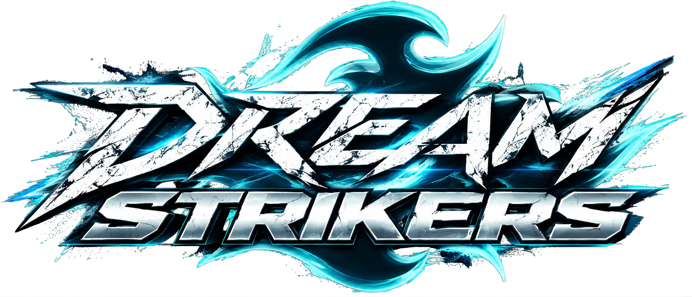
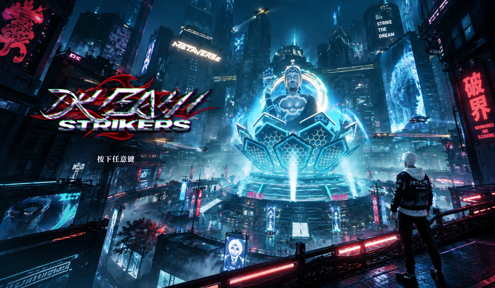
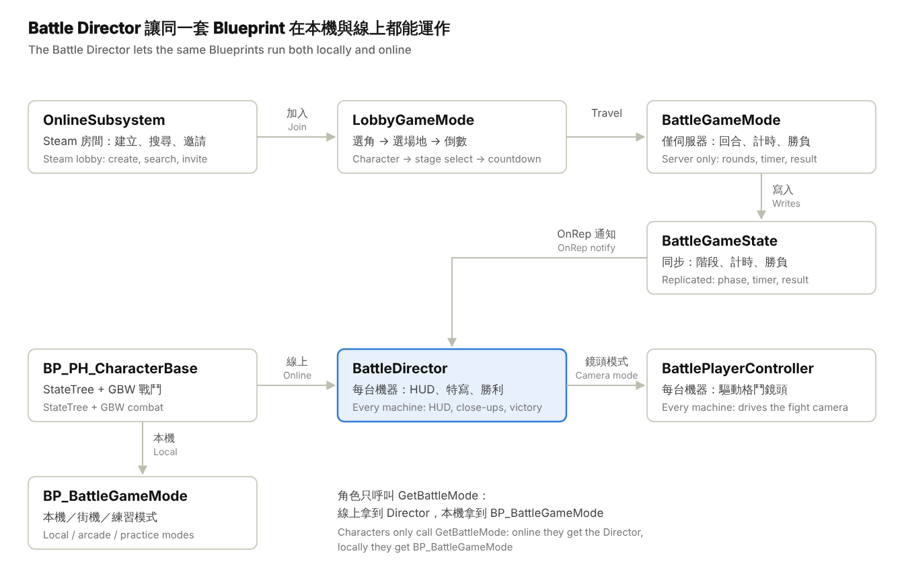
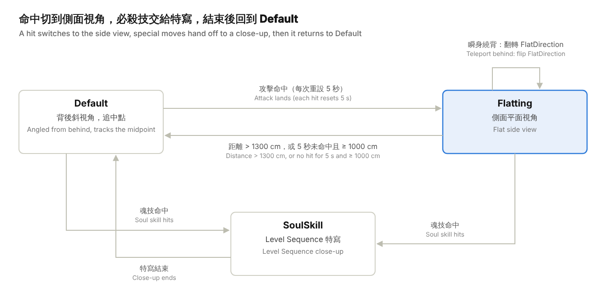
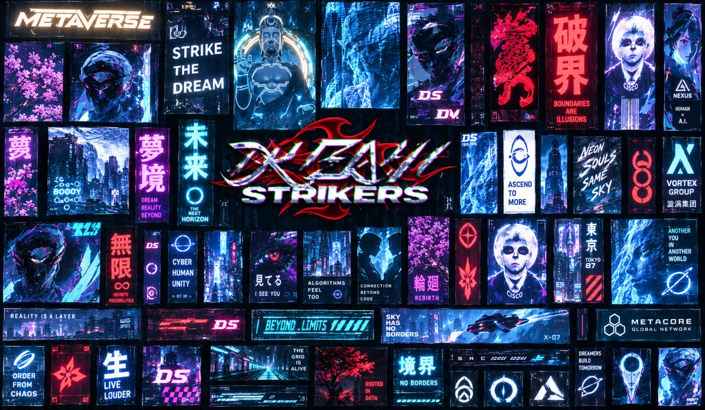

受到萬代南夢宮《火影忍者 終極風暴》系列與《Jump Force》啟發，試著製作一款可以輕鬆上手的 3D 格鬥動作遊戲。這頁整理我在專案裡負責與設計的主要系統：格鬥鏡頭、角色狀態機與戰鬥系統、線上對戰架構，以及開發工具。

:::tip
目前獨立製作中，已在 Steam 推出 Demo，規劃未來轉為免費遊玩。[前往 Steam 頁面](https://store.steampowered.com/app/3183230/_/)
:::

## 專案概覽

DreamStrikers（專案代號 Fightet）是以 Unreal Engine 5.8 開發的 3D 對戰格鬥遊戲，玩法與鏡頭參考《火影忍者 疾風傳 究極忍者風暴》系列：兩名角色在自由 3D 場地中繞圈、衝刺、追擊，鏡頭永遠從自己角色背後看向戰場。專案同時支援本機對戰、街機、練習模式，以及透過 Steam 的線上房間對戰。

| 項目 | 內容 |
| --- | --- |
| 引擎 | Unreal Engine 5.8（C++ 模組 `Fightet` + Blueprint） |
| 可玩角色 | KAI、LITO、RAIN、ICE（角色清單由 `UMS_GameInstance.Player List` 管理） |
| 遊戲模式 | 本機雙人、街機（含 AI）、練習、線上房間（2 名戰鬥者 + 最多 6 名觀戰） |
| 核心系統 | 雙人格鬥鏡頭、Soul 魂系統（魂技 1–4、覺醒、終結技 Final）、追擊／閃避（FFC） |
| 角色狀態機 | GBW Powerful State（StateTree 驅動）+ Gameplay Abilities |
| 線上 | SteamCorePro + Online Subsystem Sessions，伺服器權威的回合流程 |
| 輸入 | Enhanced Input（`IMC_Fighter` / `IMC_FighterP2`），支援 DualShock 與震動回饋 |
| UI | UMG + CommonUI + Ultimate Menu System（UMS）、Niagara UI Renderer、Async Loading Screen |

**C++ 原始碼按職責分成五個資料夾：**

| 資料夾 | 負責內容 |
| --- | --- |
| `Battle/` | 線上對戰：伺服器回合流程、跨機器同步的戰鬥導演、格鬥鏡頭、結算畫面、效能測試 |
| `Lobby/` | 線上房間：選角、選場地、戰鬥者／觀戰者輪替、共用選取框 |
| `Online/` | Steam 房間建立／搜尋／邀請、好友清單、Blueprint 反射呼叫工具、UMS 選單橋接 |
| `Menu/` | 主選單場景：標題鏡頭區域、背景飛行交通 |
| `BattleContent/` | Blueprint 函式庫的 C++ 基底 |

## 程式架構

架構的核心是「伺服器決定比賽、每台機器自己演出」。GameMode 只在伺服器跑回合流程，把結果寫進同步的 GameState。每台機器上的 Battle Director 把狀態變化轉成 HUD、鏡頭與角色事件。

從左上讀起：線上流程從 Steam 房間進入房間模式，再 travel 到戰鬥。中間強調的 Battle Director 是本機程式碼能直接上線的關鍵。

## 鏡頭系統：仿「究極風暴」的 3D 格鬥鏡頭

鏡頭的設計目標是「永遠從自己角色背後、斜向看向兩人中點」，讓玩家在自由 3D 場地中仍能同時看清自己與對手。實作上不另外生成攝影機，而是直接驅動角色身上的 SpringArm（彈簧臂）與 Camera，由 `AFightetBattlePlayerController::PlayerTick` 每幀更新。線上對戰時每台機器各自跑一份鏡頭，焦點是自己的角色；觀戰者跟隨 P1。

鏡頭分成三種模式（`E_BattleCameraMode`），另外保留「凍結」值給特定招式接管鏡頭。模式切換不在呼叫當下生效，而是寫入 `TargetCameraMode`，下一幀才套用，避免同一幀內多個系統互相覆蓋。

| 模式 | 何時使用 | 鏡頭行為 |
| --- | --- | --- |
| Default（0） | 一般移動、繞圈、走位 | 背後斜視角，沿著兩人連線轉向，彈簧臂隨距離伸縮（280–500 cm） |
| Flatting（1） | 攻擊命中後的連段互毆 | 切成側面「平面」視角，像 2D 格鬥一樣把兩人放在畫面左右，彈簧臂最長 3000 cm |
| SoulSkill（2） | 魂技／必殺技的特寫 | 交給 Level Sequence 運鏡，結束後混合回角色鏡頭 |

三個模式之間只有這幾條路徑。特寫結束一律回到 Default，所以演出後的鏡頭狀態永遠可以預期。

### Default 模式：四步演算法

1. **角度檢查（Angle Check）：** 計算「鏡頭→自己」與「鏡頭→對手」兩個向量的夾角 θ。只有 θ 大於 `TurnAngle`（30°）時才轉動彈簧臂。這是一個死區：兩人幾乎站在視線上時不轉向，防止鏡頭前後抖動。
2. **彈簧臂轉向（SpringArm Handle）：** 取兩人中點 Mid，往對手方向延伸一個臂長得到目標點，彈簧臂 yaw 以 `RLerp(…, Δt×4)` 平滑轉向它。
3. **鏡頭朝向中點（Camera Face to Mid）：** Camera 本身只轉 yaw，緩動看向 Mid，所以自己偏在畫面一側、對手在另一側。
4. **依距離調整臂長：** 臂長用 EaseOut 曲線追向 clamp(兩人距離, 預設臂長, 500)，距離拉開時鏡頭會後退。

$$
\theta = \arccos\frac{(P_{self}-C)\cdot(P_{other}-C)}{\lVert P_{self}-C\rVert\,\lVert P_{other}-C\rVert},\qquad \text{rotate arm only if } \theta > 30^\circ
$$

$$
T = M + \widehat{(P_{other}-P_{self})}\cdot L_{default},\qquad M = \tfrac{1}{2}(P_{self}+P_{other})
$$

### Flatting 模式：命中時的側面視角

攻擊命中時角色呼叫 `FlattingCameraResetTime`，鏡頭進入平面模式，每次命中都重設一個 5 秒的「仍在交戰」計時器。這讓連段期間的畫面穩定，不會因為走位而亂轉。

- **進場選邊：** 用外積 (P_self − C) × (P_other − C) 的 Z 分量判斷鏡頭目前在兩人連線的哪一側，就留在那一側。切換時不會繞到對面去。
- **持續更新：** 在 Mid 側邊、距離 clamp(兩人距離, 270, 2000) 的地方取一個側面點，彈簧臂轉向它，再加上 30° 的偏移，保留一點立體感；臂長追向 clamp(距離, 預設臂長, 3000)。
- **離開條件：** 兩人距離超過 1300 cm，或 5 秒內沒有命中且距離達 1000 cm，就回到 Default。
- **瞬身繞背修正（RetainFlattingPosition）：** 角色衝到對手背後時，兩人左右互換。若照常計算，鏡頭會一口氣轉 180°。這裡改為翻轉 `FlatDirection`，鏡頭留在原本位置，只是畫面左右對調。

### SoulSkill 模式：必殺技特寫

魂技命中時播放一段 Level Sequence 特寫，流程如下：

1. 在本機生成一台不同步的 `SoulCineCamera`，掛在施放者身上。
2. 用 `SetBindingByTag("Camera")` 把它綁到 Sequence 的鏡頭軌，所以同一段特寫可以套用在任何位置。
3. `SetViewTargetWithBlend` 混合切入。
4. 特寫結束的條件是角色狀態機上的 `CloseUp` 布林值變回 false。
5. 依指定的 BlendOut 時間混合回角色鏡頭，再清除鏡頭與 Sequence。

計時的設計和線上同步密切相關，見「網路與線上對戰」。勝利動畫使用同一套方法，另外多綁一個 `Player` 標籤給贏家。

### 本機雙人鏡頭：Switch Focus

本機對戰兩名玩家共用一個畫面，鏡頭一次只能跟一個人。`BP_BattleGameMode` 的做法是讓鏡頭「切換焦點」到比較靠近鏡頭的那位角色：

1. **量距離：** `Get Players to Camera Distance` 計算兩名角色各自到鏡頭的距離，`Players to Camera Angle` 用內積算兩人相對鏡頭的夾角。
2. **判斷要不要切：** `Get Player Camera Must Switch` 比較兩個距離，對手明顯比目前焦點更靠近鏡頭、超過門檻值時才切換。
3. **切換：** `Switch to near player camera` 把焦點換成較近的角色，並把他的彈簧臂轉向對手，切換後畫面方向不跳。
4. **冷卻：** `Allow Switch?` 由計時器控制，切換後一段時間內不再切，避免兩人距離相近時鏡頭來回跳。魂技播放期間 `STT_SoulCollsion` 也會關閉切換。

線上版每台機器都有自己的畫面，不需要切換焦點，所以 C++ 移植時固定以自己的角色為焦點，只保留 Default 與 Flatting 的運鏡。

### 其他鏡頭細節

- **備援側面鏡頭：** 角色沒有 SpringArm 時改用獨立的 CameraActor。鏡頭距離 = clamp(兩人距離 × 0.9 + 337.5, 450, 1400)，高度 120 cm，注視高度 90 cm，FOV 60°。
- **打擊震動：** 受擊、輕擊、終結技各有獨立的 Camera Shake（`BeHitCamShake`、`LightHitShake`、`FinalCameraShake`），由 GBW 的 `BP_ET_HitCameraShake` 效果觸發；手把也有對應的震動回饋。
- **標題畫面鏡頭區域：** `AFightetTitleCameraZone` 依鏡頭與區域的距離（150–1500 cm）混合 FOV，同時隱藏擋住畫面的物件、切換角色姿勢，讓選單運鏡在各個畫面間順暢過渡。
- **所有參數都是 Config：** 角度、臂長、離開距離、保持時間都是 UPROPERTY(Config)，可以在 `DefaultGame.ini` 覆寫，企劃不重新編譯就能調手感。

## 角色移動與鎖定

角色移動交給 GBW Powerful Hit 的 FlowMove 系統，所有角色模板（`PHT_KAI`、`PHT_LITO`…）都使用 `TP_FreeMode` 自由視角模式。角色在 3D 空間自由走位，「面向對手」與「繞圈」的感覺大多由上一節的鏡頭轉向產生。鎖定與衝刺方向則由 StateTree 和動畫通知處理：

| 機制 | 實作位置 | 做法 |
| --- | --- | --- |
| 地面／空中判定 | `STE_Battle_FlowMoveCognition`（StateTree Evaluator，只在伺服器執行） | 每幀用 `K2_ComputeFloorDist` 算膠囊體到地面的距離，寫入 `IsGround` / `IsAir` 給狀態樹切換 Ground → Air → Land |
| 衝刺方向 | `STC_DashDirection` | 取「自己 → 對手」的方向與輸入方向做內積，用 cos 值判斷前衝或後退；再用外積的 Z 分量判斷往左還是往右繞，對應 DashFront / DashLeft / DashRight / DashBack 四個狀態 |
| 有無輸入 | `STC_HasMoveVector` / `STC_NoMoveVector` | 區分原地出招與移動中出招，例如原地按魂技才進入 `NoMoveSoulOperation` |
| 招式鎖定 | `ANS_LockOnTarget`（動畫通知區段） | 區段開始時與每個 Tick 都把角色轉向對手，並把移動向量設成朝向對手，攻擊動畫期間持續追著對手打 |
| 追擊（瞬身） | `STT_FFC_Persue` | 消耗 FFC 量表，在對手周圍找一個沒被擋住的位置直接瞬移過去，轉向對手，同時呼叫 `RetainFlattingPosition` 修正平面鏡頭 |
| 閃避（替身） | `STT_FFC_Escape` | 往遠離對手的方向瞬移，用 `K2_FindFloor` 把落點貼回地面，轉身面向對手 |
| 空中連段 | `AN_AirAttackLaunch` / `AN_AirAttackEnd` | 把對手打上空中與結束空中連段的時間點 |

**瞬身落點演算法（CheckBlockers）：** 追擊與閃避都不是直接瞬移到固定位置。它們會在目標點周圍，從起始角度開始按固定角度遞增，逐一做膠囊體掃描（`CapsuleTraceSingleForObjects`，半徑取自角色膠囊），撞到帶特定標籤的物件就換下一個角度，直到找到空位。所以瞬身後角色不會卡進牆裡或疊在對手身上。

線上對戰時，角色移動由角色擁有者的機器決定；伺服器只透過 `FighterStarts` 告訴各機器每回合的開場位置，由擁有者自己把角色放到那裡。

## 戰鬥系統

戰鬥是資料驅動的：每個角色是一個 GBW Powerful State 模板，包含一棵 StateTree、一組陣營設定和一組初始屬性，全部寫在 `DefaultGBW.ini`。新增角色主要是新增資料和狀態樹，不必改動共用的角色基底 `BP_PH_CharacterBase`。玩家與 AI 共用同一角色，只換 StateTree（例如 `ST_PH_LITO` 與 `ST_PH_V_AI-LITO` + `GBW_ST_AI`）。

### 角色狀態樹（StateTree）

每個角色的行為是一棵 StateTree，以下以 `ST_PH_LITO` 為例。狀態樹有三個設計重點：

- **只在伺服器跑：** 外層 `Server` 狀態的進入條件是 `STC_NetInfo`，檢查 Actor 的網路角色，線上時整棵樹只在伺服器執行。這也是終結技要用 `MulticastFinal` 通知其他機器的原因。
- **受擊優先：** `Server` 上有一組 Critical 優先度的全域轉換。不論角色正在做什麼，只要 `SoulOperation`、`KnockDown`、`Balance` 屬性達到門檻，就立刻跳到對應的受擊狀態。追擊／閃避事件也在這一層接收。
- **用鎖定旗標控制取消時機：** `ActionLock`、`DashLock`、`SoulLock`、`HurtLock` 是由動畫設定的布林狀態。例如 `Attack_A` 連段中，只有 `DashLock` 解開時才能取消成衝刺，`SoulLock` 解開時才能取消成魂技。取消時機完全由動畫決定，不必寫在程式裡。

| 分支 | 子狀態 | 內容 |
| --- | --- | --- |
| FlowMove | FreeMove（Ground / Air / Land）、Jump、Dash（前／左／右／後） | 移動、跳躍、四向衝刺 |
| PH | Attack_A、Defense、Break、BeHit（BeAttacked / KnockDown）、GetUp | 普攻連段（`FM_CarouselAction` 輪播連段動作）、防禦、破防、受擊、起身 |
| Soul | SoulGather、NoMoveSoulOperation、SoulAttack（A / B / C / Awake / Final）、SoulBeHit（A / B / C） | 集魂、魂技、覺醒、終結技、被魂技命中 |
| FFC | FFC_Persue、FFC_Escape | 追擊與閃避，進入時加上 `FFC_Used` Buff |

### 共用屬性（所有角色）

| 屬性 | 範圍 | 用途 |
| --- | --- | --- |
| Soul | 1–399 | 魂量表，施放魂技與必殺技的資源 |
| SoulOperation | 0–4 | 魂技操作階段（對應輸入 `IA_Soul_1_Attack`–`IA_Soul_4_Attack`） |
| FFC | 0–400 | 追擊／閃避量表，`Buff_Recover` 每 0.2 秒回復 2 點 |
| Balance、KnockDown | 0–100 | 平衡與倒地值，決定何時破防、何時被打倒 |
| SK | −100–100 | 搭配 `SK Up` / `SK Down` Buff 增減的數值 |
| AWake | 0–1 | 覺醒狀態，打開後攻擊力與魂技傷害 +50% |

攻擊力與魂技傷害是「運算式屬性」，會隨覺醒自動重算：

$$
\text{Damage} = B + B \times 0.5 \times \text{AWake}
$$

### 角色數值（運算式的基礎值 B）

| 角色 | HP | 普攻 | 魂技 A | 魂技 B | 魂技 C | 終結技 D |
| --- | --- | --- | --- | --- | --- | --- |
| KAI | 5400 | 160 | 670 | 700 | 760 | 1200 |
| LITO | 5300 | 170 | 750 | 620 | 800 | 1000 |
| RAIN | 5200 | 190 | 680 | 500 | 800 | 1200 |
| ICE | 5105 | 88 | 460 | 410 | 520 | 1200 |

### 命中判定

- **偵測：** GBW Powerful Hit 的 Trace 設定（`PH_Trace`、`PH_Vaild`、`PH_FindActor`），有效目標限定為 `BP_PH_CharacterBase`。
- **陣營：** 用 Gameplay Tag `GBW.Camp.P1` / `GBW.Camp.P2` 區分敵我，`HitP1` / `HitP2` 兩組設定決定誰打得到誰。
- **可受擊條件（`CanHit`）：** 目標必須處於 `vincible` 狀態、不在 `Defense`，且不帶 `Wall` 或 `Cam` 標籤。無敵幀和防禦都用狀態表達，不必在每個招式裡判斷。
- **傷害與效果：** 每個招式是一個 Buff（如 `KAI_AttackDamageHeavy`、`RAIN_SoulAttack.B.Projectile`），受擊反應查 `SoulBehitData` 資料表，由動畫通知（`AN_BeHitCombo`、`AN_BeHitToOpponentPlayAnim`）對準到動畫幀。

### 受擊動畫由攻擊方提供

被魂技打中時，受擊方播的動畫不是自己的通用受傷動作，而是攻擊方角色指定的。`STE_Battle_SoulSystem_Cognition` 在狀態樹啟動時取得對手的角色名稱，用它當 Key 去 `SoulBehitData` 資料表查出一組受擊動畫（`SoulBehit_A`–`D` 與 `Ex1`–`Ex4`），存在自己身上。

這樣每組角色的魂技都能有專屬的打擊與受擊配對動畫，就像「究極風暴」的必殺技演出。新增角色時只要在資料表加一列。少數角色的特例也寫在這個 Evaluator 裡，例如 ICE 在特定狀態下會把 A 段受擊換成另一組動畫（`Character-ICE-SP`）。

魂技播放期間，`STT_SoulCollsion` 會暫時改變角色膠囊體的碰撞類型，讓運鏡中的兩名角色不會互相推擠；結束後再改回來。

### 破防與霸體

根據 `BP_PH_CharacterBase` 的註解，破防有三條路：

- **摔技：** 摔技可以直接破除防禦。
- **D_Break：** 帶有 D_Break 屬性時，下一次打在對方武器上會直接擊破防禦。
- **O_Break：** 帶有 O_Break 屬性時可以開「金鐘罩」霸體，角色套上疊加材質作為視覺提示，由計時器自動解除。

連段最後一擊會加上擊飛 Buff。

### 終結技（Final）

覺醒與終結技是一條連續的流程：

1. **覺醒：** 魂量足夠時 UI 會提示可以覺醒（`CheckPlayerCanAwakeAnHint`）。覺醒由 `STT_Awaking` 啟動，攻擊力與魂技傷害 +50%。
2. **覺醒消耗：** 覺醒期間 `AwakeEnegy` 由計時器持續扣減，同步到戰鬥 UI 的覺醒條（`Awake Fade`）。
3. **解鎖終結技：** `STC_SoulFinalCondition` 的條件是同時滿足「處於覺醒狀態」、「對手血量 ≤ 50%」與「魂技操作進入第 4 階段（`SoulOperation` = 4）」。條件成立時 UI 提示可以終結（`Hint Player Can Final`）。
4. **發動：** `STT_FinalAttackLaunch` 發動終結技，參數來自 `SoulFinalData` 資料表。
5. **演出：** `SoulKill Progress Handle` 把兩名角色移到場景中預設的必殺技位置（`SpecialMMovesLocatedPoint`）並面對面，生成專用鏡頭，用 `SetBindingByTag` 把兩人與鏡頭綁進 Level Sequence 播放。

終結技播放期間回合計時暫停，只要命中並播放完終結動畫即獲得勝利。

### 回合流程

每回合的流程是 Loading → RoundIntro（3 秒）→ Fighting → RoundOver（3 秒）→ 下一回合或 MatchOver。

- **KO 演出：** 全域時間放慢到 0.3 倍，持續 1.5 秒真實時間。
- **時間到：** 依剩餘血量百分比判定勝負。
- **結束方式：** 分為 KO、終結技 KO、時間到、棄權四種。
- **結算畫面：** 使用每回合結束時的血量、剩餘秒數與結束方式。

### AI 對手

AI 和玩家用同一個角色藍圖，只是換了 StateTree（`GBW_ST_AI`），所以 AI 能用的招式與玩家完全一致。

- **三個難度分支：** 狀態樹分成 `Server`、`Normal`、`Hard`，由一個列舉比較決定進哪一枝。
- **行為分組：** 每枝都分成自由移動（接近、集魂）、進攻（普攻、破防、魂技）、防守（防禦、後退）三組。
- **機率觸發：** 行為之間以 `FM_Distance` 距離條件與 `STC_ActionTriggerChance` 機率條件切換，同樣的局面 AI 不會每次都做一樣的事。
- **Hard 難度：** 會主動覺醒、在條件成立時發動終結技、防禦成功後隨機左右衝刺或追擊反打。

## 網路與線上對戰

線上模式是「房間制 Listen Server」：房主同時是伺服器，兩名玩家戰鬥，其餘人依排隊順序觀戰。傳輸層是 SteamCore Sockets NetDriver（失敗時退回 IpNetDriver）。這個模式最大的挑戰是：原本的本機對戰全部寫在 Blueprint 的 `BP_BattleGameMode`，而 GameMode 在線上只存在於伺服器。

### 關鍵設計：Battle Director 橋接層

解法是讓角色與 UI 不再直接拿 GameMode，改呼叫 `UFightetBattleLibrary::GetBattleMode`：

- **本機／街機／練習模式：** 回傳原本的 GameMode，行為完全不變。
- **線上模式：** 回傳 `AFightetBattleDirector`。它是一個每台機器都有的同步 Actor，實作同一個 Blueprint 介面 `BPI_BattleMode`。

這樣角色、招式、UI 的 Blueprint 只需要把「Get Game Mode」換成「Get Battle Mode」，整套戰鬥邏輯就能在線上運作，不必重寫。

對 Blueprint 的呼叫（取血量、呼叫戰鬥 UI 事件等）透過 `FightetReflection` 依名稱完成。它用 `UFunction` 反射填參數、讀回傳值，所以 C++ 不必依賴沒有 C++ 型別的 Blueprint 類別。

### 權威分配

| 資料 | 誰決定 | 如何傳到其他機器 |
| --- | --- | --- |
| 回合階段、計時、勝負、結算數據 | 伺服器 `AFightetBattleGameMode` | `AFightetBattleGameState` 同步屬性 + OnRep → `OnMatchChanged` |
| 角色移動 | 角色擁有者的機器 | 角色自身的移動同步；回合開場位置由 `FighterStarts` 提供 |
| 必殺技特寫鏡頭 | 看到命中的那台機器 | Server RPC `ServerShareSkillCam` → `MulticastSkillCam`（Reliable） |
| 平面鏡頭觸發 | 伺服器（命中常只有它看得到） | `MulticastFlatCamera`（Unreliable）、翻面 `MulticastFlipFlatCamera`（Reliable） |
| 終結技發動 | 伺服器（StateTree 只在伺服器執行） | `MulticastFinal` |
| 鏡頭、UI、勝利動畫 | 每台機器各自 | 不同步，由 Director 依比賽狀態在本機生成 |

### 可靠度細節

- **等待載入：** 伺服器串流載入場景後，檢查每個連線的 `ClientVisibleLevelNames` 是否已包含該場景，兩位戰鬥者都載入完才生成角色（最多等 30 秒）。這樣較慢的玩家不會一進場就被打。
- **角色永遠相關：** 戰鬥者設為 `bAlwaysRelevant`。特寫與勝利鏡頭會飛離角色很遠，若依距離剔除，客戶端的角色會消失。
- **遠端特寫逾時：** 從其他機器觸發的特寫若沒收到結束訊號，6–8 秒後自動切回，避免封包遺失把畫面卡在特寫。
- **線上暫停：** 只開選單並停用自己角色的輸入，比賽照常進行。
- **載入黑幕：** 直到第一回合開始前都保持全黑與載入畫面，玩家不會看到場景串流的過程。
- **離線處理：** 中途離開的戰鬥者，角色會留在場上到比賽結束，該回合判對手勝（棄權）。
- **結算畫面：** 等所有戰鬥者按下確認後才回房間，最少停留 8 秒、最多 40 秒。

### 房間系統

- **建房選項：** 房間名稱、人數 2–8、公開或私人、密碼（只廣播雜湊值）、回合數 1/3/5/7/9、回合秒數。
- **加入方式：** 房間列表（含 Ping）、房間代碼、Steam 好友邀請。搜尋會比對協定版本號，不同版本的客戶端看不到彼此的房間。
- **房間流程：** 選角 → 選場地 → 倒數 4.5 秒 → Seamless Travel 進戰鬥地圖，結束後再回房間。
- **輪替規則：** 贏家留在戰鬥位並累計連勝，輸家排到隊伍最後。跨地圖旅行時，成員的排隊順序、位置、連勝與戰績存在 `UFightetOnlineSubsystem`（GameInstance Subsystem）；回房間後戰鬥位為原主保留 15 秒。

## 其他技術與工具

| 技術 | 實作 | 亮點 |
| --- | --- | --- |
| 自動效能測試 | `Fightet.PerfRun SKY,Tokyo,…` 主控台指令 | 逐一載入每個場景，放 RAIN 對 KAI 待機，每個場景輸出一份 CSV Profile，完成後自動關閉，用於獨立（-game）執行 |
| 自動化測試介面 | `InjectInput`、`StartHeldInput`、`DescribeBattle`、`NetTestSkillCam`、`NetConfirmResult` | 模擬按鍵與搖桿、把比賽狀態輸出成文字，可以用腳本自動跑完一場線上對戰 |
| 共用選取框 | `UFightetSelectFrameLayer`（Slate `NativePaint`） | 1P／2P 發光框畫在任何選角、選場地畫面上，跟隨目標 Widget 的幾何位置；選擇中呼吸閃爍、移動時彈入、鎖定後常亮。用反射讀 Blueprint 畫面的游標，不必改動原本的 Graph |
| 選單橋接 | `FightetUMS`、`FightetReflection` | C++ 的線上選單直接驅動 Ultimate Menu System 的 Blueprint 畫面（導覽、焦點、設定列） |
| 主選單場景 | `AFightetTitleCameraZone`、`AFightetSkyTraffic` | 標題鏡頭依距離混合 FOV 與角色姿勢；背景城市有循環飛行的載具與頭尾燈 |
| 運鏡與演出 | Level Sequence（標籤綁定）、Movie Render Pipeline | 特寫與勝利動畫可重複套用在任何角色與場景 |
| 美術管線 | MetaHuman、Live Link Face、Hair Strands、Niagara（含 UI Renderer）、GPU Lightmass、Apex Destruction | 臉部動態捕捉、毛髮、UI 粒子特效、可破壞場景 |
| 載入 | Async Loading Screen + 手動鏡頭淡入淡出 | 場景與角色載入時不露出半成品畫面 |
| 版本控管 | Git + Git LFS（`.uasset` / `.umap` 可鎖定）、UEGitPlugin | 編輯器內鎖檔，避免二進位資產衝突 |
| 本地化 | Localization 設定，預設英文 | 語言選單儲存玩家選擇 |

## 美術風格

